# Checking normality and outliers

## Description

This shows the output of functions from the package rwf for checking the
normality assumption and finding outliers. The functions draw normality
diagnostic plots (histogram, density, boxplot, Q-Q plot), run a battery
of eight normality tests, flag outliers with three detection rules,
report the percentage of extreme z-scores, and replace outliers with
missing values. Each section gives the formulas the function uses.

Installation instructions for rwf can be found
[here](https://github.com/sedzinfo/rwf)

The code can be found
[here](https://github.com/sedzinfo/rwf/blob/main/rwf/R/EXPLORE_ASSUMPTIONS.R)

## Data

Three simulated variables with 300 cases each: one normal, one
right-skewed (exponential) and one with heavy tails (t distribution with
3 degrees of freedom). Five missing values are added to the normal
variable.

``` r

set.seed(1)
df <- data.frame(normal = rnorm(300, mean = 50, sd = 10),
                 skewed = rexp(300, rate = 0.1),
                 heavy_tails = 50 + 10 * rt(300, df = 3))
df$normal[sample(300, 5)] <- NA
head(df)
```

    ##     normal     skewed heavy_tails
    ## 1       NA  6.2850350    33.31939
    ## 2 51.83643  1.0222607    43.23947
    ## 3 41.64371  2.4303513    27.45275
    ## 4 65.95281  0.7392298    56.85755
    ## 5 53.29508 10.7779558    54.86836
    ## 6 41.79532  0.6612121    43.73194

## Notation

x_1,\dots,x_n are the non-missing values of a variable and
x\_{(1)}\le\dots\le x\_{(n)} the same values sorted. \bar{x} is the
mean, s the sample standard deviation, M the median and
z_i=(x_i-\bar{x})/s the z-scores. Q_p is the p quantile (R’s default,
type 7), Q_1=Q\_{0.25}, Q_3=Q\_{0.75} and IQR=Q_3-Q_1. \Phi and \varphi
are the standard normal distribution and density functions and \Phi^{-1}
the normal quantile function.
F_n(x)=\frac{1}{n}\sum\_{i=1}^{n}\mathbf{1}\[x_i\le x\] is the empirical
distribution function.

## plot_normality_diagnostics

Draws four base-graphics panels for each numeric variable: histogram,
density, boxplot and Q-Q plot. Variables with 2 or fewer values or zero
variance are skipped. With `file`, the panels are also saved to a PDF.

**Histogram.** With the default `breaks = "Sturges"` the number of
classes is (Sturges, 1926):

k=\left\lceil\log_2 n+1\right\rceil

**Density.** A Gaussian kernel density estimate with Silverman’s
rule-of-thumb bandwidth (Silverman, 1986):

\hat{f}(x)=\frac{1}{nh}\sum\_{i=1}^{n}\varphi\left(\frac{x-x_i}{h}\right),\qquad
h=0.9\min\left\\s,\\ \frac{IQR}{1.34}\right\\n^{-1/5}

**Boxplot.** The box runs from the lower hinge H_L to the upper hinge
H_U (Tukey’s hinges, close to Q_1 and Q_3) with a line at the median;
the whiskers reach the most extreme values inside the fences and values
outside are drawn as points (Tukey, 1977):

\left\[H_L-1.5\\(H_U-H_L),\\ \\ H_U+1.5\\(H_U-H_L)\right\]

**Q-Q plot.** Each sorted value is plotted against the normal quantile
of its plotting position (Wilk & Gnanadesikan, 1968), and the reference
line passes through the first and third quartiles:

\left(\Phi^{-1}(p_i),\\ x\_{(i)}\right),\qquad
p_i=\frac{i-a}{n+1-2a},\qquad a=\begin{cases}3/8 & n\le10\\ 1/2 &
n\>10\end{cases}

\text{slope}=\frac{Q_3-Q_1}{\Phi^{-1}(0.75)-\Phi^{-1}(0.25)},\qquad
\text{intercept}=Q_1-\text{slope}\cdot\Phi^{-1}(0.25)

Points close to the line mean the data are close to normal; a curve
means skew and an S shape means heavier or lighter tails than normal.

``` r

plot_normality_diagnostics(df = df, title = "Simulated data")
```

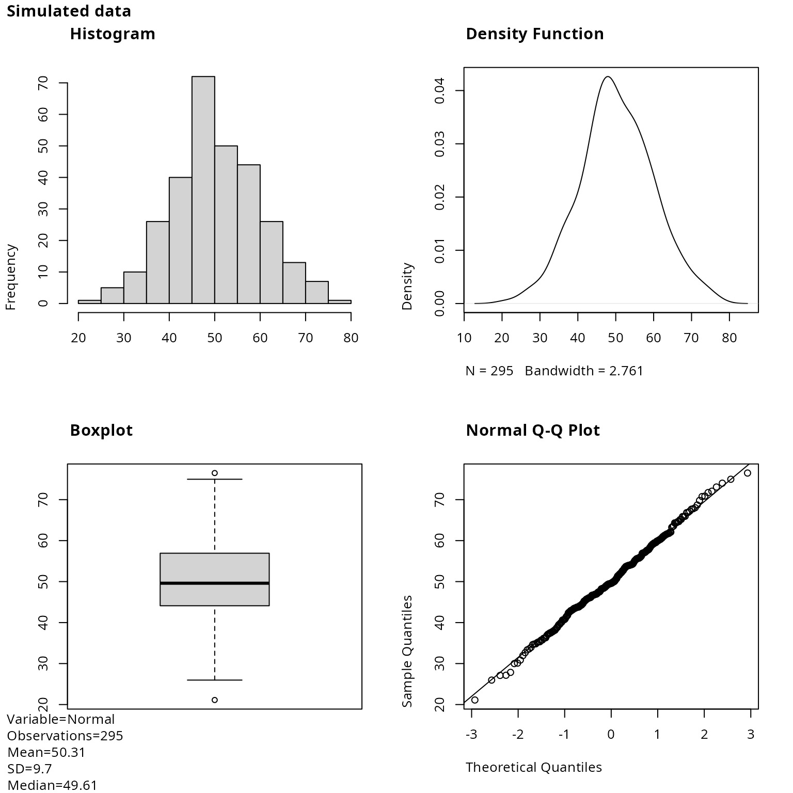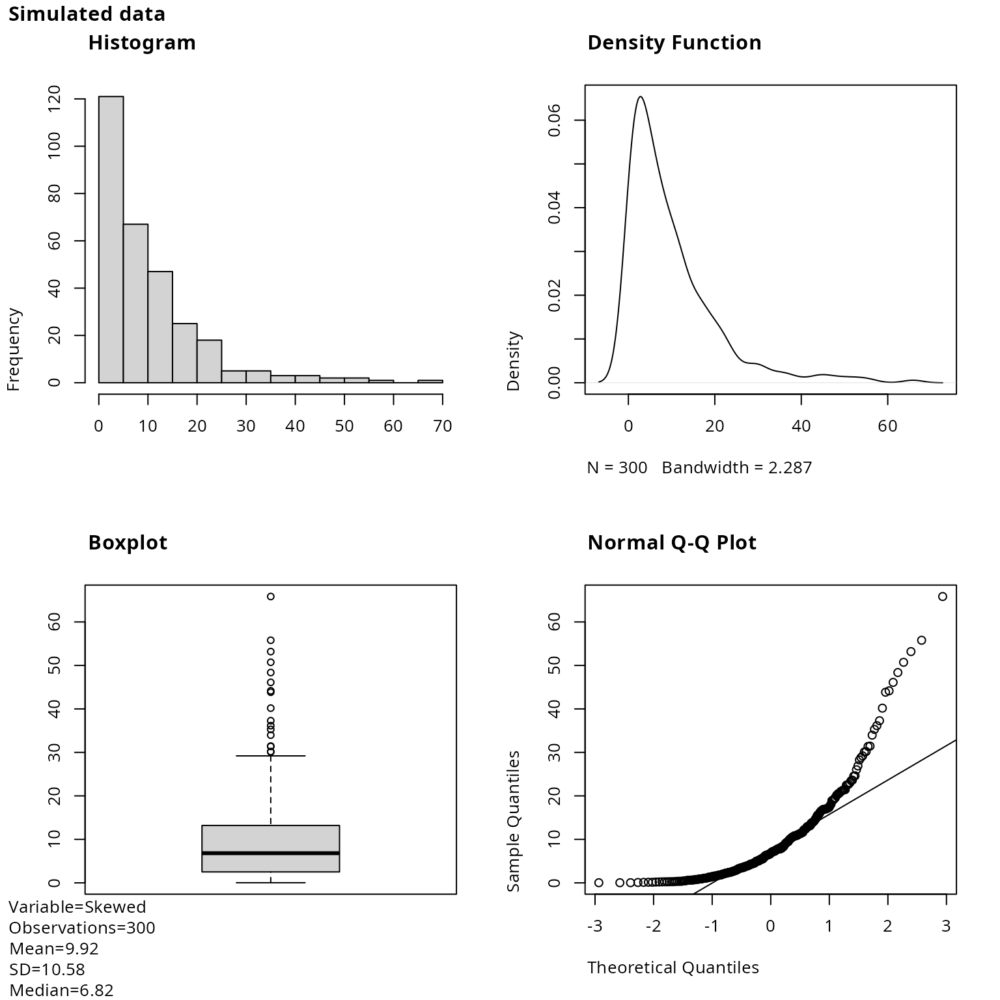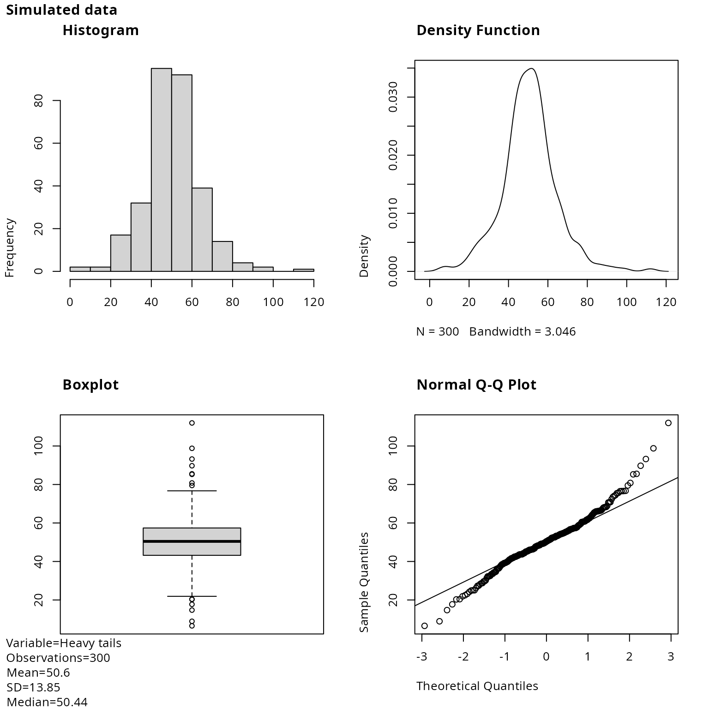

## plot_histogram

One `ggplot2` histogram per numeric variable, with the number of
observations, mean, SD and median in the caption. `bins` equal-width
bins cover the range of the data; `ggplot2` centres the first and last
bins on the minimum and maximum, so the bin width is:

w=\frac{x\_{(n)}-x\_{(1)}}{\text{bins}-1}

``` r

invisible(plot_multiplot(plotlist = plot_histogram(df = df, bins = 30), cols = 3))
```

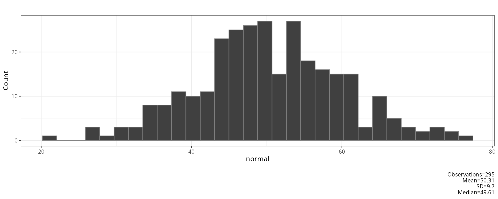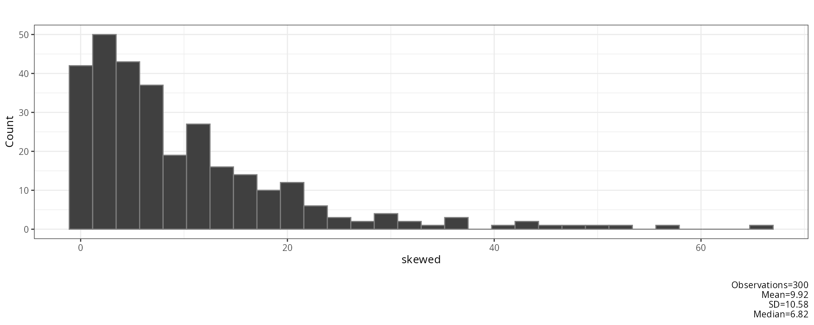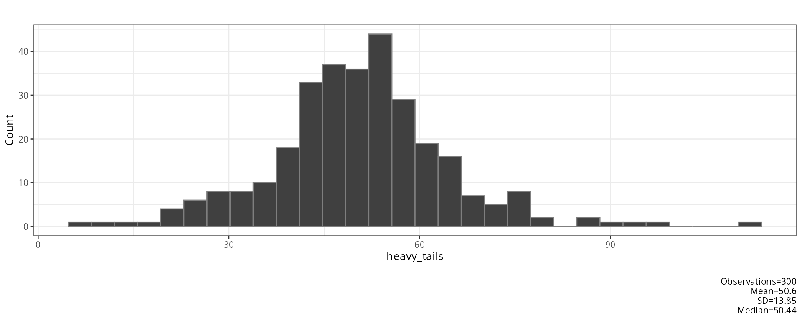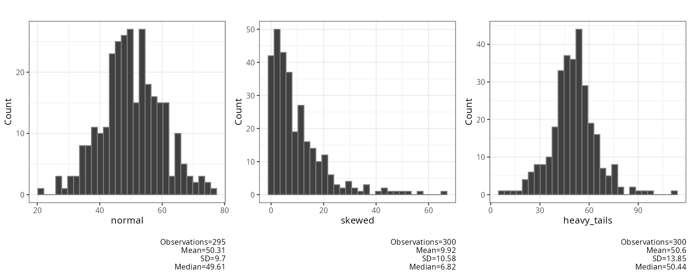

`xlims` fixes the x-axis range, `fill` and `color` set the bar colours:

``` r

plot_histogram(df = df$skewed, bins = 20, xlims = c(0, 60), fill = "steelblue", color = "white")[[1]]
```

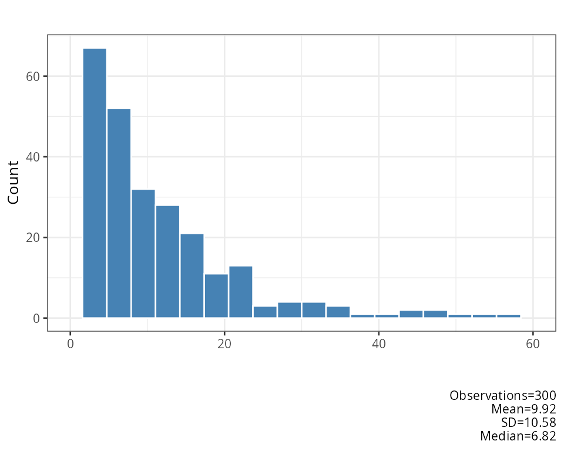

## plot_qq

One `ggplot2` Q-Q plot per numeric variable, with the same plotting
positions p_i and quartile reference line as in
[plot_normality_diagnostics](#plot_normality_diagnostics).

``` r

invisible(plot_multiplot(plotlist = plot_qq(df = df[, c("skewed", "heavy_tails")]), cols = 2))
```

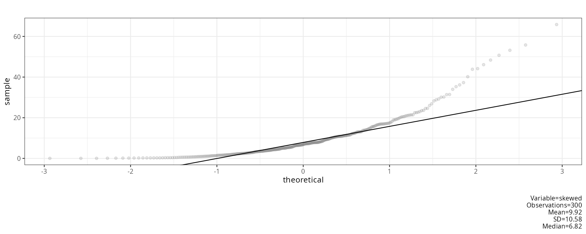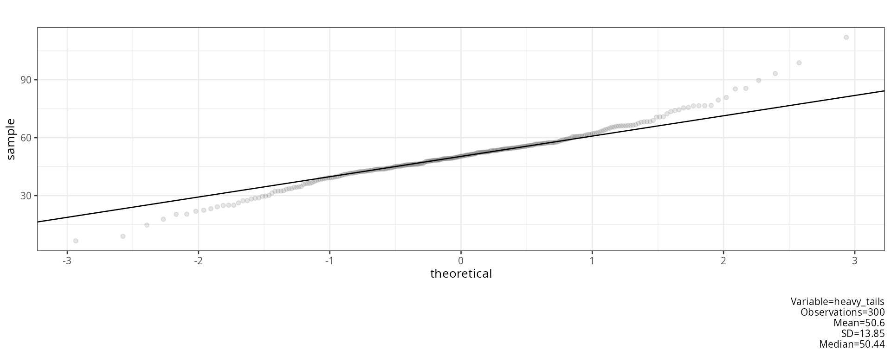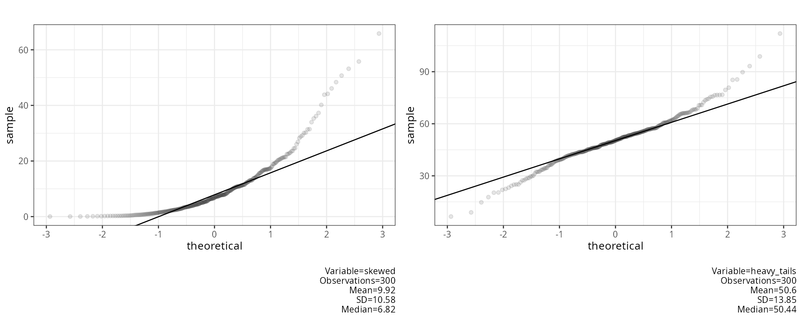

The right-skewed variable bends away from the line at the top; the
heavy-tailed variable forms an S shape, with points below the line on
the left and above it on the right.

## plot_boxplot

All numeric variables as side-by-side boxplots on one plot. `ggplot2`
draws the box from Q_1 to Q_3 with a line at M; whiskers reach the most
extreme values inside the fences and values outside are drawn as points:

\left\[Q_1-1.5\\IQR,\\ \\ Q_3+1.5\\IQR\right\]

``` r

plot_boxplot(df = df, title = "Simulated data")
```

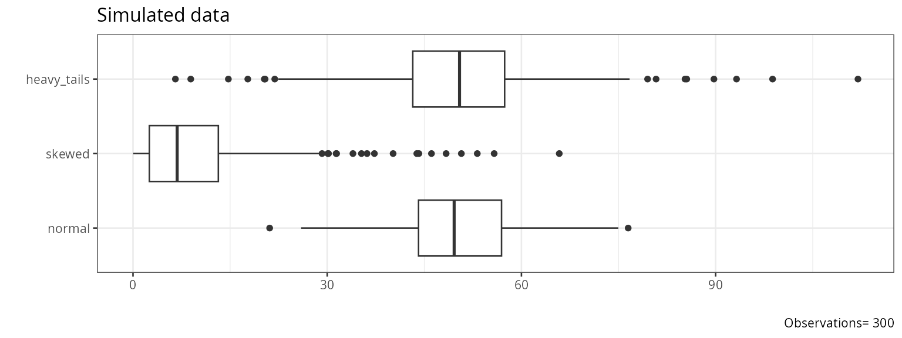

## report_normality_tests

Runs eight normality tests on each variable. Each variable is first
converted to z-scores, and variables with fewer than 8 or more than 4999
values are skipped. Small p values mean the data deviate from normality;
with large samples even small, unimportant deviations give small p
values.

``` r

report_normality_tests(df = df)
```

    ## [1] "##################################################"
    ## [1] "NORMALITY TESTS"
    ## [1] "##################################################"
    ## [1] ""
    ## [1] "#########################"
    ##       variable   n    statistic df            p                                         method alternative n.classes
    ## 1       normal 295 9.972825e-01 NA 9.060430e-01                    Shapiro-Wilk normality test        <NA>        NA
    ## 2       normal 295 2.718761e-01 NA 9.576420e-01       Anderson-Darling test of goodness-of-fit        <NA>        NA
    ## 3       normal 295 5.050757e-02 NA 5.023404e-01                Cramer-von Mises normality test        <NA>        NA
    ## 4       normal 295 9.976499e-01 NA 9.079017e-01                 Shapiro-Francia normality test        <NA>        NA
    ## 5       normal 295 1.472553e-01  2 9.290176e-01                        Robust Jarque Bera Test        <NA>        NA
    ## 6       normal 295 4.067779e-02 NA 2.755917e-01 Lilliefors (Kolmogorov-Smirnov) normality test        <NA>        NA
    ## 7       normal 295 4.067779e-02 NA 7.134580e-01  Asymptotic one-sample Kolmogorov-Smirnov test   two-sided        NA
    ## 8       normal 295 1.530508e+01 17 5.735170e-01              Pearson chi-square normality test        <NA>        20
    ## 9       skewed 300 7.899850e-01 NA 2.287367e-19                    Shapiro-Wilk normality test        <NA>        NA
    ## 10      skewed 300 1.589933e+01 NA 2.000000e-06       Anderson-Darling test of goodness-of-fit        <NA>        NA
    ## 11      skewed 300 2.660485e+00 NA 7.370000e-10                Cramer-von Mises normality test        <NA>        NA
    ## 12      skewed 300 7.886278e-01 NA 7.775158e-17                 Shapiro-Francia normality test        <NA>        NA
    ## 13      skewed 300 1.530339e+03  2 0.000000e+00                        Robust Jarque Bera Test        <NA>        NA
    ## 14      skewed 300 1.749833e-01 NA 6.644600e-25 Lilliefors (Kolmogorov-Smirnov) normality test        <NA>        NA
    ## 15      skewed 300 1.749833e-01 NA 2.100843e-08  Asymptotic one-sample Kolmogorov-Smirnov test   two-sided        NA
    ## 16      skewed 300 1.869333e+02 17 1.192809e-30              Pearson chi-square normality test        <NA>        20
    ## 17 heavy_tails 300 9.740061e-01 NA 2.937593e-05                    Shapiro-Wilk normality test        <NA>        NA
    ## 18 heavy_tails 300 1.994873e+00 NA 9.247587e-02       Anderson-Darling test of goodness-of-fit        <NA>        NA
    ## 19 heavy_tails 300 3.432478e-01 NA 1.067328e-04                Cramer-von Mises normality test        <NA>        NA
    ## 20 heavy_tails 300 9.711620e-01 NA 2.863242e-05                 Shapiro-Francia normality test        <NA>        NA
    ## 21 heavy_tails 300 8.216889e+01  2 0.000000e+00                        Robust Jarque Bera Test        <NA>        NA
    ## 22 heavy_tails 300 7.338292e-02 NA 5.103346e-04 Lilliefors (Kolmogorov-Smirnov) normality test        <NA>        NA
    ## 23 heavy_tails 300 7.338292e-02 NA 7.902856e-02  Asymptotic one-sample Kolmogorov-Smirnov test   two-sided        NA
    ## 24 heavy_tails 300 3.453333e+01 17 7.160032e-03              Pearson chi-square normality test        <NA>        20
    ##                                                                                                            instruction
    ## 1                                                      Shapiro-Wilk Composite null hypothesis: any normal distribution
    ## 2                                                  Anderson-Darling Composite null hypothesis: any normal distribution
    ## 3                                                  Cramer-von-Mises Composite null hypothesis: any normal distribution
    ## 4                                                   Shapiro-Francia Composite null hypothesis: any normal distribution
    ## 5                                                       Jarque-Bera Composite null hypothesis: any normal distribution
    ## 6                                                        Lilliefors Composite null hypothesis: any normal distribution
    ## 7                                        Kolmogorov-Smirnov Exact null hypothesis: fully specified normal distribution
    ## 8  Pearson X2 Tests weaker null hypothesis: any distribution with the same probabilities for the given class intervals
    ## 9                                                      Shapiro-Wilk Composite null hypothesis: any normal distribution
    ## 10                                                 Anderson-Darling Composite null hypothesis: any normal distribution
    ## 11                                                 Cramer-von-Mises Composite null hypothesis: any normal distribution
    ## 12                                                  Shapiro-Francia Composite null hypothesis: any normal distribution
    ## 13                                                      Jarque-Bera Composite null hypothesis: any normal distribution
    ## 14                                                       Lilliefors Composite null hypothesis: any normal distribution
    ## 15                                       Kolmogorov-Smirnov Exact null hypothesis: fully specified normal distribution
    ## 16 Pearson X2 Tests weaker null hypothesis: any distribution with the same probabilities for the given class intervals
    ## 17                                                     Shapiro-Wilk Composite null hypothesis: any normal distribution
    ## 18                                                 Anderson-Darling Composite null hypothesis: any normal distribution
    ## 19                                                 Cramer-von-Mises Composite null hypothesis: any normal distribution
    ## 20                                                  Shapiro-Francia Composite null hypothesis: any normal distribution
    ## 21                                                      Jarque-Bera Composite null hypothesis: any normal distribution
    ## 22                                                       Lilliefors Composite null hypothesis: any normal distribution
    ## 23                                       Kolmogorov-Smirnov Exact null hypothesis: fully specified normal distribution
    ## 24 Pearson X2 Tests weaker null hypothesis: any distribution with the same probabilities for the given class intervals
    ## NULL

**Shapiro-Wilk** (Shapiro & Wilk, 1965). The weights a_i come from the
expected values of normal order statistics; R computes W and its p value
with Royston’s (1995) approximation:

W=\frac{\left(\sum\_{i=1}^{n}a_i\\x\_{(i)}\right)^2}{\sum\_{i=1}^{n}(x_i-\bar{x})^2}

**Anderson-Darling** (Anderson & Darling, 1952), with F the distribution
function of the null hypothesis:

A^2=-n-\frac{1}{n}\sum\_{i=1}^{n}(2i-1)\left\[\ln
F\left(x\_{(i)}\right)+\ln\left(1-F\left(x\_{(n+1-i)}\right)\right)\right\]

`report_normality_tests` calls
[`DescTools::AndersonDarlingTest`](https://andrisignorell.github.io/DescTools/reference/AndersonDarlingTest.html)
with its default null distribution, the uniform distribution on \[0,1\],
so F(x)=x (see the `method` column). For a test of normality F=\Phi.

**Cramér-von Mises** (Stephens, 1974). The p value uses the modified
statistic W^2\left(1+\frac{0.5}{n}\right):

W^2=\frac{1}{12n}+\sum\_{i=1}^{n}\left(\Phi\left(z\_{(i)}\right)-\frac{2i-1}{2n}\right)^2

**Shapiro-Francia** (Shapiro & Francia, 1972). The squared correlation
between the sorted data and approximate expected normal order statistics
m_i; the p value uses Royston’s (1993) approximation:

W'=\operatorname{cor}\left(x\_{(i)},m_i\right)^2,\qquad
m_i=\Phi^{-1}\left(\frac{i-3/8}{n+1/4}\right)

**Jarque-Bera.**
[`DescTools::JarqueBeraTest`](https://andrisignorell.github.io/DescTools/reference/JarqueBeraTest.html)
computes the robust version (Gel & Gastwirth, 2008), which replaces the
standard deviation by a robust measure of spread J. With
m_k=\frac{1}{n}\sum\_{i=1}^{n}(x_i-\bar{x})^k:

RJB=\frac{n}{6}\left(\frac{m_3}{J^3}\right)^2+\frac{n}{64}\left(\frac{m_4}{J^4}-3\right)^2,\qquad
J=\sqrt{\frac{\pi}{2}}\\\frac{1}{n}\sum\_{i=1}^{n}\left\|x_i-M\right\|

The p value comes from the \chi^2 distribution with 2 degrees of
freedom. The classic test (Jarque & Bera, 1987) uses
JB=\frac{n}{6}\left(b_1^2+\frac{(b_2-3)^2}{4}\right) with
b_1=m_3/m_2^{3/2} and b_2=m_4/m_2^2.

**Lilliefors** (Lilliefors, 1967). The largest distance between the
empirical distribution and the normal distribution with the mean and SD
estimated from the data; the p value uses the Dallal & Wilkinson (1986)
approximation, and Stephens’ (1974) modified statistic when that
approximation gives p\>0.1:

D=\max\_{i}\left\\\frac{i}{n}-\Phi\left(z\_{(i)}\right),\\
\Phi\left(z\_{(i)}\right)-\frac{i-1}{n}\right\\

**Kolmogorov-Smirnov** (Kolmogorov, 1933; Smirnov, 1948). The same
distance as Lilliefors:

D=\sup_x\left\|F_n(x)-\Phi\left(\frac{x-\bar{x}}{s}\right)\right\|

Its p value comes from the Kolmogorov distribution, which assumes the
mean and SD are known in advance. Here they are estimated from the same
data, which makes the p value too large; the Lilliefors test corrects
for this, which is why the two rows have the same statistic but
different p values.

**Pearson \chi^2** (Pearson, 1900). The range is split into k classes
that are equally likely under the fitted normal distribution, so each
has expected count E_j=N/k, where N is the number of non-missing values.
With O_j the observed count in class j:

P=\sum\_{j=1}^{k}\frac{(O_j-E_j)^2}{E_j},\qquad
k=\left\lceil2\\n^{2/5}\right\rceil,\qquad df=k-3

Here n is the number of rows of `df`, including missing values (Moore,
1986). Two degrees of freedom are subtracted for the estimated mean and
SD.

With `file`, the results are also written to a `.log` file and an
`.xlsx` file in which p values \le .05 are highlighted.

## plot_outlier

One dot plot per numeric variable with outliers coloured and labelled by
row name. Dashed lines show the centre and the two cut-offs. `method`
selects the rule:

| `method` | Outlier when | Centre line |
|----|----|----|
| `"mean"` | \left\lvert x_i-\bar{x}\right\rvert\>2s | \bar{x} |
| `"median"` | \left\lvert x_i-M\right\rvert\>2\\\dfrac{MAD}{0.6745}, with MAD=\operatorname{median}\_i\left\lvert x_i-M\right\rvert | M |
| `"boxplot"` | x_i\<Q_1-1.5\\IQR or x_i\>Q_3+1.5\\IQR | M |

Dividing the MAD by 0.6745 \left(=\Phi^{-1}(0.75)\right) makes it
estimate the standard deviation for normal data (Leys et al., 2013). The
mean and SD are pulled towards outliers themselves, so the median and
boxplot rules are more robust. The plots below apply the three rules to
the first 100 cases of the skewed variable.

``` r

skewed <- df$skewed[1:100]
invisible(plot_multiplot(plotlist = c(plot_outlier(df = skewed, method = "mean", title = "mean"),
                                      plot_outlier(df = skewed, method = "median", title = "median"),
                                      plot_outlier(df = skewed, method = "boxplot", title = "boxplot")),
                         cols = 3))
```

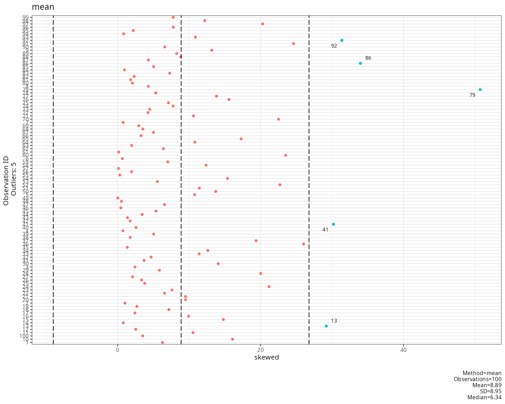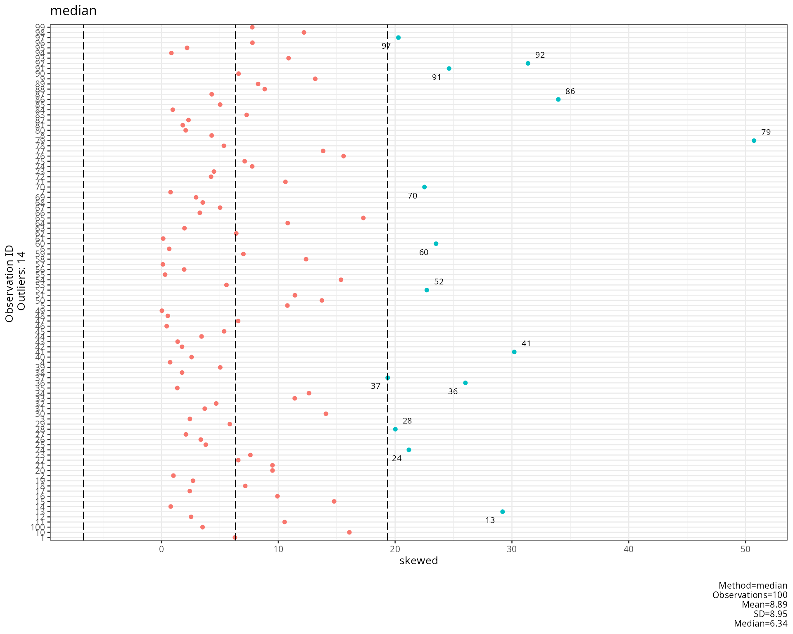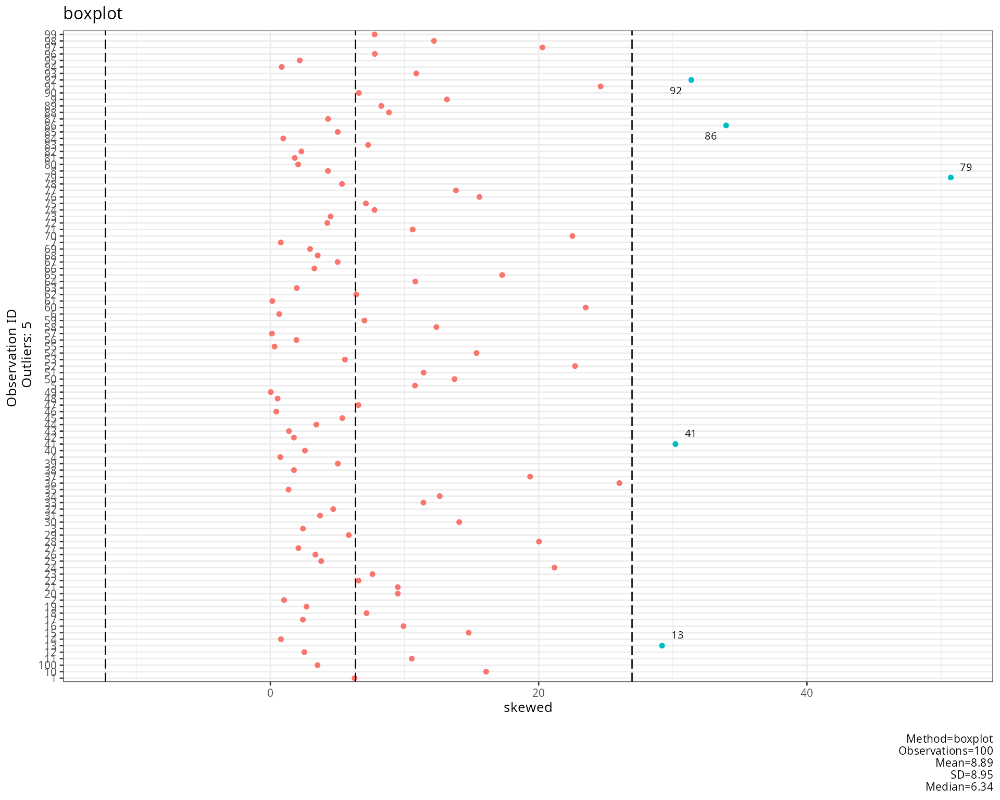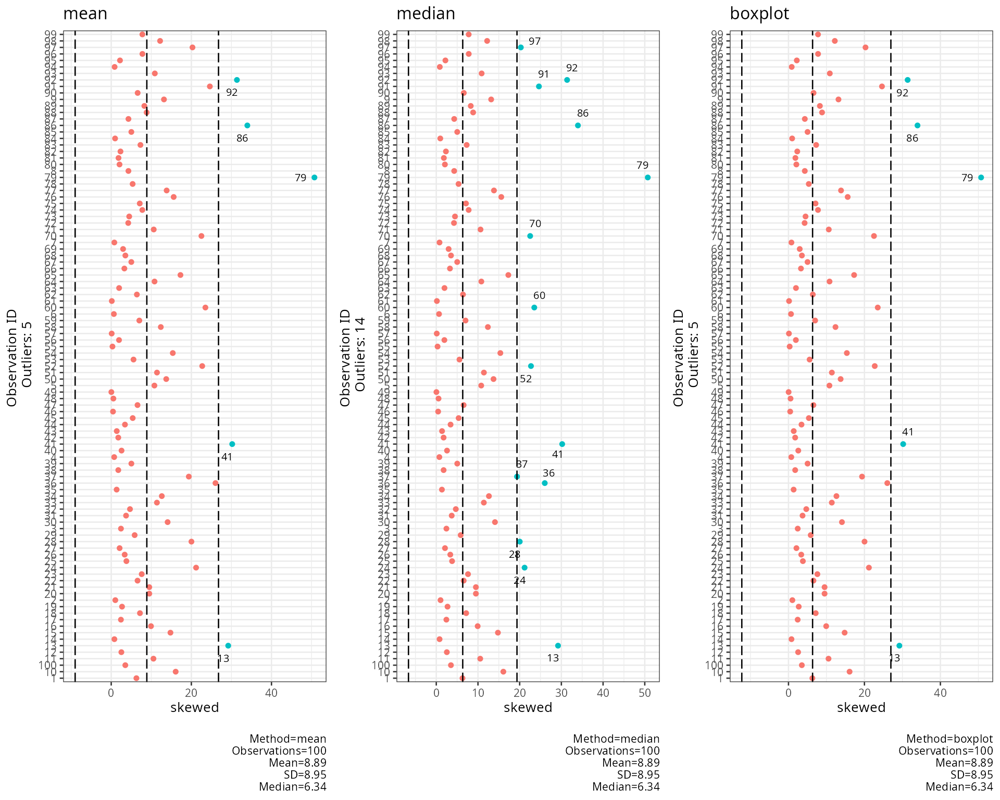

## outlier_summary

Converts the variable to z-scores and reports the percentage of
non-missing values beyond three cut-offs:

\text{percent}\_c=100\cdot\frac{1}{n}\sum\_{i=1}^{n}\mathbf{1}\left\[\lvert
z_i\rvert\ge c\right\],\qquad c\in\\1.96,\\ 2.58,\\ 3.29\\

For normal data about 100\cdot2\left(1-\Phi(c)\right) percent are
expected: 5%, 1% and 0.1%. Clearly larger percentages point to heavy
tails or outliers (Tabachnick & Fidell, 2013).

``` r

data.frame(t(sapply(df, outlier_summary)))
```

    ##             abs_z_1.96 abs_z_2.58 abs_z_3.29
    ## normal          5.76 %     0.68 %        0 %
    ## skewed             5 %     3.33 %        2 %
    ## heavy_tails     5.67 %     2.33 %     0.67 %

## remove_outliers

Replaces values outside the fences with `NA`. With `probs` =(p_1,p_2):

x_i'=\begin{cases}\text{NA} & x_i\<Q\_{p_1}-1.5\\IQR\\ \text{ or }\\
x_i\>Q\_{p_2}+1.5\\IQR\\ x_i & \text{otherwise}\end{cases}

IQR is always Q\_{0.75}-Q\_{0.25}, whatever `probs` is; with the default
`probs = c(0.25, 0.75)` these are the boxplot fences (Tukey, 1977).

``` r

cleaned <- data.frame(sapply(df, remove_outliers))
data.frame(missing_before = colSums(is.na(df)),
           missing_after = colSums(is.na(cleaned)))
```

    ##             missing_before missing_after
    ## normal                   5             7
    ## skewed                   0            18
    ## heavy_tails              0            15

## References

Anderson, T. W., & Darling, D. A. (1952). Asymptotic theory of certain
“goodness of fit” criteria based on stochastic processes. *The Annals of
Mathematical Statistics, 23*(2), 193–212.
<https://doi.org/10.1214/aoms/1177729437>

Dallal, G. E., & Wilkinson, L. (1986). An analytic approximation to the
distribution of Lilliefors’s test statistic for normality. *The American
Statistician, 40*(4), 294–296.
<https://doi.org/10.1080/00031305.1986.10475419>

Gel, Y. R., & Gastwirth, J. L. (2008). A robust modification of the
Jarque-Bera test of normality. *Economics Letters, 99*(1), 30–32.
<https://doi.org/10.1016/j.econlet.2007.05.022>

Jarque, C. M., & Bera, A. K. (1987). A test for normality of
observations and regression residuals. *International Statistical
Review, 55*(2), 163–172. <https://doi.org/10.2307/1403192>

Kolmogorov, A. N. (1933). Sulla determinazione empirica di una legge di
distribuzione. *Giornale dell’Istituto Italiano degli Attuari, 4*,
83–91.

Leys, C., Ley, C., Klein, O., Bernard, P., & Licata, L. (2013).
Detecting outliers: Do not use standard deviation around the mean, use
absolute deviation around the median. *Journal of Experimental Social
Psychology, 49*(4), 764–766.
<https://doi.org/10.1016/j.jesp.2013.03.013>

Lilliefors, H. W. (1967). On the Kolmogorov-Smirnov test for normality
with mean and variance unknown. *Journal of the American Statistical
Association, 62*(318), 399–402.
<https://doi.org/10.1080/01621459.1967.10482916>

Moore, D. S. (1986). Tests of chi-squared type. In R. B. D’Agostino & M.
A. Stephens (Eds.), *Goodness-of-fit techniques* (pp. 63–95). Marcel
Dekker.

Pearson, K. (1900). On the criterion that a given system of deviations
from the probable in the case of a correlated system of variables is
such that it can be reasonably supposed to have arisen from random
sampling. *The London, Edinburgh, and Dublin Philosophical Magazine and
Journal of Science, 50*(302), 157–175.
<https://doi.org/10.1080/14786440009463897>

Royston, P. (1993). A pocket-calculator algorithm for the
Shapiro-Francia test for non-normality: An application to medicine.
*Statistics in Medicine, 12*(2), 181–184.
<https://doi.org/10.1002/sim.4780120209>

Royston, P. (1995). Remark AS R94: A remark on algorithm AS 181: The
W-test for normality. *Journal of the Royal Statistical Society: Series
C (Applied Statistics), 44*(4), 547–551.
<https://doi.org/10.2307/2986146>

Shapiro, S. S., & Francia, R. S. (1972). An approximate analysis of
variance test for normality. *Journal of the American Statistical
Association, 67*(337), 215–216.
<https://doi.org/10.1080/01621459.1972.10481232>

Shapiro, S. S., & Wilk, M. B. (1965). An analysis of variance test for
normality (complete samples). *Biometrika, 52*(3–4), 591–611.
<https://doi.org/10.1093/biomet/52.3-4.591>

Silverman, B. W. (1986). *Density estimation for statistics and data
analysis*. Chapman & Hall.

Smirnov, N. (1948). Table for estimating the goodness of fit of
empirical distributions. *The Annals of Mathematical Statistics, 19*(2),
279–281. <https://doi.org/10.1214/aoms/1177730256>

Stephens, M. A. (1974). EDF statistics for goodness of fit and some
comparisons. *Journal of the American Statistical Association, 69*(347),
730–737. <https://doi.org/10.1080/01621459.1974.10480196>

Sturges, H. A. (1926). The choice of a class interval. *Journal of the
American Statistical Association, 21*(153), 65–66.
<https://doi.org/10.1080/01621459.1926.10502161>

Tabachnick, B. G., & Fidell, L. S. (2013). *Using multivariate
statistics* (6th ed.). Pearson.

Tukey, J. W. (1977). *Exploratory data analysis*. Addison-Wesley.

Wilk, M. B., & Gnanadesikan, R. (1968). Probability plotting methods for
the analysis of data. *Biometrika, 55*(1), 1–17.
<https://doi.org/10.1093/biomet/55.1.1>
