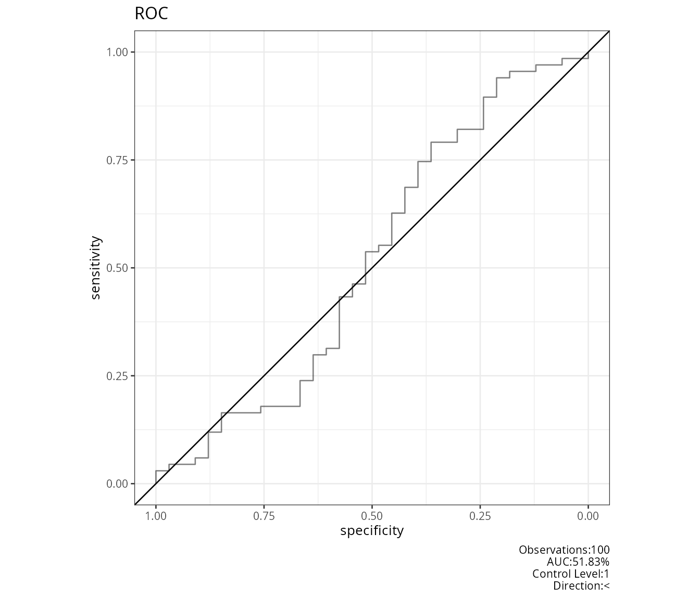
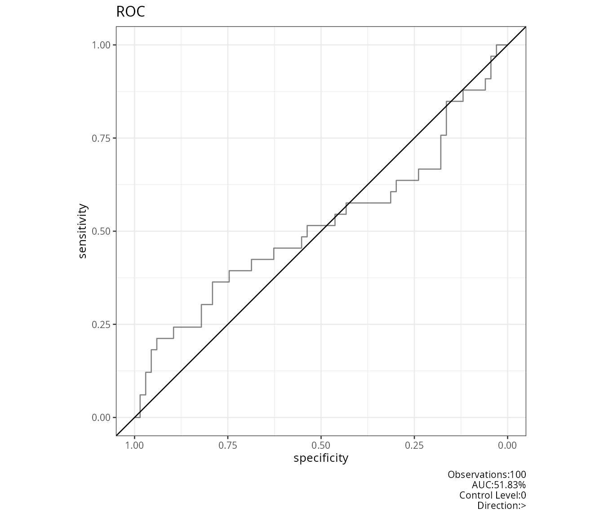
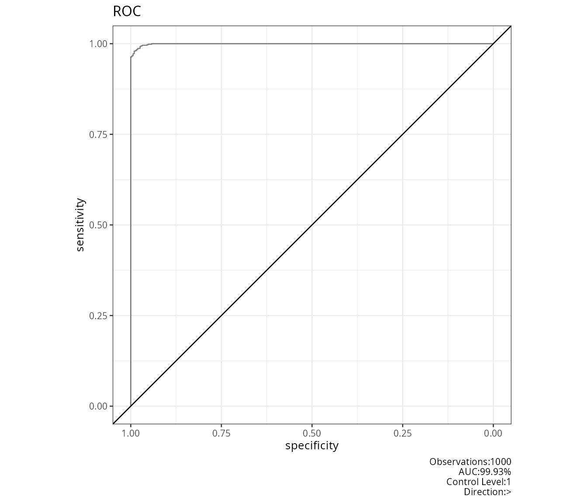
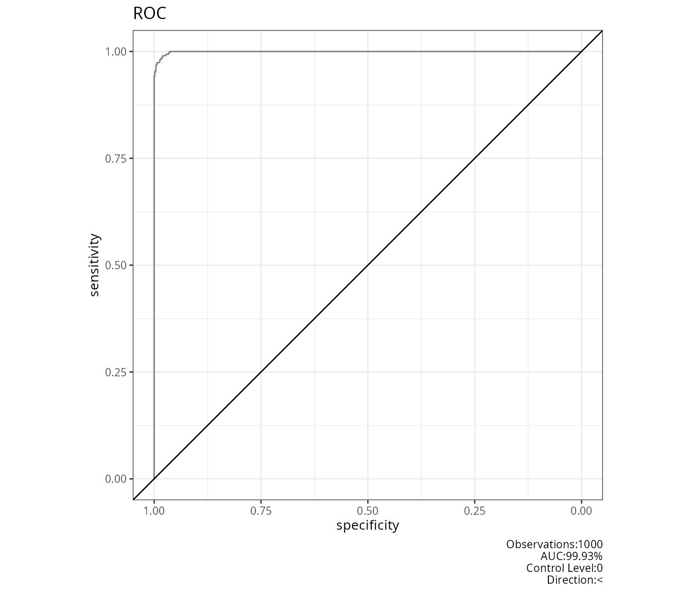
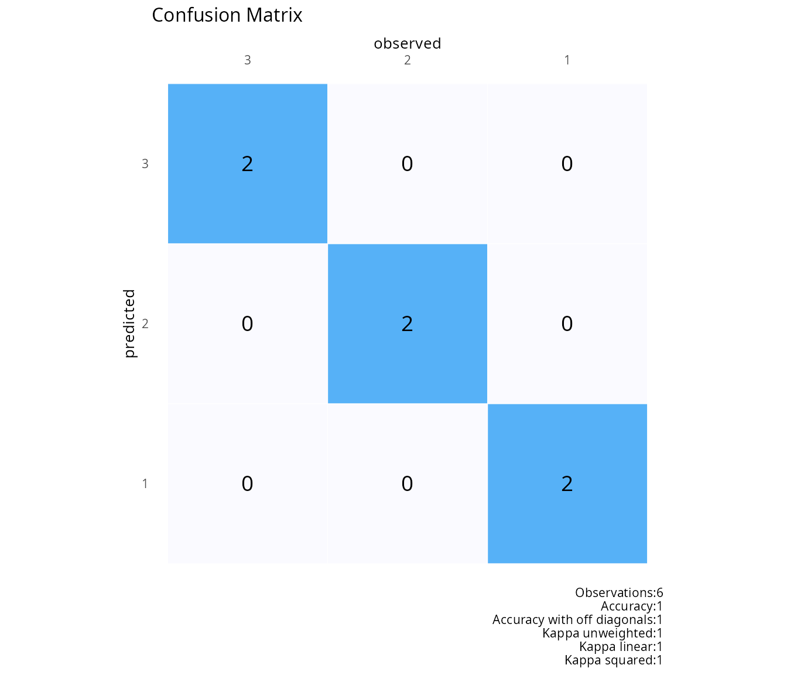
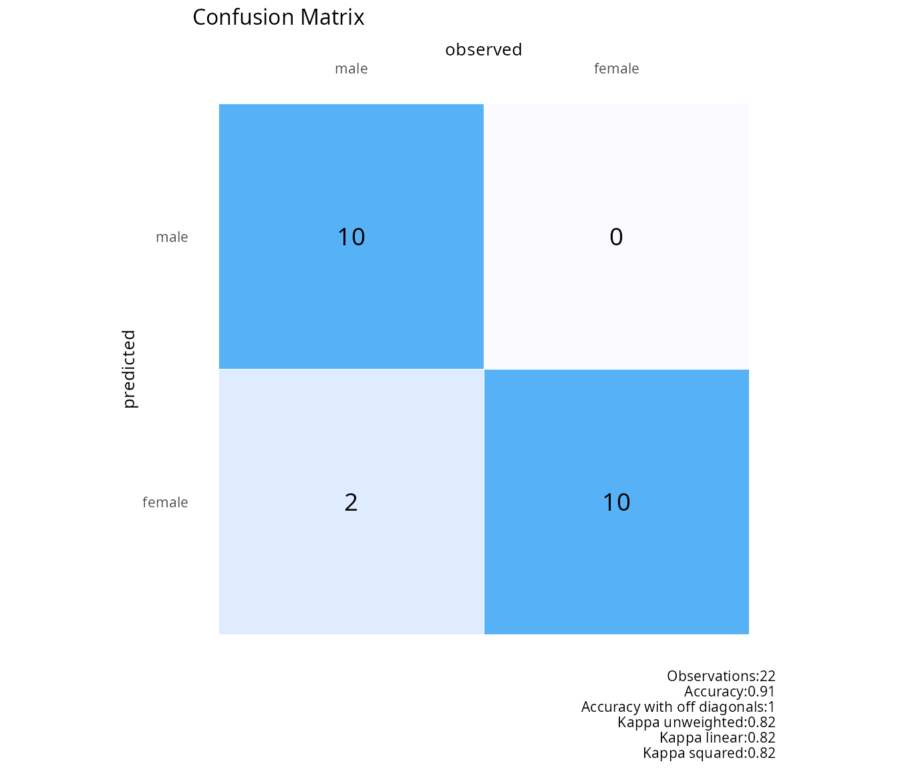
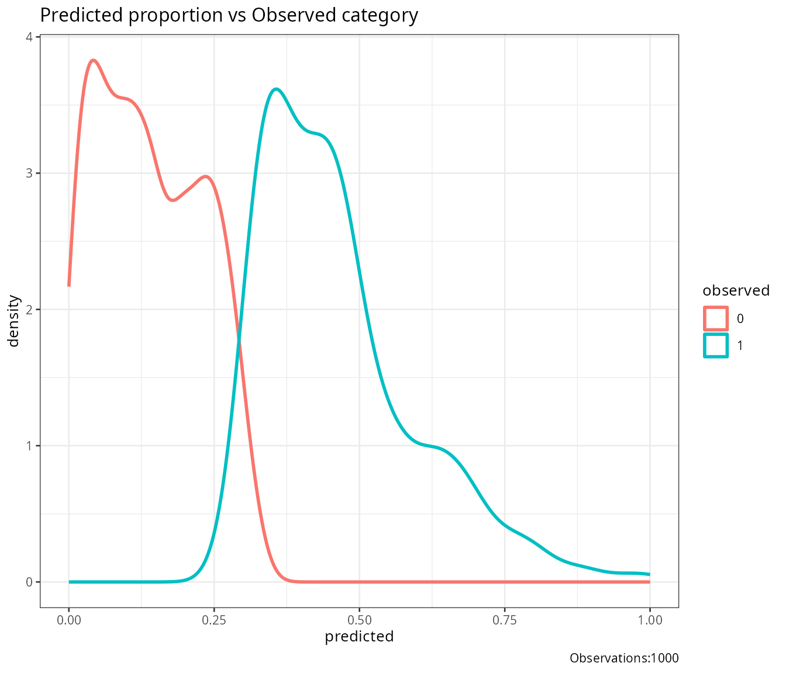
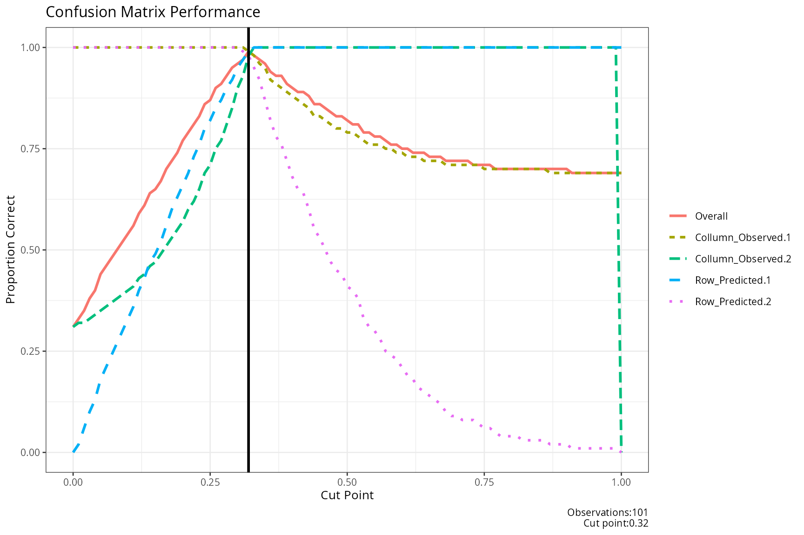
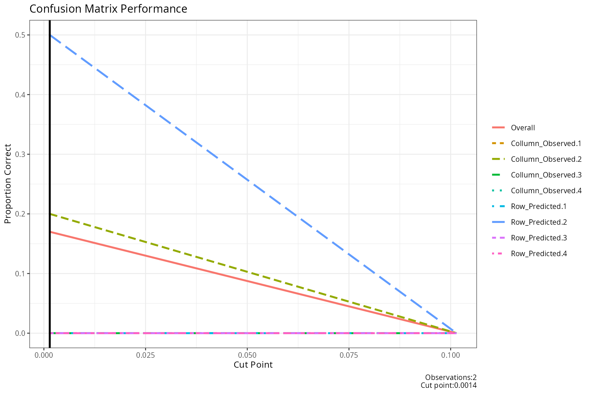
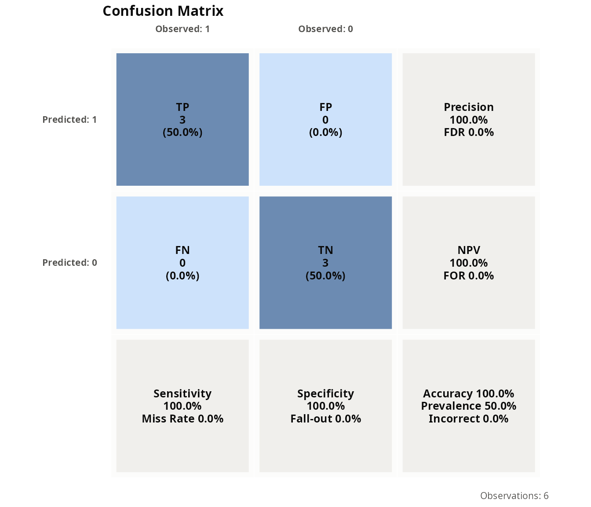

# Training and testing models

## Description

This shows the output of useful functions for training and testing from
the package rwf. The functions include plotting ROC curves, confusion
matrices, separability plots, and evaluating confusion matrix
performance at different cut-off points. Additionally, it demonstrates
k-fold and k-sample cross-validation procedures, scaling data, and
calculating confusion matrix statistics.

Installation instructions for rwf can be found
[here](https://github.com/sedzinfo/rwf)

The code can be found
[here](https://github.com/sedzinfo/rwf/blob/main/rwf/R/FUNCTIONS_TRAIN_TEST.R)

## Plot Receiver Operating Characteristic ROC Curve

``` r

# Observed vector binary
observed<-round(abs(rnorm(100,m=0,sd=.5)))
# Predicted vector continuous
predicted<-abs(rnorm(100,m=0,sd=.5))
plot_roc(observed=observed,predicted=predicted)
```



``` r

# An example with a good prediction
df1<-data.frame(matrix(.999,ncol=2,nrow=2))
correlation_martix<-as.matrix(df1)
diag(correlation_martix)<-1
df1<-generate_correlation_matrix(correlation_martix,nrows=1000)
df1$X1<-ifelse(abs(df1$X1)<1,0,1)
df1$X2<-abs(df1$X2)
df1$X2<-(df1$X2-min(df1$X2))/(max(df1$X2)-min(df1$X2))
plot_roc(observed=round(abs(df1$X1),0),predicted=abs(df1$X2))
```



## Plot Confusion Matrix

``` r

plot_confusion(observed=c(1,2,3,1,2,3),predicted=c(1,2,3,1,2,3))
```



``` r

observed<-c(rep("male",10),rep("female",10),"male","male")
predicted<-c(rep("male",10),rep("female",10),"female","female")
plot_confusion(observed=observed,predicted=predicted)
```



## Plot Separability

This function generates a separability plot using ggplot2. It shows the
density distribution of predicted probabilities for different observed
categories. The plot helps to visualize how well the predicted
probabilities separate the different observed categories.

``` r

df1<-data.frame(matrix(.999,ncol=2,nrow=2))
correlation_martix<-as.matrix(df1)
diag(correlation_martix)<-1
df1<-generate_correlation_matrix(correlation_martix,nrows=1000)
df1$X1<-ifelse(abs(df1$X1)<1,0,1)
df1$X2<-abs(df1$X2)
df1$X2<-(df1$X2-min(df1$X2))/(max(df1$X2)-min(df1$X2))
plot_separability(observed=round(abs(df1$X1),0),predicted=abs(df1$X2))
```



## Plot Confusion Matrix Performance

This function evaluates the performance of a confusion matrix at
different cut-off points. It iterates through a range of cut-off points,
calculates the confusion matrix,and evaluates the proportion of correct
classifications for each cut-off.

``` r

df<-data.frame(matrix(.999,ncol=2,nrow=2))
correlation_martix<-as.matrix(df)
diag(correlation_martix)<-1
df<-generate_correlation_matrix(correlation_martix,nrows=1000)
df$X1<-ifelse(abs(df$X1)<1,0,1)
df$X2<-abs(df$X2)
df$X2<-(df$X2-min(df$X2))/(max(df$X2)-min(df$X2))
result_confusion_performance(observed=round(abs(df$X1),0),
                             predicted=abs(df$X2),
                             step=.01)
```

    ## $plot_performance



    ## 
    ## $cut_performance
    ##     cut_point Overall Collumn_Observed.1 Collumn_Observed.2 Row_Predicted.1 Row_Predicted.2 Mean_proportion
    ## 1        0.00    0.31               1.00               0.31            0.00            1.00          0.5775
    ## 2        0.01    0.33               1.00               0.32            0.02            1.00          0.5850
    ## 3        0.02    0.35               1.00               0.32            0.06            1.00          0.5950
    ## 4        0.03    0.38               1.00               0.33            0.10            1.00          0.6075
    ## 5        0.04    0.40               1.00               0.34            0.13            1.00          0.6175
    ## 6        0.05    0.44               1.00               0.35            0.18            1.00          0.6325
    ## 7        0.06    0.46               1.00               0.36            0.21            1.00          0.6425
    ## 8        0.07    0.48               1.00               0.37            0.24            1.00          0.6525
    ## 9        0.08    0.50               1.00               0.38            0.27            1.00          0.6625
    ## 10       0.09    0.52               1.00               0.39            0.30            1.00          0.6725
    ## 11       0.10    0.54               1.00               0.40            0.33            1.00          0.6825
    ## 12       0.11    0.56               1.00               0.41            0.36            1.00          0.6925
    ## 13       0.12    0.59               1.00               0.43            0.40            1.00          0.7075
    ## 14       0.13    0.61               1.00               0.44            0.43            1.00          0.7175
    ## 15       0.14    0.64               1.00               0.46            0.47            1.00          0.7325
    ## 16       0.15    0.65               1.00               0.47            0.49            1.00          0.7400
    ## 17       0.16    0.67               1.00               0.49            0.52            1.00          0.7525
    ## 18       0.17    0.70               1.00               0.51            0.56            1.00          0.7675
    ## 19       0.18    0.72               1.00               0.53            0.60            1.00          0.7825
    ## 20       0.19    0.74               1.00               0.55            0.63            1.00          0.7950
    ## 21       0.20    0.77               1.00               0.57            0.66            1.00          0.8075
    ## 22       0.21    0.79               1.00               0.60            0.69            1.00          0.8225
    ## 23       0.22    0.81               1.00               0.62            0.73            1.00          0.8375
    ## 24       0.23    0.83               1.00               0.65            0.76            1.00          0.8525
    ## 25       0.24    0.86               1.00               0.69            0.80            1.00          0.8725
    ## 26       0.25    0.87               1.00               0.71            0.82            1.00          0.8825
    ## 27       0.26    0.90               1.00               0.75            0.85            1.00          0.9000
    ## 28       0.27    0.91               1.00               0.77            0.87            1.00          0.9100
    ## 29       0.28    0.93               1.00               0.81            0.90            1.00          0.9275
    ## 30       0.29    0.95               1.00               0.85            0.92            1.00          0.9425
    ## 31       0.30    0.96               1.00               0.90            0.95            1.00          0.9625
    ## 32       0.31    0.97               1.00               0.93            0.97            0.99          0.9725
    ## 33       0.32    0.99               0.99               0.98            0.99            0.98          0.9850
    ## 34       0.33    0.98               0.98               1.00            1.00            0.95          0.9825
    ## 35       0.34    0.97               0.96               1.00            1.00            0.92          0.9700
    ## 36       0.35    0.96               0.95               1.00            1.00            0.87          0.9550
    ## 37       0.36    0.94               0.92               1.00            1.00            0.82          0.9350
    ## 38       0.37    0.93               0.91               1.00            1.00            0.78          0.9225
    ## 39       0.38    0.93               0.90               1.00            1.00            0.76          0.9150
    ## 40       0.39    0.91               0.89               1.00            1.00            0.72          0.9025
    ## 41       0.40    0.90               0.88               1.00            1.00            0.68          0.8900
    ## 42       0.41    0.89               0.87               1.00            1.00            0.65          0.8800
    ## 43       0.42    0.89               0.86               1.00            1.00            0.64          0.8750
    ## 44       0.43    0.88               0.85               1.00            1.00            0.60          0.8625
    ## 45       0.44    0.86               0.83               1.00            1.00            0.55          0.8450
    ## 46       0.45    0.86               0.83               1.00            1.00            0.53          0.8400
    ## 47       0.46    0.85               0.82               1.00            1.00            0.50          0.8300
    ## 48       0.47    0.84               0.81               1.00            1.00            0.47          0.8200
    ## 49       0.48    0.83               0.80               1.00            1.00            0.45          0.8125
    ## 50       0.49    0.83               0.80               1.00            1.00            0.44          0.8100
    ## 51       0.50    0.82               0.79               1.00            1.00            0.41          0.8000
    ## 52       0.51    0.81               0.79               1.00            1.00            0.40          0.7975
    ## 53       0.52    0.81               0.78               1.00            1.00            0.38          0.7900
    ## 54       0.53    0.79               0.77               1.00            1.00            0.33          0.7750
    ## 55       0.54    0.79               0.76               1.00            1.00            0.31          0.7675
    ## 56       0.55    0.78               0.76               1.00            1.00            0.30          0.7650
    ## 57       0.56    0.78               0.76               1.00            1.00            0.28          0.7600
    ## 58       0.57    0.77               0.75               1.00            1.00            0.25          0.7500
    ## 59       0.58    0.76               0.75               1.00            1.00            0.24          0.7475
    ## 60       0.59    0.76               0.74               1.00            1.00            0.23          0.7425
    ## 61       0.60    0.75               0.74               1.00            1.00            0.21          0.7375
    ## 62       0.61    0.75               0.73               1.00            1.00            0.19          0.7300
    ## 63       0.62    0.74               0.73               1.00            1.00            0.18          0.7275
    ## 64       0.63    0.74               0.73               1.00            1.00            0.16          0.7225
    ## 65       0.64    0.74               0.72               1.00            1.00            0.15          0.7175
    ## 66       0.65    0.73               0.72               1.00            1.00            0.14          0.7150
    ## 67       0.66    0.73               0.72               1.00            1.00            0.13          0.7125
    ## 68       0.67    0.73               0.72               1.00            1.00            0.12          0.7100
    ## 69       0.68    0.72               0.71               1.00            1.00            0.10          0.7025
    ## 70       0.69    0.72               0.71               1.00            1.00            0.09          0.7000
    ## 71       0.70    0.72               0.71               1.00            1.00            0.09          0.7000
    ## 72       0.71    0.72               0.71               1.00            1.00            0.08          0.6975
    ## 73       0.72    0.72               0.71               1.00            1.00            0.08          0.6975
    ## 74       0.73    0.71               0.71               1.00            1.00            0.08          0.6975
    ## 75       0.74    0.71               0.71               1.00            1.00            0.07          0.6950
    ## 76       0.75    0.71               0.70               1.00            1.00            0.06          0.6900
    ## 77       0.76    0.71               0.70               1.00            1.00            0.06          0.6900
    ## 78       0.77    0.70               0.70               1.00            1.00            0.05          0.6875
    ## 79       0.78    0.70               0.70               1.00            1.00            0.04          0.6850
    ## 80       0.79    0.70               0.70               1.00            1.00            0.04          0.6850
    ## 81       0.80    0.70               0.70               1.00            1.00            0.04          0.6850
    ## 82       0.81    0.70               0.70               1.00            1.00            0.04          0.6850
    ## 83       0.82    0.70               0.70               1.00            1.00            0.03          0.6825
    ## 84       0.83    0.70               0.70               1.00            1.00            0.03          0.6825
    ## 85       0.84    0.70               0.70               1.00            1.00            0.03          0.6825
    ## 86       0.85    0.70               0.70               1.00            1.00            0.03          0.6825
    ## 87       0.86    0.70               0.70               1.00            1.00            0.03          0.6825
    ## 88       0.87    0.70               0.69               1.00            1.00            0.02          0.6775
    ## 89       0.88    0.70               0.69               1.00            1.00            0.02          0.6775
    ## 90       0.89    0.70               0.69               1.00            1.00            0.02          0.6775
    ## 91       0.90    0.70               0.69               1.00            1.00            0.02          0.6775
    ## 92       0.91    0.69               0.69               1.00            1.00            0.01          0.6750
    ## 93       0.92    0.69               0.69               1.00            1.00            0.01          0.6750
    ## 94       0.93    0.69               0.69               1.00            1.00            0.01          0.6750
    ## 95       0.94    0.69               0.69               1.00            1.00            0.01          0.6750
    ## 96       0.95    0.69               0.69               1.00            1.00            0.01          0.6750
    ## 97       0.96    0.69               0.69               1.00            1.00            0.01          0.6750
    ## 98       0.97    0.69               0.69               1.00            1.00            0.01          0.6750
    ## 99       0.98    0.69               0.69               1.00            1.00            0.01          0.6750
    ## 100      0.99    0.69               0.69               1.00            1.00            0.01          0.6750
    ## 101      1.00    0.69               0.69               0.00            1.00            0.00          0.4225
    ## 
    ## $cut
    ## [1] 0.32
    ## 
    ## $confusion_matrix
    ##          0      1     sum    p
    ## 0   683.00   5.00  688.00 0.99
    ## 1     7.00 305.00  312.00 0.98
    ## sum 690.00 310.00 1000.00 1.00
    ## p     0.99   0.98    1.00 0.99

``` r

result_confusion_performance(observed=c(1,2,3,1,2,3),predicted=abs(rnorm(6,0,sd=.1)))
```

    ## $plot_performance



    ## 
    ## $cut_performance
    ##     cut_point Overall Collumn_Observed.1 Collumn_Observed.2 Collumn_Observed.3 Collumn_Observed.4 Row_Predicted.1 Row_Predicted.2 Row_Predicted.3 Row_Predicted.4 Mean_proportion
    ## 1 0.001444013    0.17                  0                0.2                  0                  0               0             0.5               0               0          0.0875
    ## 2 0.101444013    0.00                  0                0.0                  0                  0               0             0.0               0               0          0.0000
    ## 
    ## $cut
    ## [1] 0.001444013
    ## 
    ## $confusion_matrix
    ##        0    1    2    3  sum    p
    ## 0   0.00 1.00 0.00 0.00 1.00 0.00
    ## 1   0.00 1.00 2.00 2.00 5.00 0.20
    ## 2   0.00 0.00 0.00 0.00 0.00 0.00
    ## 3   0.00 0.00 0.00 0.00 0.00 0.00
    ## sum 0.00 2.00 2.00 2.00 6.00 1.00
    ## p   0.00 0.50 0.00 0.00 1.00 0.17

## KFOLD

Sample data for train test validation procedures

``` r

infert_formula<-as.formula(factor(case)~age+parity+education+spontaneous+induced)
result<-k_fold(infert,k=10,model_formula=infert_formula)
```

    ## Fold Cases: 1 Train: 223 Test: 25 Total: 248 Unique Train: 223 Unique Test: 25 
    ## Fold Cases: 2 Train: 223 Test: 25 Total: 248 Unique Train: 223 Unique Test: 25 
    ## Fold Cases: 3 Train: 223 Test: 25 Total: 248 Unique Train: 223 Unique Test: 25 
    ## Fold Cases: 4 Train: 224 Test: 24 Total: 248 Unique Train: 224 Unique Test: 24 
    ## Fold Cases: 5 Train: 223 Test: 25 Total: 248 Unique Train: 223 Unique Test: 25 
    ## Fold Cases: 6 Train: 223 Test: 25 Total: 248 Unique Train: 223 Unique Test: 25 
    ## Fold Cases: 7 Train: 224 Test: 24 Total: 248 Unique Train: 224 Unique Test: 24 
    ## Fold Cases: 8 Train: 223 Test: 25 Total: 248 Unique Train: 223 Unique Test: 25 
    ## Fold Cases: 9 Train: 223 Test: 25 Total: 248 Unique Train: 223 Unique Test: 25 
    ## Fold Cases: 10 Train: 223 Test: 25 Total: 248 Unique Train: 223 Unique Test: 25

``` r

model_formula<-as.formula(mpg~cyl+disp+hp+drat+wt+qsec+vs+am+gear+carb)
result<-k_fold(mtcars,k=2,model_formula=model_formula)
```

    ## Fold Cases: 1 Train: 16 Test: 16 Total: 32 Unique Train: 16 Unique Test: 16 
    ## Fold Cases: 2 Train: 16 Test: 16 Total: 32 Unique Train: 16 Unique Test: 16

## KSAMPLE

Sample data for train test validation procedures

``` r

infert_formula<-as.formula(factor(case)~age+parity+education+spontaneous+induced)
result<-k_sample(df=infert,k=10,model_formula=infert_formula)
```

    ## Fold Cases: 1 Train: 12 Test: 6 Validation: 6 Total: 25 Unique Train: 12 Unique Test: 6 Unique Validation: 7 
    ## Fold Cases: 2 Train: 12 Test: 6 Validation: 6 Total: 25 Unique Train: 12 Unique Test: 6 Unique Validation: 7 
    ## Fold Cases: 3 Train: 12 Test: 6 Validation: 6 Total: 25 Unique Train: 12 Unique Test: 6 Unique Validation: 7 
    ## Fold Cases: 4 Train: 12 Test: 6 Validation: 6 Total: 24 Unique Train: 12 Unique Test: 6 Unique Validation: 6 
    ## Fold Cases: 5 Train: 12 Test: 6 Validation: 6 Total: 25 Unique Train: 12 Unique Test: 6 Unique Validation: 7 
    ## Fold Cases: 6 Train: 12 Test: 6 Validation: 6 Total: 25 Unique Train: 12 Unique Test: 6 Unique Validation: 7 
    ## Fold Cases: 7 Train: 12 Test: 6 Validation: 6 Total: 24 Unique Train: 12 Unique Test: 6 Unique Validation: 6 
    ## Fold Cases: 8 Train: 12 Test: 6 Validation: 6 Total: 25 Unique Train: 12 Unique Test: 6 Unique Validation: 7 
    ## Fold Cases: 9 Train: 12 Test: 6 Validation: 6 Total: 25 Unique Train: 12 Unique Test: 6 Unique Validation: 7 
    ## Fold Cases: 10 Train: 12 Test: 6 Validation: 6 Total: 25 Unique Train: 12 Unique Test: 6 Unique Validation: 7

``` r

model_formula<-as.formula(mpg~cyl+disp+hp+drat+wt+qsec+vs+am+gear+carb)
result<-k_sample(df=mtcars,k=10,model_formula=model_formula)
```

    ## Fold Cases: 1 Train: 2 Test: 1 Validation: 1 Total: 4 Unique Train: 2 Unique Test: 1 Unique Validation: 1 
    ## Fold Cases: 2 Train: 1 Test: 1 Validation: 1 Total: 3 Unique Train: 1 Unique Test: 1 Unique Validation: 1 
    ## Fold Cases: 3 Train: 1 Test: 1 Validation: 1 Total: 3 Unique Train: 1 Unique Test: 1 Unique Validation: 1 
    ## Fold Cases: 4 Train: 1 Test: 1 Validation: 1 Total: 3 Unique Train: 1 Unique Test: 1 Unique Validation: 1 
    ## Fold Cases: 5 Train: 1 Test: 1 Validation: 1 Total: 3 Unique Train: 1 Unique Test: 1 Unique Validation: 1 
    ## Fold Cases: 6 Train: 1 Test: 1 Validation: 1 Total: 3 Unique Train: 1 Unique Test: 1 Unique Validation: 1 
    ## Fold Cases: 7 Train: 1 Test: 1 Validation: 1 Total: 3 Unique Train: 1 Unique Test: 1 Unique Validation: 1 
    ## Fold Cases: 8 Train: 1 Test: 1 Validation: 1 Total: 3 Unique Train: 1 Unique Test: 1 Unique Validation: 1 
    ## Fold Cases: 9 Train: 1 Test: 1 Validation: 1 Total: 3 Unique Train: 1 Unique Test: 1 Unique Validation: 1 
    ## Fold Cases: 10 Train: 2 Test: 1 Validation: 1 Total: 4 Unique Train: 2 Unique Test: 1 Unique Validation: 1

## Scaling

Scale all data between 0 and 1

``` r

result<-recode_scale_dummy(infert)
head(result)
```

    ##   X6.11yrs X12..yrs X0.5yrs       age parity induced case spontaneous    stratum pooled.stratum
    ## 1        0        0       1 0.2173913    1.0     0.5    1         1.0 0.00000000     0.03225806
    ## 2        0        0       1 0.9130435    0.0     0.5    1         0.0 0.01219512     0.00000000
    ## 3        0        0       1 0.7826087    1.0     1.0    1         0.0 0.02439024     0.04838710
    ## 4        0        0       1 0.5652174    0.6     1.0    1         0.0 0.03658537     0.01612903
    ## 5        1        0       0 0.6086957    0.4     0.5    1         0.5 0.04878049     0.50000000
    ## 6        1        0       0 0.6521739    0.6     1.0    1         0.5 0.06097561     0.56451613

## Confusion Matrix

``` r

confusion(observed=c(1,2,3,4,5,10),predicted=c(1,2,3,4,5,11))
```

    ##          observed
    ## predicted 1 2 3 4 5 10 11
    ##        1  1 0 0 0 0  0  0
    ##        2  0 1 0 0 0  0  0
    ##        3  0 0 1 0 0  0  0
    ##        4  0 0 0 1 0  0  0
    ##        5  0 0 0 0 1  0  0
    ##        10 0 0 0 0 0  0  0
    ##        11 0 0 0 0 0  1  0

``` r

confusion(observed=c(1,2,2,2,2),predicted=c(1,1,2,2,2))
```

    ##          observed
    ## predicted 1 2
    ##         1 1 1
    ##         2 0 3

## Proportion Accutate

``` r

proportion_accurate(observed=c(1,2,3,4,5,10),predicted=c(1,2,3,4,5,11))
```

    ##   cm_diagonal cm_off_diagonal kappa_unweighted kappa_linear kappa_squared
    ## 1   0.8333333               1        0.8064516    0.9285714     0.9801325

## Confusion Matrix Percent

``` r

observed<-factor(round(rnorm(10000,m=10,sd=1)))
predicted<-factor(round(rnorm(10000,m=10,sd=1)))
confusion_matrix_percent(observed,predicted)
```

    ##        6     7      8       9      10      11     12    13   14      sum    p
    ## 6   0.00  0.00   1.00    1.00    2.00    1.00   0.00  0.00 0.00     5.00 0.00
    ## 7   0.00  0.00   2.00   14.00   24.00   16.00   2.00  0.00 0.00    58.00 0.00
    ## 8   0.00  2.00  30.00  154.00  246.00  131.00  33.00  1.00 0.00   597.00 0.05
    ## 9   0.00 13.00 160.00  606.00  905.00  587.00 150.00 12.00 0.00  2433.00 0.25
    ## 10  0.00 35.00 241.00  958.00 1403.00  938.00 212.00 25.00 0.00  3812.00 0.37
    ## 11  0.00 10.00 157.00  608.00  929.00  565.00 124.00 18.00 1.00  2412.00 0.23
    ## 12  0.00  4.00  30.00  164.00  246.00  154.00  29.00  4.00 0.00   631.00 0.05
    ## 13  0.00  0.00   4.00   17.00   19.00    8.00   1.00  3.00 0.00    52.00 0.06
    ## 14  0.00  0.00   0.00    0.00    0.00    0.00   0.00  0.00 0.00     0.00 0.00
    ## sum 0.00 64.00 625.00 2522.00 3774.00 2400.00 551.00 63.00 1.00 10000.00 1.00
    ## p   0.00  0.00   0.05    0.24    0.37    0.24   0.05  0.05 0.00     1.00 0.26

## Confusion Matrix Percent

``` r

plot_confusion_extended(observed=c(0,0,0,1,1,1),predicted=c(0,0,0,1,1,1))
```


