# ANOVA

## Description

This shows the output of ANOVA-related functions from the package rwf.
The functions cover non-parametric alternatives (Kruskal-Wallis),
one-way and factorial ANOVA, MANOVA, effect size estimation, and post
hoc comparisons. Each section shows rwf output alongside equivalent
results from established packages so you can verify the numbers.

Installation instructions for rwf can be found
[here](https://github.com/sedzinfo/rwf)

The code can be found
[here](https://github.com/sedzinfo/rwf/blob/main/rwf/R/GLM_ANOVA.R)

## Formula

The built-in `mtcars` dataset is used throughout the non-parametric and
one-way sections. The formula `qsec ~ cyl` models quarter-mile time
(`qsec`) as a function of number of cylinders (`cyl`), treating
cylinders as a grouping factor.

``` r

mtcars
```

    ##                      mpg cyl  disp  hp drat    wt  qsec vs am gear carb
    ## Mazda RX4           21.0   6 160.0 110 3.90 2.620 16.46  0  1    4    4
    ## Mazda RX4 Wag       21.0   6 160.0 110 3.90 2.875 17.02  0  1    4    4
    ## Datsun 710          22.8   4 108.0  93 3.85 2.320 18.61  1  1    4    1
    ## Hornet 4 Drive      21.4   6 258.0 110 3.08 3.215 19.44  1  0    3    1
    ## Hornet Sportabout   18.7   8 360.0 175 3.15 3.440 17.02  0  0    3    2
    ## Valiant             18.1   6 225.0 105 2.76 3.460 20.22  1  0    3    1
    ## Duster 360          14.3   8 360.0 245 3.21 3.570 15.84  0  0    3    4
    ## Merc 240D           24.4   4 146.7  62 3.69 3.190 20.00  1  0    4    2
    ## Merc 230            22.8   4 140.8  95 3.92 3.150 22.90  1  0    4    2
    ## Merc 280            19.2   6 167.6 123 3.92 3.440 18.30  1  0    4    4
    ## Merc 280C           17.8   6 167.6 123 3.92 3.440 18.90  1  0    4    4
    ## Merc 450SE          16.4   8 275.8 180 3.07 4.070 17.40  0  0    3    3
    ## Merc 450SL          17.3   8 275.8 180 3.07 3.730 17.60  0  0    3    3
    ## Merc 450SLC         15.2   8 275.8 180 3.07 3.780 18.00  0  0    3    3
    ## Cadillac Fleetwood  10.4   8 472.0 205 2.93 5.250 17.98  0  0    3    4
    ## Lincoln Continental 10.4   8 460.0 215 3.00 5.424 17.82  0  0    3    4
    ## Chrysler Imperial   14.7   8 440.0 230 3.23 5.345 17.42  0  0    3    4
    ## Fiat 128            32.4   4  78.7  66 4.08 2.200 19.47  1  1    4    1
    ## Honda Civic         30.4   4  75.7  52 4.93 1.615 18.52  1  1    4    2
    ## Toyota Corolla      33.9   4  71.1  65 4.22 1.835 19.90  1  1    4    1
    ## Toyota Corona       21.5   4 120.1  97 3.70 2.465 20.01  1  0    3    1
    ## Dodge Challenger    15.5   8 318.0 150 2.76 3.520 16.87  0  0    3    2
    ## AMC Javelin         15.2   8 304.0 150 3.15 3.435 17.30  0  0    3    2
    ## Camaro Z28          13.3   8 350.0 245 3.73 3.840 15.41  0  0    3    4
    ## Pontiac Firebird    19.2   8 400.0 175 3.08 3.845 17.05  0  0    3    2
    ## Fiat X1-9           27.3   4  79.0  66 4.08 1.935 18.90  1  1    4    1
    ## Porsche 914-2       26.0   4 120.3  91 4.43 2.140 16.70  0  1    5    2
    ## Lotus Europa        30.4   4  95.1 113 3.77 1.513 16.90  1  1    5    2
    ## Ford Pantera L      15.8   8 351.0 264 4.22 3.170 14.50  0  1    5    4
    ## Ferrari Dino        19.7   6 145.0 175 3.62 2.770 15.50  0  1    5    6
    ## Maserati Bora       15.0   8 301.0 335 3.54 3.570 14.60  0  1    5    8
    ## Volvo 142E          21.4   4 121.0 109 4.11 2.780 18.60  1  1    4    2

``` r

form<-formula(qsec~cyl)
```

## Kruskal-Wallis Test

The Kruskal-Wallis test is the non-parametric equivalent of a one-way
ANOVA. It tests whether the distributions of two or more independent
groups differ, without assuming normality. Use it when your data violate
the normality assumption or when you have ordinal outcomes.

The effect size reported here is **epsilon-squared (ε²)**, the
rank-based analogue of eta-squared. Values close to 0 indicate no
effect; values close to 1 indicate a strong effect.

`compute_kruskal_wallis_test` is verified against
[`stats::kruskal.test`](https://rdrr.io/r/stats/kruskal.test.html) (test
statistic and p-value),
[`rcompanion::epsilonSquared`](https://rdrr.io/pkg/rcompanion/man/epsilonSquared.html)
(effect size with confidence intervals), and
[`rstatix::kruskal_effsize`](https://rpkgs.datanovia.com/rstatix/reference/kruskal_effsize.html)
(effect size via bootstrap CI). All four should produce equivalent
results.

``` r

stats::kruskal.test(formula=form,data=mtcars)
```

    ## 
    ##  Kruskal-Wallis rank sum test
    ## 
    ## data:  qsec by cyl
    ## Kruskal-Wallis chi-squared = 10.155, df = 2, p-value = 0.006235

``` r

rcompanion::epsilonSquared(x=mtcars$qsec,g=mtcars$cyl,group="row",ci=TRUE,conf=0.95,type="perc",R=1000,digits=3)
```

    ##   epsilon.squared lower.ci upper.ci
    ## 1           0.328    0.105    0.653

``` r

rstatix::kruskal_effsize(mtcars,form,ci=TRUE,conf.level=0.95,ci.type="perc",nboot=100)
```

    ## # A tibble: 1 × 7
    ##   .y.       n effsize conf.low conf.high method  magnitude
    ## * <chr> <int>   <dbl>    <dbl>     <dbl> <chr>   <ord>    
    ## 1 qsec     32   0.281     0.03      0.65 eta2[H] large

``` r

compute_kruskal_wallis_test(formula=form,df=mtcars)
```

    ##      formula                       method     etasq epsilonsq        H df           p
    ## 1 qsec ~ cyl Kruskal-Wallis rank sum test 0.2812123 0.3275857 10.15516  2 0.006234986

## One-Way ANOVA

`compute_one_way_test` runs a one-way ANOVA and returns the full table
including **Sum of Squares (SS)**, **Mean Squares (MS)**, **effect
size** (η²), and **observed power**. It supports both equal-variance
(`var.equal = TRUE`, classic Fisher ANOVA) and unequal-variance
(`var.equal = FALSE`, Welch ANOVA) versions.

Results are verified against `oneway.test` (F and p),
[`car::Anova`](https://rdrr.io/pkg/car/man/Anova.html) (type II SS),
[`lsr::etaSquared`](https://lsr.djnavarro.net/reference/etaSquared.html)
(η²), and
[`sjstats::anova_stats`](https://strengejacke.github.io/sjstats/reference/anova_stats.html)
(full table). All should agree.

``` r

compute_one_way_test(formula=form,df=mtcars,var.equal=TRUE)
```

    ##      formula                    method ss_effect ss_error ms_effect ms_error     etasq partial.etasq   omegasq partial.omegasq  cohens.f     power statistic df_effect df_error           p
    ## 1 qsec ~ cyl Assuming homoscedasticity  34.60575  64.3824  17.30288 2.220083 0.3495949     0.3495949 0.2980547       0.2980547 0.7331462 0.9502718  7.793798         2       29 0.001955091

``` r

compute_one_way_test(formula=form,df=mtcars,var.equal=FALSE)
```

    ##      formula                      method ss_effect ss_error ms_effect ms_error     etasq partial.etasq   omegasq partial.omegasq cohens.f     power statistic df_effect df_error           p
    ## 1 qsec ~ cyl Assuming heteroscedasticity  32.28002  29.4274  16.14001 2.094919 0.5231141     0.5231141 0.4402688       0.4402688 1.047348 0.9984608  7.704359         2 14.04703 0.005512376

``` r

oneway.test(formula=form,data=mtcars,var.equal=TRUE)
```

    ## 
    ##  One-way analysis of means
    ## 
    ## data:  qsec and cyl
    ## F = 7.7938, num df = 2, denom df = 29, p-value = 0.001955

``` r

oneway.test(formula=form,data=mtcars,var.equal=FALSE)
```

    ## 
    ##  One-way analysis of means (not assuming equal variances)
    ## 
    ## data:  qsec and cyl
    ## F = 7.7044, num df = 2.000, denom df = 14.047, p-value = 0.005512

``` r

car::Anova(aov(form,data=mtcars),type=2)
```

    ## Anova Table (Type II tests)
    ## 
    ## Response: qsec
    ##           Sum Sq Df F value    Pr(>F)    
    ## cyl       34.603  1  16.123 0.0003661 ***
    ## Residuals 64.385 30                      
    ## ---
    ## Signif. codes:  0 '***' 0.001 '**' 0.01 '*' 0.05 '.' 0.1 ' ' 1

``` r

model<-lm(form,data=mtcars)
lsr::etaSquared(aov(form,data=mtcars),type=3,anova=TRUE)
```

    ##              eta.sq eta.sq.part       SS df        MS        F            p
    ## cyl       0.3495672   0.3495672 34.60301  1 34.603009 16.12313 0.0003660533
    ## Residuals 0.6504328          NA 64.38514 30  2.146171       NA           NA

``` r

sjstats::anova_stats(model,digits=22)
```

    ## etasq | partial.etasq | omegasq | partial.omegasq | epsilonsq | cohens.f |      term |  sumsq | df | meansq | statistic | p.value | power
    ## -----------------------------------------------------------------------------------------------------------------------------------------
    ## 0.350 |         0.350 |   0.321 |           0.321 |     0.328 |    0.733 |       cyl | 34.603 |  1 | 34.603 |    16.123 |  < .001 | 0.980
    ##       |               |         |                 |           |          | Residuals | 64.385 | 30 |  2.146 |           |         |

## Report One-Way ANOVA

`report_oneway` is a convenience wrapper that runs a one-way ANOVA
across multiple dependent variables (`dv`) and grouping factors (`iv`)
in a single call. It returns a structured report with SS, MS, effect
sizes, power, and post hoc pairwise comparisons.

- `result0` skips diagnostic and means plots — useful when you just need
  the tables.
- `result1` adds diagnostic plots (residuals, Q-Q) and a means plot with
  error bars, which helps assess whether ANOVA assumptions are met.

The chunk uses `results='hide'` to suppress raw output during
computation; the formatted results are printed in the next chunk.

``` r

result0<-report_oneway(df=mtcars,dv=2:4,iv=9:10,plot_diagnostics=FALSE,plot_means=FALSE)
result1<-report_oneway(df=mtcars,dv=2:4,iv=9:10,plot_diagnostics=TRUE,plot_means=TRUE)
```

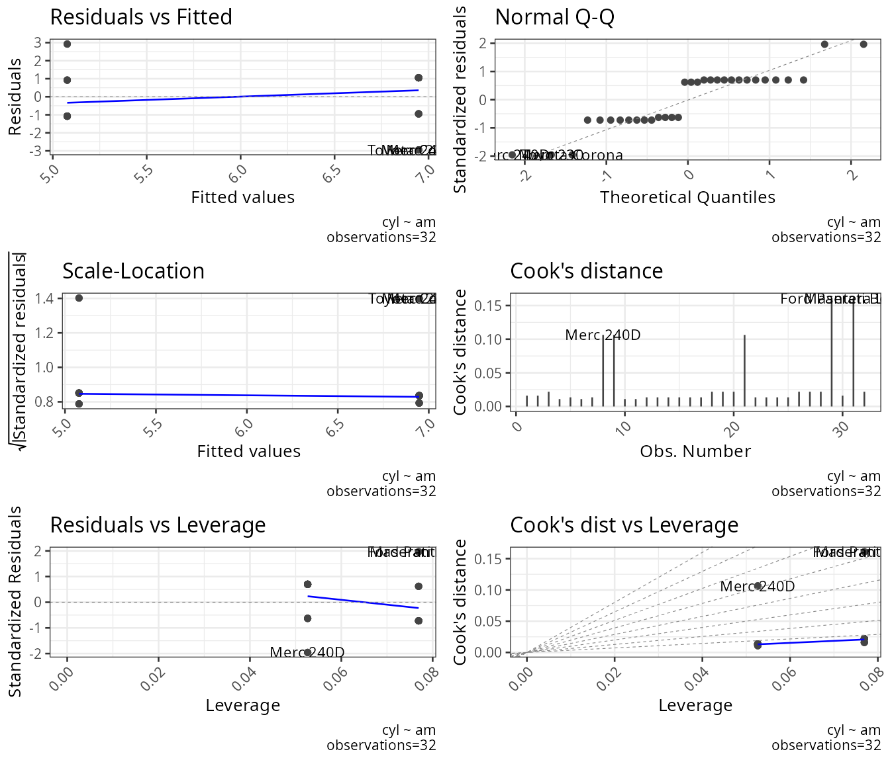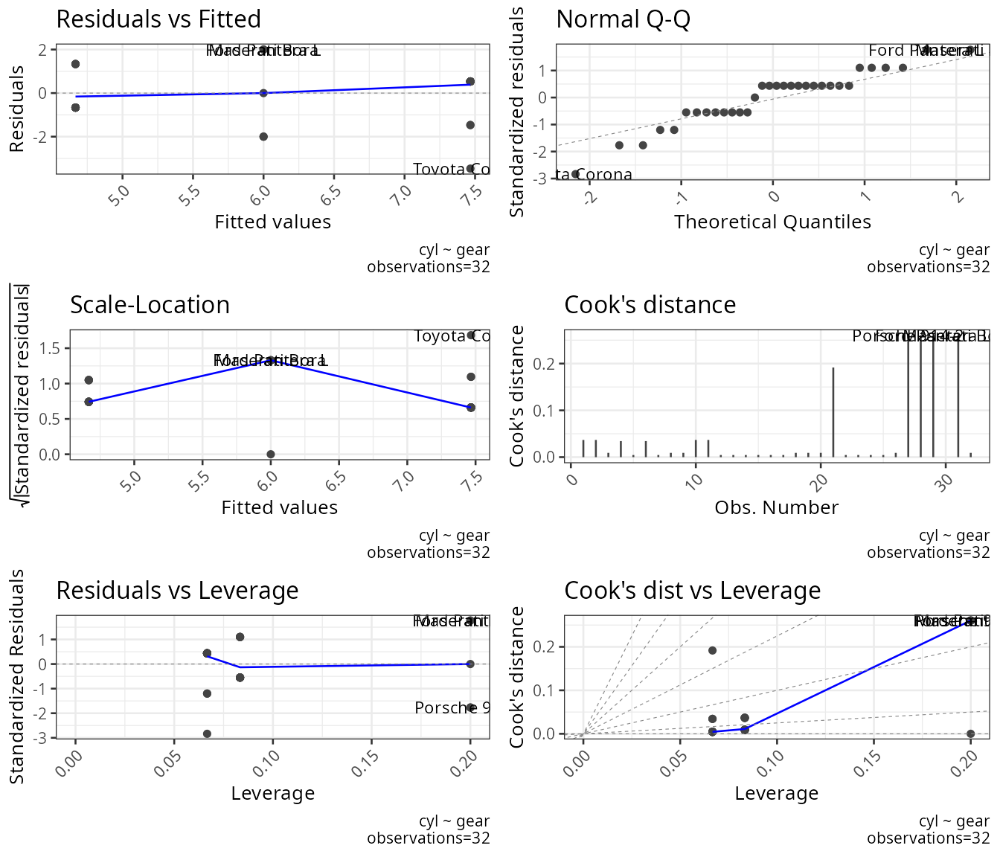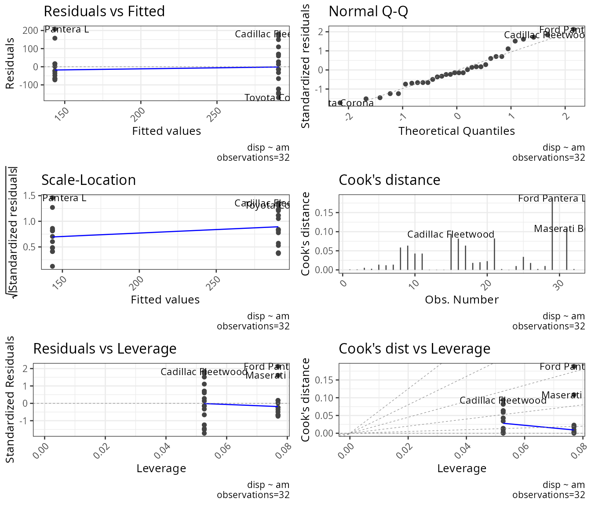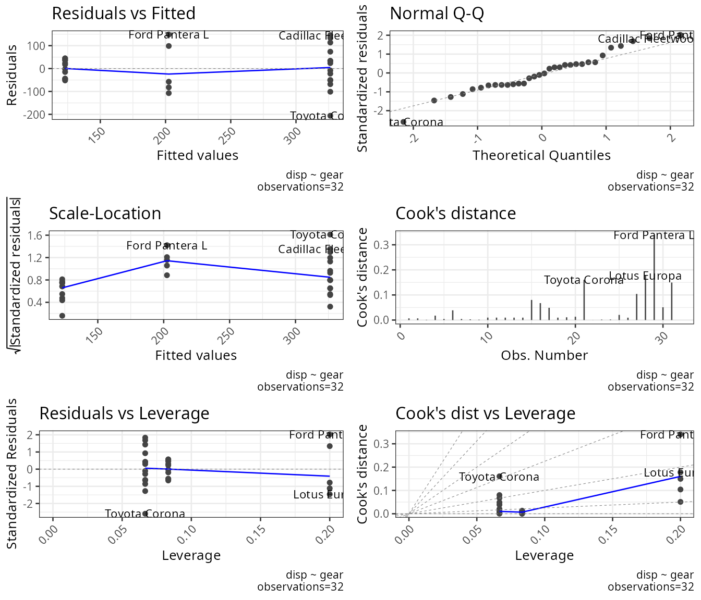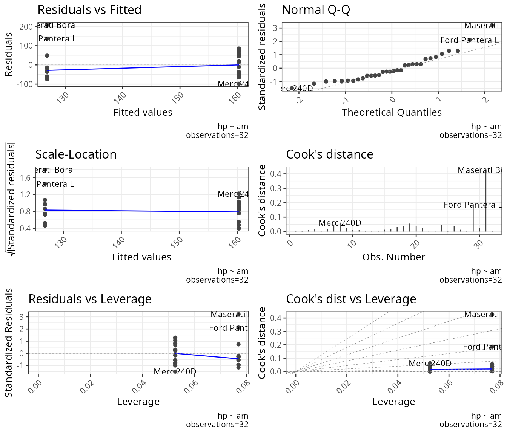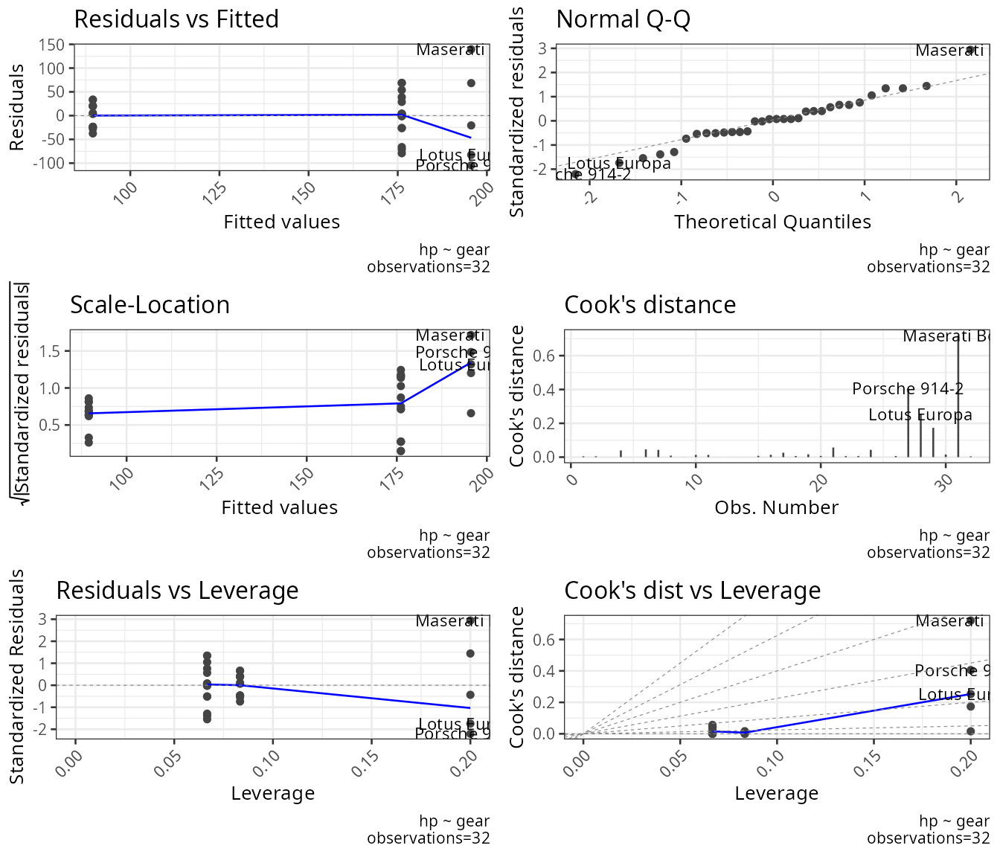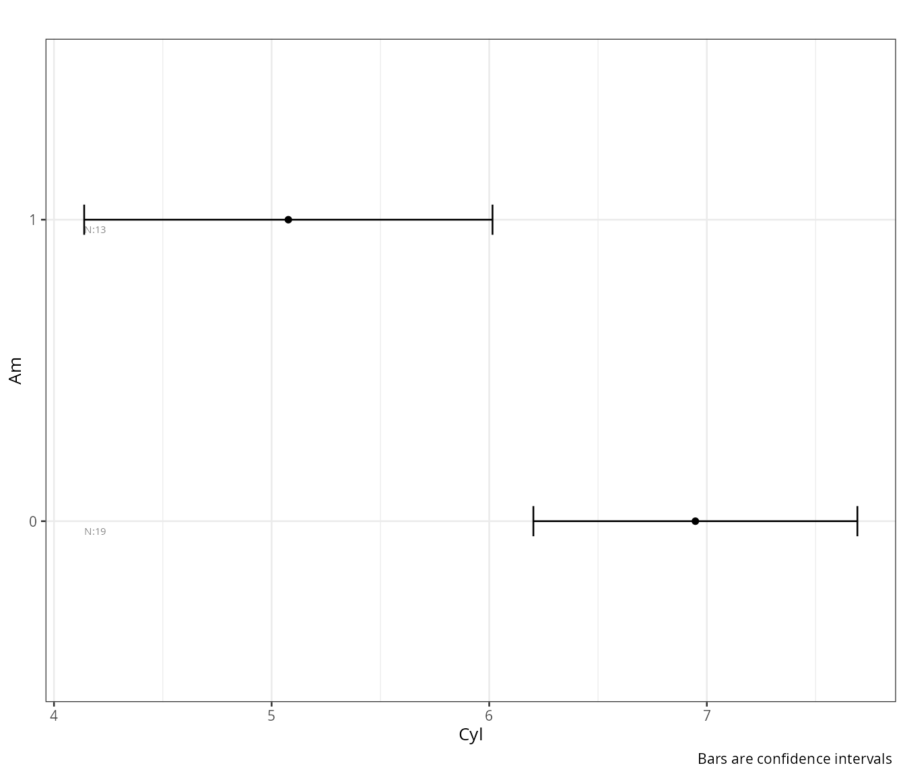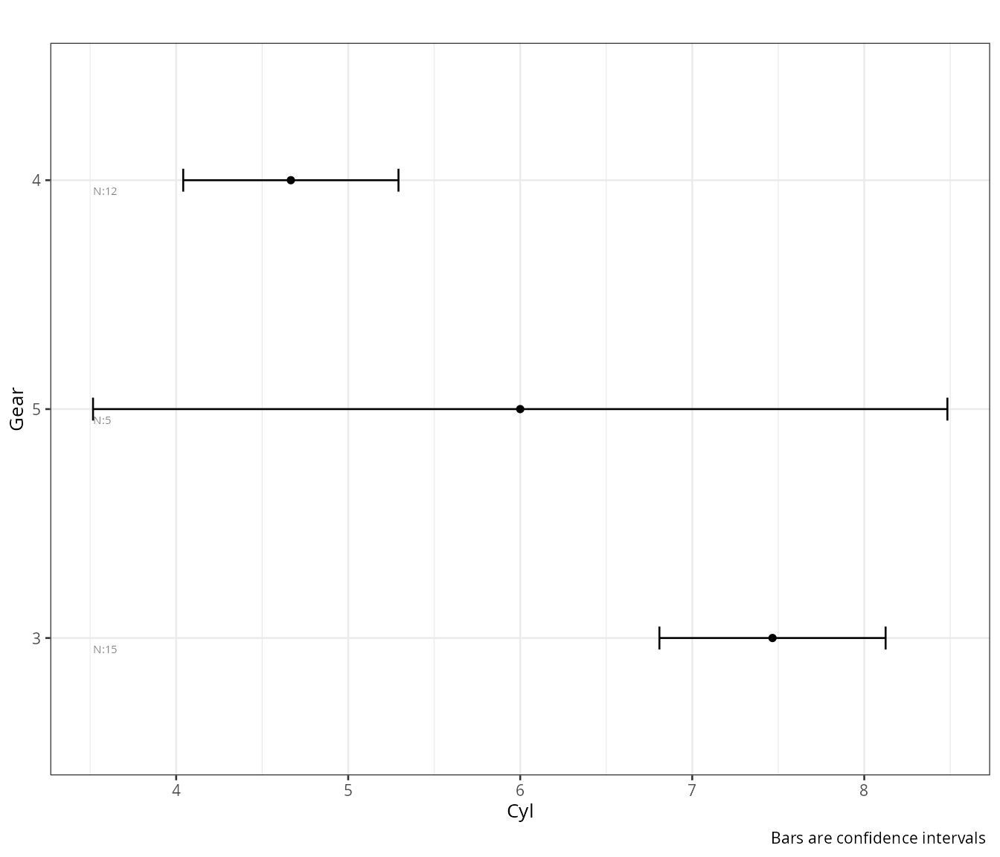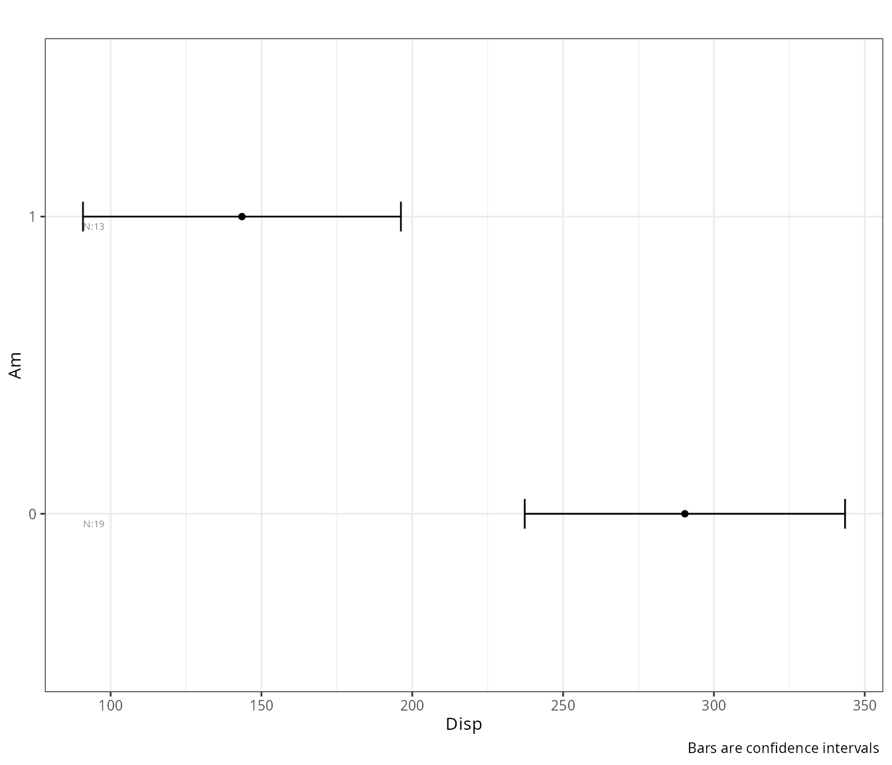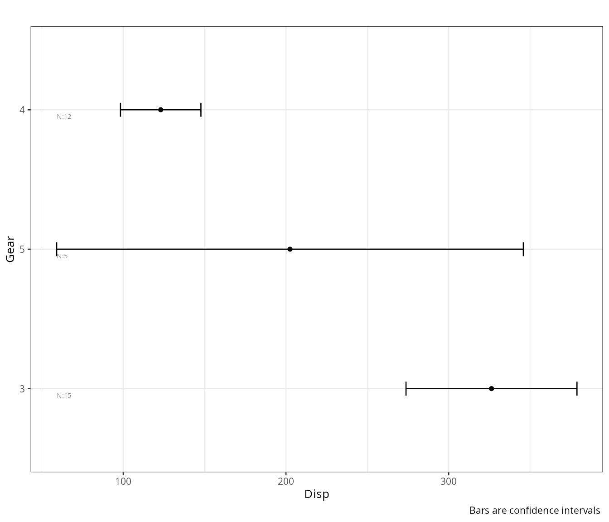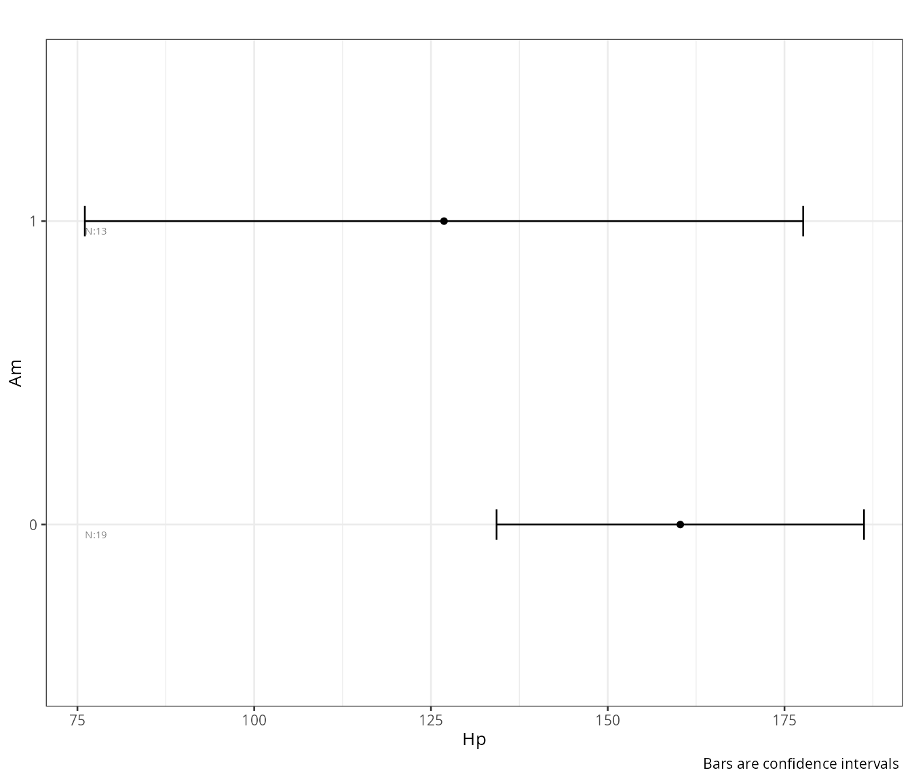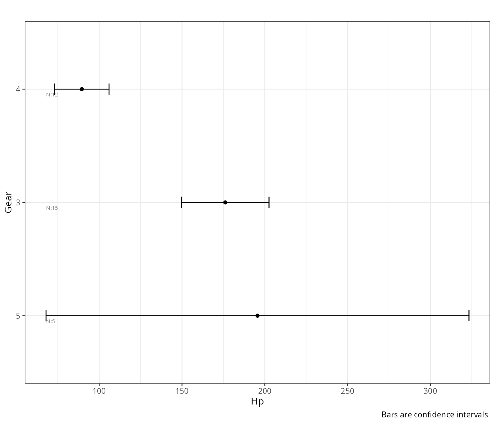

    ## $instructions
    ## $instructions$fisher
    ## [1] "Fisher assumes homoscedasticity (equal variances)"
    ## 
    ## $instructions$welch
    ## [1] "Welch does not assume homoscedasticity (it allows unequal variances)"
    ## 
    ## $instructions$kruskal
    ## [1] "Kruskal Wallis procedure does not assume normality but it is not an alternative for violations of heteroscedasticity"
    ## 
    ## $instructions$tukey
    ## [1] "Posthoc Tukey (Tukey-Kramer): handles unequal sample sizes but assumes equal variances"
    ## 
    ## $instructions$games_howell
    ## [1] "Posthoc Games Howell: good for unequal sample sizes and heteroscedasticity"
    ## 
    ## $instructions$homogeneity_instruction
    ## [1] "significant tests show heteroscedasticity and suggest the use of Welch or alternative procedures. Levene test depends on normality: Non normal distributions may result in false significant results. Sample size may affect test results"
    ## 
    ## 
    ## $fisher
    ##     DV   IV     formula                    method    ss_effect     ss_error    ms_effect     ms_error      etasq partial.etasq    omegasq partial.omegasq  cohens.f     power statistic df_effect
    ## 1  cyl   am    cyl ~ am Assuming homoscedasticity     27.00455     71.87045     27.00455     2.395682 0.27311813    0.27311813 0.24300096      0.24300096 0.6129758 0.9184281 11.272181         1
    ## 2  cyl gear  cyl ~ gear Assuming homoscedasticity     52.47500     46.40000     26.23750     1.600000 0.53072061    0.53072061 0.49042050      0.49042050 1.0634504 0.9996388 16.398437         2
    ## 3 disp   am   disp ~ am Assuming homoscedasticity 166450.11542 309734.67927 166450.11542 10324.489309 0.34954941    0.34954941 0.32090986      0.32090986 0.7330728 0.9798600 16.121874         1
    ## 4 disp gear disp ~ gear Assuming homoscedasticity 280220.63002 195964.16467 140110.31501  6757.384989 0.58847034    0.58847034 0.55225216      0.55225216 1.1958087 0.9999773 20.734399         2
    ## 5   hp   am     hp ~ am Assuming homoscedasticity   8619.49848 137107.37652   8619.49848  4570.245884 0.05914831    0.05914831 0.02694165      0.02694165 0.2507325 0.2790832  1.886003         1
    ## 6   hp gear   hp ~ gear Assuming homoscedasticity  64212.94167  81513.93333  32106.47083  2810.825287 0.44063898    0.44063898 0.39445401      0.39445401 0.8875552 0.9929814 11.422436         2
    ##   df_error            p bonferroni_p significant
    ## 1       30 2.151207e-03  0.008333333        TRUE
    ## 2       29 1.720904e-05  0.008333333        TRUE
    ## 3       30 3.662114e-04  0.008333333        TRUE
    ## 4       29 2.563401e-06  0.008333333        TRUE
    ## 5       30 1.798309e-01  0.008333333       FALSE
    ## 6       29 2.195517e-04  0.008333333        TRUE
    ## 
    ## $welch
    ##     DV   IV     formula                      method  ss_effect ss_error ms_effect ms_error      etasq partial.etasq    omegasq partial.omegasq  cohens.f     power statistic df_effect  df_error
    ## 1  cyl   am    cyl ~ am Assuming heteroscedasticity  11.250079 25.85363 11.250079 1.000000 0.30320635    0.30320635 0.26900478      0.26900478 0.6596553 0.9484216 11.250079         1 25.853626
    ## 2  cyl gear  cyl ~ gear Assuming heteroscedasticity  89.718224 21.14094 44.859112 2.134628 0.80929909    0.80929909 0.75622706      0.75622706 2.0600518 1.0000000 21.014951         2  9.903806
    ## 3 disp   am   disp ~ am Assuming heteroscedasticity  17.620909 29.25845 17.620909 1.000000 0.37587775    0.37587775 0.34714140      0.34714140 0.7760478 0.9887519 17.620909         1 29.258453
    ## 4 disp gear disp ~ gear Assuming heteroscedasticity 115.251778 20.05336 57.625889 2.142450 0.85179157    0.85179157 0.80733957      0.80733957 2.3973432 1.0000000 26.897193         2  9.360015
    ## 5   hp   am     hp ~ am Assuming heteroscedasticity   1.603234 18.71541  1.603234 1.000000 0.07890458    0.07890458 0.02829608      0.02829608 0.2926839 0.3488429  1.603234         1 18.715410
    ## 6   hp gear   hp ~ gear Assuming heteroscedasticity  78.700513 19.94351 39.350256 2.143291 0.79782339    0.79782339 0.73832634      0.73832634 1.9864971 1.0000000 18.359738         2  9.305091
    ##              p bonferroni_p significant
    ## 1 0.0024647126  0.008333333        TRUE
    ## 2 0.0002731347  0.008333333        TRUE
    ## 3 0.0002300413  0.008333333        TRUE
    ## 4 0.0001317283  0.008333333        TRUE
    ## 5 0.2209795813  0.008333333       FALSE
    ## 6 0.0005886831  0.008333333        TRUE
    ## 
    ## $kruskal_wallis
    ##     IV   DV     formula                       method     etasq epsilonsq         H df            p bonferroni_p significant
    ## 1   am  cyl    cyl ~ am Kruskal-Wallis rank sum test 0.2483103 0.2725583  8.449308  1 0.0036518239  0.008333333        TRUE
    ## 2 gear  cyl  cyl ~ gear Kruskal-Wallis rank sum test 0.5076650 0.5394286 16.722286  2 0.0002337770  0.008333333        TRUE
    ## 3   am disp   disp ~ am Kruskal-Wallis rank sum test 0.3691091 0.3894605 12.073274  1 0.0005114979  0.008333333        TRUE
    ## 4 gear disp disp ~ gear Kruskal-Wallis rank sum test 0.5026731 0.5347587 16.577519  2 0.0002513261  0.008333333        TRUE
    ## 5   am   hp     hp ~ am Kruskal-Wallis rank sum test 0.1023240 0.1312813  4.069719  1 0.0436585370  0.008333333       FALSE
    ## 6 gear   hp   hp ~ gear Kruskal-Wallis rank sum test 0.4347059 0.4711765 14.606471  2 0.0006733567  0.008333333        TRUE
    ## 
    ## $games_howell
    ##          method   IV   DV LEVEL         t        df            p bonferroni_p significant
    ## 1  Games Howell   am  cyl   0:1 3.3541138 25.853626 2.464713e-03  0.008333333        TRUE
    ## 2  Games Howell gear  cyl   3:4 6.6975616 24.949414 1.510268e-06  0.008333333        TRUE
    ## 3  Games Howell gear  cyl   3:5 1.5512092  4.975258 3.466759e-01  0.008333333       FALSE
    ## 4  Games Howell gear  cyl   4:5 1.4206860  4.830969 4.016459e-01  0.008333333       FALSE
    ## 5  Games Howell   am disp   0:1 4.1977266 29.258453 2.300413e-04  0.008333333        TRUE
    ## 6  Games Howell gear disp   3:4 7.5447410 19.415582 9.992173e-07  0.008333333        TRUE
    ## 7  Games Howell gear disp   3:5 2.1661489  5.915543 1.573336e-01  0.008333333       FALSE
    ## 8  Games Howell gear disp   4:5 1.5033871  4.383729 3.741102e-01  0.008333333       FALSE
    ## 9  Games Howell   am   hp   0:1 1.2661888 18.715410 2.209796e-01  0.008333333       FALSE
    ## 10 Games Howell gear   hp   3:4 6.0143334 22.355479 1.277187e-05  0.008333333        TRUE
    ## 11 Games Howell gear   hp   3:5 0.4088898  4.587327 9.136296e-01  0.008333333       FALSE
    ## 12 Games Howell gear   hp   4:5 2.2772062  4.213060 1.655664e-01  0.008333333       FALSE
    ## 
    ## $tukey
    ##    Method   IV   DV LEVEL         t df            p bonferroni_p significant
    ## 1   Tukey   am  cyl   0:1 3.3574068 30 2.151207e-03  0.008333333        TRUE
    ## 2   Tukey gear  cyl   3:4 5.7154761 29 1.019711e-05  0.008333333        TRUE
    ## 3   Tukey gear  cyl   3:5 2.2453656 29 8.029755e-02  0.008333333       FALSE
    ## 4   Tukey gear  cyl   4:5 1.9802951 29 1.351338e-01  0.008333333       FALSE
    ## 5   Tukey   am disp   0:1 4.0152053 30 3.662114e-04  0.008333333        TRUE
    ## 6   Tukey gear disp   3:4 6.3850869 29 1.638269e-06  0.008333333        TRUE
    ## 7   Tukey gear disp   3:5 2.9168702 29 1.800373e-02  0.008333333       FALSE
    ## 8   Tukey gear disp   4:5 1.8160534 29 1.821800e-01  0.008333333       FALSE
    ## 9   Tukey   am   hp   0:1 1.3733183 30 1.798309e-01  0.008333333       FALSE
    ## 10  Tukey gear   hp   3:4 4.2191257 29 6.267499e-04  0.008333333        TRUE
    ## 11  Tukey gear   hp   3:5 0.7110339 29 7.589758e-01  0.008333333       FALSE
    ## 12  Tukey gear   hp   4:5 3.7596691 29 2.144708e-03  0.008333333        TRUE
    ## 
    ## $homogeneity
    ##        Test   DV   IV    Statistic df_1 df_2            p bonferroni_p significant
    ## 1    Levene  cyl   am 2.640471e-04    1   30 0.9871429143  0.008333333       FALSE
    ## 2    Levene  cyl gear 2.485472e+00    2   29 0.1008580083  0.008333333       FALSE
    ## 3    Levene disp   am 1.687300e+00    1   30 0.2038527460  0.008333333       FALSE
    ## 4    Levene disp gear 5.310649e+00    2   29 0.0108344001  0.008333333       FALSE
    ## 5    Levene   hp   am 1.096916e+00    1   30 0.3033090390  0.008333333       FALSE
    ## 6    Levene   hp gear 8.909260e+00    2   29 0.0009631958  0.008333333        TRUE
    ## 7  Bartlett  cyl   am 3.570702e-04    1   NA 0.9849238307  0.008333333       FALSE
    ## 8  Bartlett  cyl gear 3.403548e+00    2   NA 0.1823597392  0.008333333       FALSE
    ## 9  Bartlett disp   am 7.310694e-01    1   NA 0.3925367660  0.008333333       FALSE
    ## 10 Bartlett disp gear 9.151295e+00    2   NA 0.0102996280  0.008333333       FALSE
    ## 11 Bartlett   hp   am 2.820842e+00    1   NA 0.0930475533  0.008333333       FALSE
    ## 12 Bartlett   hp gear 1.263581e+01    2   NA 0.0018037216  0.008333333        TRUE

    ## $instructions
    ## $instructions$fisher
    ## [1] "Fisher assumes homoscedasticity (equal variances)"
    ## 
    ## $instructions$welch
    ## [1] "Welch does not assume homoscedasticity (it allows unequal variances)"
    ## 
    ## $instructions$kruskal
    ## [1] "Kruskal Wallis procedure does not assume normality but it is not an alternative for violations of heteroscedasticity"
    ## 
    ## $instructions$tukey
    ## [1] "Posthoc Tukey (Tukey-Kramer): handles unequal sample sizes but assumes equal variances"
    ## 
    ## $instructions$games_howell
    ## [1] "Posthoc Games Howell: good for unequal sample sizes and heteroscedasticity"
    ## 
    ## $instructions$homogeneity_instruction
    ## [1] "significant tests show heteroscedasticity and suggest the use of Welch or alternative procedures. Levene test depends on normality: Non normal distributions may result in false significant results. Sample size may affect test results"
    ## 
    ## 
    ## $fisher
    ##     DV   IV     formula                    method    ss_effect     ss_error    ms_effect     ms_error      etasq partial.etasq    omegasq partial.omegasq  cohens.f     power statistic df_effect
    ## 1  cyl   am    cyl ~ am Assuming homoscedasticity     27.00455     71.87045     27.00455     2.395682 0.27311813    0.27311813 0.24300096      0.24300096 0.6129758 0.9184281 11.272181         1
    ## 2  cyl gear  cyl ~ gear Assuming homoscedasticity     52.47500     46.40000     26.23750     1.600000 0.53072061    0.53072061 0.49042050      0.49042050 1.0634504 0.9996388 16.398437         2
    ## 3 disp   am   disp ~ am Assuming homoscedasticity 166450.11542 309734.67927 166450.11542 10324.489309 0.34954941    0.34954941 0.32090986      0.32090986 0.7330728 0.9798600 16.121874         1
    ## 4 disp gear disp ~ gear Assuming homoscedasticity 280220.63002 195964.16467 140110.31501  6757.384989 0.58847034    0.58847034 0.55225216      0.55225216 1.1958087 0.9999773 20.734399         2
    ## 5   hp   am     hp ~ am Assuming homoscedasticity   8619.49848 137107.37652   8619.49848  4570.245884 0.05914831    0.05914831 0.02694165      0.02694165 0.2507325 0.2790832  1.886003         1
    ## 6   hp gear   hp ~ gear Assuming homoscedasticity  64212.94167  81513.93333  32106.47083  2810.825287 0.44063898    0.44063898 0.39445401      0.39445401 0.8875552 0.9929814 11.422436         2
    ##   df_error            p bonferroni_p significant
    ## 1       30 2.151207e-03  0.008333333        TRUE
    ## 2       29 1.720904e-05  0.008333333        TRUE
    ## 3       30 3.662114e-04  0.008333333        TRUE
    ## 4       29 2.563401e-06  0.008333333        TRUE
    ## 5       30 1.798309e-01  0.008333333       FALSE
    ## 6       29 2.195517e-04  0.008333333        TRUE
    ## 
    ## $welch
    ##     DV   IV     formula                      method  ss_effect ss_error ms_effect ms_error      etasq partial.etasq    omegasq partial.omegasq  cohens.f     power statistic df_effect  df_error
    ## 1  cyl   am    cyl ~ am Assuming heteroscedasticity  11.250079 25.85363 11.250079 1.000000 0.30320635    0.30320635 0.26900478      0.26900478 0.6596553 0.9484216 11.250079         1 25.853626
    ## 2  cyl gear  cyl ~ gear Assuming heteroscedasticity  89.718224 21.14094 44.859112 2.134628 0.80929909    0.80929909 0.75622706      0.75622706 2.0600518 1.0000000 21.014951         2  9.903806
    ## 3 disp   am   disp ~ am Assuming heteroscedasticity  17.620909 29.25845 17.620909 1.000000 0.37587775    0.37587775 0.34714140      0.34714140 0.7760478 0.9887519 17.620909         1 29.258453
    ## 4 disp gear disp ~ gear Assuming heteroscedasticity 115.251778 20.05336 57.625889 2.142450 0.85179157    0.85179157 0.80733957      0.80733957 2.3973432 1.0000000 26.897193         2  9.360015
    ## 5   hp   am     hp ~ am Assuming heteroscedasticity   1.603234 18.71541  1.603234 1.000000 0.07890458    0.07890458 0.02829608      0.02829608 0.2926839 0.3488429  1.603234         1 18.715410
    ## 6   hp gear   hp ~ gear Assuming heteroscedasticity  78.700513 19.94351 39.350256 2.143291 0.79782339    0.79782339 0.73832634      0.73832634 1.9864971 1.0000000 18.359738         2  9.305091
    ##              p bonferroni_p significant
    ## 1 0.0024647126  0.008333333        TRUE
    ## 2 0.0002731347  0.008333333        TRUE
    ## 3 0.0002300413  0.008333333        TRUE
    ## 4 0.0001317283  0.008333333        TRUE
    ## 5 0.2209795813  0.008333333       FALSE
    ## 6 0.0005886831  0.008333333        TRUE
    ## 
    ## $kruskal_wallis
    ##     IV   DV     formula                       method     etasq epsilonsq         H df            p bonferroni_p significant
    ## 1   am  cyl    cyl ~ am Kruskal-Wallis rank sum test 0.2483103 0.2725583  8.449308  1 0.0036518239  0.008333333        TRUE
    ## 2 gear  cyl  cyl ~ gear Kruskal-Wallis rank sum test 0.5076650 0.5394286 16.722286  2 0.0002337770  0.008333333        TRUE
    ## 3   am disp   disp ~ am Kruskal-Wallis rank sum test 0.3691091 0.3894605 12.073274  1 0.0005114979  0.008333333        TRUE
    ## 4 gear disp disp ~ gear Kruskal-Wallis rank sum test 0.5026731 0.5347587 16.577519  2 0.0002513261  0.008333333        TRUE
    ## 5   am   hp     hp ~ am Kruskal-Wallis rank sum test 0.1023240 0.1312813  4.069719  1 0.0436585370  0.008333333       FALSE
    ## 6 gear   hp   hp ~ gear Kruskal-Wallis rank sum test 0.4347059 0.4711765 14.606471  2 0.0006733567  0.008333333        TRUE
    ## 
    ## $games_howell
    ##          method   IV   DV LEVEL         t        df            p bonferroni_p significant
    ## 1  Games Howell   am  cyl   0:1 3.3541138 25.853626 2.464713e-03  0.008333333        TRUE
    ## 2  Games Howell gear  cyl   3:4 6.6975616 24.949414 1.510268e-06  0.008333333        TRUE
    ## 3  Games Howell gear  cyl   3:5 1.5512092  4.975258 3.466759e-01  0.008333333       FALSE
    ## 4  Games Howell gear  cyl   4:5 1.4206860  4.830969 4.016459e-01  0.008333333       FALSE
    ## 5  Games Howell   am disp   0:1 4.1977266 29.258453 2.300413e-04  0.008333333        TRUE
    ## 6  Games Howell gear disp   3:4 7.5447410 19.415582 9.992173e-07  0.008333333        TRUE
    ## 7  Games Howell gear disp   3:5 2.1661489  5.915543 1.573336e-01  0.008333333       FALSE
    ## 8  Games Howell gear disp   4:5 1.5033871  4.383729 3.741102e-01  0.008333333       FALSE
    ## 9  Games Howell   am   hp   0:1 1.2661888 18.715410 2.209796e-01  0.008333333       FALSE
    ## 10 Games Howell gear   hp   3:4 6.0143334 22.355479 1.277187e-05  0.008333333        TRUE
    ## 11 Games Howell gear   hp   3:5 0.4088898  4.587327 9.136296e-01  0.008333333       FALSE
    ## 12 Games Howell gear   hp   4:5 2.2772062  4.213060 1.655664e-01  0.008333333       FALSE
    ## 
    ## $tukey
    ##    Method   IV   DV LEVEL         t df            p bonferroni_p significant
    ## 1   Tukey   am  cyl   0:1 3.3574068 30 2.151207e-03  0.008333333        TRUE
    ## 2   Tukey gear  cyl   3:4 5.7154761 29 1.019711e-05  0.008333333        TRUE
    ## 3   Tukey gear  cyl   3:5 2.2453656 29 8.029755e-02  0.008333333       FALSE
    ## 4   Tukey gear  cyl   4:5 1.9802951 29 1.351338e-01  0.008333333       FALSE
    ## 5   Tukey   am disp   0:1 4.0152053 30 3.662114e-04  0.008333333        TRUE
    ## 6   Tukey gear disp   3:4 6.3850869 29 1.638269e-06  0.008333333        TRUE
    ## 7   Tukey gear disp   3:5 2.9168702 29 1.800373e-02  0.008333333       FALSE
    ## 8   Tukey gear disp   4:5 1.8160534 29 1.821800e-01  0.008333333       FALSE
    ## 9   Tukey   am   hp   0:1 1.3733183 30 1.798309e-01  0.008333333       FALSE
    ## 10  Tukey gear   hp   3:4 4.2191257 29 6.267499e-04  0.008333333        TRUE
    ## 11  Tukey gear   hp   3:5 0.7110339 29 7.589758e-01  0.008333333       FALSE
    ## 12  Tukey gear   hp   4:5 3.7596691 29 2.144708e-03  0.008333333        TRUE
    ## 
    ## $homogeneity
    ##        Test   DV   IV    Statistic df_1 df_2            p bonferroni_p significant
    ## 1    Levene  cyl   am 2.640471e-04    1   30 0.9871429143  0.008333333       FALSE
    ## 2    Levene  cyl gear 2.485472e+00    2   29 0.1008580083  0.008333333       FALSE
    ## 3    Levene disp   am 1.687300e+00    1   30 0.2038527460  0.008333333       FALSE
    ## 4    Levene disp gear 5.310649e+00    2   29 0.0108344001  0.008333333       FALSE
    ## 5    Levene   hp   am 1.096916e+00    1   30 0.3033090390  0.008333333       FALSE
    ## 6    Levene   hp gear 8.909260e+00    2   29 0.0009631958  0.008333333        TRUE
    ## 7  Bartlett  cyl   am 3.570702e-04    1   NA 0.9849238307  0.008333333       FALSE
    ## 8  Bartlett  cyl gear 3.403548e+00    2   NA 0.1823597392  0.008333333       FALSE
    ## 9  Bartlett disp   am 7.310694e-01    1   NA 0.3925367660  0.008333333       FALSE
    ## 10 Bartlett disp gear 9.151295e+00    2   NA 0.0102996280  0.008333333       FALSE
    ## 11 Bartlett   hp   am 2.820842e+00    1   NA 0.0930475533  0.008333333       FALSE
    ## 12 Bartlett   hp gear 1.263581e+01    2   NA 0.0018037216  0.008333333        TRUE

## Report Factorial ANOVA

`report_factorial_anova` handles designs with multiple factors, both
within-subjects (repeated measures) and between-subjects, including
mixed designs and ANCOVA (with covariates). It returns effect sizes and
optionally post hoc comparisons.

### Define models

A synthetic dataset is generated here with 80 subjects (`id`), four
independent variables (`IV1`–`IV4`), and four dependent variables
(`DV1`–`DV4`). The DVs are drawn from a correlated multivariate
distribution (near-zero inter-correlations) and shifted so that `IV1`
groups differ on `DV1` — this ensures at least one meaningful effect to
detect.

- **r1**: Fully within-subjects design (IV1 × IV2 repeated, with post
  hocs)
- **r2**: Fully between-subjects design (IV1 × IV2, with post hocs)
- **r3**: Between-subjects design without post hocs
- **r4**: Within-subjects design with covariates (DV3, DV4 as
  within-covariates)

``` r

set.seed(12345)
df<-data.frame(id=rep(seq(1,80),each=81,1),
               IV1=rep(LETTERS[1:3],each=1,2160),
               IV2=rep(LETTERS[4:6],each=3,720),
               IV3=rep(LETTERS[7:9],each=9,240),
               IV4=rep(LETTERS[10:12],each=27,80),
               stringsAsFactors=FALSE)
ctdf<-data.frame(matrix(.01,ncol=4,nrow=4))
correlation_martix<-as.matrix(ctdf)
diag(correlation_martix)<-1
ctdf<-generate_correlation_matrix(correlation_martix,nrows=nrow(df))+10
names(ctdf)<-paste0("DV",1:4)
df<-data.frame(df,ctdf)
df$DV2<-df$DV2+10
df$DV3<-df$DV3+20
df$DV4<-df$DV4+30
df[df$IV1%in%"A",]$DV1<-df[df$IV1%in%"A",]$DV1+1
df[df$IV1%in%"B",]$DV1<-df[df$IV1%in%"B",]$DV1+2
df[df$IV1%in%"C",]$DV1<-df[df$IV1%in%"C",]$DV1+3
cdf(df)
```

    ## $summary
    ##   COLLUMNS ROWS TOTAL EMPTY null NAN na INF   FIN FACTOR
    ## 1        9 6480 58320     0    0   0  0   0 32400      0
    ## 
    ## $check
    ##   NAMES EMPTY null na NOT_NA NAN INF  FIN RANGE  MEAN MEDIAN    SD              MIN              MAX      MODE      TYPE     CLASS FACTOR
    ## 1    id     0    0  0   6480   0   0 6480    80 40.50  40.50 23.09                1               80   numeric   integer   integer  FALSE
    ## 2   IV1     0    0  0   6480   0   0    0     3    NA     NA    NA                A                C character character character  FALSE
    ## 3   IV2     0    0  0   6480   0   0    0     3    NA     NA    NA                D                F character character character  FALSE
    ## 4   IV3     0    0  0   6480   0   0    0     3    NA     NA    NA                G                I character character character  FALSE
    ## 5   IV4     0    0  0   6480   0   0    0     3    NA     NA    NA                J                L character character character  FALSE
    ## 6   DV1     0    0  0   6480   0   0 6480  6480 11.98  11.99  1.30 7.51291207335776 16.2640490751635   numeric    double   numeric  FALSE
    ## 7   DV2     0    0  0   6480   0   0 6480  6480 20.01  20.02  1.00 16.3378832518107 23.6232526335438   numeric    double   numeric  FALSE
    ## 8   DV3     0    0  0   6480   0   0 6480  6480 30.01  30.00  0.98 26.1265203294059 33.1419727424988   numeric    double   numeric  FALSE
    ## 9   DV4     0    0  0   6480   0   0 6480  6480 40.00  39.99  1.01  36.482400155701 43.7443144516511   numeric    double   numeric  FALSE

``` r

r1<-report_factorial_anova(df=df,
                           wid="id",
                           dv=c("DV1","DV2"),
                           within=c("IV1","IV2"),
                           within_full=c("IV1","IV2"),
                           between=NULL,
                           within_covariates=NULL,
                           between_covariates=NULL,
                           post_hoc=TRUE)
r2<-report_factorial_anova(df=df,
                           wid="id",
                           dv=c("DV1","DV2"),
                           within=NULL,
                           within_full=NULL,
                           between=c("IV1","IV2"),
                           within_covariates=NULL,
                           between_covariates=NULL,
                           post_hoc=TRUE)
r3<-report_factorial_anova(df=df,
                           wid="id",
                           dv=c("DV1","DV2"),
                           # within=c("IV3","IV4"),
                           # within_full=c("IV3","IV4"),
                           between=c("IV1","IV2"),
                           within_covariates=NULL,
                           between_covariates=NULL,
                           post_hoc=FALSE)
r4<-report_factorial_anova(df=df,
                           wid="id",
                           dv=c("DV1","DV2"),
                           within=c("IV1","IV2"),
                           within_full=c("IV1","IV2"),
                           between=NULL,
                           within_covariates=c("DV3","DV4"),
                           between_covariates=NULL,
                           post_hoc=TRUE)
```

### Within-subjects with post hocs

``` r

r1
```

    ## $omnibus
    ##    dv      Effect DFn DFd          SSn       SSd            F             p      W[M]       p[M]       GGe         p[GG]       HFe         p[HF]
    ## 1 DV1         IV1   2 158 5.006671e+02 17.930125 2.205935e+03 3.643342e-116 0.9782102 0.42350247 0.9786749 9.499976e-114 1.0032624 3.643342e-116
    ## 2 DV1         IV2   2 158 4.504472e-01 17.900158 1.987989e+00  1.403820e-01 0.9706304 0.31268097 0.9714684  1.418139e-01 0.9955929  1.406031e-01
    ## 3 DV1     IV1:IV2   4 316 2.462502e-01 32.449806 5.995034e-01  6.632592e-01 0.8975588 0.49773872 0.9505826  6.548731e-01 1.0046403  6.632592e-01
    ## 4 DV1 (Intercept)   1  79 1.033068e+05  8.172377 9.986373e+05 8.512832e-164        NA         NA        NA            NA        NA            NA
    ## 5 DV2         IV1   2 158 3.109476e-01 17.270983 1.422320e+00  2.442245e-01 0.9774644 0.41108985 0.9779610  2.443691e-01 1.0025025  2.442245e-01
    ## 6 DV2         IV2   2 158 3.547385e-01 17.657932 1.587068e+00  2.077672e-01 0.9975940 0.91033076 0.9975998  2.078264e-01 1.0234165  2.077672e-01
    ## 7 DV2     IV1:IV2   4 316 3.513928e-01 34.051055 8.152474e-01  5.161703e-01 0.8244874 0.09264403 0.9243789  5.080674e-01 0.9754035  5.136027e-01
    ## 8 DV2 (Intercept)   1  79 2.884130e+05 10.463958 2.177439e+06 3.618624e-177        NA         NA        NA            NA        NA            NA
    ## 
    ## $omnibus_effect_size
    ##     dv etasq partial.etasq omegasq partial.omegasq epsilonsq cohens.f      group      term   sumsq  df  meansq statistic p.value power
    ## 1  DV1 0.014         0.201   0.000           0.001     0.000    0.502         id Residuals   8.172  79   0.103        NA      NA 0.999
    ## 2  DV1 0.866         0.939   0.866           0.871     0.866    3.928     id:IV1       IV1 500.667   2 250.334  2205.935   0.000 1.000
    ## 3  DV1 0.031         0.356   0.003           0.023     0.003    0.743     id:IV1 Residuals  17.930 158   0.113        NA      NA 1.000
    ## 4  DV1 0.001         0.014   0.000           0.003     0.000    0.118     id:IV2       IV2   0.450   2   0.225     1.988   0.140 0.450
    ## 5  DV1 0.031         0.356   0.003           0.022     0.003    0.743     id:IV2 Residuals  17.900 158   0.113        NA      NA 1.000
    ## 6  DV1 0.000         0.008   0.000          -0.002     0.000    0.087 id:IV1:IV2   IV1:IV2   0.246   4   0.062     0.600   0.663 0.200
    ## 7  DV1    NA            NA      NA              NA        NA       NA id:IV1:IV2 Residuals  32.450 316   0.103        NA      NA    NA
    ## 8  DV2 0.130         0.235   0.024           0.025     0.024    0.554         id Residuals  10.464  79   0.132        NA      NA 1.000
    ## 9  DV2 0.004         0.009   0.001           0.001     0.001    0.096     id:IV1       IV1   0.311   2   0.155     1.422   0.244 0.311
    ## 10 DV2 0.215         0.337   0.003           0.003     0.003    0.712     id:IV1 Residuals  17.271 158   0.109        NA      NA 1.000
    ## 11 DV2 0.004         0.010   0.002           0.002     0.002    0.102     id:IV2       IV2   0.355   2   0.177     1.587   0.208 0.349
    ## 12 DV2 0.219         0.341   0.008           0.008     0.008    0.720     id:IV2 Residuals  17.658 158   0.112        NA      NA 1.000
    ## 13 DV2 0.004         0.010  -0.001          -0.001    -0.001    0.102 id:IV1:IV2   IV1:IV2   0.351   4   0.088     0.815   0.516 0.264
    ## 14 DV2    NA            NA      NA              NA        NA       NA id:IV1:IV2 Residuals  34.051 316   0.108        NA      NA    NA
    ## 
    ## $post_hoc
    ##     dv  contrast      estimate         SE       df      t.ratio      p.value
    ## 1  DV1     A - B -1.0369057041 0.03075194 158.0000 -33.71838554 1.465494e-14
    ## 2  DV1     A - C -2.0425227385 0.03075194 158.0000 -66.41931749 1.465494e-14
    ## 3  DV1     B - C -1.0056170344 0.03075194 158.0000 -32.70093195 1.465494e-14
    ## 4  DV1     D - E  0.0504865094 0.03072623 158.0000   1.64310789 2.307019e-01
    ## 5  DV1     D - F  0.0553036770 0.03072623 158.0000   1.79988494 1.729367e-01
    ## 6  DV1     E - F  0.0048171676 0.03072623 158.0000   0.15677705 9.865421e-01
    ## 7  DV1 A D - B D -1.0083363900 0.05154774 472.9164 -19.56121477 3.020106e-11
    ## 8  DV1 A D - C D -2.0455057318 0.05154774 472.9164 -39.68177420 3.020106e-11
    ## 9  DV1 A D - A E  0.0727904308 0.05153241 472.9528   1.41251762 8.928075e-01
    ## 10 DV1 A D - B E -1.0144401291 0.05239777 553.4885 -19.36036702 4.328203e-10
    ## 11 DV1 A D - C E -1.9607328952 0.05239777 553.4885 -37.42015658 4.328203e-10
    ## 12 DV1 A D - A F  0.0585860764 0.05153241 472.9528   1.13687835 9.683248e-01
    ## 13 DV1 A D - B F -0.9565640860 0.05239777 553.4885 -18.25581545 4.328203e-10
    ## 14 DV1 A D - C F -1.9899530812 0.05239777 553.4885 -37.97781741 4.328203e-10
    ## 15 DV1 B D - C D -1.0371693419 0.05154774 472.9164 -20.12055942 3.020106e-11
    ## 16 DV1 B D - A E  1.0811268208 0.05239777 553.4885  20.63306788 4.328203e-10
    ## 17 DV1 B D - B E -0.0061037391 0.05153241 472.9528  -0.11844468 1.000000e+00
    ## 18 DV1 B D - C E -0.9523965053 0.05239777 553.4885 -18.17627809 4.328203e-10
    ## 19 DV1 B D - A F  1.0669224664 0.05239777 553.4885  20.36198089 4.328203e-10
    ## 20 DV1 B D - B F  0.0517723040 0.05153241 472.9528   1.00465529 9.853769e-01
    ## 21 DV1 B D - C F -0.9816166912 0.05239777 553.4885 -18.73393892 4.328203e-10
    ## 22 DV1 C D - A E  2.1182961626 0.05239777 553.4885  40.42721693 4.328203e-10
    ## 23 DV1 C D - B E  1.0310656027 0.05239777 553.4885  19.67766053 4.328203e-10
    ## 24 DV1 C D - C E  0.0847728366 0.05153241 472.9528   1.64503938 7.792801e-01
    ## 25 DV1 C D - A F  2.1040918082 0.05239777 553.4885  40.15612994 4.328203e-10
    ## 26 DV1 C D - B F  1.0889416459 0.05239777 553.4885  20.78221210 4.328203e-10
    ## 27 DV1 C D - C F  0.0555526506 0.05153241 472.9528   1.07801392 9.771442e-01
    ## 28 DV1 A E - B E -1.0872305599 0.05154774 472.9164 -21.09172167 3.020106e-11
    ## 29 DV1 A E - C E -2.0335233260 0.05154774 472.9164 -39.44932160 3.020106e-11
    ## 30 DV1 A E - A F -0.0142043544 0.05153241 472.9528  -0.27563926 9.999990e-01
    ## 31 DV1 A E - B F -1.0293545167 0.05239777 553.4885 -19.64500483 4.328203e-10
    ## 32 DV1 A E - C F -2.0627435120 0.05239777 553.4885 -39.36700679 4.328203e-10
    ## 33 DV1 B E - C E -0.9462927661 0.05154774 472.9164 -18.35759992 3.020106e-11
    ## 34 DV1 B E - A F  1.0730262055 0.05239777 553.4885  20.47846941 4.328203e-10
    ## 35 DV1 B E - B F  0.0578760432 0.05153241 472.9528   1.12309997 9.705838e-01
    ## 36 DV1 B E - C F -0.9755129521 0.05239777 553.4885 -18.61745039 4.328203e-10
    ## 37 DV1 C E - A F  2.0193189716 0.05239777 553.4885  38.53825898 4.328203e-10
    ## 38 DV1 C E - B F  1.0041688093 0.05239777 553.4885  19.16434113 4.328203e-10
    ## 39 DV1 C E - C F -0.0292201860 0.05153241 472.9528  -0.56702546 9.997406e-01
    ## 40 DV1 A F - B F -1.0151501623 0.05154774 472.9164 -19.69339850 3.020106e-11
    ## 41 DV1 A F - C F -2.0485391576 0.05154774 472.9164 -39.74062112 3.020106e-11
    ## 42 DV1 B F - C F -1.0333889953 0.05154774 472.9164 -20.04722261 3.020106e-11
    ## 43 DV2     A - B  0.0479519981 0.03018140 158.0000   1.58879309 2.534586e-01
    ## 44 DV2     A - C  0.0091815180 0.03018140 158.0000   0.30421115 9.502826e-01
    ## 45 DV2     B - C -0.0387704800 0.03018140 158.0000  -1.28458195 4.059592e-01
    ## 46 DV2     D - E  0.0188734694 0.03051763 158.0000   0.61844486 8.102461e-01
    ## 47 DV2     D - F -0.0347216147 0.03051763 158.0000  -1.13775605 4.923455e-01
    ## 48 DV2     E - F -0.0535950840 0.03051763 158.0000  -1.75620091 1.878610e-01
    ## 49 DV2 A D - B D  0.0011955595 0.05202748 473.9783   0.02297938 1.000000e+00
    ## 50 DV2 A D - C D -0.0240057438 0.05202748 473.9783  -0.46140509 9.999455e-01
    ## 51 DV2 A D - A E -0.0474360729 0.05222324 473.8582  -0.90833255 9.924667e-01
    ## 52 DV2 A D - B E  0.0514053968 0.05234705 564.8614   0.98201141 9.874125e-01
    ## 53 DV2 A D - C E  0.0298408999 0.05234705 564.8614   0.57005891 9.997310e-01
    ## 54 DV2 A D - A F -0.0483557728 0.05222324 473.8582  -0.92594348 9.914345e-01
    ## 55 DV2 A D - B F -0.0045368077 0.05234705 564.8614  -0.08666788 1.000000e+00
    ## 56 DV2 A D - C F -0.0740824478 0.05234705 564.8614  -1.41521735 8.918559e-01
    ## 57 DV2 B D - C D -0.0252013032 0.05202748 473.9783  -0.48438448 9.999211e-01
    ## 58 DV2 B D - A E -0.0486316323 0.05234705 564.8614  -0.92902343 9.912641e-01
    ## 59 DV2 B D - B E  0.0502098373 0.05222324 473.8582   0.96144615 9.890141e-01
    ## 60 DV2 B D - C E  0.0286453404 0.05234705 564.8614   0.54721981 9.998020e-01
    ## 61 DV2 B D - A F -0.0495513322 0.05234705 564.8614  -0.94659271 9.901081e-01
    ## 62 DV2 B D - B F -0.0057323672 0.05222324 473.8582  -0.10976659 1.000000e+00
    ## 63 DV2 B D - C F -0.0752780072 0.05234705 564.8614  -1.43805645 8.826715e-01
    ## 64 DV2 C D - A E -0.0234303291 0.05234705 564.8614  -0.44759601 9.999570e-01
    ## 65 DV2 C D - B E  0.0754111406 0.05234705 564.8614   1.44059973 8.816204e-01
    ## 66 DV2 C D - C E  0.0538466437 0.05222324 473.8582   1.03108576 9.827313e-01
    ## 67 DV2 C D - A F -0.0243500290 0.05234705 564.8614  -0.46516529 9.999423e-01
    ## 68 DV2 C D - B F  0.0194689360 0.05234705 564.8614   0.37192043 9.999897e-01
    ## 69 DV2 C D - C F -0.0500767040 0.05222324 473.8582  -0.95889684 9.892040e-01
    ## 70 DV2 A E - B E  0.0988414697 0.05202748 473.9783   1.89979357 6.142402e-01
    ## 71 DV2 A E - C E  0.0772769728 0.05202748 473.9783   1.48531074 8.621149e-01
    ## 72 DV2 A E - A F -0.0009196999 0.05222324 473.8582  -0.01761093 1.000000e+00
    ## 73 DV2 A E - B F  0.0428992651 0.05234705 564.8614   0.81951644 9.962788e-01
    ## 74 DV2 A E - C F -0.0266463749 0.05234705 564.8614  -0.50903302 9.998853e-01
    ## 75 DV2 B E - C E -0.0215644969 0.05202748 473.9783  -0.41448284 9.999761e-01
    ## 76 DV2 B E - A F -0.0997611696 0.05234705 564.8614  -1.90576502 6.100317e-01
    ## 77 DV2 B E - B F -0.0559422046 0.05222324 473.8582  -1.07121274 9.780294e-01
    ## 78 DV2 B E - C F -0.1254878446 0.05234705 564.8614  -2.39722876 2.874034e-01
    ## 79 DV2 C E - A F -0.0781966727 0.05234705 564.8614  -1.49381251 8.583339e-01
    ## 80 DV2 C E - B F -0.0343777077 0.05234705 564.8614  -0.65672679 9.992339e-01
    ## 81 DV2 C E - C F -0.1039233477 0.05222324 473.8582  -1.98998260 5.511505e-01
    ## 82 DV2 A F - B F  0.0438189650 0.05202748 473.9783   0.84222734 9.954928e-01
    ## 83 DV2 A F - C F -0.0257266750 0.05202748 473.9783  -0.49448245 9.999077e-01
    ## 84 DV2 B F - C F -0.0695456400 0.05202748 473.9783  -1.33670979 9.198388e-01
    ## 
    ## $object
    ## $object$DV1
    ## $object$DV1$ANOVA
    ##        Effect DFn DFd          SSn       SSd            F             p p<.05
    ## 1 (Intercept)   1  79 1.033068e+05  8.172377 9.986373e+05 8.512832e-164     *
    ## 2         IV1   2 158 5.006671e+02 17.930125 2.205935e+03 3.643342e-116     *
    ## 3         IV2   2 158 4.504472e-01 17.900158 1.987989e+00  1.403820e-01      
    ## 4     IV1:IV2   4 316 2.462502e-01 32.449806 5.995034e-01  6.632592e-01      
    ## 
    ## $object$DV1$`Mauchly's Test for Sphericity`
    ##    Effect      W[M]      p[M] p<.05[M]
    ## 2     IV1 0.9782102 0.4235025         
    ## 3     IV2 0.9706304 0.3126810         
    ## 4 IV1:IV2 0.8975588 0.4977387         
    ## 
    ## $object$DV1$`Sphericity Corrections`
    ##    Effect       GGe         p[GG] p[GG]<.05       HFe         p[HF] p[HF]<.05
    ## 2     IV1 0.9786749 9.499976e-114         * 1.0032624 3.643342e-116         *
    ## 3     IV2 0.9714684  1.418139e-01           0.9955929  1.406031e-01          
    ## 4 IV1:IV2 0.9505826  6.548731e-01           1.0046403  6.632592e-01          
    ## 
    ## $object$DV1$aov
    ## 
    ## Call:
    ## aov(formula = formula(aov_formula), data = data)
    ## 
    ## Grand Mean: 11.97839
    ## 
    ## Stratum 1: id
    ## 
    ## Terms:
    ##                 Residuals
    ## Sum of Squares   8.172377
    ## Deg. of Freedom        79
    ## 
    ## Residual standard error: 0.321633
    ## 
    ## Stratum 2: id:IV1
    ## 
    ## Terms:
    ##                      IV1 Residuals
    ## Sum of Squares  500.6671   17.9301
    ## Deg. of Freedom        2       158
    ## 
    ## Residual standard error: 0.3368706
    ## Estimated effects may be unbalanced
    ## 
    ## Stratum 3: id:IV2
    ## 
    ## Terms:
    ##                       IV2 Residuals
    ## Sum of Squares   0.450447 17.900158
    ## Deg. of Freedom         2       158
    ## 
    ## Residual standard error: 0.336589
    ## Estimated effects may be unbalanced
    ## 
    ## Stratum 4: id:IV1:IV2
    ## 
    ## Terms:
    ##                  IV1:IV2 Residuals
    ## Sum of Squares   0.24625  32.44981
    ## Deg. of Freedom        4       316
    ## 
    ## Residual standard error: 0.3204517
    ## Estimated effects may be unbalanced
    ## 
    ## $object$DV1$effect_size
    ##    dv etasq partial.etasq omegasq partial.omegasq epsilonsq cohens.f      group      term   sumsq  df  meansq statistic p.value power
    ## 1 DV1 0.014         0.201   0.000           0.001     0.000    0.502         id Residuals   8.172  79   0.103        NA      NA 0.999
    ## 2 DV1 0.866         0.939   0.866           0.871     0.866    3.928     id:IV1       IV1 500.667   2 250.334  2205.935   0.000 1.000
    ## 3 DV1 0.031         0.356   0.003           0.023     0.003    0.743     id:IV1 Residuals  17.930 158   0.113        NA      NA 1.000
    ## 4 DV1 0.001         0.014   0.000           0.003     0.000    0.118     id:IV2       IV2   0.450   2   0.225     1.988   0.140 0.450
    ## 5 DV1 0.031         0.356   0.003           0.022     0.003    0.743     id:IV2 Residuals  17.900 158   0.113        NA      NA 1.000
    ## 6 DV1 0.000         0.008   0.000          -0.002     0.000    0.087 id:IV1:IV2   IV1:IV2   0.246   4   0.062     0.600   0.663 0.200
    ## 7 DV1    NA            NA      NA              NA        NA       NA id:IV1:IV2 Residuals  32.450 316   0.103        NA      NA    NA
    ## 
    ## 
    ## $object$DV2
    ## $object$DV2$ANOVA
    ##        Effect DFn DFd          SSn      SSd            F             p p<.05
    ## 1 (Intercept)   1  79 2.884130e+05 10.46396 2.177439e+06 3.618624e-177     *
    ## 2         IV1   2 158 3.109476e-01 17.27098 1.422320e+00  2.442245e-01      
    ## 3         IV2   2 158 3.547385e-01 17.65793 1.587068e+00  2.077672e-01      
    ## 4     IV1:IV2   4 316 3.513928e-01 34.05105 8.152474e-01  5.161703e-01      
    ## 
    ## $object$DV2$`Mauchly's Test for Sphericity`
    ##    Effect      W[M]       p[M] p<.05[M]
    ## 2     IV1 0.9774644 0.41108985         
    ## 3     IV2 0.9975940 0.91033076         
    ## 4 IV1:IV2 0.8244874 0.09264403         
    ## 
    ## $object$DV2$`Sphericity Corrections`
    ##    Effect       GGe     p[GG] p[GG]<.05       HFe     p[HF] p[HF]<.05
    ## 2     IV1 0.9779610 0.2443691           1.0025025 0.2442245          
    ## 3     IV2 0.9975998 0.2078264           1.0234165 0.2077672          
    ## 4 IV1:IV2 0.9243789 0.5080674           0.9754035 0.5136027          
    ## 
    ## $object$DV2$aov
    ## 
    ## Call:
    ## aov(formula = formula(aov_formula), data = data)
    ## 
    ## Grand Mean: 20.01433
    ## 
    ## Stratum 1: id
    ## 
    ## Terms:
    ##                 Residuals
    ## Sum of Squares   10.46396
    ## Deg. of Freedom        79
    ## 
    ## Residual standard error: 0.3639439
    ## 
    ## Stratum 2: id:IV1
    ## 
    ## Terms:
    ##                       IV1 Residuals
    ## Sum of Squares   0.310948 17.270983
    ## Deg. of Freedom         2       158
    ## 
    ## Residual standard error: 0.3306207
    ## Estimated effects may be unbalanced
    ## 
    ## Stratum 3: id:IV2
    ## 
    ## Terms:
    ##                       IV2 Residuals
    ## Sum of Squares   0.354739 17.657932
    ## Deg. of Freedom         2       158
    ## 
    ## Residual standard error: 0.3343039
    ## Estimated effects may be unbalanced
    ## 
    ## Stratum 4: id:IV1:IV2
    ## 
    ## Terms:
    ##                  IV1:IV2 Residuals
    ## Sum of Squares   0.35139  34.05105
    ## Deg. of Freedom        4       316
    ## 
    ## Residual standard error: 0.3282629
    ## Estimated effects may be unbalanced
    ## 
    ## $object$DV2$effect_size
    ##    dv etasq partial.etasq omegasq partial.omegasq epsilonsq cohens.f      group      term  sumsq  df meansq statistic p.value power
    ## 1 DV2 0.130         0.235   0.024           0.025     0.024    0.554         id Residuals 10.464  79  0.132        NA      NA 1.000
    ## 2 DV2 0.004         0.009   0.001           0.001     0.001    0.096     id:IV1       IV1  0.311   2  0.155     1.422   0.244 0.311
    ## 3 DV2 0.215         0.337   0.003           0.003     0.003    0.712     id:IV1 Residuals 17.271 158  0.109        NA      NA 1.000
    ## 4 DV2 0.004         0.010   0.002           0.002     0.002    0.102     id:IV2       IV2  0.355   2  0.177     1.587   0.208 0.349
    ## 5 DV2 0.219         0.341   0.008           0.008     0.008    0.720     id:IV2 Residuals 17.658 158  0.112        NA      NA 1.000
    ## 6 DV2 0.004         0.010  -0.001          -0.001    -0.001    0.102 id:IV1:IV2   IV1:IV2  0.351   4  0.088     0.815   0.516 0.264
    ## 7 DV2    NA            NA      NA              NA        NA       NA id:IV1:IV2 Residuals 34.051 316  0.108        NA      NA    NA

### Between-subjects with post hocs

``` r

r2
```

    ## $omnibus
    ##    dv      Effect DFn DFd            F         p DFn[L] DFd[L]    SSn[L]   SSd[L]      F[L]      p[L]
    ## 1 DV1 (Intercept)   1 711 9.487337e+05 0.0000000      8    711 0.2633023 28.19911 0.8298484 0.5763858
    ## 2 DV1         IV1   2 711 2.555373e+03 0.0000000      8    711 0.2633023 28.19911 0.8298484 0.5763858
    ## 3 DV1         IV2   2 711 2.057788e+00 0.1284964      8    711 0.2633023 28.19911 0.8298484 0.5763858
    ## 4 DV1     IV1:IV2   4 711 4.982419e-01 0.7370508      8    711 0.2633023 28.19911 0.8298484 0.5763858
    ## 5 DV2 (Intercept)   1 711 2.548947e+06 0.0000000      8    711 0.4409639 28.74319 1.3634765 0.2091424
    ## 6 DV2         IV1   2 711 1.305139e+00 0.2717836      8    711 0.4409639 28.74319 1.3634765 0.2091424
    ## 7 DV2         IV2   2 711 1.645497e+00 0.1936504      8    711 0.4409639 28.74319 1.3634765 0.2091424
    ## 8 DV2     IV1:IV2   4 711 7.968209e-01 0.5274172      8    711 0.4409639 28.74319 1.3634765 0.2091424
    ## 
    ## $omnibus_effect_size
    ##    dv etasq partial.etasq omegasq partial.omegasq epsilonsq cohens.f      term   sumsq  df  meansq statistic p.value power
    ## 1 DV1 0.866         0.868   0.866           0.866     0.866    2.559       IV1 500.667   2 250.334  2328.076   0.000 1.000
    ## 2 DV1 0.001         0.006   0.000           0.003     0.000    0.077       IV2   0.450   2   0.225     2.095   0.124 0.433
    ## 3 DV1 0.000         0.003   0.000          -0.002     0.000    0.057   IV1:IV2   0.246   4   0.062     0.573   0.683 0.192
    ## 4 DV1    NA            NA      NA              NA        NA       NA Residuals  76.452 711   0.108        NA      NA    NA
    ## 5 DV2 0.004         0.004   0.001           0.001     0.001    0.063       IV1   0.311   2   0.155     1.391   0.249 0.301
    ## 6 DV2 0.004         0.004   0.002           0.002     0.002    0.067       IV2   0.355   2   0.177     1.587   0.205 0.338
    ## 7 DV2 0.004         0.004  -0.001          -0.001    -0.001    0.067   IV1:IV2   0.351   4   0.088     0.786   0.534 0.255
    ## 8 DV2    NA            NA      NA              NA        NA       NA Residuals  79.444 711   0.112        NA      NA    NA
    ## 
    ## $post_hoc
    ##     dv  contrast      estimate         SE  df      t.ratio   p.value
    ## 1  DV1     A - B -1.0369057041 0.02993438 711 -34.63928644 0.0000000
    ## 2  DV1     A - C -2.0425227385 0.02993438 711 -68.23333107 0.0000000
    ## 3  DV1     B - C -1.0056170344 0.02993438 711 -33.59404463 0.0000000
    ## 4  DV1     D - E  0.0504865094 0.02993438 711   1.68657251 0.2110233
    ## 5  DV1     D - F  0.0553036770 0.02993438 711   1.84749674 0.1550558
    ## 6  DV1     E - F  0.0048171676 0.02993438 711   0.16092423 0.9858249
    ## 7  DV1 A D - B D -1.0083363900 0.05184787 711 -19.44797945 0.0000000
    ## 8  DV1 A D - C D -2.0455057318 0.05184787 711 -39.45206563 0.0000000
    ## 9  DV1 A D - A E  0.0727904308 0.05184787 711   1.40392315 0.8963372
    ## 10 DV1 A D - B E -1.0144401291 0.05184787 711 -19.56570345 0.0000000
    ## 11 DV1 A D - C E -1.9607328952 0.05184787 711 -37.81703549 0.0000000
    ## 12 DV1 A D - A F  0.0585860764 0.05184787 711   1.12996101 0.9695884
    ## 13 DV1 A D - B F -0.9565640860 0.05184787 711 -18.44943698 0.0000000
    ## 14 DV1 A D - C F -1.9899530812 0.05184787 711 -38.38061089 0.0000000
    ## 15 DV1 B D - C D -1.0371693419 0.05184787 711 -20.00408618 0.0000000
    ## 16 DV1 B D - A E  1.0811268208 0.05184787 711  20.85190260 0.0000000
    ## 17 DV1 B D - B E -0.0061037391 0.05184787 711  -0.11772400 1.0000000
    ## 18 DV1 B D - C E -0.9523965053 0.05184787 711 -18.36905605 0.0000000
    ## 19 DV1 B D - A F  1.0669224664 0.05184787 711  20.57794046 0.0000000
    ## 20 DV1 B D - B F  0.0517723040 0.05184787 711   0.99854247 0.9860058
    ## 21 DV1 B D - C F -0.9816166912 0.05184787 711 -18.93263144 0.0000000
    ## 22 DV1 C D - A E  2.1182961626 0.05184787 711  40.85598878 0.0000000
    ## 23 DV1 C D - B E  1.0310656027 0.05184787 711  19.88636218 0.0000000
    ## 24 DV1 C D - C E  0.0847728366 0.05184787 711   1.63503014 0.7852153
    ## 25 DV1 C D - A F  2.1040918082 0.05184787 711  40.58202664 0.0000000
    ## 26 DV1 C D - B F  1.0889416459 0.05184787 711  21.00262865 0.0000000
    ## 27 DV1 C D - C F  0.0555526506 0.05184787 711   1.07145474 0.9780882
    ## 28 DV1 A E - B E -1.0872305599 0.05184787 711 -20.96962660 0.0000000
    ## 29 DV1 A E - C E -2.0335233260 0.05184787 711 -39.22095865 0.0000000
    ## 30 DV1 A E - A F -0.0142043544 0.05184787 711  -0.27396214 0.9999991
    ## 31 DV1 A E - B F -1.0293545167 0.05184787 711 -19.85336013 0.0000000
    ## 32 DV1 A E - C F -2.0627435120 0.05184787 711 -39.78453404 0.0000000
    ## 33 DV1 B E - C E -0.9462927661 0.05184787 711 -18.25133205 0.0000000
    ## 34 DV1 B E - A F  1.0730262055 0.05184787 711  20.69566446 0.0000000
    ## 35 DV1 B E - B F  0.0578760432 0.05184787 711   1.11626647 0.9717671
    ## 36 DV1 B E - C F -0.9755129521 0.05184787 711 -18.81490744 0.0000000
    ## 37 DV1 C E - A F  2.0193189716 0.05184787 711  38.94699651 0.0000000
    ## 38 DV1 C E - B F  1.0041688093 0.05184787 711  19.36759851 0.0000000
    ## 39 DV1 C E - C F -0.0292201860 0.05184787 711  -0.56357539 0.9997540
    ## 40 DV1 A F - B F -1.0151501623 0.05184787 711 -19.57939800 0.0000000
    ## 41 DV1 A F - C F -2.0485391576 0.05184787 711 -39.51057190 0.0000000
    ## 42 DV1 B F - C F -1.0333889953 0.05184787 711 -19.93117390 0.0000000
    ## 43 DV2     A - B  0.0479519981 0.03051441 711   1.57145438 0.2587123
    ## 44 DV2     A - C  0.0091815180 0.03051441 711   0.30089125 0.9513228
    ## 45 DV2     B - C -0.0387704800 0.03051441 711  -1.27056312 0.4123237
    ## 46 DV2     D - E  0.0188734694 0.03051441 711   0.61851012 0.8100324
    ## 47 DV2     D - F -0.0347216147 0.03051441 711  -1.13787612 0.4910522
    ## 48 DV2     E - F -0.0535950840 0.03051441 711  -1.75638623 0.1852310
    ## 49 DV2 A D - B D  0.0011955595 0.05285250 711   0.02262068 1.0000000
    ## 50 DV2 A D - C D -0.0240057438 0.05285250 711  -0.45420259 0.9999521
    ## 51 DV2 A D - A E -0.0474360729 0.05285250 711  -0.89751800 0.9930855
    ## 52 DV2 A D - B E  0.0514053968 0.05285250 711   0.97261991 0.9882062
    ## 53 DV2 A D - C E  0.0298408999 0.05285250 711   0.56460713 0.9997506
    ## 54 DV2 A D - A F -0.0483557728 0.05285250 711  -0.91491926 0.9921330
    ## 55 DV2 A D - B F -0.0045368077 0.05285250 711  -0.08583903 1.0000000
    ## 56 DV2 A D - C F -0.0740824478 0.05285250 711  -1.40168287 0.8971908
    ## 57 DV2 B D - C D -0.0252013032 0.05285250 711  -0.47682327 0.9999305
    ## 58 DV2 B D - A E -0.0486316323 0.05285250 711  -0.92013868 0.9918277
    ## 59 DV2 B D - B E  0.0502098373 0.05285250 711   0.94999923 0.9898960
    ## 60 DV2 B D - C E  0.0286453404 0.05285250 711   0.54198645 0.9998165
    ## 61 DV2 B D - A F -0.0495513322 0.05285250 711  -0.93753994 0.9907416
    ## 62 DV2 B D - B F -0.0057323672 0.05285250 711  -0.10845971 1.0000000
    ## 63 DV2 B D - C F -0.0752780072 0.05285250 711  -1.42430354 0.8883677
    ## 64 DV2 C D - A E -0.0234303291 0.05285250 711  -0.44331541 0.9999602
    ## 65 DV2 C D - B E  0.0754111406 0.05285250 711   1.42682250 0.8873573
    ## 66 DV2 C D - C E  0.0538466437 0.05285250 711   1.01880972 0.9840732
    ## 67 DV2 C D - A F -0.0243500290 0.05285250 711  -0.46071667 0.9999466
    ## 68 DV2 C D - B F  0.0194689360 0.05285250 711   0.36836356 0.9999905
    ## 69 DV2 C D - C F -0.0500767040 0.05285250 711  -0.94748027 0.9900717
    ## 70 DV2 A E - B E  0.0988414697 0.05285250 711   1.87013792 0.6346727
    ## 71 DV2 A E - C E  0.0772769728 0.05285250 711   1.46212513 0.8726094
    ## 72 DV2 A E - A F -0.0009196999 0.05285250 711  -0.01740126 1.0000000
    ## 73 DV2 A E - B F  0.0428992651 0.05285250 711   0.81167897 0.9965294
    ## 74 DV2 A E - C F -0.0266463749 0.05285250 711  -0.50416486 0.9998938
    ## 75 DV2 B E - C E -0.0215644969 0.05285250 711  -0.40801278 0.9999790
    ## 76 DV2 B E - A F -0.0997611696 0.05285250 711  -1.88753917 0.6226398
    ## 77 DV2 B E - B F -0.0559422046 0.05285250 711  -1.05845895 0.9797029
    ## 78 DV2 B E - C F -0.1254878446 0.05285250 711  -2.37430278 0.2997711
    ## 79 DV2 C E - A F -0.0781966727 0.05285250 711  -1.47952639 0.8649389
    ## 80 DV2 C E - B F -0.0343777077 0.05285250 711  -0.65044616 0.9992883
    ## 81 DV2 C E - C F -0.1039233477 0.05285250 711  -1.96628999 0.5675590
    ## 82 DV2 A F - B F  0.0438189650 0.05285250 711   0.82908022 0.9959789
    ## 83 DV2 A F - C F -0.0257266750 0.05285250 711  -0.48676361 0.9999187
    ## 84 DV2 B F - C F -0.0695456400 0.05285250 711  -1.31584383 0.9265915
    ## 
    ## $object
    ## $object$DV1
    ## $object$DV1$ANOVA
    ##        Effect DFn DFd            F         p p<.05
    ## 1 (Intercept)   1 711 9.487337e+05 0.0000000     *
    ## 2         IV1   2 711 2.555373e+03 0.0000000     *
    ## 3         IV2   2 711 2.057788e+00 0.1284964      
    ## 4     IV1:IV2   4 711 4.982419e-01 0.7370508      
    ## 
    ## $object$DV1$`Levene's Test for Homogeneity of Variance`
    ##        Effect DFn[L] DFd[L]    SSn[L]   SSd[L]      F[L]      p[L] p<.05[L]
    ## 1 (Intercept)      8    711 0.2633023 28.19911 0.8298484 0.5763858         
    ## 2         IV1      8    711 0.2633023 28.19911 0.8298484 0.5763858         
    ## 3         IV2      8    711 0.2633023 28.19911 0.8298484 0.5763858         
    ## 4     IV1:IV2      8    711 0.2633023 28.19911 0.8298484 0.5763858         
    ## 
    ## $object$DV1$aov
    ## Call:
    ##    aov(formula = formula(aov_formula), data = data)
    ## 
    ## Terms:
    ##                      IV1      IV2  IV1:IV2 Residuals
    ## Sum of Squares  500.6671   0.4504   0.2463   76.4525
    ## Deg. of Freedom        2        2        4       711
    ## 
    ## Residual standard error: 0.3279147
    ## Estimated effects may be unbalanced
    ## 
    ## $object$DV1$effect_size
    ##          dv etasq partial.etasq omegasq partial.omegasq epsilonsq cohens.f      term   sumsq  df  meansq statistic p.value power
    ## IV1     DV1 0.866         0.868   0.866           0.866     0.866    2.559       IV1 500.667   2 250.334  2328.076   0.000 1.000
    ## IV2     DV1 0.001         0.006   0.000           0.003     0.000    0.077       IV2   0.450   2   0.225     2.095   0.124 0.433
    ## IV1:IV2 DV1 0.000         0.003   0.000          -0.002     0.000    0.057   IV1:IV2   0.246   4   0.062     0.573   0.683 0.192
    ## 1       DV1    NA            NA      NA              NA        NA       NA Residuals  76.452 711   0.108        NA      NA    NA
    ## 
    ## 
    ## $object$DV2
    ## $object$DV2$ANOVA
    ##        Effect DFn DFd            F         p p<.05
    ## 1 (Intercept)   1 711 2.548947e+06 0.0000000     *
    ## 2         IV1   2 711 1.305139e+00 0.2717836      
    ## 3         IV2   2 711 1.645497e+00 0.1936504      
    ## 4     IV1:IV2   4 711 7.968209e-01 0.5274172      
    ## 
    ## $object$DV2$`Levene's Test for Homogeneity of Variance`
    ##        Effect DFn[L] DFd[L]    SSn[L]   SSd[L]     F[L]      p[L] p<.05[L]
    ## 1 (Intercept)      8    711 0.4409639 28.74319 1.363476 0.2091424         
    ## 2         IV1      8    711 0.4409639 28.74319 1.363476 0.2091424         
    ## 3         IV2      8    711 0.4409639 28.74319 1.363476 0.2091424         
    ## 4     IV1:IV2      8    711 0.4409639 28.74319 1.363476 0.2091424         
    ## 
    ## $object$DV2$aov
    ## Call:
    ##    aov(formula = formula(aov_formula), data = data)
    ## 
    ## Terms:
    ##                      IV1      IV2  IV1:IV2 Residuals
    ## Sum of Squares   0.31095  0.35474  0.35139  79.44393
    ## Deg. of Freedom        2        2        4       711
    ## 
    ## Residual standard error: 0.3342686
    ## Estimated effects may be unbalanced
    ## 
    ## $object$DV2$effect_size
    ##          dv etasq partial.etasq omegasq partial.omegasq epsilonsq cohens.f      term  sumsq  df meansq statistic p.value power
    ## IV1     DV2 0.004         0.004   0.001           0.001     0.001    0.063       IV1  0.311   2  0.155     1.391   0.249 0.301
    ## IV2     DV2 0.004         0.004   0.002           0.002     0.002    0.067       IV2  0.355   2  0.177     1.587   0.205 0.338
    ## IV1:IV2 DV2 0.004         0.004  -0.001          -0.001    -0.001    0.067   IV1:IV2  0.351   4  0.088     0.786   0.534 0.255
    ## 1       DV2    NA            NA      NA              NA        NA       NA Residuals 79.444 711  0.112        NA      NA    NA

### Between-subjects without post hocs

``` r

r3
```

    ## $omnibus
    ##    dv      Effect DFn DFd            F         p DFn[L] DFd[L]    SSn[L]   SSd[L]      F[L]      p[L]
    ## 1 DV1 (Intercept)   1 711 9.487337e+05 0.0000000      8    711 0.2633023 28.19911 0.8298484 0.5763858
    ## 2 DV1         IV1   2 711 2.555373e+03 0.0000000      8    711 0.2633023 28.19911 0.8298484 0.5763858
    ## 3 DV1         IV2   2 711 2.057788e+00 0.1284964      8    711 0.2633023 28.19911 0.8298484 0.5763858
    ## 4 DV1     IV1:IV2   4 711 4.982419e-01 0.7370508      8    711 0.2633023 28.19911 0.8298484 0.5763858
    ## 5 DV2 (Intercept)   1 711 2.548947e+06 0.0000000      8    711 0.4409639 28.74319 1.3634765 0.2091424
    ## 6 DV2         IV1   2 711 1.305139e+00 0.2717836      8    711 0.4409639 28.74319 1.3634765 0.2091424
    ## 7 DV2         IV2   2 711 1.645497e+00 0.1936504      8    711 0.4409639 28.74319 1.3634765 0.2091424
    ## 8 DV2     IV1:IV2   4 711 7.968209e-01 0.5274172      8    711 0.4409639 28.74319 1.3634765 0.2091424
    ## 
    ## $omnibus_effect_size
    ##    dv etasq partial.etasq omegasq partial.omegasq epsilonsq cohens.f      term   sumsq  df  meansq statistic p.value power
    ## 1 DV1 0.866         0.868   0.866           0.866     0.866    2.559       IV1 500.667   2 250.334  2328.076   0.000 1.000
    ## 2 DV1 0.001         0.006   0.000           0.003     0.000    0.077       IV2   0.450   2   0.225     2.095   0.124 0.433
    ## 3 DV1 0.000         0.003   0.000          -0.002     0.000    0.057   IV1:IV2   0.246   4   0.062     0.573   0.683 0.192
    ## 4 DV1    NA            NA      NA              NA        NA       NA Residuals  76.452 711   0.108        NA      NA    NA
    ## 5 DV2 0.004         0.004   0.001           0.001     0.001    0.063       IV1   0.311   2   0.155     1.391   0.249 0.301
    ## 6 DV2 0.004         0.004   0.002           0.002     0.002    0.067       IV2   0.355   2   0.177     1.587   0.205 0.338
    ## 7 DV2 0.004         0.004  -0.001          -0.001    -0.001    0.067   IV1:IV2   0.351   4   0.088     0.786   0.534 0.255
    ## 8 DV2    NA            NA      NA              NA        NA       NA Residuals  79.444 711   0.112        NA      NA    NA
    ## 
    ## $post_hoc
    ##     dv  contrast      estimate         SE  df      t.ratio   p.value
    ## 1  DV1     A - B -1.0369057041 0.02993438 711 -34.63928644 0.0000000
    ## 2  DV1     A - C -2.0425227385 0.02993438 711 -68.23333107 0.0000000
    ## 3  DV1     B - C -1.0056170344 0.02993438 711 -33.59404463 0.0000000
    ## 4  DV1     D - E  0.0504865094 0.02993438 711   1.68657251 0.2110233
    ## 5  DV1     D - F  0.0553036770 0.02993438 711   1.84749674 0.1550558
    ## 6  DV1     E - F  0.0048171676 0.02993438 711   0.16092423 0.9858249
    ## 7  DV1 A D - B D -1.0083363900 0.05184787 711 -19.44797945 0.0000000
    ## 8  DV1 A D - C D -2.0455057318 0.05184787 711 -39.45206563 0.0000000
    ## 9  DV1 A D - A E  0.0727904308 0.05184787 711   1.40392315 0.8963372
    ## 10 DV1 A D - B E -1.0144401291 0.05184787 711 -19.56570345 0.0000000
    ## 11 DV1 A D - C E -1.9607328952 0.05184787 711 -37.81703549 0.0000000
    ## 12 DV1 A D - A F  0.0585860764 0.05184787 711   1.12996101 0.9695884
    ## 13 DV1 A D - B F -0.9565640860 0.05184787 711 -18.44943698 0.0000000
    ## 14 DV1 A D - C F -1.9899530812 0.05184787 711 -38.38061089 0.0000000
    ## 15 DV1 B D - C D -1.0371693419 0.05184787 711 -20.00408618 0.0000000
    ## 16 DV1 B D - A E  1.0811268208 0.05184787 711  20.85190260 0.0000000
    ## 17 DV1 B D - B E -0.0061037391 0.05184787 711  -0.11772400 1.0000000
    ## 18 DV1 B D - C E -0.9523965053 0.05184787 711 -18.36905605 0.0000000
    ## 19 DV1 B D - A F  1.0669224664 0.05184787 711  20.57794046 0.0000000
    ## 20 DV1 B D - B F  0.0517723040 0.05184787 711   0.99854247 0.9860058
    ## 21 DV1 B D - C F -0.9816166912 0.05184787 711 -18.93263144 0.0000000
    ## 22 DV1 C D - A E  2.1182961626 0.05184787 711  40.85598878 0.0000000
    ## 23 DV1 C D - B E  1.0310656027 0.05184787 711  19.88636218 0.0000000
    ## 24 DV1 C D - C E  0.0847728366 0.05184787 711   1.63503014 0.7852153
    ## 25 DV1 C D - A F  2.1040918082 0.05184787 711  40.58202664 0.0000000
    ## 26 DV1 C D - B F  1.0889416459 0.05184787 711  21.00262865 0.0000000
    ## 27 DV1 C D - C F  0.0555526506 0.05184787 711   1.07145474 0.9780882
    ## 28 DV1 A E - B E -1.0872305599 0.05184787 711 -20.96962660 0.0000000
    ## 29 DV1 A E - C E -2.0335233260 0.05184787 711 -39.22095865 0.0000000
    ## 30 DV1 A E - A F -0.0142043544 0.05184787 711  -0.27396214 0.9999991
    ## 31 DV1 A E - B F -1.0293545167 0.05184787 711 -19.85336013 0.0000000
    ## 32 DV1 A E - C F -2.0627435120 0.05184787 711 -39.78453404 0.0000000
    ## 33 DV1 B E - C E -0.9462927661 0.05184787 711 -18.25133205 0.0000000
    ## 34 DV1 B E - A F  1.0730262055 0.05184787 711  20.69566446 0.0000000
    ## 35 DV1 B E - B F  0.0578760432 0.05184787 711   1.11626647 0.9717671
    ## 36 DV1 B E - C F -0.9755129521 0.05184787 711 -18.81490744 0.0000000
    ## 37 DV1 C E - A F  2.0193189716 0.05184787 711  38.94699651 0.0000000
    ## 38 DV1 C E - B F  1.0041688093 0.05184787 711  19.36759851 0.0000000
    ## 39 DV1 C E - C F -0.0292201860 0.05184787 711  -0.56357539 0.9997540
    ## 40 DV1 A F - B F -1.0151501623 0.05184787 711 -19.57939800 0.0000000
    ## 41 DV1 A F - C F -2.0485391576 0.05184787 711 -39.51057190 0.0000000
    ## 42 DV1 B F - C F -1.0333889953 0.05184787 711 -19.93117390 0.0000000
    ## 43 DV2     A - B  0.0479519981 0.03051441 711   1.57145438 0.2587123
    ## 44 DV2     A - C  0.0091815180 0.03051441 711   0.30089125 0.9513228
    ## 45 DV2     B - C -0.0387704800 0.03051441 711  -1.27056312 0.4123237
    ## 46 DV2     D - E  0.0188734694 0.03051441 711   0.61851012 0.8100324
    ## 47 DV2     D - F -0.0347216147 0.03051441 711  -1.13787612 0.4910522
    ## 48 DV2     E - F -0.0535950840 0.03051441 711  -1.75638623 0.1852310
    ## 49 DV2 A D - B D  0.0011955595 0.05285250 711   0.02262068 1.0000000
    ## 50 DV2 A D - C D -0.0240057438 0.05285250 711  -0.45420259 0.9999521
    ## 51 DV2 A D - A E -0.0474360729 0.05285250 711  -0.89751800 0.9930855
    ## 52 DV2 A D - B E  0.0514053968 0.05285250 711   0.97261991 0.9882062
    ## 53 DV2 A D - C E  0.0298408999 0.05285250 711   0.56460713 0.9997506
    ## 54 DV2 A D - A F -0.0483557728 0.05285250 711  -0.91491926 0.9921330
    ## 55 DV2 A D - B F -0.0045368077 0.05285250 711  -0.08583903 1.0000000
    ## 56 DV2 A D - C F -0.0740824478 0.05285250 711  -1.40168287 0.8971908
    ## 57 DV2 B D - C D -0.0252013032 0.05285250 711  -0.47682327 0.9999305
    ## 58 DV2 B D - A E -0.0486316323 0.05285250 711  -0.92013868 0.9918277
    ## 59 DV2 B D - B E  0.0502098373 0.05285250 711   0.94999923 0.9898960
    ## 60 DV2 B D - C E  0.0286453404 0.05285250 711   0.54198645 0.9998165
    ## 61 DV2 B D - A F -0.0495513322 0.05285250 711  -0.93753994 0.9907416
    ## 62 DV2 B D - B F -0.0057323672 0.05285250 711  -0.10845971 1.0000000
    ## 63 DV2 B D - C F -0.0752780072 0.05285250 711  -1.42430354 0.8883677
    ## 64 DV2 C D - A E -0.0234303291 0.05285250 711  -0.44331541 0.9999602
    ## 65 DV2 C D - B E  0.0754111406 0.05285250 711   1.42682250 0.8873573
    ## 66 DV2 C D - C E  0.0538466437 0.05285250 711   1.01880972 0.9840732
    ## 67 DV2 C D - A F -0.0243500290 0.05285250 711  -0.46071667 0.9999466
    ## 68 DV2 C D - B F  0.0194689360 0.05285250 711   0.36836356 0.9999905
    ## 69 DV2 C D - C F -0.0500767040 0.05285250 711  -0.94748027 0.9900717
    ## 70 DV2 A E - B E  0.0988414697 0.05285250 711   1.87013792 0.6346727
    ## 71 DV2 A E - C E  0.0772769728 0.05285250 711   1.46212513 0.8726094
    ## 72 DV2 A E - A F -0.0009196999 0.05285250 711  -0.01740126 1.0000000
    ## 73 DV2 A E - B F  0.0428992651 0.05285250 711   0.81167897 0.9965294
    ## 74 DV2 A E - C F -0.0266463749 0.05285250 711  -0.50416486 0.9998938
    ## 75 DV2 B E - C E -0.0215644969 0.05285250 711  -0.40801278 0.9999790
    ## 76 DV2 B E - A F -0.0997611696 0.05285250 711  -1.88753917 0.6226398
    ## 77 DV2 B E - B F -0.0559422046 0.05285250 711  -1.05845895 0.9797029
    ## 78 DV2 B E - C F -0.1254878446 0.05285250 711  -2.37430278 0.2997711
    ## 79 DV2 C E - A F -0.0781966727 0.05285250 711  -1.47952639 0.8649389
    ## 80 DV2 C E - B F -0.0343777077 0.05285250 711  -0.65044616 0.9992883
    ## 81 DV2 C E - C F -0.1039233477 0.05285250 711  -1.96628999 0.5675590
    ## 82 DV2 A F - B F  0.0438189650 0.05285250 711   0.82908022 0.9959789
    ## 83 DV2 A F - C F -0.0257266750 0.05285250 711  -0.48676361 0.9999187
    ## 84 DV2 B F - C F -0.0695456400 0.05285250 711  -1.31584383 0.9265915
    ## 
    ## $object
    ## $object$DV1
    ## $object$DV1$ANOVA
    ##        Effect DFn DFd            F         p p<.05
    ## 1 (Intercept)   1 711 9.487337e+05 0.0000000     *
    ## 2         IV1   2 711 2.555373e+03 0.0000000     *
    ## 3         IV2   2 711 2.057788e+00 0.1284964      
    ## 4     IV1:IV2   4 711 4.982419e-01 0.7370508      
    ## 
    ## $object$DV1$`Levene's Test for Homogeneity of Variance`
    ##        Effect DFn[L] DFd[L]    SSn[L]   SSd[L]      F[L]      p[L] p<.05[L]
    ## 1 (Intercept)      8    711 0.2633023 28.19911 0.8298484 0.5763858         
    ## 2         IV1      8    711 0.2633023 28.19911 0.8298484 0.5763858         
    ## 3         IV2      8    711 0.2633023 28.19911 0.8298484 0.5763858         
    ## 4     IV1:IV2      8    711 0.2633023 28.19911 0.8298484 0.5763858         
    ## 
    ## $object$DV1$aov
    ## Call:
    ##    aov(formula = formula(aov_formula), data = data)
    ## 
    ## Terms:
    ##                      IV1      IV2  IV1:IV2 Residuals
    ## Sum of Squares  500.6671   0.4504   0.2463   76.4525
    ## Deg. of Freedom        2        2        4       711
    ## 
    ## Residual standard error: 0.3279147
    ## Estimated effects may be unbalanced
    ## 
    ## $object$DV1$effect_size
    ##          dv etasq partial.etasq omegasq partial.omegasq epsilonsq cohens.f      term   sumsq  df  meansq statistic p.value power
    ## IV1     DV1 0.866         0.868   0.866           0.866     0.866    2.559       IV1 500.667   2 250.334  2328.076   0.000 1.000
    ## IV2     DV1 0.001         0.006   0.000           0.003     0.000    0.077       IV2   0.450   2   0.225     2.095   0.124 0.433
    ## IV1:IV2 DV1 0.000         0.003   0.000          -0.002     0.000    0.057   IV1:IV2   0.246   4   0.062     0.573   0.683 0.192
    ## 1       DV1    NA            NA      NA              NA        NA       NA Residuals  76.452 711   0.108        NA      NA    NA
    ## 
    ## 
    ## $object$DV2
    ## $object$DV2$ANOVA
    ##        Effect DFn DFd            F         p p<.05
    ## 1 (Intercept)   1 711 2.548947e+06 0.0000000     *
    ## 2         IV1   2 711 1.305139e+00 0.2717836      
    ## 3         IV2   2 711 1.645497e+00 0.1936504      
    ## 4     IV1:IV2   4 711 7.968209e-01 0.5274172      
    ## 
    ## $object$DV2$`Levene's Test for Homogeneity of Variance`
    ##        Effect DFn[L] DFd[L]    SSn[L]   SSd[L]     F[L]      p[L] p<.05[L]
    ## 1 (Intercept)      8    711 0.4409639 28.74319 1.363476 0.2091424         
    ## 2         IV1      8    711 0.4409639 28.74319 1.363476 0.2091424         
    ## 3         IV2      8    711 0.4409639 28.74319 1.363476 0.2091424         
    ## 4     IV1:IV2      8    711 0.4409639 28.74319 1.363476 0.2091424         
    ## 
    ## $object$DV2$aov
    ## Call:
    ##    aov(formula = formula(aov_formula), data = data)
    ## 
    ## Terms:
    ##                      IV1      IV2  IV1:IV2 Residuals
    ## Sum of Squares   0.31095  0.35474  0.35139  79.44393
    ## Deg. of Freedom        2        2        4       711
    ## 
    ## Residual standard error: 0.3342686
    ## Estimated effects may be unbalanced
    ## 
    ## $object$DV2$effect_size
    ##          dv etasq partial.etasq omegasq partial.omegasq epsilonsq cohens.f      term  sumsq  df meansq statistic p.value power
    ## IV1     DV2 0.004         0.004   0.001           0.001     0.001    0.063       IV1  0.311   2  0.155     1.391   0.249 0.301
    ## IV2     DV2 0.004         0.004   0.002           0.002     0.002    0.067       IV2  0.355   2  0.177     1.587   0.205 0.338
    ## IV1:IV2 DV2 0.004         0.004  -0.001          -0.001    -0.001    0.067   IV1:IV2  0.351   4  0.088     0.786   0.534 0.255
    ## 1       DV2    NA            NA      NA              NA        NA       NA Residuals 79.444 711  0.112        NA      NA    NA

### Within-subjects with covariates

``` r

r4
```

    ## $omnibus
    ##    dv      Effect DFn DFd          SSn       SSd            F             p      W[M]       p[M]       GGe         p[GG]       HFe         p[HF]
    ## 1 DV1         IV1   2 158 5.006671e+02 17.930125 2.205935e+03 3.643342e-116 0.9782102 0.42350247 0.9786749 9.499976e-114 1.0032624 3.643342e-116
    ## 2 DV1         IV2   2 158 4.504472e-01 17.900158 1.987989e+00  1.403820e-01 0.9706304 0.31268097 0.9714684  1.418139e-01 0.9955929  1.406031e-01
    ## 3 DV1     IV1:IV2   4 316 2.462502e-01 32.449806 5.995034e-01  6.632592e-01 0.8975588 0.49773872 0.9505826  6.548731e-01 1.0046403  6.632592e-01
    ## 4 DV1 (Intercept)   1  79 1.033068e+05  8.172377 9.986373e+05 8.512832e-164        NA         NA        NA            NA        NA            NA
    ## 5 DV2         IV1   2 158 3.109476e-01 17.270983 1.422320e+00  2.442245e-01 0.9774644 0.41108985 0.9779610  2.443691e-01 1.0025025  2.442245e-01
    ## 6 DV2         IV2   2 158 3.547385e-01 17.657932 1.587068e+00  2.077672e-01 0.9975940 0.91033076 0.9975998  2.078264e-01 1.0234165  2.077672e-01
    ## 7 DV2     IV1:IV2   4 316 3.513928e-01 34.051055 8.152474e-01  5.161703e-01 0.8244874 0.09264403 0.9243789  5.080674e-01 0.9754035  5.136027e-01
    ## 8 DV2 (Intercept)   1  79 2.884130e+05 10.463958 2.177439e+06 3.618624e-177        NA         NA        NA            NA        NA            NA
    ## 
    ## $omnibus_effect_size
    ##     dv etasq partial.etasq omegasq partial.omegasq epsilonsq cohens.f      group      term   sumsq  df  meansq statistic p.value power
    ## 1  DV1 0.014         0.201   0.000           0.001     0.000    0.502         id Residuals   8.172  79   0.103        NA      NA 0.999
    ## 2  DV1 0.866         0.939   0.866           0.871     0.866    3.928     id:IV1       IV1 500.667   2 250.334  2205.935   0.000 1.000
    ## 3  DV1 0.031         0.356   0.003           0.023     0.003    0.743     id:IV1 Residuals  17.930 158   0.113        NA      NA 1.000
    ## 4  DV1 0.001         0.014   0.000           0.003     0.000    0.118     id:IV2       IV2   0.450   2   0.225     1.988   0.140 0.450
    ## 5  DV1 0.031         0.356   0.003           0.022     0.003    0.743     id:IV2 Residuals  17.900 158   0.113        NA      NA 1.000
    ## 6  DV1 0.000         0.008   0.000          -0.002     0.000    0.087 id:IV1:IV2   IV1:IV2   0.246   4   0.062     0.600   0.663 0.200
    ## 7  DV1    NA            NA      NA              NA        NA       NA id:IV1:IV2 Residuals  32.450 316   0.103        NA      NA    NA
    ## 8  DV2 0.130         0.235   0.024           0.025     0.024    0.554         id Residuals  10.464  79   0.132        NA      NA 1.000
    ## 9  DV2 0.004         0.009   0.001           0.001     0.001    0.096     id:IV1       IV1   0.311   2   0.155     1.422   0.244 0.311
    ## 10 DV2 0.215         0.337   0.003           0.003     0.003    0.712     id:IV1 Residuals  17.271 158   0.109        NA      NA 1.000
    ## 11 DV2 0.004         0.010   0.002           0.002     0.002    0.102     id:IV2       IV2   0.355   2   0.177     1.587   0.208 0.349
    ## 12 DV2 0.219         0.341   0.008           0.008     0.008    0.720     id:IV2 Residuals  17.658 158   0.112        NA      NA 1.000
    ## 13 DV2 0.004         0.010  -0.001          -0.001    -0.001    0.102 id:IV1:IV2   IV1:IV2   0.351   4   0.088     0.815   0.516 0.264
    ## 14 DV2    NA            NA      NA              NA        NA       NA id:IV1:IV2 Residuals  34.051 316   0.108        NA      NA    NA
    ## 
    ## $post_hoc
    ##     dv  contrast      estimate         SE       df      t.ratio      p.value
    ## 1  DV1     A - B  1.0369057041 0.03075194 158.0000  33.71838554 1.465494e-14
    ## 2  DV1     A - C  2.0425227385 0.03075194 158.0000  66.41931749 1.465494e-14
    ## 3  DV1     B - C  1.0056170344 0.03075194 158.0000  32.70093195 1.465494e-14
    ## 4  DV1     D - E -0.0504865094 0.03072623 158.0000  -1.64310789 2.307019e-01
    ## 5  DV1     D - F -0.0553036770 0.03072623 158.0000  -1.79988494 1.729367e-01
    ## 6  DV1     E - F -0.0048171676 0.03072623 158.0000  -0.15677705 9.865421e-01
    ## 7  DV1 A D - B D  1.0083363900 0.05154774 472.9164  19.56121477 3.020106e-11
    ## 8  DV1 A D - C D  2.0455057318 0.05154774 472.9164  39.68177420 3.020106e-11
    ## 9  DV1 A D - A E -0.0727904308 0.05153241 472.9528  -1.41251762 8.928075e-01
    ## 10 DV1 A D - B E  1.0144401291 0.05239777 553.4885  19.36036702 4.328203e-10
    ## 11 DV1 A D - C E  1.9607328952 0.05239777 553.4885  37.42015658 4.328203e-10
    ## 12 DV1 A D - A F -0.0585860764 0.05153241 472.9528  -1.13687835 9.683248e-01
    ## 13 DV1 A D - B F  0.9565640860 0.05239777 553.4885  18.25581545 4.328203e-10
    ## 14 DV1 A D - C F  1.9899530812 0.05239777 553.4885  37.97781741 4.328203e-10
    ## 15 DV1 B D - C D  1.0371693419 0.05154774 472.9164  20.12055942 3.020106e-11
    ## 16 DV1 B D - A E -1.0811268208 0.05239777 553.4885 -20.63306788 4.328203e-10
    ## 17 DV1 B D - B E  0.0061037391 0.05153241 472.9528   0.11844468 1.000000e+00
    ## 18 DV1 B D - C E  0.9523965053 0.05239777 553.4885  18.17627809 4.328203e-10
    ## 19 DV1 B D - A F -1.0669224664 0.05239777 553.4885 -20.36198089 4.328203e-10
    ## 20 DV1 B D - B F -0.0517723040 0.05153241 472.9528  -1.00465529 9.853769e-01
    ## 21 DV1 B D - C F  0.9816166912 0.05239777 553.4885  18.73393892 4.328203e-10
    ## 22 DV1 C D - A E -2.1182961626 0.05239777 553.4885 -40.42721693 4.328203e-10
    ## 23 DV1 C D - B E -1.0310656027 0.05239777 553.4885 -19.67766053 4.328203e-10
    ## 24 DV1 C D - C E -0.0847728366 0.05153241 472.9528  -1.64503938 7.792801e-01
    ## 25 DV1 C D - A F -2.1040918082 0.05239777 553.4885 -40.15612994 4.328203e-10
    ## 26 DV1 C D - B F -1.0889416459 0.05239777 553.4885 -20.78221210 4.328203e-10
    ## 27 DV1 C D - C F -0.0555526506 0.05153241 472.9528  -1.07801392 9.771442e-01
    ## 28 DV1 A E - B E  1.0872305599 0.05154774 472.9164  21.09172167 3.020106e-11
    ## 29 DV1 A E - C E  2.0335233260 0.05154774 472.9164  39.44932160 3.020106e-11
    ## 30 DV1 A E - A F  0.0142043544 0.05153241 472.9528   0.27563926 9.999990e-01
    ## 31 DV1 A E - B F  1.0293545167 0.05239777 553.4885  19.64500483 4.328203e-10
    ## 32 DV1 A E - C F  2.0627435120 0.05239777 553.4885  39.36700679 4.328203e-10
    ## 33 DV1 B E - C E  0.9462927661 0.05154774 472.9164  18.35759992 3.020106e-11
    ## 34 DV1 B E - A F -1.0730262055 0.05239777 553.4885 -20.47846941 4.328203e-10
    ## 35 DV1 B E - B F -0.0578760432 0.05153241 472.9528  -1.12309997 9.705838e-01
    ## 36 DV1 B E - C F  0.9755129521 0.05239777 553.4885  18.61745039 4.328203e-10
    ## 37 DV1 C E - A F -2.0193189716 0.05239777 553.4885 -38.53825898 4.328203e-10
    ## 38 DV1 C E - B F -1.0041688093 0.05239777 553.4885 -19.16434113 4.328203e-10
    ## 39 DV1 C E - C F  0.0292201860 0.05153241 472.9528   0.56702546 9.997406e-01
    ## 40 DV1 A F - B F  1.0151501623 0.05154774 472.9164  19.69339850 3.020106e-11
    ## 41 DV1 A F - C F  2.0485391576 0.05154774 472.9164  39.74062112 3.020106e-11
    ## 42 DV1 B F - C F  1.0333889953 0.05154774 472.9164  20.04722261 3.020106e-11
    ## 43 DV2     A - B -0.0479519981 0.03018140 158.0000  -1.58879309 2.534586e-01
    ## 44 DV2     A - C -0.0091815180 0.03018140 158.0000  -0.30421115 9.502826e-01
    ## 45 DV2     B - C  0.0387704800 0.03018140 158.0000   1.28458195 4.059592e-01
    ## 46 DV2     D - E -0.0188734694 0.03051763 158.0000  -0.61844486 8.102461e-01
    ## 47 DV2     D - F  0.0347216147 0.03051763 158.0000   1.13775605 4.923455e-01
    ## 48 DV2     E - F  0.0535950840 0.03051763 158.0000   1.75620091 1.878610e-01
    ## 49 DV2 A D - B D -0.0011955595 0.05202748 473.9783  -0.02297938 1.000000e+00
    ## 50 DV2 A D - C D  0.0240057438 0.05202748 473.9783   0.46140509 9.999455e-01
    ## 51 DV2 A D - A E  0.0474360729 0.05222324 473.8582   0.90833255 9.924667e-01
    ## 52 DV2 A D - B E -0.0514053968 0.05234705 564.8614  -0.98201141 9.874125e-01
    ## 53 DV2 A D - C E -0.0298408999 0.05234705 564.8614  -0.57005891 9.997310e-01
    ## 54 DV2 A D - A F  0.0483557728 0.05222324 473.8582   0.92594348 9.914345e-01
    ## 55 DV2 A D - B F  0.0045368077 0.05234705 564.8614   0.08666788 1.000000e+00
    ## 56 DV2 A D - C F  0.0740824478 0.05234705 564.8614   1.41521735 8.918559e-01
    ## 57 DV2 B D - C D  0.0252013032 0.05202748 473.9783   0.48438448 9.999211e-01
    ## 58 DV2 B D - A E  0.0486316323 0.05234705 564.8614   0.92902343 9.912641e-01
    ## 59 DV2 B D - B E -0.0502098373 0.05222324 473.8582  -0.96144615 9.890141e-01
    ## 60 DV2 B D - C E -0.0286453404 0.05234705 564.8614  -0.54721981 9.998020e-01
    ## 61 DV2 B D - A F  0.0495513322 0.05234705 564.8614   0.94659271 9.901081e-01
    ## 62 DV2 B D - B F  0.0057323672 0.05222324 473.8582   0.10976659 1.000000e+00
    ## 63 DV2 B D - C F  0.0752780072 0.05234705 564.8614   1.43805645 8.826715e-01
    ## 64 DV2 C D - A E  0.0234303291 0.05234705 564.8614   0.44759601 9.999570e-01
    ## 65 DV2 C D - B E -0.0754111406 0.05234705 564.8614  -1.44059973 8.816204e-01
    ## 66 DV2 C D - C E -0.0538466437 0.05222324 473.8582  -1.03108576 9.827313e-01
    ## 67 DV2 C D - A F  0.0243500290 0.05234705 564.8614   0.46516529 9.999423e-01
    ## 68 DV2 C D - B F -0.0194689360 0.05234705 564.8614  -0.37192043 9.999897e-01
    ## 69 DV2 C D - C F  0.0500767040 0.05222324 473.8582   0.95889684 9.892040e-01
    ## 70 DV2 A E - B E -0.0988414697 0.05202748 473.9783  -1.89979357 6.142402e-01
    ## 71 DV2 A E - C E -0.0772769728 0.05202748 473.9783  -1.48531074 8.621149e-01
    ## 72 DV2 A E - A F  0.0009196999 0.05222324 473.8582   0.01761093 1.000000e+00
    ## 73 DV2 A E - B F -0.0428992651 0.05234705 564.8614  -0.81951644 9.962788e-01
    ## 74 DV2 A E - C F  0.0266463749 0.05234705 564.8614   0.50903302 9.998853e-01
    ## 75 DV2 B E - C E  0.0215644969 0.05202748 473.9783   0.41448284 9.999761e-01
    ## 76 DV2 B E - A F  0.0997611696 0.05234705 564.8614   1.90576502 6.100317e-01
    ## 77 DV2 B E - B F  0.0559422046 0.05222324 473.8582   1.07121274 9.780294e-01
    ## 78 DV2 B E - C F  0.1254878446 0.05234705 564.8614   2.39722876 2.874034e-01
    ## 79 DV2 C E - A F  0.0781966727 0.05234705 564.8614   1.49381251 8.583339e-01
    ## 80 DV2 C E - B F  0.0343777077 0.05234705 564.8614   0.65672679 9.992339e-01
    ## 81 DV2 C E - C F  0.1039233477 0.05222324 473.8582   1.98998260 5.511505e-01
    ## 82 DV2 A F - B F -0.0438189650 0.05202748 473.9783  -0.84222734 9.954928e-01
    ## 83 DV2 A F - C F  0.0257266750 0.05202748 473.9783   0.49448245 9.999077e-01
    ## 84 DV2 B F - C F  0.0695456400 0.05202748 473.9783   1.33670979 9.198388e-01
    ## 
    ## $object
    ## $object$DV1
    ## $object$DV1$ANOVA
    ##        Effect DFn DFd          SSn       SSd            F             p p<.05
    ## 1 (Intercept)   1  79 1.033068e+05  8.172377 9.986373e+05 8.512832e-164     *
    ## 2         IV1   2 158 5.006671e+02 17.930125 2.205935e+03 3.643342e-116     *
    ## 3         IV2   2 158 4.504472e-01 17.900158 1.987989e+00  1.403820e-01      
    ## 4     IV1:IV2   4 316 2.462502e-01 32.449806 5.995034e-01  6.632592e-01      
    ## 
    ## $object$DV1$`Mauchly's Test for Sphericity`
    ##    Effect      W[M]      p[M] p<.05[M]
    ## 2     IV1 0.9782102 0.4235025         
    ## 3     IV2 0.9706304 0.3126810         
    ## 4 IV1:IV2 0.8975588 0.4977387         
    ## 
    ## $object$DV1$`Sphericity Corrections`
    ##    Effect       GGe         p[GG] p[GG]<.05       HFe         p[HF] p[HF]<.05
    ## 2     IV1 0.9786749 9.499976e-114         * 1.0032624 3.643342e-116         *
    ## 3     IV2 0.9714684  1.418139e-01           0.9955929  1.406031e-01          
    ## 4 IV1:IV2 0.9505826  6.548731e-01           1.0046403  6.632592e-01          
    ## 
    ## $object$DV1$aov
    ## 
    ## Call:
    ## aov(formula = formula(aov_formula), data = data)
    ## 
    ## Grand Mean: 11.97839
    ## 
    ## Stratum 1: id
    ## 
    ## Terms:
    ##                 Residuals
    ## Sum of Squares   8.172377
    ## Deg. of Freedom        79
    ## 
    ## Residual standard error: 0.321633
    ## 
    ## Stratum 2: id:IV1
    ## 
    ## Terms:
    ##                      IV1 Residuals
    ## Sum of Squares  500.6671   17.9301
    ## Deg. of Freedom        2       158
    ## 
    ## Residual standard error: 0.3368706
    ## Estimated effects may be unbalanced
    ## 
    ## Stratum 3: id:IV2
    ## 
    ## Terms:
    ##                       IV2 Residuals
    ## Sum of Squares   0.450447 17.900158
    ## Deg. of Freedom         2       158
    ## 
    ## Residual standard error: 0.336589
    ## Estimated effects may be unbalanced
    ## 
    ## Stratum 4: id:IV1:IV2
    ## 
    ## Terms:
    ##                  IV1:IV2 Residuals
    ## Sum of Squares   0.24625  32.44981
    ## Deg. of Freedom        4       316
    ## 
    ## Residual standard error: 0.3204517
    ## Estimated effects may be unbalanced
    ## 
    ## $object$DV1$effect_size
    ##    dv etasq partial.etasq omegasq partial.omegasq epsilonsq cohens.f      group      term   sumsq  df  meansq statistic p.value power
    ## 1 DV1 0.014         0.201   0.000           0.001     0.000    0.502         id Residuals   8.172  79   0.103        NA      NA 0.999
    ## 2 DV1 0.866         0.939   0.866           0.871     0.866    3.928     id:IV1       IV1 500.667   2 250.334  2205.935   0.000 1.000
    ## 3 DV1 0.031         0.356   0.003           0.023     0.003    0.743     id:IV1 Residuals  17.930 158   0.113        NA      NA 1.000
    ## 4 DV1 0.001         0.014   0.000           0.003     0.000    0.118     id:IV2       IV2   0.450   2   0.225     1.988   0.140 0.450
    ## 5 DV1 0.031         0.356   0.003           0.022     0.003    0.743     id:IV2 Residuals  17.900 158   0.113        NA      NA 1.000
    ## 6 DV1 0.000         0.008   0.000          -0.002     0.000    0.087 id:IV1:IV2   IV1:IV2   0.246   4   0.062     0.600   0.663 0.200
    ## 7 DV1    NA            NA      NA              NA        NA       NA id:IV1:IV2 Residuals  32.450 316   0.103        NA      NA    NA
    ## 
    ## 
    ## $object$DV2
    ## $object$DV2$ANOVA
    ##        Effect DFn DFd          SSn      SSd            F             p p<.05
    ## 1 (Intercept)   1  79 2.884130e+05 10.46396 2.177439e+06 3.618624e-177     *
    ## 2         IV1   2 158 3.109476e-01 17.27098 1.422320e+00  2.442245e-01      
    ## 3         IV2   2 158 3.547385e-01 17.65793 1.587068e+00  2.077672e-01      
    ## 4     IV1:IV2   4 316 3.513928e-01 34.05105 8.152474e-01  5.161703e-01      
    ## 
    ## $object$DV2$`Mauchly's Test for Sphericity`
    ##    Effect      W[M]       p[M] p<.05[M]
    ## 2     IV1 0.9774644 0.41108985         
    ## 3     IV2 0.9975940 0.91033076         
    ## 4 IV1:IV2 0.8244874 0.09264403         
    ## 
    ## $object$DV2$`Sphericity Corrections`
    ##    Effect       GGe     p[GG] p[GG]<.05       HFe     p[HF] p[HF]<.05
    ## 2     IV1 0.9779610 0.2443691           1.0025025 0.2442245          
    ## 3     IV2 0.9975998 0.2078264           1.0234165 0.2077672          
    ## 4 IV1:IV2 0.9243789 0.5080674           0.9754035 0.5136027          
    ## 
    ## $object$DV2$aov
    ## 
    ## Call:
    ## aov(formula = formula(aov_formula), data = data)
    ## 
    ## Grand Mean: 20.01433
    ## 
    ## Stratum 1: id
    ## 
    ## Terms:
    ##                 Residuals
    ## Sum of Squares   10.46396
    ## Deg. of Freedom        79
    ## 
    ## Residual standard error: 0.3639439
    ## 
    ## Stratum 2: id:IV1
    ## 
    ## Terms:
    ##                       IV1 Residuals
    ## Sum of Squares   0.310948 17.270983
    ## Deg. of Freedom         2       158
    ## 
    ## Residual standard error: 0.3306207
    ## Estimated effects may be unbalanced
    ## 
    ## Stratum 3: id:IV2
    ## 
    ## Terms:
    ##                       IV2 Residuals
    ## Sum of Squares   0.354739 17.657932
    ## Deg. of Freedom         2       158
    ## 
    ## Residual standard error: 0.3343039
    ## Estimated effects may be unbalanced
    ## 
    ## Stratum 4: id:IV1:IV2
    ## 
    ## Terms:
    ##                  IV1:IV2 Residuals
    ## Sum of Squares   0.35139  34.05105
    ## Deg. of Freedom        4       316
    ## 
    ## Residual standard error: 0.3282629
    ## Estimated effects may be unbalanced
    ## 
    ## $object$DV2$effect_size
    ##    dv etasq partial.etasq omegasq partial.omegasq epsilonsq cohens.f      group      term  sumsq  df meansq statistic p.value power
    ## 1 DV2 0.130         0.235   0.024           0.025     0.024    0.554         id Residuals 10.464  79  0.132        NA      NA 1.000
    ## 2 DV2 0.004         0.009   0.001           0.001     0.001    0.096     id:IV1       IV1  0.311   2  0.155     1.422   0.244 0.311
    ## 3 DV2 0.215         0.337   0.003           0.003     0.003    0.712     id:IV1 Residuals 17.271 158  0.109        NA      NA 1.000
    ## 4 DV2 0.004         0.010   0.002           0.002     0.002    0.102     id:IV2       IV2  0.355   2  0.177     1.587   0.208 0.349
    ## 5 DV2 0.219         0.341   0.008           0.008     0.008    0.720     id:IV2 Residuals 17.658 158  0.112        NA      NA 1.000
    ## 6 DV2 0.004         0.010  -0.001          -0.001    -0.001    0.102 id:IV1:IV2   IV1:IV2  0.351   4  0.088     0.815   0.516 0.264
    ## 7 DV2    NA            NA      NA              NA        NA       NA id:IV1:IV2 Residuals 34.051 316  0.108        NA      NA    NA

## MANOVA

MANOVA (Multivariate Analysis of Variance) extends ANOVA to situations
where you have multiple dependent variables simultaneously. It tests
whether group means differ across a linear combination of DVs, which can
be more powerful than running separate ANOVAs and controls the
family-wise error rate.

`report_manova` wraps R’s `manova` and returns the multivariate test
statistics (Pillai’s trace, Wilks’ lambda, Hotelling-Lawley trace, Roy’s
greatest root) along with approximate F-values and p-values.

Two models are demonstrated:

- `model_mixed`: a within-subjects mixed design using the `npk` dataset
  (nitrogen/phosphate/potassium effects on crop yield) with an added
  random noise variable `foo`.
- `model_between`: a fully between-subjects design with randomly
  generated variables, serving as a baseline showing near-null results.

``` r

## Set orthogonal contrasts.
op<-options(contrasts=c("contr.helmert","contr.poly"))
model_mixed<-manova(cbind(yield,foo)~N*P*K,within(npk,foo<-rnorm(24)))
model_between<-manova(cbind(rnorm(24),rnorm(24))~round(rnorm(24),0)*round(rnorm(24),0))
report_manova(model=model_mixed)
```

    ## [1] "##################################################"
    ## [1] "Pillai,Wilks,Hotelling-Lawley,Roy Statistics"
    ## [1] "##################################################"
    ##          Group Df    Statistic     approx F num Df den Df       Pr(>F)             type
    ## 1  (Intercept)  1 9.934657e-01 1.140290e+03      2     15 4.111407e-17           Pillai
    ## 2            N  1 2.866124e-01 3.013219e+00      2     15 7.942214e-02           Pillai
    ## 3            P  1 2.446281e-01 2.428884e+00      2     15 1.219569e-01           Pillai
    ## 4            K  1 2.172784e-01 2.081951e+00      2     15 1.592410e-01           Pillai
    ## 5          N:P  1 1.306456e-01 1.127092e+00      2     15 3.499261e-01           Pillai
    ## 6          N:K  1 5.436295e-01 8.934015e+00      2     15 2.785364e-03           Pillai
    ## 7          P:K  1 1.843131e-03 1.384901e-02      2     15 9.862590e-01           Pillai
    ## 8        N:P:K  1 1.012288e-01 8.447263e-01      2     15 4.491266e-01           Pillai
    ## 9    Residuals 16           NA           NA     NA     NA           NA           Pillai
    ## 10 (Intercept)  1 6.534295e-03 1.140290e+03      2     15 4.111407e-17            Wilks
    ## 11           N  1 7.133876e-01 3.013219e+00      2     15 7.942214e-02            Wilks
    ## 12           P  1 7.553719e-01 2.428884e+00      2     15 1.219569e-01            Wilks
    ## 13           K  1 7.827216e-01 2.081951e+00      2     15 1.592410e-01            Wilks
    ## 14         N:P  1 8.693544e-01 1.127092e+00      2     15 3.499261e-01            Wilks
    ## 15         N:K  1 4.563705e-01 8.934015e+00      2     15 2.785364e-03            Wilks
    ## 16         P:K  1 9.981569e-01 1.384901e-02      2     15 9.862590e-01            Wilks
    ## 17       N:P:K  1 8.987712e-01 8.447263e-01      2     15 4.491266e-01            Wilks
    ## 18   Residuals 16           NA           NA     NA     NA           NA            Wilks
    ## 19 (Intercept)  1 1.520387e+02 1.140290e+03      2     15 4.111407e-17 Hotelling-Lawley
    ## 20           N  1 4.017626e-01 3.013219e+00      2     15 7.942214e-02 Hotelling-Lawley
    ## 21           P  1 3.238512e-01 2.428884e+00      2     15 1.219569e-01 Hotelling-Lawley
    ## 22           K  1 2.775935e-01 2.081951e+00      2     15 1.592410e-01 Hotelling-Lawley
    ## 23         N:P  1 1.502789e-01 1.127092e+00      2     15 3.499261e-01 Hotelling-Lawley
    ## 24         N:K  1 1.191202e+00 8.934015e+00      2     15 2.785364e-03 Hotelling-Lawley
    ## 25         P:K  1 1.846535e-03 1.384901e-02      2     15 9.862590e-01 Hotelling-Lawley
    ## 26       N:P:K  1 1.126302e-01 8.447263e-01      2     15 4.491266e-01 Hotelling-Lawley
    ## 27   Residuals 16           NA           NA     NA     NA           NA Hotelling-Lawley
    ## 28 (Intercept)  1 1.520387e+02 1.140290e+03      2     15 4.111407e-17              Roy
    ## 29           N  1 4.017626e-01 3.013219e+00      2     15 7.942214e-02              Roy
    ## 30           P  1 3.238512e-01 2.428884e+00      2     15 1.219569e-01              Roy
    ## 31           K  1 2.775935e-01 2.081951e+00      2     15 1.592410e-01              Roy
    ## 32         N:P  1 1.502789e-01 1.127092e+00      2     15 3.499261e-01              Roy
    ## 33         N:K  1 1.191202e+00 8.934015e+00      2     15 2.785364e-03              Roy
    ## 34         P:K  1 1.846535e-03 1.384901e-02      2     15 9.862590e-01              Roy
    ## 35       N:P:K  1 1.126302e-01 8.447263e-01      2     15 4.491266e-01              Roy
    ## 36   Residuals 16           NA           NA     NA     NA           NA              Roy
    ## [1] "##################################################"
    ## [1] "type Three"
    ## [1] "##################################################"
    ## 
    ## Type III MANOVA Tests: Pillai test statistic
    ##             Df test stat approx F num Df den Df    Pr(>F)    
    ## (Intercept)  1   0.99347  1140.29      2     15 < 2.2e-16 ***
    ## N            1   0.28661     3.01      2     15  0.079422 .  
    ## P            1   0.24463     2.43      2     15  0.121957    
    ## K            1   0.21728     2.08      2     15  0.159241    
    ## N:P          1   0.13065     1.13      2     15  0.349926    
    ## N:K          1   0.54363     8.93      2     15  0.002785 ** 
    ## P:K          1   0.00184     0.01      2     15  0.986259    
    ## N:P:K        1   0.10123     0.84      2     15  0.449127    
    ## ---
    ## Signif. codes:  0 '***' 0.001 '**' 0.01 '*' 0.05 '.' 0.1 ' ' 1

``` r

report_manova(model=model_between)
```

    ## [1] "##################################################"
    ## [1] "Pillai,Wilks,Hotelling-Lawley,Roy Statistics"
    ## [1] "##################################################"
    ##                  Group Df  Statistic  approx F num Df den Df    Pr(>F)             type
    ## 1          (Intercept)  1 0.07701860 0.8761772      2     21 0.4310483           Pillai
    ## 2  round(rnorm(24), 0)  1 0.01224930 0.1302127      2     21 0.8786120           Pillai
    ## 3            Residuals 22         NA        NA     NA     NA        NA           Pillai
    ## 4          (Intercept)  1 0.92298140 0.8761772      2     21 0.4310483            Wilks
    ## 5  round(rnorm(24), 0)  1 0.98775070 0.1302127      2     21 0.8786120            Wilks
    ## 6            Residuals 22         NA        NA     NA     NA        NA            Wilks
    ## 7          (Intercept)  1 0.08344545 0.8761772      2     21 0.4310483 Hotelling-Lawley
    ## 8  round(rnorm(24), 0)  1 0.01240121 0.1302127      2     21 0.8786120 Hotelling-Lawley
    ## 9            Residuals 22         NA        NA     NA     NA        NA Hotelling-Lawley
    ## 10         (Intercept)  1 0.08344545 0.8761772      2     21 0.4310483              Roy
    ## 11 round(rnorm(24), 0)  1 0.01240121 0.1302127      2     21 0.8786120              Roy
    ## 12           Residuals 22         NA        NA     NA     NA        NA              Roy
    ## [1] "##################################################"
    ## [1] "type Three"
    ## [1] "##################################################"
    ## 
    ## Type III MANOVA Tests: Pillai test statistic
    ##                     Df test stat approx F num Df den Df Pr(>F)
    ## (Intercept)          1  0.067931  0.76526      2     21 0.4778
    ## round(rnorm(24), 0)  1  0.012249  0.13021      2     21 0.8786

## Effect Size

`compute_aov_es` calculates ANOVA effect sizes — **eta-squared (η²)**,
**partial eta-squared (η²p)**, and **omega-squared (ω²)** — from a
fitted `aov` model. It supports all three sums-of-squares types (I, II,
III), which differ in how they partition variance when factors are
unbalanced or correlated.

- **Type I (sequential SS)**: each factor is adjusted only for factors
  listed before it — order matters.
- **Type II**: each factor is adjusted for all other main effects but
  not interactions — recommended for main effects when no significant
  interaction is present.
- **Type III**: each term is adjusted for all other terms including
  interactions — required when testing main effects in the presence of
  interactions.

Results are compared against
[`sjstats::anova_stats`](https://strengejacke.github.io/sjstats/reference/anova_stats.html)
using the `CO2` dataset, with `uptake` as the outcome. Both one-way
(`Treatment`) and factorial (`Treatment × Type`) models are shown.

``` r

form<-formula(uptake~Treatment)
one_way_between<-aov(form,CO2)
factorial_between<-aov(uptake~Treatment*Type,CO2)
compute_aov_es(model=one_way_between,ss="I")
```

    ##                 call ss comparisons Df    Sum Sq  Mean Sq  F value      Pr(>F)     etasq partial_etasq    omegasq partial_omegasq  epsilonsq  cohens_f
    ## 1 uptake ~ Treatment  I   Treatment  1  988.1144 988.1144 9.293115 0.003095733 0.1017943     0.1017943 0.08985627      0.08985627 0.09084053 0.3366462
    ## 2 uptake ~ Treatment  I   Residuals 82 8718.8612 106.3276       NA          NA        NA            NA         NA              NA         NA        NA

``` r

sjstats::anova_stats(one_way_between,digits=10)
```

    ## etasq | partial.etasq | omegasq | partial.omegasq | epsilonsq | cohens.f |      term |    sumsq | df |  meansq | statistic | p.value | power
    ## --------------------------------------------------------------------------------------------------------------------------------------------
    ## 0.102 |         0.102 |   0.090 |           0.090 |     0.091 |    0.337 | Treatment |  988.114 |  1 | 988.114 |     9.293 |   0.003 | 0.862
    ##       |               |         |                 |           |          | Residuals | 8718.861 | 82 | 106.328 |           |         |

``` r

compute_aov_es(model=one_way_between,ss="II")
```

    ##                 call ss comparisons Df    Sum Sq  Mean Sq  F value      Pr(>F)     etasq partial_etasq    omegasq partial_omegasq  epsilonsq  cohens_f
    ## 1 uptake ~ Treatment II   Treatment  1  988.1144 988.1144 9.293115 0.003095733 0.1017943     0.1017943 0.08985627      0.08985627 0.09084053 0.3366462
    ## 2 uptake ~ Treatment II   Residuals 82 8718.8612 106.3276       NA          NA        NA            NA         NA              NA         NA        NA

``` r

sjstats::anova_stats(one_way_between,digits=10)
```

    ## etasq | partial.etasq | omegasq | partial.omegasq | epsilonsq | cohens.f |      term |    sumsq | df |  meansq | statistic | p.value | power
    ## --------------------------------------------------------------------------------------------------------------------------------------------
    ## 0.102 |         0.102 |   0.090 |           0.090 |     0.091 |    0.337 | Treatment |  988.114 |  1 | 988.114 |     9.293 |   0.003 | 0.862
    ##       |               |         |                 |           |          | Residuals | 8718.861 | 82 | 106.328 |           |         |

``` r

compute_aov_es(model=one_way_between,ss="III")
```

    ##                 call  ss comparisons Df     Sum Sq    Mean Sq    F value       Pr(>F)     etasq partial_etasq    omegasq partial_omegasq  epsilonsq  cohens_f
    ## 1 uptake ~ Treatment III   Treatment  1   988.1144   988.1144   9.293115 3.095733e-03 0.1017943     0.1017943 0.08985627      0.08985627 0.09084053 0.3366462
    ## 2 uptake ~ Treatment III (Intercept)  1 62206.4144 62206.4144 585.044981 4.440975e-39        NA            NA         NA              NA         NA        NA
    ## 3 uptake ~ Treatment III   Residuals 82  8718.8612   106.3276         NA           NA        NA            NA         NA              NA         NA        NA

``` r

sjstats::anova_stats(one_way_between,digits=10)
```

    ## etasq | partial.etasq | omegasq | partial.omegasq | epsilonsq | cohens.f |      term |    sumsq | df |  meansq | statistic | p.value | power
    ## --------------------------------------------------------------------------------------------------------------------------------------------
    ## 0.102 |         0.102 |   0.090 |           0.090 |     0.091 |    0.337 | Treatment |  988.114 |  1 | 988.114 |     9.293 |   0.003 | 0.862
    ##       |               |         |                 |           |          | Residuals | 8718.861 | 82 | 106.328 |           |         |

``` r

compute_aov_es(model=factorial_between,ss="I")
```

    ##                        call ss    comparisons Df    Sum Sq    Mean Sq  F value       Pr(>F)      etasq partial_etasq    omegasq partial_omegasq  epsilonsq  cohens_f
    ## 1 uptake ~ Treatment * Type  I      Treatment  1  988.1144  988.11440 15.41641 1.817080e-04 0.10179426    0.16156982 0.09456686      0.14648382 0.09519128 0.4389820
    ## 2 uptake ~ Treatment * Type  I           Type  1 3365.5344 3365.53440 52.50856 2.377680e-10 0.34671298    0.39626543 0.33787899      0.38011297 0.34011000 0.8101586
    ## 3 uptake ~ Treatment * Type  I Treatment:Type  1  225.7296  225.72964  3.52180 6.421283e-02 0.02325437    0.04216624 0.01654217      0.02914641 0.01665139 0.2098154
    ## 4 uptake ~ Treatment * Type  I      Residuals 80 5127.5971   64.09496       NA           NA         NA            NA         NA              NA         NA        NA

``` r

sjstats::anova_stats(factorial_between,digits=10)
```

    ## etasq | partial.etasq | omegasq | partial.omegasq | epsilonsq | cohens.f |           term |    sumsq | df |   meansq | statistic | p.value | power
    ## --------------------------------------------------------------------------------------------------------------------------------------------------
    ## 0.102 |         0.162 |   0.095 |           0.146 |     0.095 |    0.439 |      Treatment |  988.114 |  1 |  988.114 |    15.416 |  < .001 | 0.975
    ## 0.347 |         0.396 |   0.338 |           0.380 |     0.340 |    0.810 |           Type | 3365.534 |  1 | 3365.534 |    52.509 |  < .001 | 1.000
    ## 0.023 |         0.042 |   0.017 |           0.029 |     0.017 |    0.210 | Treatment:Type |  225.730 |  1 |  225.730 |     3.522 |   0.064 | 0.467
    ##       |               |         |                 |           |          |      Residuals | 5127.597 | 80 |   64.095 |           |         |

``` r

compute_aov_es(model=factorial_between,ss="II")
```

    ##                        call ss    comparisons Df    Sum Sq    Mean Sq  F value       Pr(>F)      etasq partial_etasq    omegasq partial_omegasq  epsilonsq  cohens_f
    ## 1 uptake ~ Treatment * Type II      Treatment  1  988.1144  988.11440 15.41641 1.817080e-04 0.10179426    0.16156982 0.09456686      0.14648382 0.09519128 0.4389820
    ## 2 uptake ~ Treatment * Type II           Type  1 3365.5344 3365.53440 52.50856 2.377680e-10 0.34671298    0.39626543 0.33787899      0.38011297 0.34011000 0.8101586
    ## 3 uptake ~ Treatment * Type II Treatment:Type  1  225.7296  225.72964  3.52180 6.421283e-02 0.02325437    0.04216624 0.01654217      0.02914641 0.01665139 0.2098154
    ## 4 uptake ~ Treatment * Type II      Residuals 80 5127.5971   64.09496       NA           NA         NA            NA         NA              NA         NA        NA

``` r

sjstats::anova_stats(factorial_between,digits=10)
```

    ## etasq | partial.etasq | omegasq | partial.omegasq | epsilonsq | cohens.f |           term |    sumsq | df |   meansq | statistic | p.value | power
    ## --------------------------------------------------------------------------------------------------------------------------------------------------
    ## 0.102 |         0.162 |   0.095 |           0.146 |     0.095 |    0.439 |      Treatment |  988.114 |  1 |  988.114 |    15.416 |  < .001 | 0.975
    ## 0.347 |         0.396 |   0.338 |           0.380 |     0.340 |    0.810 |           Type | 3365.534 |  1 | 3365.534 |    52.509 |  < .001 | 1.000
    ## 0.023 |         0.042 |   0.017 |           0.029 |     0.017 |    0.210 | Treatment:Type |  225.730 |  1 |  225.730 |     3.522 |   0.064 | 0.467
    ##       |               |         |                 |           |          |      Residuals | 5127.597 | 80 |   64.095 |           |         |

``` r

compute_aov_es(model=factorial_between,ss="III")
```

    ##                        call  ss    comparisons Df     Sum Sq     Mean Sq   F value       Pr(>F)      etasq partial_etasq    omegasq partial_omegasq  epsilonsq  cohens_f
    ## 1 uptake ~ Treatment * Type III      Treatment  1   988.1144   988.11440  15.41641 1.817080e-04 0.10179426    0.16156982 0.09456686      0.14648382 0.09519128 0.4389820
    ## 2 uptake ~ Treatment * Type III           Type  1  3365.5344  3365.53440  52.50856 2.377680e-10 0.34671298    0.39626543 0.33787899      0.38011297 0.34011000 0.8101586
    ## 3 uptake ~ Treatment * Type III Treatment:Type  1   225.7296   225.72964   3.52180 6.421283e-02 0.02325437    0.04216624 0.01654217      0.02914641 0.01665139 0.2098154
    ## 4 uptake ~ Treatment * Type III    (Intercept)  1 62206.4144 62206.41440 970.53513 1.709930e-46         NA            NA         NA              NA         NA        NA
    ## 5 uptake ~ Treatment * Type III      Residuals 80  5127.5971    64.09496        NA           NA         NA            NA         NA              NA         NA        NA

``` r

sjstats::anova_stats(car::Anova(factorial_between,Type=3),digits=10)
```

    ## etasq | partial.etasq | omegasq | partial.omegasq | epsilonsq | cohens.f |           term |    sumsq | df |   meansq | statistic | p.value | power
    ## --------------------------------------------------------------------------------------------------------------------------------------------------
    ## 0.102 |         0.162 |   0.095 |           0.146 |     0.095 |    0.439 |      Treatment |  988.114 |  1 |  988.114 |    15.416 |  < .001 | 0.975
    ## 0.347 |         0.396 |   0.338 |           0.380 |     0.340 |    0.810 |           Type | 3365.534 |  1 | 3365.534 |    52.509 |  < .001 | 1.000
    ## 0.023 |         0.042 |   0.017 |           0.029 |     0.017 |    0.210 | Treatment:Type |  225.730 |  1 |  225.730 |     3.522 |   0.064 | 0.467
    ##       |               |         |                 |           |          |      Residuals | 5127.597 | 80 |   64.095 |           |         |

## Post Hoc

Post hoc tests are run after a significant ANOVA F-test to identify
*which* group pairs actually differ. `compute_posthoc` takes a numeric
outcome vector and a grouping vector, then runs pairwise comparisons
with p-value adjustment for multiple comparisons.

Here, column 6 (`wt`, car weight) is compared across the groups defined
by column 10 (`gear`, number of gears) in `mtcars`.

``` r

compute_posthoc(mtcars[,6],mtcars[,10])
```

    ## $input
    ## $input$x
    ##  [1] 4 4 4 3 3 3 3 4 4 4 4 3 3 3 3 3 3 4 4 4 3 3 3 3 3 4 5 5 5 5 5 4
    ## 
    ## $input$y
    ##  [1] 2.620 2.875 2.320 3.215 3.440 3.460 3.570 3.190 3.150 3.440 3.440 4.070 3.730 3.780 5.250 5.424 5.345 2.200 1.615 1.835 2.465 3.520 3.435 3.840 3.845 1.935 2.140 1.513 3.170 2.770 3.570 2.780
    ## 
    ## 
    ## $output
    ## $output$tukey
    ##              t df            p
    ## 3:4 4.32841883 29 0.0004656723
    ## 3:5 3.20577548 29 0.0088998876
    ## 4:5 0.03932826 29 0.9991476445
    ## 
    ## $output$games.howell
    ##              t        df            p
    ## 3:4 4.52202013 24.955198 0.0003678293
    ## 3:5 2.96666733  6.997059 0.0485710651
    ## 4:5 0.03893324  6.099698 0.9991647643
