# Exploratory factor analysis

## Description

This shows the output of Exploratory Factor Analysis (EFA) functions
from the package rwf. EFA uncovers the latent structure underlying a set
of observed variables: it identifies groups of variables that share
common variance, which are interpreted as factors. The functions include
loading plots, scree plots, loading tables, residual diagnostics, and a
full EFA report.

Installation instructions for rwf can be found
[here](https://github.com/sedzinfo/rwf)

The code can be found
[here](https://github.com/sedzinfo/rwf/blob/main/rwf/R/GLM_EFA.R)

## Plot Loadings

`plot_loadings` produces a heatmap of factor loadings, making it easy to
see which variables belong to which factor and how strongly they load.
Two matrix types are available:

- **Structure matrix**: correlations between each variable and each
  factor — shows total association including shared variance between
  factors.
- **Pattern matrix**: unique contribution of each factor to each
  variable after accounting for factor intercorrelations — use this to
  interpret factor meaning in oblique rotation.

Four datasets are shown to illustrate how the plot looks under different
factor structures:

1.  `mtcars` — a real dataset with a moderate two-factor structure.
2.  A simulated dataset with two clear, well-separated factors (high
    within-factor correlations ~0.8, low cross-factor correlations
    ~0.1).
3.  A simulated dataset where only one factor has strong internal
    correlations — tests asymmetric structure detection.
4.  A near-identity correlation matrix (all correlations ~0.01) — no
    real factor structure; loadings should be near zero.

``` r

model<-psych::fa(mtcars,nfactors=2,rotate="oblimin",fm="pa",oblique.scores=TRUE)
plot_loadings(model=model,matrix_type="structure")
```

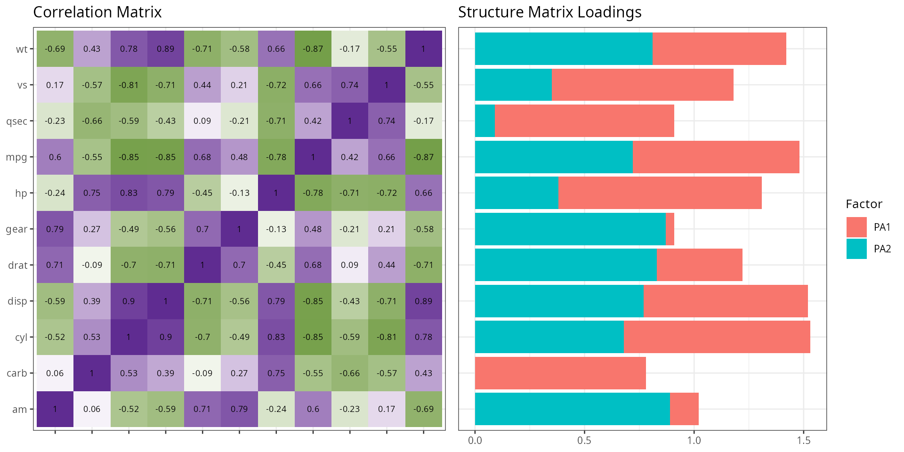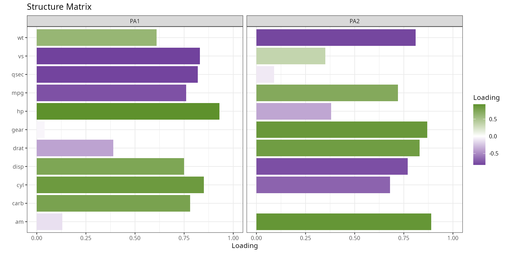

``` r

plot_loadings(model=model,matrix_type="pattern")
```

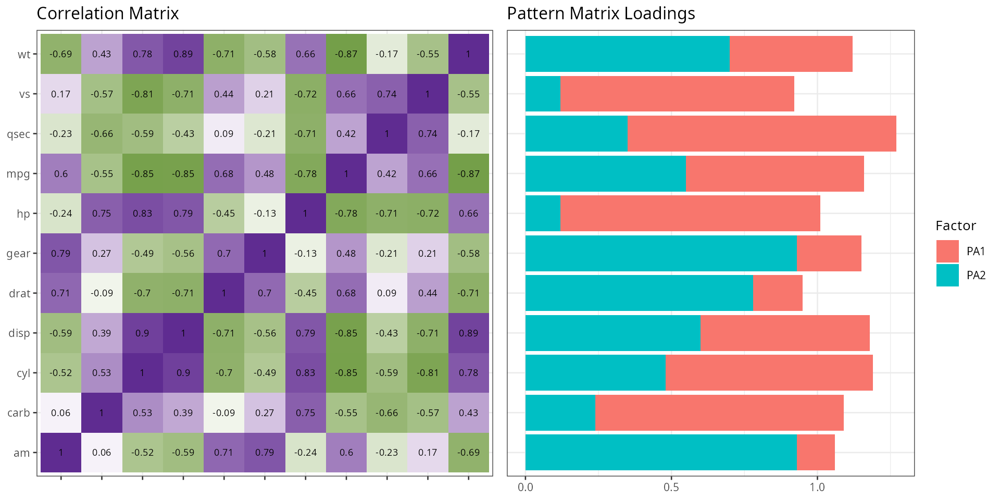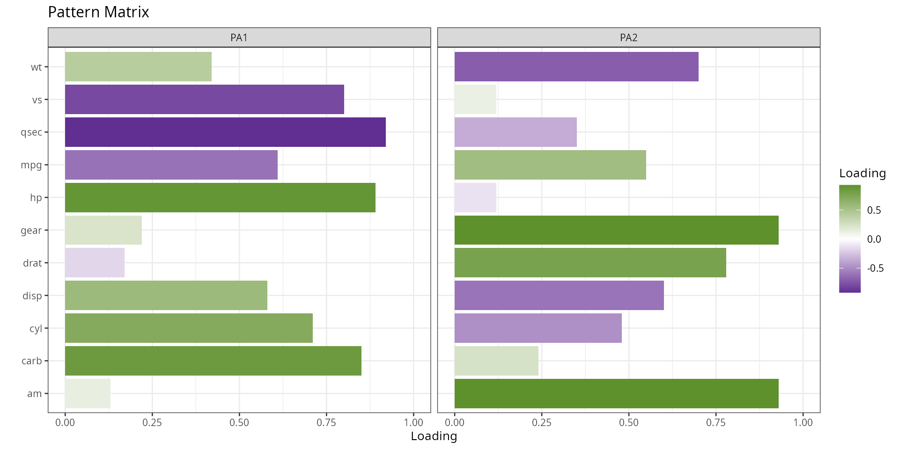

``` r

cm<-matrix(c(1,.8,.8,.1,.1,.1,
             .8,1,.8,.1,.1,.1,
             .8,.8,1,.1,.1,.1,
             .1,.1,.1,1,.8,.8,
             .1,.1,.1,.8,1,.8,
             .1,.1,.1,.8,.8,1),
           ncol=6,nrow=6)
df1<-generate_correlation_matrix(cm,nrows=10000)
model1<-psych::fa(df1,nfactors=2,rotate="oblimin",fm="pa",oblique.scores=TRUE)
plot_loadings(model=model1,matrix_type="pattern",base_size=10)
```

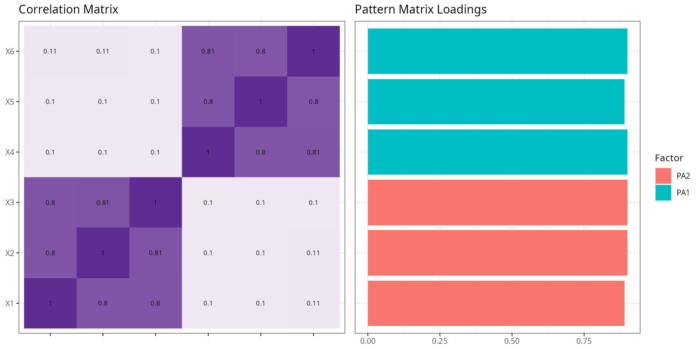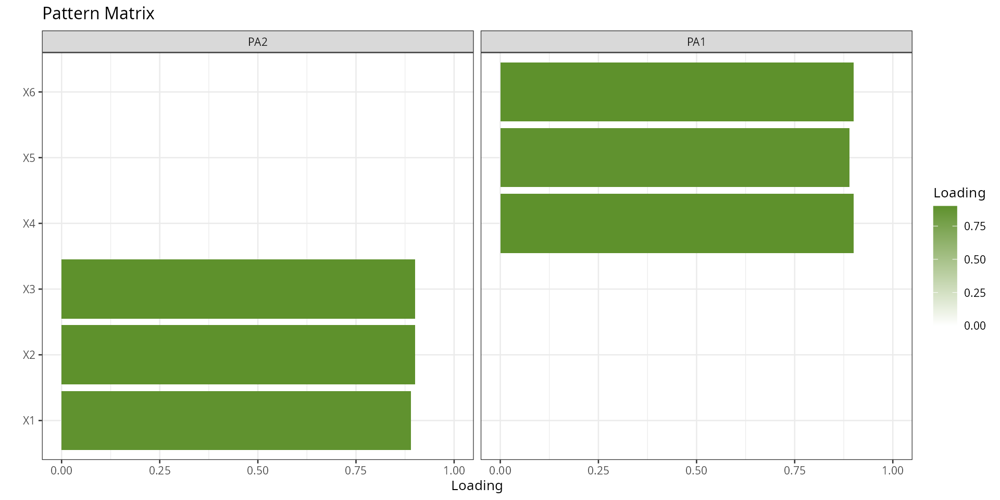

``` r

cm<-matrix(c(1,.1,.1,.1,.1,.1,
             .1,1,.1,.1,.1,.1,
             .1,.1,1,.1,.1,.1,
             .1,.1,.1,1,.8,.8,
             .1,.1,.1,.8,1,.8,
             .1,.1,.1,.8,.8,1),
           ncol=6,nrow=6)
df1<-generate_correlation_matrix(cm,nrows=10000)
model2<-psych::fa(df1,nfactors=2,rotate="oblimin",fm="pa",oblique.scores=TRUE)
plot_loadings(model=model2,matrix_type="pattern",base_size=10)
```

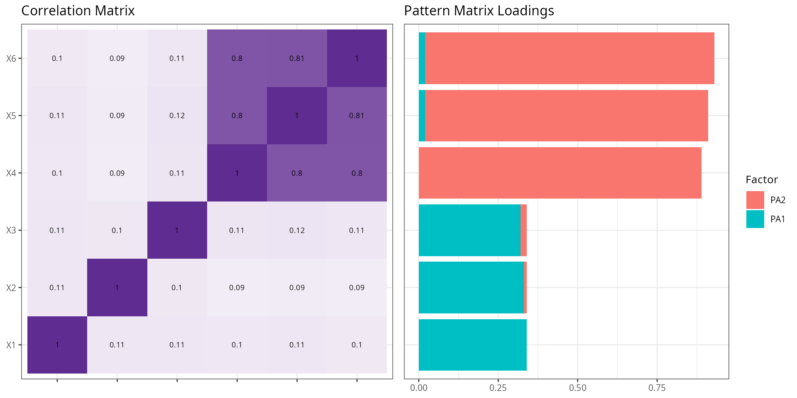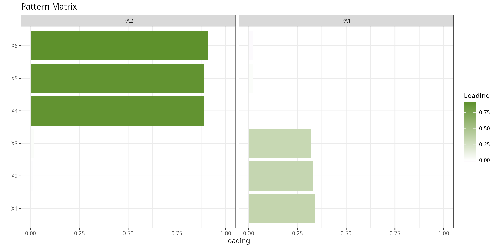

``` r

cm<-matrix(c(1,.01,.01,.01,.01,.01,
             .01,1,.01,.01,.01,.01,
             .01,.01,1,.01,.01,.01,
             .01,.01,.01,1,.01,.01,
             .01,.01,.01,.01,1,.01,
             .01,.01,.01,.01,.01,1),
           ncol=6,nrow=6)
df1<-generate_correlation_matrix(cm,nrows=10000)
model3<-psych::fa(df1,nfactors=2,rotate="oblimin",fm="pa",oblique.scores=TRUE)
plot_loadings(model=model3,matrix_type="pattern",base_size=10)
```

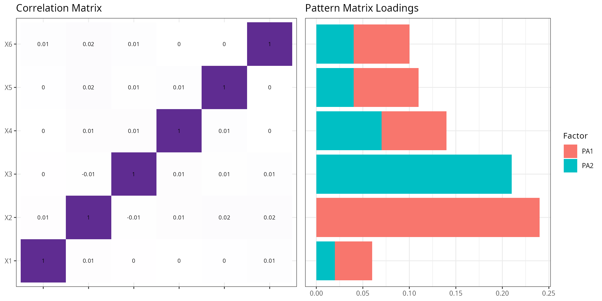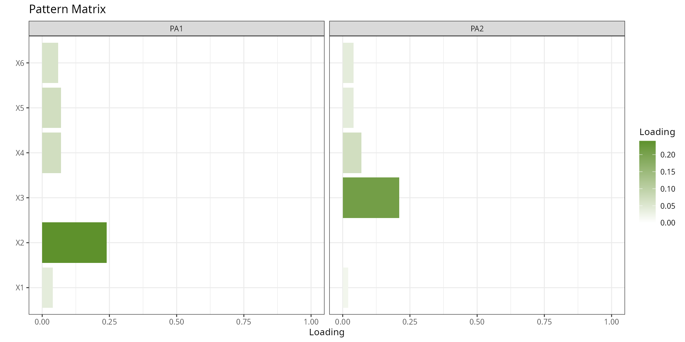

## Plot Scree

A scree plot shows eigenvalues (the amount of variance each factor
explains) in descending order. It is used to decide how many factors to
retain. The conventional rule is to keep factors whose eigenvalue
exceeds 1 (Kaiser criterion) or to look for the “elbow” — the point
where the curve flattens out.

`plot_scree` plots eigenvalues alongside parallel analysis results,
which compares observed eigenvalues against those from random data of
the same size. Factors with eigenvalues above the parallel analysis line
are unlikely to be noise and should be retained.

``` r

plot_scree(df=mtcars,title="",base_size=15)
```

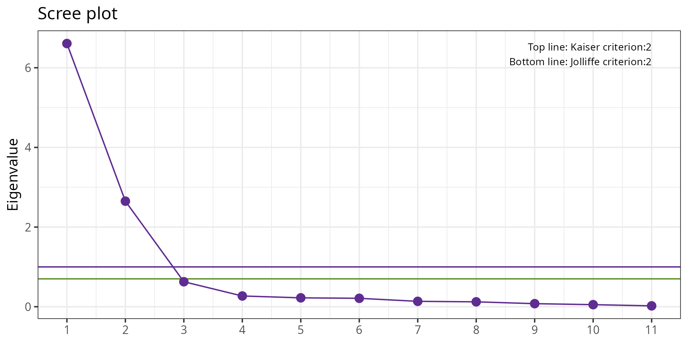

## Model Loadings

`model_loadings` returns the factor loading matrix as a formatted table.
The `cut` argument suppresses loadings below a threshold so only
meaningful loadings are shown — this makes factor interpretation
cleaner. The `sort` argument reorders variables so that items loading on
the same factor appear together.

Three calls demonstrate the options:

- `cut = NULL`: all loadings shown, pattern matrix.
- `cut = 0.4`: only loadings ≥ 0.4 shown, structure matrix — a common
  threshold for “meaningful” loadings in applied research.
- `cut = 0.4, matrix_type = "all"`: both pattern and structure matrices
  side by side, unsorted.

``` r

model<-psych::fa(mtcars,nfactors=2,rotate="oblimin",fm="pa",oblique.scores=TRUE)
model_loadings(model=model,cut=NULL,matrix_type="pattern")
```

    ##       Matrix variable   PA2  PA1
    ## qsec Pattern     qsec -0.92     
    ## hp   Pattern       hp  0.89     
    ## carb Pattern     carb  0.85     
    ## vs   Pattern       vs  -0.8     
    ## cyl  Pattern      cyl           
    ## mpg  Pattern      mpg           
    ## am   Pattern       am       0.93
    ## gear Pattern     gear       0.93
    ## drat Pattern     drat       0.78
    ## wt   Pattern       wt           
    ## disp Pattern     disp

``` r

model_loadings(model=model,cut=0.4,matrix_type="structure")
```

    ##         Matrix variable   PA2   PA1
    ## hp   Structure       hp  0.93      
    ## cyl  Structure      cyl  0.85 -0.68
    ## vs   Structure       vs -0.83      
    ## qsec Structure     qsec -0.82      
    ## carb Structure     carb  0.78      
    ## mpg  Structure      mpg -0.76  0.72
    ## am   Structure       am        0.89
    ## gear Structure     gear        0.87
    ## drat Structure     drat        0.83
    ## wt   Structure       wt  0.61 -0.81
    ## disp Structure     disp  0.75 -0.77

``` r

model_loadings(model=model,cut=0.4,matrix_type="all",sort=FALSE)
```

    ##       Matrix variable   PA2   PA1
    ## 1    Pattern      mpg -0.61  0.55
    ## 2    Pattern      cyl  0.71 -0.48
    ## 3    Pattern     disp  0.58  -0.6
    ## 4    Pattern       hp  0.89      
    ## 5    Pattern     drat        0.78
    ## 6    Pattern       wt  0.42  -0.7
    ## 7    Pattern     qsec -0.92      
    ## 8    Pattern       vs  -0.8      
    ## 9    Pattern       am        0.93
    ## 10   Pattern     gear        0.93
    ## 11   Pattern     carb  0.85      
    ## 12 Structure      mpg -0.76  0.72
    ## 13 Structure      cyl  0.85 -0.68
    ## 14 Structure     disp  0.75 -0.77
    ## 15 Structure       hp  0.93      
    ## 16 Structure     drat        0.83
    ## 17 Structure       wt  0.61 -0.81
    ## 18 Structure     qsec -0.82      
    ## 19 Structure       vs -0.83      
    ## 20 Structure       am        0.89
    ## 21 Structure     gear        0.87
    ## 22 Structure     carb  0.78

## Compute Residual

Residuals in EFA are the differences between the observed correlation
matrix and the correlation matrix reproduced by the factor model. A
good-fitting model produces small residuals.

`compute_residual_stats` returns summary statistics of these residuals
(mean, RMSR — root mean square of residuals, and the proportion of
residuals above a given threshold). A low RMSR (typically \< 0.05) and
few large residuals indicate that the factor model adequately reproduces
the observed correlations.

``` r

model<-psych::fa(mtcars,nfactors=2,rotate="oblimin",fm="pa",oblique.scores=TRUE)
compute_residual_stats(model)
```

    ##                       residual_statistics       value critical                              formula
    ## 1              Root Mean Squared Residual  0.04419293       NA              sqrt(mean(residuals^2))
    ## 2     Number of absolute residuals > 0.05 13.00000000       NA                  abs(residuals)>0.05
    ## 3 Proportion of absolute residuals > 0.05  0.23636364      0.5 numberLargeResiduals/nrow(residuals)

## Report EFA

`report_efa` bundles all the above steps into a single call — it fits
the EFA model, extracts loadings, computes residual statistics, and
produces plots. It returns a structured list suitable for inclusion in a
report.

The example uses a simulated dataset with a known two-factor structure
(the same 6×6 correlation matrix used in the Plot Loadings section), so
the output should cleanly recover the two factors. The computation chunk
uses `results='hide'` to suppress intermediate output; the formatted
result is printed in the next chunk.

``` r

cm<-matrix(c(1,.8,.8,.1,.1,.1,
             .8,1,.8,.1,.1,.1,
             .8,.8,1,.1,.1,.1,
             .1,.1,.1,1,.8,.8,
             .1,.1,.1,.8,1,.8,
             .1,.1,.1,.8,.8,1),
           ncol=6,nrow=6)
df1<-generate_correlation_matrix(cm,nrows=10000)
model<-psych::fa(df1,nfactors=2,rotate="oblimin",fm="pa",oblique.scores=TRUE)
result<-report_efa(model=model,df=df1)
```

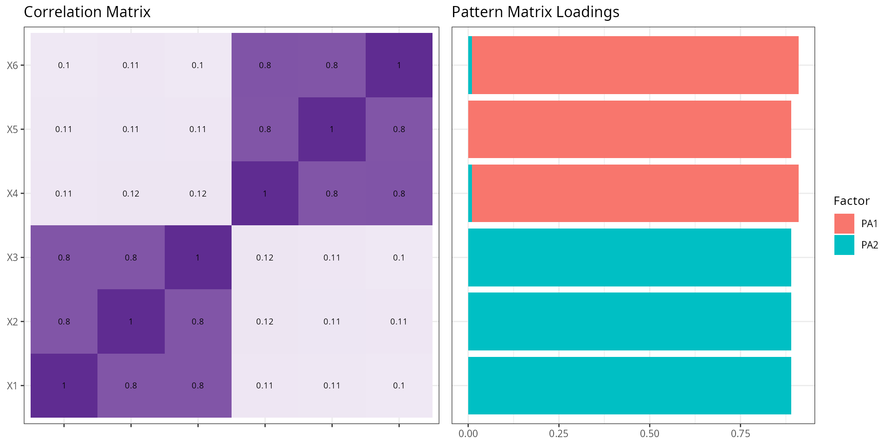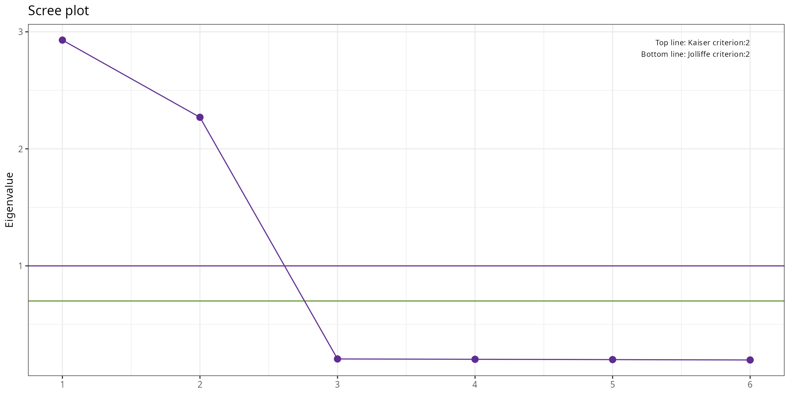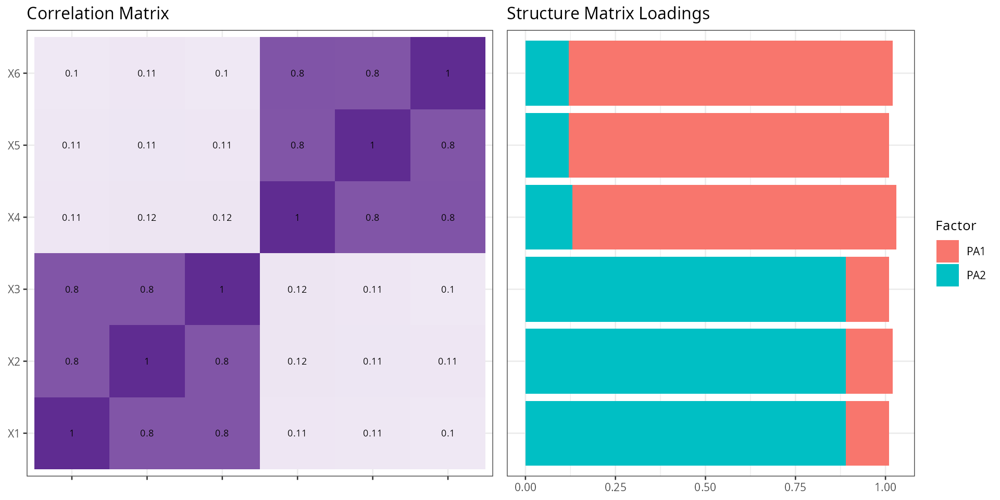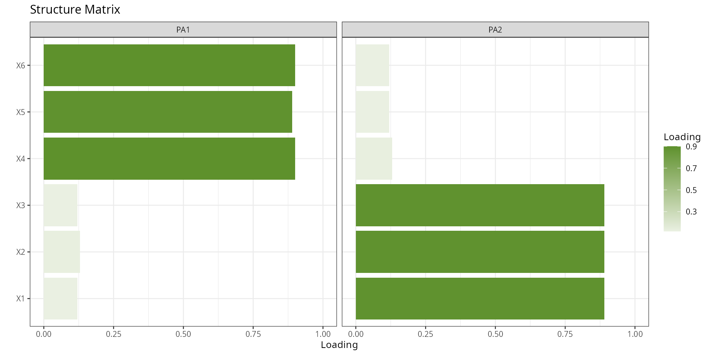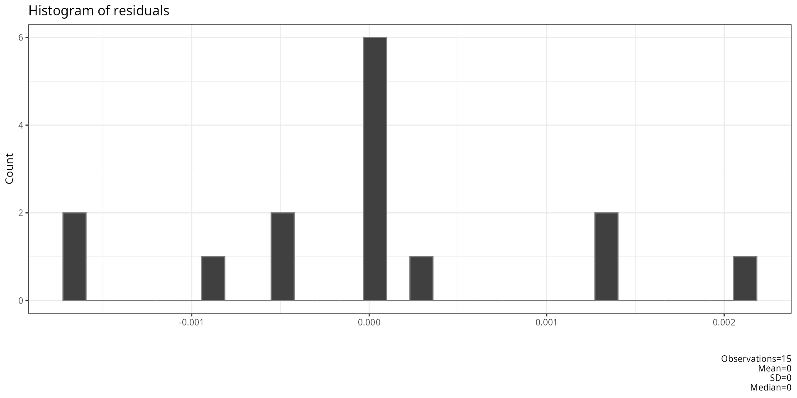

``` r

result
```

    ## $correlations
    ##                        type            X1            X2            X3            X4            X5            X6
    ## X1  reproduced correlations  7.980176e-01  7.975985e-01  7.991958e-01  1.118429e-01  1.076295e-01  1.016668e-01
    ## X2  reproduced correlations  7.975985e-01  7.972255e-01  7.987964e-01  1.177913e-01  1.135650e-01  1.076289e-01
    ## X3  reproduced correlations  7.991958e-01  7.987964e-01  8.003848e-01  1.146651e-01  1.104388e-01  1.044776e-01
    ## X4  reproduced correlations  1.118429e-01  1.177913e-01  1.146651e-01  8.026912e-01  8.001231e-01  8.023623e-01
    ## X5  reproduced correlations  1.076295e-01  1.135650e-01  1.104388e-01  8.001231e-01  7.975823e-01  7.998452e-01
    ## X6  reproduced correlations  1.016668e-01  1.076289e-01  1.044776e-01  8.023623e-01  7.998452e-01  8.021647e-01
    ## X11   observed correlations  1.000000e+00  7.976339e-01  7.992422e-01  1.109671e-01  1.089633e-01  1.012123e-01
    ## X21   observed correlations  7.976339e-01  1.000000e+00  7.988371e-01  1.173023e-01  1.119286e-01  1.097475e-01
    ## X31   observed correlations  7.992422e-01  7.988371e-01  1.000000e+00  1.160289e-01  1.107386e-01  1.028172e-01
    ## X41   observed correlations  1.109671e-01  1.173023e-01  1.160289e-01  1.000000e+00  8.001456e-01  8.024353e-01
    ## X51   observed correlations  1.089633e-01  1.119286e-01  1.107386e-01  8.001456e-01  1.000000e+00  7.998712e-01
    ## X61   observed correlations  1.012123e-01  1.097475e-01  1.028172e-01  8.024353e-01  7.998712e-01  1.000000e+00
    ## X12   residual correlations  2.019824e-01  3.537643e-05  4.634404e-05 -8.758042e-04  1.333786e-03 -4.544231e-04
    ## X22   residual correlations  3.537643e-05  2.027745e-01  4.072121e-05 -4.890160e-04 -1.636389e-03  2.118636e-03
    ## X32   residual correlations  4.634404e-05  4.072121e-05  1.996152e-01  1.363727e-03  2.998459e-04 -1.660455e-03
    ## X42   residual correlations -8.758042e-04 -4.890160e-04  1.363727e-03  1.973088e-01  2.244427e-05  7.296284e-05
    ## X52   residual correlations  1.333786e-03 -1.636389e-03  2.998459e-04  2.244427e-05  2.024177e-01  2.595446e-05
    ## X62   residual correlations -4.544231e-04  2.118636e-03 -1.660455e-03  7.296284e-05  2.595446e-05  1.978353e-01
    ## 
    ## $npobs
    ##       X1    X2    X3    X4    X5    X6
    ## X1 10000 10000 10000 10000 10000 10000
    ## X2 10000 10000 10000 10000 10000 10000
    ## X3 10000 10000 10000 10000 10000 10000
    ## X4 10000 10000 10000 10000 10000 10000
    ## X5 10000 10000 10000 10000 10000 10000
    ## X6 10000 10000 10000 10000 10000 10000
    ## 
    ## $residual_stats
    ##                       residual_statistics        value critical                              formula
    ## 1              Root Mean Squared Residual 0.0009958705       NA              sqrt(mean(residuals^2))
    ## 2     Number of absolute residuals > 0.05 0.0000000000       NA                  abs(residuals)>0.05
    ## 3 Proportion of absolute residuals > 0.05 0.0000000000      0.5 numberLargeResiduals/nrow(residuals)
    ## 
    ## $determinant_test
    ##   determinant above_critical
    ## 1  0.01069189           TRUE
    ## 
    ## $bartlett_test
    ##   x_squared[bartlett] df[bartlett] p[bartlett]
    ## 1             45365.3           15           0
    ## 
    ## $kmo_test
    ##    Overall_MSA       MSA Kaiser_1974
    ## X1   0.7696336 0.7695213          NA
    ## X2   0.7696336 0.7706771          NA
    ## X3   0.7696336 0.7681331          NA
    ## X4   0.7696336 0.7691521          NA
    ## X5   0.7696336 0.7722382          NA
    ## X6   0.7696336 0.7680972          NA
    ## 
    ## $loadings
    ##       Matrix variable       PA1        PA2               type row.names.model.Vaccounted.
    ## 1    Pattern       X4 0.9000000  0.0100000               <NA>                        <NA>
    ## 2    Pattern       X6 0.9000000 -0.0100000               <NA>                        <NA>
    ## 3    Pattern       X5 0.8900000  0.0000000               <NA>                        <NA>
    ## 4    Pattern       X1 0.0000000  0.8900000               <NA>                        <NA>
    ## 5    Pattern       X2 0.0000000  0.8900000               <NA>                        <NA>
    ## 6    Pattern       X3 0.0000000  0.8900000               <NA>                        <NA>
    ## 7  Structure       X4 0.9000000  0.1300000               <NA>                        <NA>
    ## 8  Structure       X6 0.9000000  0.1200000               <NA>                        <NA>
    ## 9  Structure       X5 0.8900000  0.1200000               <NA>                        <NA>
    ## 10 Structure       X1 0.1200000  0.8900000               <NA>                        <NA>
    ## 11 Structure       X2 0.1300000  0.8900000               <NA>                        <NA>
    ## 12 Structure       X3 0.1200000  0.8900000               <NA>                        <NA>
    ## 13      <NA>     <NA> 2.4023922  2.3956739 variance accounted                 SS loadings
    ## 14      <NA>     <NA> 0.4003987  0.3992790 variance accounted              Proportion Var
    ## 15      <NA>     <NA> 0.4003987  0.7996777 variance accounted              Cumulative Var
    ## 16      <NA>     <NA> 0.5007001  0.4992999 variance accounted        Proportion Explained
    ## 17      <NA>     <NA> 0.5007001  1.0000000 variance accounted       Cumulative Proportion
    ## 
    ## $instruction_loading_critical_values
    ##    sample critical_loading
    ## 1      50             0.75
    ## 2      60             0.70
    ## 3      70             0.65
    ## 4      85             0.60
    ## 5     100             0.55
    ## 6     120             0.50
    ## 7     150             0.45
    ## 8     200             0.40
    ## 9     250             0.35
    ## 10    350             0.30
    ## 
    ## $weights
    ##            PA1         PA2
    ## X1 -0.04549781  0.34898326
    ## X2 -0.04274961  0.34680476
    ## X3 -0.04495219  0.35329559
    ## X4  0.35269511 -0.04266452
    ## X5  0.34325201 -0.04319775
    ## X6  0.35281669 -0.04714012
