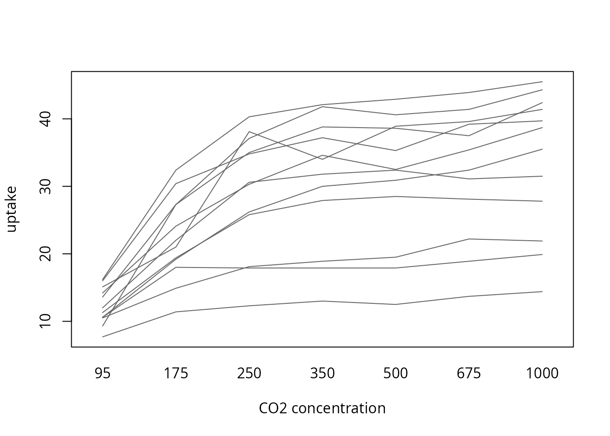

# Friedman test

## Description

This shows the output of `compute_friedman_test` from the package rwf,
which runs the Friedman rank-sum test (Friedman, 1937), the
non-parametric alternative to the one-way repeated measures ANOVA. The
function returns the test statistic Q with its degrees of freedom and p
value, Kendall’s coefficient of concordance W (Kendall & Babington
Smith, 1939) as the effect size and, optionally, a bootstrap confidence
interval for W. Each section gives the formulas the function uses,
computes them by hand and checks the results against `stats`, `coin`,
`rstatix` and `effectsize`.

Q is computed with the same tie-corrected formula as
[`stats::friedman.test`](https://rdrr.io/r/stats/friedman.test.html) (R
Core Team, 2026).

Installation instructions for rwf can be found
[here](https://github.com/sedzinfo/rwf)

The code can be found
[here](https://github.com/sedzinfo/rwf/blob/main/rwf/R/GLM_ANOVA.R)

## Notation

There are n blocks (usually subjects) and k groups (usually conditions
or time points). Each block has exactly one observation in each group:
y\_{ij} is the observation of block i in group j. The observations are
ranked **within each block** from 1 to k, and tied values get the mean
of the ranks they span (mid-ranks). r\_{ij} is the rank of y\_{ij}
within block i, R_j=\sum\_{i=1}^{n}r\_{ij} is the rank sum of group j,
and n(k+1)/2 is the rank sum every group would have if the groups did
not differ. t are the sizes of the groups of tied values within blocks.

## The Friedman test

The Friedman test asks whether the blocks rank the groups in a
consistent order. Each subject is compared only with itself, so
differences between subjects (one plant absorbs more CO₂ than another
overall) do not matter, only the order of the conditions within each
subject. Its null hypothesis is that, within every block, all orderings
of the groups are equally likely.

### The Q statistic

Without ties the statistic is

Q_0=\frac{12}{nk(k+1)}\sum\_{j=1}^{k}R_j^2-3n(k+1)

The general form, which also corrects for ties within blocks, is

Q=\frac{12\sum\_{j=1}^{k}\left(R_j-\frac{n(k+1)}{2}\right)^2}{nk(k+1)-\frac{\sum\left(t^3-t\right)}{k-1}}

Values that occur once in a block have t=1 and add nothing to the sum,
so Q=Q_0 when there are no ties.

### Degrees of freedom and p value

Under the null hypothesis Q approximately follows a chi-squared
distribution with k-1 degrees of freedom:

df=k-1,\qquad p=P\left(\chi^2\_{k-1}\ge Q\right)

## When to use it and assumptions

### When to use it

Use the Friedman test to compare three or more related measurements,
where the same subjects are measured under every condition or the
observations come in matched sets (blocks), and the repeated measures
ANOVA is not a good fit:

- **The outcome is ordinal**, such as Likert ratings of several products
  by the same people, or rankings by judges.
- **The outcome is continuous but the residuals are clearly not normal**
  and there are few subjects.
- **There are outliers** that would dominate the condition means. Ranks
  within blocks limit the influence of any single value.
- **Sphericity is badly violated** and you would rather not rely on
  corrections.

Do not use it when:

- **The residuals are normal.** The repeated measures ANOVA is then more
  powerful, and the gap is larger than for the Kruskal-Wallis test,
  because the Friedman test throws away the differences between blocks
  and the sizes of the differences within them. Its asymptotic relative
  efficiency under normality is \frac{3}{\pi}\cdot\frac{k}{k+1}, which
  is 0.72 for k=3 and 0.84 for k=7 (Hollander, Wolfe & Chicken, 2014).
- **The groups are independent.** Use the Kruskal-Wallis test,
  `compute_kruskal_wallis_test`.
- **There are only two conditions.** The Friedman test with k=2 is the
  sign test, which uses only the direction of each difference. The
  Wilcoxon signed-rank test also uses the sizes of the differences and
  is usually more powerful.
- **The design has more than one within-subject factor, or
  between-subject factors.** The test handles a single factor in a
  complete block design.

With k=2 the statistic reduces to Q=(n\_+-n\_-)^2/(n\_++n\_-), where
n\_+ and n\_- count the blocks with a positive and a negative
difference, and tied blocks drop out. This is the squared z of the sign
test:

``` r

bp_long <- data.frame(patient = rep(df_blood_pressure$patient, 2),
                      time = rep(c("before", "after"), each = nrow(df_blood_pressure)),
                      bp = c(df_blood_pressure$bp_before, df_blood_pressure$bp_after))
difference <- df_blood_pressure$bp_before - df_blood_pressure$bp_after
data.frame(Q_rwf = compute_friedman_test(formula = bp ~ time | patient, df = bp_long)$Q,
           Q_sign_test = (sum(difference > 0) - sum(difference < 0))^2 / sum(difference != 0))
```

    ##      Q_rwf Q_sign_test
    ## 1 7.758621    7.758621

### Assumptions

1.  **Independent blocks.** The subjects (blocks) are independent of
    each other. Observations within a block may be related, which is the
    point of the design.
2.  **One observation per block and group.** The design is an
    unreplicated complete block design. Blocks with a missing value are
    dropped (see [Missing values](#missing-values)).
3.  **An outcome that is at least ordinal within blocks.** The values
    within a block must be orderable. Values do not have to be
    comparable across blocks.
4.  **No block by group interaction.** The test detects a consistent
    shift across conditions. If some subjects go up and others go down,
    the rank sums cancel out and the test has little power.
5.  **Enough blocks for the chi-squared approximation.** With few blocks
    use an exact or permutation p value, such as
    `coin::friedman_test(distribution = coin::approximate(nresample = 10000))`.

Normality and sphericity are **not** assumed.

### After a significant result

A significant Q means that at least one condition differs from the
others, not which ones. Follow it with pairwise comparisons, such as
Wilcoxon signed-rank tests between every pair of conditions with an
adjustment for multiple comparisons.
[`stats::pairwise.wilcox.test`](https://rdrr.io/r/stats/pairwise.wilcox.test.html)
with `paired = TRUE` pairs observations by position, so the data must be
sorted by block within each group, as `df_co2` is:

``` r

stats::pairwise.wilcox.test(df_co2$uptake, df_co2$conc, paired = TRUE, p.adjust.method = "holm")
```

    ## 
    ##  Pairwise comparisons using Wilcoxon signed rank exact test 
    ## 
    ## data:  df_co2$uptake and df_co2$conc 
    ## 
    ##      95    175   250   350   500   675  
    ## 175  0.010 -     -     -     -     -    
    ## 250  0.010 0.011 -     -     -     -    
    ## 350  0.010 0.011 0.094 -     -     -    
    ## 500  0.010 0.011 0.011 0.805 -     -    
    ## 675  0.010 0.010 0.010 0.108 0.121 -    
    ## 1000 0.010 0.010 0.010 0.017 0.017 0.017
    ## 
    ## P value adjustment method: holm

## Why effect sizes

A p value answers one question: if the conditions did not differ, how
surprising would data like these be? It does not say how large the
difference is. Because Q grows with the number of blocks, a trivial
difference becomes “significant” with many subjects, and a large
difference can be “non-significant” with few.

An effect size answers a different question: how much do the conditions
differ? Effect sizes are useful because they:

- **measure magnitude.** They separate practical importance from
  statistical significance.
- **do not grow with n.** The same population effect gives roughly the
  same effect size with 10 subjects or 1,000.
- **can be compared across studies.** This is what meta-analysis
  combines.
- **drive power analysis.** The sample size a new study needs depends on
  the effect size it expects.
- **are expected in reports.** The APA Task Force on Statistical
  Inference recommends reporting effect sizes for primary outcomes
  (Wilkinson & Task Force on Statistical Inference, 1999; see also
  Lakens, 2013).

The [simulation below](#p-values-shrink-effect-sizes-do-not) shows this
with data.

## Kendall’s W

### Formula

Kendall’s coefficient of concordance measures how strongly the blocks
agree on the order of the groups:

W=\frac{12\sum\_{j=1}^{k}\left(R_j-\frac{n(k+1)}{2}\right)^2}{n^2\left(k^3-k\right)-n\sum\left(t^3-t\right)}=\frac{Q}{n(k-1)}

W lies in \[0,1\]. W=0 means the rank sums are all equal, so the blocks
show no common order. W=1 means every block ranks the groups in exactly
the same order.

### W and the Spearman correlation

Without ties, W is a rescaled mean of the Spearman correlations r_s
between all pairs of blocks:

\bar{r}\_s=\frac{nW-1}{n-1}

`df_co2` has one plant with tied values, so the two are close but not
identical here:

``` r

uptake <- tapply(df_co2$uptake, list(df_co2$Plant, df_co2$conc), identity)
spearman <- cor(t(uptake), method = "spearman")
W <- compute_friedman_test(formula = uptake ~ conc | Plant, df = df_co2)$kendall_w
n <- nrow(uptake)
data.frame(mean_spearman = mean(spearman[upper.tri(spearman)]),
           from_W = (n * W - 1) / (n - 1))
```

    ##   mean_spearman    from_W
    ## 1     0.8122001 0.8132825

The relation also shows the bias of W. Under the null hypothesis
E\[Q\]=k-1, so E\[W\]=1/n rather than 0, while \bar{r}\_s is centred at
0 ([simulation below](#bias-of-kendalls-w)).

### Interpretation

Commonly used benchmarks for W are the Cohen (1988) benchmarks for
correlations, which
[`rstatix::friedman_effsize`](https://rpkgs.datanovia.com/rstatix/reference/friedman_effsize.html)
also uses:

| Magnitude | W             |
|-----------|---------------|
| tiny      | \< 0.1        |
| small     | 0.1 to \< 0.3 |
| medium    | 0.3 to \< 0.5 |
| large     | ≥ 0.5         |

[`effectsize::interpret_kendalls_w`](https://easystats.github.io/effectsize/reference/interpret_kendalls_w.html)
uses agreement labels instead (Landis & Koch, 1977): slight below 0.2,
fair from 0.2, moderate from 0.4, substantial from 0.6 and almost
perfect from 0.8. These are rough guides. What counts as a meaningful
effect depends on the field and the outcome.

## Data

`df_co2` records the CO₂ uptake of 12 grass plants, each measured at 7
ambient CO₂ concentrations. The plants are the blocks and the
concentrations are the groups. The formula `uptake ~ conc | Plant` asks
whether uptake changes with concentration, comparing each plant only
with itself.

``` r

head(df_co2)
```

    ##   Plant   Type  Treatment conc uptake
    ## 1   Qn1 Quebec nonchilled   95   16.0
    ## 2   Qn1 Quebec nonchilled  175   30.4
    ## 3   Qn1 Quebec nonchilled  250   34.8
    ## 4   Qn1 Quebec nonchilled  350   37.2
    ## 5   Qn1 Quebec nonchilled  500   35.3
    ## 6   Qn1 Quebec nonchilled  675   39.2

``` r

form <- formula(uptake ~ conc | Plant)
table(df_co2$Plant, df_co2$conc)
```

    ##      
    ##       95 175 250 350 500 675 1000
    ##   Mc1  1   1   1   1   1   1    1
    ##   Mc2  1   1   1   1   1   1    1
    ##   Mc3  1   1   1   1   1   1    1
    ##   Mn1  1   1   1   1   1   1    1
    ##   Mn2  1   1   1   1   1   1    1
    ##   Mn3  1   1   1   1   1   1    1
    ##   Qc1  1   1   1   1   1   1    1
    ##   Qc2  1   1   1   1   1   1    1
    ##   Qc3  1   1   1   1   1   1    1
    ##   Qn1  1   1   1   1   1   1    1
    ##   Qn2  1   1   1   1   1   1    1
    ##   Qn3  1   1   1   1   1   1    1

Each line is one plant. Uptake rises with concentration in almost every
plant, even though the plants differ a lot in their overall level:

``` r

interaction.plot(df_co2$conc, df_co2$Plant, df_co2$uptake, legend = FALSE,
                 xlab = "CO2 concentration", ylab = "uptake", col = "grey40", lty = 1)
```



## compute_friedman_test

``` r

result <- compute_friedman_test(formula = form, df = df_co2)
result
```

    ##                 formula                 method kendall_w        Q df  n            p
    ## 1 uptake ~ conc | Plant Friedman rank sum test 0.8288423 59.67665  6 12 5.235869e-11

The output columns are:

| Column      | Formula                          |
|-------------|----------------------------------|
| `formula`   | the model formula                |
| `method`    | the test name                    |
| `kendall_w` | W=Q/(n(k-1))                     |
| `Q`         | tie-corrected Friedman statistic |
| `df`        | k-1                              |
| `n`         | number of complete blocks used   |
| `p`         | P\left(\chi^2\_{k-1}\ge Q\right) |

## Step by step

Every quantity from the formulas above, computed by hand. First the
blocks by groups matrix and the ranks within each block:

``` r

y <- tapply(df_co2$uptake, list(df_co2$Plant, df_co2$conc), identity)
n <- nrow(y)
k <- ncol(y)
r <- t(apply(y, 1, rank))
r
```

    ##     95 175 250 350 500 675 1000
    ## Mc1  1   2   3   4   5   7    6
    ## Mc2  1   2   3   5   4   6    7
    ## Mc3  1   5   3   3   3   6    7
    ## Mn1  1   2   3   4   5   6    7
    ## Mn2  1   2   3   6   7   4    5
    ## Mn3  1   2   3   5   7   6    4
    ## Qc1  1   2   3   5   4   6    7
    ## Qc2  1   2   3   6   5   4    7
    ## Qc3  1   2   4   3   5   6    7
    ## Qn1  1   2   3   5   4   6    7
    ## Qn2  1   2   3   6   4   5    7
    ## Qn3  1   2   3   4   5   6    7

``` r

R_j <- colSums(r)
R_j
```

    ##   95  175  250  350  500  675 1000 
    ##   12   27   37   56   58   68   78

Q without ties, the tie correction and the corrected Q:

``` r

Q_0 <- 12 / (n * k * (k + 1)) * sum(R_j^2) - 3 * n * (k + 1)
ties <- sum(apply(y, 1, function(u) {
  t <- table(u)
  sum(t^3 - t)
}))
Q <- 12 * sum((R_j - n * (k + 1) / 2)^2) / (n * k * (k + 1) - ties / (k - 1))
data.frame(Q_0, ties, Q)
```

    ##        Q_0 ties        Q
    ## 1 59.32143   24 59.67665

Degrees of freedom, p value and Kendall’s W, from Q and from its own
formula:

``` r

by_hand <- data.frame(kendall_w = Q / (n * (k - 1)),
                      Q = Q,
                      df = k - 1,
                      n = n,
                      p = pchisq(Q, k - 1, lower.tail = FALSE))
by_hand
```

    ##   kendall_w        Q df  n            p
    ## 1 0.8288423 59.67665  6 12 5.235869e-11

``` r

12 * sum((R_j - n * (k + 1) / 2)^2) / (n^2 * (k^3 - k) - n * ties)
```

    ## [1] 0.8288423

``` r

all.equal(by_hand, result[, c("kendall_w", "Q", "df", "n", "p")], check.attributes = FALSE)
```

    ## [1] TRUE

## Checks against other packages

### stats, coin and rstatix

[`stats::friedman.test`](https://rdrr.io/r/stats/friedman.test.html)
(with a formula or with the blocks by groups matrix),
[`coin::friedman_test`](https://rdrr.io/pkg/coin/man/SymmetryTests.html)
and
[`rstatix::friedman_test`](https://rpkgs.datanovia.com/rstatix/reference/friedman_test.html)
give the same Q, degrees of freedom and p value. `coin` needs the groups
and blocks as factors:

``` r

stats::friedman.test(formula = form, data = df_co2)
```

    ## 
    ##  Friedman rank sum test
    ## 
    ## data:  uptake and conc and Plant
    ## Friedman chi-squared = 59.677, df = 6, p-value = 5.236e-11

``` r

stats::friedman.test(y)
```

    ## 
    ##  Friedman rank sum test
    ## 
    ## data:  y
    ## Friedman chi-squared = 59.677, df = 6, p-value = 5.236e-11

``` r

coin::friedman_test(uptake ~ factor(conc) | factor(Plant), data = df_co2)
```

    ## 
    ##  Asymptotic Friedman Test
    ## 
    ## data:  uptake by factor(conc) (95, 175, 250, 350, 500, 675, 1000) 
    ##   stratified by factor(Plant)
    ## chi-squared = 59.677, df = 6, p-value = 5.236e-11

``` r

rstatix::friedman_test(df_co2, form)
```

    ## # A tibble: 1 × 6
    ##   .y.        n statistic    df        p method       
    ## * <chr>  <int>     <dbl> <dbl>    <dbl> <chr>        
    ## 1 uptake    12      59.7     6 5.24e-11 Friedman test

### rstatix and effectsize

[`rstatix::friedman_effsize`](https://rpkgs.datanovia.com/rstatix/reference/friedman_effsize.html)
and
[`effectsize::kendalls_w`](https://easystats.github.io/effectsize/reference/rank_epsilon_squared.html)
compute W. Their confidence intervals are bootstrapped, so they change
slightly from run to run. The [confidence
intervals](#confidence-intervals) section compares them with the
interval from rwf.

``` r

rstatix::friedman_effsize(df_co2, form, ci = TRUE, conf.level = 0.95, ci.type = "perc", nboot = 100)
```

    ## # A tibble: 1 × 7
    ##   .y.        n effsize conf.low conf.high method    magnitude
    ## * <chr>  <int>   <dbl>    <dbl>     <dbl> <chr>     <ord>    
    ## 1 uptake    12   0.829     0.72      0.94 Kendall W large

``` r

effectsize::kendalls_w(form, data = df_co2)
```

    ## Kendall's W |       95% CI
    ## --------------------------
    ## 0.83        | [0.78, 1.00]
    ## 
    ## - One-sided CIs: upper bound fixed at [1.00].

### A test function

`check_friedman` puts each rwf value next to the value from the other
packages and returns the difference. The other packages need complete
blocks, so incomplete blocks are dropped first, as rwf does. The rows
are also sorted by block and group, because
[`effectsize::kendalls_w`](https://easystats.github.io/effectsize/reference/rank_epsilon_squared.html)
depends on the row order (see [effectsize and row
order](#effectsize-and-row-order)).

``` r

check_friedman <- function(formula, df) {
  vars <- all.vars(formula)
  df <- data.frame(y = df[[vars[1]]], g = factor(df[[vars[2]]]), b = factor(df[[vars[3]]]))
  incomplete <- unique(df$b[is.na(df$y)])
  df <- droplevels(df[!df$b %in% incomplete, ])
  df <- df[order(df$b, df$g), ]
  rwf <- compute_friedman_test(formula = y ~ g | b, df = df)
  fr <- stats::friedman.test(y ~ g | b, data = df)
  comparison <- data.frame(
    statistic = c("Q", "Q", "Q", "df", "p", "kendall_w", "kendall_w"),
    package = c("stats::friedman.test", "coin::friedman_test", "rstatix::friedman_test", "stats::friedman.test",
                "stats::friedman.test", "rstatix::friedman_effsize", "effectsize::kendalls_w"),
    rwf = c(rwf$Q, rwf$Q, rwf$Q, rwf$df, rwf$p, rwf$kendall_w, rwf$kendall_w),
    other = c(unname(fr$statistic),
              unname(coin::statistic(coin::friedman_test(y ~ g | b, data = df))),
              rstatix::friedman_test(df, y ~ g | b)$statistic,
              unname(fr$parameter),
              fr$p.value,
              rstatix::friedman_effsize(df, y ~ g | b)$effsize,
              suppressWarnings(effectsize::kendalls_w(y ~ g | b, data = df, ci = NULL)$Kendalls_W)))
  comparison$difference <- comparison$rwf - comparison$other
  comparison
}
check_friedman(formula = form, df = df_co2)
```

    ##   statistic                   package          rwf        other    difference
    ## 1         Q      stats::friedman.test 5.967665e+01 5.967665e+01  0.000000e+00
    ## 2         Q       coin::friedman_test 5.967665e+01 5.967665e+01 -7.105427e-15
    ## 3         Q    rstatix::friedman_test 5.967665e+01 5.967665e+01  0.000000e+00
    ## 4        df      stats::friedman.test 6.000000e+00 6.000000e+00  0.000000e+00
    ## 5         p      stats::friedman.test 5.235869e-11 5.235869e-11  0.000000e+00
    ## 6 kendall_w rstatix::friedman_effsize 8.288423e-01 8.288423e-01  0.000000e+00
    ## 7 kendall_w    effectsize::kendalls_w 8.288423e-01 8.288423e-01  1.110223e-16

The same check on seven datasets with different numbers of blocks and
groups and with and without ties. `RoundingTimes` is the example from
[`?friedman.test`](https://rdrr.io/r/stats/friedman.test.html): 22
baseball players, each timed rounding first base with three methods.
`max_abs_difference` is the largest absolute difference across all the
comparisons for that dataset:

``` r

RoundingTimes <- matrix(c(5.40, 5.50, 5.55, 5.85, 5.70, 5.75, 5.20, 5.60, 5.50, 5.55, 5.50, 5.40,
                          5.90, 5.85, 5.70, 5.45, 5.55, 5.60, 5.40, 5.40, 5.35, 5.45, 5.50, 5.35,
                          5.25, 5.15, 5.00, 5.85, 5.80, 5.70, 5.25, 5.20, 5.10, 5.65, 5.55, 5.45,
                          5.60, 5.35, 5.45, 5.05, 5.00, 4.95, 5.50, 5.50, 5.40, 5.45, 5.55, 5.50,
                          5.55, 5.55, 5.35, 5.45, 5.50, 5.55, 5.50, 5.45, 5.25, 5.65, 5.60, 5.40,
                          5.70, 5.65, 5.55, 6.30, 6.30, 6.25),
                        nrow = 22, byrow = TRUE)
df_rounding <- data.frame(time = c(RoundingTimes),
                          method = rep(c("Round Out", "Narrow Angle", "Wide Angle"), each = 22),
                          player = rep(1:22, times = 3))
datasets <- list(
  list(formula = uptake ~ conc | Plant, df = df_co2),
  list(formula = time ~ method | player, df = df_rounding),
  list(formula = bp ~ time | patient, df = bp_long),
  list(formula = decrease ~ treatment | rowpos, df = OrchardSprays),
  list(formula = circumference ~ age | Tree, df = as.data.frame(Orange)),
  list(formula = conc ~ time | Subject, df = as.data.frame(Indometh)),
  list(formula = height ~ age | Seed, df = as.data.frame(Loblolly))
)
do.call(rbind, lapply(datasets, function(d) {
  rwf <- compute_friedman_test(formula = d$formula, df = d$df)
  check <- check_friedman(formula = d$formula, df = d$df)
  data.frame(formula = deparse(d$formula),
             n = rwf$n,
             k = rwf$df + 1,
             Q = rwf$Q,
             kendall_w = rwf$kendall_w,
             max_abs_difference = max(abs(check$difference)))
}))
```

    ##                         formula   n  k         Q  kendall_w max_abs_difference
    ## 1         uptake ~ conc | Plant  12  7 59.676647 0.82884232       7.105427e-15
    ## 2        time ~ method | player  22  3 11.142857 0.25324675       3.552714e-15
    ## 3           bp ~ time | patient 120  2  7.758621 0.06465517       0.000000e+00
    ## 4 decrease ~ treatment | rowpos   8  8 45.808670 0.81801196       7.105427e-15
    ## 5    circumference ~ age | Tree   5  7 29.913978 0.99713262       7.105427e-15
    ## 6         conc ~ time | Subject   6 11 59.536826 0.99228044       2.131628e-14
    ## 7           height ~ age | Seed  14  6 70.000000 1.00000000       0.000000e+00

### effectsize and row order

With the formula interface,
[`effectsize::kendalls_w`](https://easystats.github.io/effectsize/reference/rank_epsilon_squared.html)
(version 1.0.3 here) returns a different W when the rows are not sorted
by block. `OrchardSprays` is a Latin square stored in field order, so
within each row position the treatments appear in a different order.
rwf, `stats`, `coin` and `rstatix` give the same result in any row
order, and so does `effectsize` when it is given sorted rows or the
blocks by groups matrix:

``` r

orchard <- data.frame(decrease = OrchardSprays$decrease,
                      treatment = factor(OrchardSprays$treatment),
                      rowpos = factor(OrchardSprays$rowpos))
orchard_sorted <- orchard[order(orchard$rowpos, orchard$treatment), ]
orchard_matrix <- tapply(orchard$decrease, list(orchard$rowpos, orchard$treatment), identity)
suppressWarnings(data.frame(
  input = c("original order", "sorted by block", "matrix"),
  rwf = c(compute_friedman_test(decrease ~ treatment | rowpos, df = orchard)$kendall_w,
          compute_friedman_test(decrease ~ treatment | rowpos, df = orchard_sorted)$kendall_w,
          NA),
  effectsize = c(effectsize::kendalls_w(decrease ~ treatment | rowpos, data = orchard, ci = NULL)$Kendalls_W,
                 effectsize::kendalls_w(decrease ~ treatment | rowpos, data = orchard_sorted, ci = NULL)$Kendalls_W,
                 effectsize::kendalls_w(orchard_matrix, ci = NULL)$Kendalls_W)))
```

    ##             input      rwf effectsize
    ## 1  original order 0.818012  0.7986215
    ## 2 sorted by block 0.818012  0.8180120
    ## 3          matrix       NA  0.8180120

When you use
[`effectsize::kendalls_w`](https://easystats.github.io/effectsize/reference/rank_epsilon_squared.html)
with a formula, sort the data by block and group first.

## Confidence intervals

With `ci = TRUE` the function adds a percentile bootstrap confidence
interval for W. It draws `nboot` samples of n **blocks** with
replacement, so each resampled subject keeps all of its repeated
measurements, and computes W in each, giving W^{\*}\_1,\dots,W^{\*}\_B.
The interval is

\left\[W^{\*}\_{(\alpha/2)},\\ W^{\*}\_{(1-\alpha/2)}\right\],\qquad
\alpha=1-\texttt{conf.level}

where W^{\*}\_{(q)} is the q quantile of the bootstrap estimates.

``` r

set.seed(1)
compute_friedman_test(formula = form, df = df_co2, ci = TRUE, conf.level = 0.95, nboot = 5000)
```

    ##                 formula                 method kendall_w kendall_w_lower kendall_w_upper        Q df  n            p
    ## 1 uptake ~ conc | Plant Friedman rank sum test 0.8288423        0.750505       0.9300719 59.67665  6 12 5.235869e-11

`rstatix` and `effectsize` also resample blocks with the percentile
method. Each bootstrap draws different resamples, so the limits agree
only to about two decimals, and they get closer as `nboot` grows:

``` r

set.seed(1)
rwf <- compute_friedman_test(formula = form, df = df_co2, ci = TRUE, nboot = 5000)
set.seed(1)
rstatix_w <- rstatix::friedman_effsize(df_co2, form, ci = TRUE, ci.type = "perc", nboot = 5000)
set.seed(1)
effectsize_w <- suppressWarnings(effectsize::kendalls_w(form, data = df_co2, alternative = "two.sided", iterations = 5000))
data.frame(package = c("rwf", "rstatix::friedman_effsize", "effectsize::kendalls_w"),
           estimate = c(rwf$kendall_w, rstatix_w$effsize, effectsize_w$Kendalls_W),
           lower = c(rwf$kendall_w_lower, rstatix_w$conf.low, effectsize_w$CI_low),
           upper = c(rwf$kendall_w_upper, rstatix_w$conf.high, effectsize_w$CI_high))
```

    ##                     package  estimate    lower     upper
    ## 1                       rwf 0.8288423 0.750505 0.9300719
    ## 2 rstatix::friedman_effsize 0.8288423 0.750000 0.9300000
    ## 3    effectsize::kendalls_w 0.8288423 0.751506 0.9280754

`rstatix` rounds its limits to two decimals. `effectsize` reports
one-sided intervals by default, so `alternative = "two.sided"` is set
here.

## p values shrink, effect sizes do not

Each simulated subject has its own overall level (standard deviation 1)
and is measured under three conditions whose means differ by 0.5
standard deviations, with 10 to 1,000 subjects. The population effect is
the same in every row. As the number of subjects grows, Q grows and the
p value drops towards 0, while W settles around the same value:

``` r

set.seed(1)
simulate_blocks <- function(n_subjects, shift) {
  subject_level <- rnorm(n_subjects)
  data.frame(subject = rep(seq_len(n_subjects), times = 3),
             condition = rep(c("a", "b", "c"), each = n_subjects),
             score = rep(subject_level, times = 3) + rep(c(0, 1, 2) * shift, each = n_subjects) + rnorm(3 * n_subjects))
}
do.call(rbind, lapply(c(10, 30, 100, 300, 1000), function(n_subjects) {
  sim <- simulate_blocks(n_subjects, shift = 0.5)
  cbind(n_subjects, compute_friedman_test(formula = score ~ condition | subject, df = sim)[, c("Q", "p", "kendall_w")])
}))
```

    ##   n_subjects          Q            p kendall_w
    ## 1         10   5.600000 6.081006e-02 0.2800000
    ## 2         30   6.666667 3.567399e-02 0.1111111
    ## 3        100  21.060000 2.672262e-05 0.1053000
    ## 4        300  92.240000 9.339820e-21 0.1537333
    ## 5       1000 257.768000 1.062649e-56 0.1288840

W with 10 subjects is higher than the rest partly because of its
small-sample bias of about 1/n ([below](#bias-of-kendalls-w)). A p value
from one study says little about the size of the effect. The effect size
does.

## Bias of Kendall’s W

When there is no effect at all, the average W is close to 1/n, while the
average \bar{r}\_s=(nW-1)/(n-1) is close to 0. With 10 subjects the bias
is 1/10=0.1, which already reaches the “small” benchmark:

``` r

set.seed(1)
null_W <- replicate(2000, {
  sim <- simulate_blocks(10, shift = 0)
  compute_friedman_test(formula = score ~ condition | subject, df = sim)$kendall_w
})
data.frame(mean_kendall_w = mean(null_W),
           expected_kendall_w = 1 / 10,
           mean_spearman = mean((10 * null_W - 1) / (10 - 1)))
```

    ##   mean_kendall_w expected_kendall_w mean_spearman
    ## 1        0.10034                0.1  0.0003777778

With few subjects, judge W against 1/n, or report \bar{r}\_s alongside
it.

## Missing values

`compute_friedman_test` drops every block with a missing value and
reports in `n` how many blocks remain. This is what the matrix method of
[`stats::friedman.test`](https://rdrr.io/r/stats/friedman.test.html)
does. The formula method of
[`stats::friedman.test`](https://rdrr.io/r/stats/friedman.test.html)
stops with an error instead. Here one measurement of the first plant is
set to missing:

``` r

df_missing <- df_co2
df_missing$uptake[1] <- NA
compute_friedman_test(formula = form, df = df_missing)
```

    ##                 formula                 method kendall_w        Q df  n            p
    ## 1 uptake ~ conc | Plant Friedman rank sum test 0.8175876 53.96078  6 11 7.512708e-10

``` r

tryCatch(stats::friedman.test(formula = form, data = df_missing), error = conditionMessage)
```

    ## [1] "not an unreplicated complete block design"

``` r

stats::friedman.test(tapply(df_missing$uptake, list(df_missing$Plant, df_missing$conc), identity))
```

    ## 
    ##  Friedman rank sum test
    ## 
    ## data:  tapply(df_missing$uptake, list(df_missing$Plant, df_missing$conc), identity)
    ## Friedman chi-squared = 53.961, df = 6, p-value = 7.513e-10

``` r

check_friedman(formula = form, df = df_missing)
```

    ##   statistic                   package          rwf        other   difference
    ## 1         Q      stats::friedman.test 5.396078e+01 5.396078e+01 0.000000e+00
    ## 2         Q       coin::friedman_test 5.396078e+01 5.396078e+01 2.131628e-14
    ## 3         Q    rstatix::friedman_test 5.396078e+01 5.396078e+01 0.000000e+00
    ## 4        df      stats::friedman.test 6.000000e+00 6.000000e+00 0.000000e+00
    ## 5         p      stats::friedman.test 7.512708e-10 7.512708e-10 0.000000e+00
    ## 6 kendall_w rstatix::friedman_effsize 8.175876e-01 8.175876e-01 0.000000e+00
    ## 7 kendall_w    effectsize::kendalls_w 8.175876e-01 8.175876e-01 0.000000e+00

A block with two observations for the same group is an error, because
the design is no longer an unreplicated complete block design:

``` r

tryCatch(compute_friedman_test(formula = form, df = rbind(df_co2, df_co2[1, ])), error = conditionMessage)
```

    ## [1] "each block must have at most one observation per group"

## References

Cohen, J. (1988). *Statistical power analysis for the behavioral
sciences* (2nd ed.). Lawrence Erlbaum Associates.

Friedman, M. (1937). The use of ranks to avoid the assumption of
normality implicit in the analysis of variance. *Journal of the American
Statistical Association, 32*(200), 675–701.
<https://doi.org/10.1080/01621459.1937.10503522>

Hollander, M., Wolfe, D. A., & Chicken, E. (2014). *Nonparametric
statistical methods* (3rd ed.). Wiley.

Kendall, M. G., & Babington Smith, B. (1939). The problem of m rankings.
*The Annals of Mathematical Statistics, 10*(3), 275–287.
<https://doi.org/10.1214/aoms/1177732186>

Lakens, D. (2013). Calculating and reporting effect sizes to facilitate
cumulative science: A practical primer for t-tests and ANOVAs.
*Frontiers in Psychology, 4*, 863.
<https://doi.org/10.3389/fpsyg.2013.00863>

Landis, J. R., & Koch, G. G. (1977). The measurement of observer
agreement for categorical data. *Biometrics, 33*(1), 159–174.
<https://doi.org/10.2307/2529310>

R Core Team. (2026). *R: A language and environment for statistical
computing*. R Foundation for Statistical Computing, Vienna, Austria.
<https://doi.org/10.32614/R.manuals>

Wilkinson, L., & Task Force on Statistical Inference. (1999).
Statistical methods in psychology journals: Guidelines and explanations.
*American Psychologist, 54*(8), 594–604.
<https://doi.org/10.1037/0003-066X.54.8.594>
