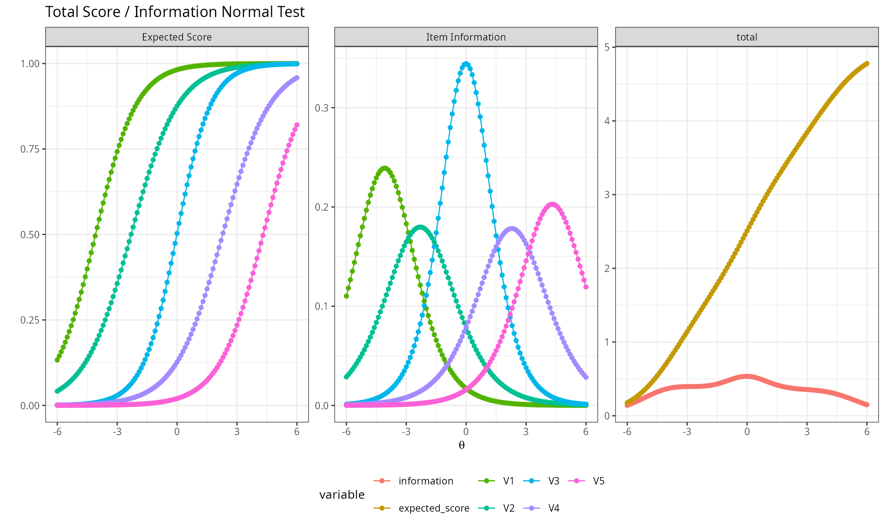
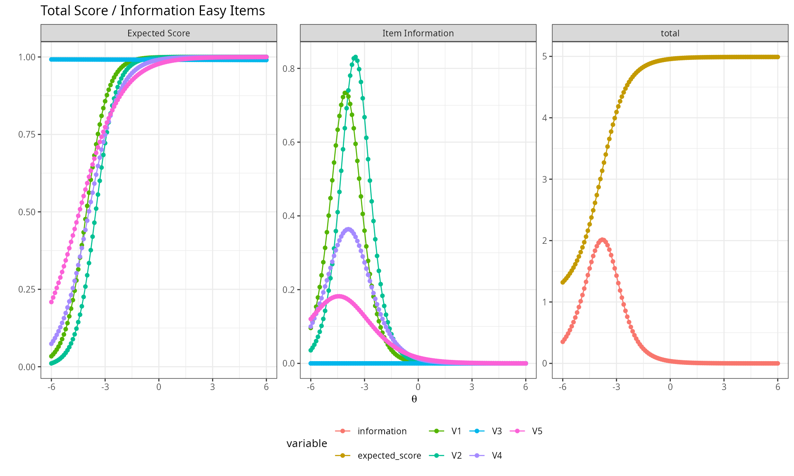
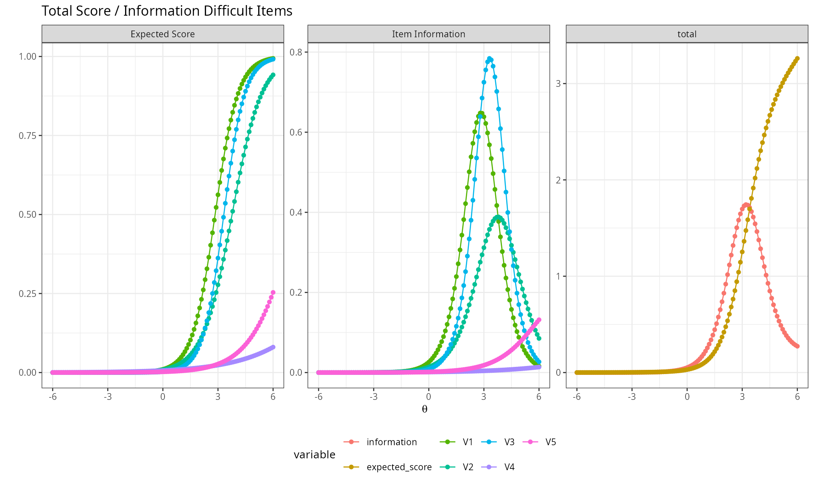
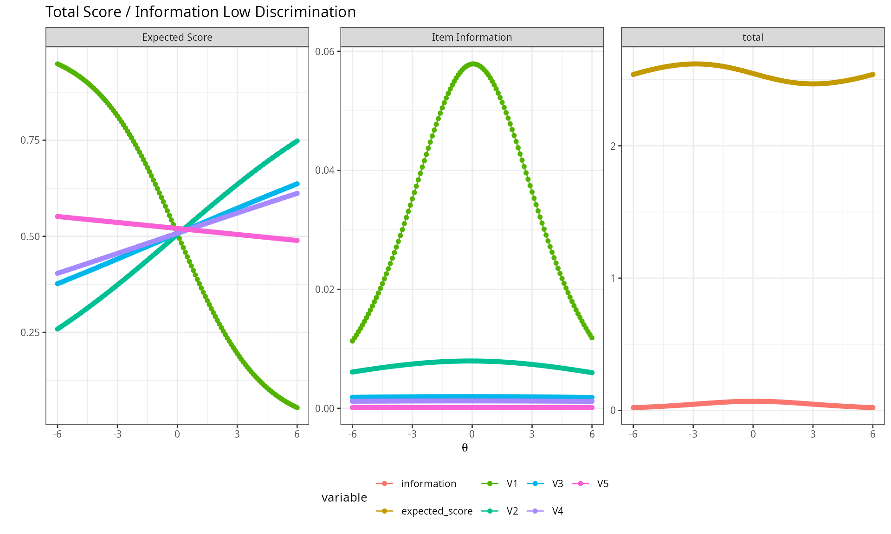
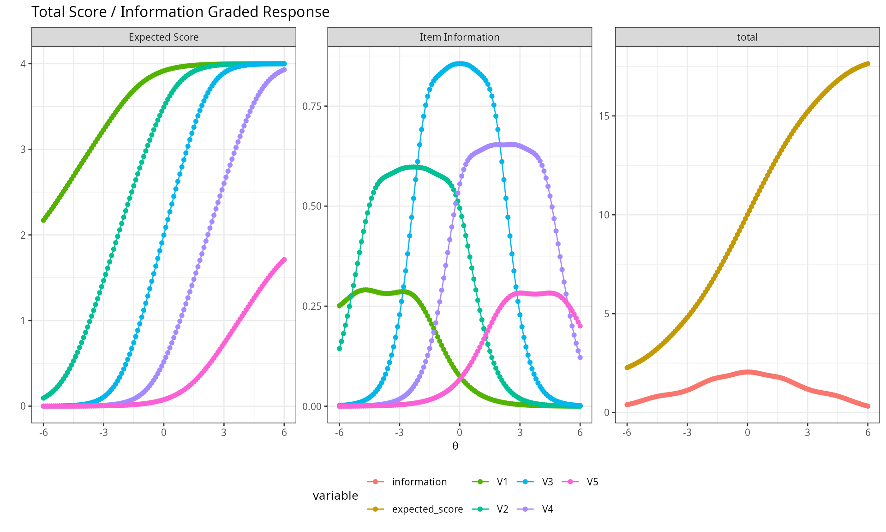

# Item response theory reports

## Description

This shows the output of unidimensional IRT reporting functions from the
package rwf. The functions are `plot_irt_onefactor` (test information
and expected score curves) and `report_irt` (a full model report:
coefficients, local independence diagnostics, absolute and relative fit
statistics). Both use models fit with the `mirt` package.

Installation instructions for rwf can be found
[here](https://github.com/sedzinfo/rwf)

The code can be found
[here](https://github.com/sedzinfo/rwf/blob/main/rwf/R/GLM_IRT.R)

## Theoretical Background

### Item and test information

Item information I_i(\theta) quantifies how precisely an item measures
ability at a given point on the \theta scale — the more strongly an
item’s response probability changes with \theta around a given point,
the more information it provides there. Test information is simply the
sum of item informations:

I(\theta) = \sum\_{i=1}^n I_i(\theta)

Test information is directly related to measurement precision: the
standard error of the ability estimate at \theta is SE(\theta) =
1/\sqrt{I(\theta)}. A test with high, flat information across a wide
range measures consistently well across the whole ability spectrum; a
test with information concentrated in a narrow band measures precisely
only there (e.g. around a pass/fail cutoff) and poorly elsewhere.

### Expected score

The expected score at \theta is the sum of item response probabilities
at that ability level — essentially the test characteristic curve,
mapping \theta onto the raw-score metric test-takers and stakeholders
actually see.

### Model fit

- **M2 statistic** (Maydeu-Olivares & Joe, 2006) — a limited-information
  goodness-of-fit test appropriate for dichotomous IRT models, alongside
  its associated RMSEA, SRMR, TLI, and CFI.
- **Item fit** — per-item statistics (e.g. S-\chi^2) flagging items
  whose observed response pattern deviates from what the fitted model
  predicts.
- **Q3 statistic** — residual correlations between item pairs after
  conditioning on \theta; large absolute values (there’s no firm
  consensus threshold, but values beyond roughly ±0.2 are commonly
  flagged) suggest **local dependence** — the items share variance
  beyond the single common factor, violating the local independence
  assumption central to unidimensional IRT.

------------------------------------------------------------------------

## Simulating item banks

[`psych::sim.rasch`](https://rdrr.io/pkg/psych/man/sim.irt.html) and
[`psych::sim.poly`](https://rdrr.io/pkg/psych/man/sim.irt.html) generate
dichotomous and polytomous (graded-response) item response data
respectively, from known generating parameters — useful for confirming
that a fitted model recovers the properties actually built into the
simulation.

``` r

set.seed(12345)
cormatrix_normal <- psych::sim.rasch(nvar = 5, n = 5000, low = -4, high = 4, d = NULL, a = 1, mu = 0, sd = 1)$items
cormatrix_easy    <- psych::sim.rasch(nvar = 5, n = 5000, low = -6, high = -4, d = NULL, a = 1, mu = 0, sd = 1)$items
cormatrix_hard    <- psych::sim.rasch(nvar = 5, n = 5000, low = 4, high = 6, d = NULL, a = 1, mu = 0, sd = 1)$items
cormatrix_lowdisc <- psych::sim.rasch(nvar = 5, n = 5000, low = -4, high = -4, d = NULL, a = 0.01, mu = 0, sd = 1)$items

model_normal  <- mirt::mirt(cormatrix_normal, 1, empiricalhist = TRUE, calcNull = TRUE)
model_easy    <- mirt::mirt(cormatrix_easy, 1, empiricalhist = TRUE, calcNull = TRUE)
model_hard    <- mirt::mirt(cormatrix_hard, 1, empiricalhist = TRUE, calcNull = TRUE)
model_lowdisc <- mirt::mirt(cormatrix_lowdisc, 1, empiricalhist = TRUE, calcNull = TRUE)
```

## Test Information and Expected Score Plots

`plot_irt_onefactor` shows, in one faceted plot: each item’s individual
information curve, the total test information curve, and the expected
total score curve, all against \theta.

### A normally-targeted item bank

``` r

plot_irt_onefactor(model = model_normal, base_size = 10, title = "Normal Test")
```



Items targeted across the middle of the ability range produce
information that peaks near \theta=0 — this is where the test measures
most precisely.

### Items that are too easy

``` r

plot_irt_onefactor(model = model_easy, base_size = 10, title = "Easy Items")
```



Information concentrates at very low \theta — the test discriminates
well among low-ability examinees but provides almost no information for
anyone of average or high ability, since nearly everyone above that
range answers correctly.

### Items that are too hard

``` r

plot_irt_onefactor(model = model_hard, base_size = 10, title = "Difficult Items")
```



The mirror image of the easy case — information concentrates at high
\theta, and the test provides little precision for low- or
average-ability examinees.

### Low discrimination

``` r

plot_irt_onefactor(model = model_lowdisc, base_size = 10, title = "Low Discrimination")
```



With discrimination near zero, information is low and nearly flat across
the whole ability range — the items barely distinguish between high- and
low-ability examinees at all, regardless of where they’re targeted.

### Graded response (polytomous) items

``` r

cormatrix_graded <- psych::sim.poly(nvar = 5, n = 5000, low = -4, high = 4, a = 1, c = 0, z = 1, d = NULL,
                                     mu = 0, sd = 1, cat = 5, mod = "logistic", theta = NULL)$items
model_graded <- mirt::mirt(cormatrix_graded, 1, itemtype = "graded")
plot_irt_onefactor(model = model_graded, base_size = 10, title = "Graded Response")
```



The same information/expected-score logic extends directly to ordinal
(Likert-type) items scored with a graded response model.

## Full Model Report

`report_irt` bundles coefficients, local-independence diagnostics (Q3),
item fit, and both relative (AIC/BIC/SABIC) and absolute (M2, RMSEA,
CFI, TLI, SRMR) fit statistics into one report.

``` r

result <- report_irt(model = model_normal)
```

``` r

result$model_coefficients
```

    ##           a1           d g u
    ## V1 0.9780104  3.99223519 0 1
    ## V2 0.8479110  1.95252978 0 1
    ## V3 1.1738968  0.01239706 0 1
    ## V4 0.8444014 -1.92714665 0 1
    ## V5 0.9006706 -3.88346798 0 1

``` r

result$q3_matrix
```

    ##                V1           V2          V3          V4   V5         min           max
    ## V1             NA           NA          NA          NA   NA          NA            NA
    ## V2  -0.0565901333           NA          NA          NA   NA -0.05659013 -0.0565901333
    ## V3  -0.0515645959 -0.125794388          NA          NA   NA -0.12579439 -0.0515645959
    ## V4  -0.0042992023 -0.048856265 -0.13620190          NA   NA -0.13620190 -0.0042992023
    ## V5   0.0004612702 -0.005053068 -0.06771623 -0.02557768   NA -0.06771623  0.0004612702
    ## min -0.0565901333 -0.125794388 -0.13620190 -0.02557768  Inf -0.13620190 -0.0565901333
    ## max  0.0004612702 -0.005053068 -0.06771623 -0.02557768 -Inf -0.05659013  0.0004612702

``` r

result$item_fit
```

    ##   item  S_X2 df.S_X2 RMSEA.S_X2 p.S_X2
    ## 1   V1 2.689       1      0.018  0.101
    ## 2   V2 0.716       2      0.000  0.699
    ## 3   V3 0.637       2      0.000  0.727
    ## 4   V4 1.316       2      0.000  0.518
    ## 5   V5 2.041       1      0.014  0.153

``` r

result$m2_fit
```

    ##          M2 df     p RMSEA RMSEA_5 RMSEA_95 SRMSR   TLI   CFI
    ## stats 5.596  5 0.348 0.005       0    0.021  0.01 0.995 0.998

- **`model_coefficients`**: discrimination (`a1`), difficulty (`d`),
  guessing (`g`), and inattentiveness (`u`) for each item.
- **`q3_matrix`**: pairwise residual correlations (lower triangle) plus
  each item’s min/max residual correlation with any other item — a quick
  scan for local dependence.
- **`item_fit`**: per-item fit statistics; large values / small p-values
  flag items that don’t behave as the model predicts.
- **`m2_fit`**: the overall M2 test and its associated
  RMSEA/SRMR/CFI/TLI — the standard “does this model fit at all” check.

Comparing models with different numbers of factors illustrates how these
statistics respond to model complexity:

``` r

model_twofactor   <- mirt::mirt(cormatrix_normal, 2, empiricalhist = TRUE, calcNull = TRUE)
result_twofactor  <- report_irt(model = model_twofactor)
```

``` r

result$m2_fit
```

    ##          M2 df     p RMSEA RMSEA_5 RMSEA_95 SRMSR   TLI   CFI
    ## stats 5.596  5 0.348 0.005       0    0.021  0.01 0.995 0.998

``` r

result_twofactor$m2_fit
```

    ##          M2 df     p RMSEA RMSEA_5 RMSEA_95 SRMSR   TLI CFI
    ## stats 0.648  1 0.421     0       0    0.035 0.004 1.014   1

------------------------------------------------------------------------

## Conclusion

`plot_irt_onefactor` makes it immediately visible *where* on the ability
scale a test measures well, by plotting information and expected score
together; `report_irt` answers the complementary question of *whether
the model is even correct* — via absolute fit (M2 family), local
independence (Q3), and item-level fit diagnostics that together
determine whether the unidimensional IRT model is an adequate
description of the data before its parameter estimates are trusted for
scoring.

------------------------------------------------------------------------

*Rendered with R 4.6.1 · mirt 1.48*
