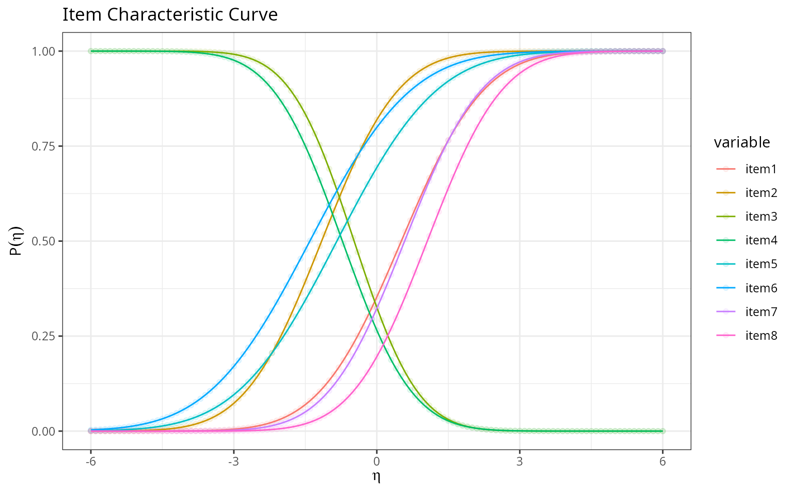
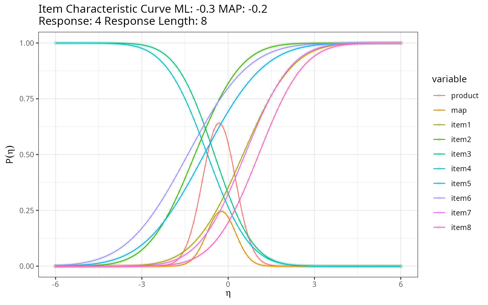

# Thurstonian item response theory

``` r

library(thurstonianIRT)
```

## Description

This shows the output of Thurstonian IRT functions from the package rwf,
for forced-choice and ranking questionnaires where respondents rank or
compare items within blocks instead of rating each item independently.
The functions cover the full workflow: building the comparison design,
encoding rank data into the binary pairwise-comparison format the model
needs, a from-scratch single-dimension item characteristic curve and
grid-based ability estimator, a MAP/Empirical-Bayes-Modal scorer that
reproduces `thurstonianIRT::predict()` directly from a fitted `lavaan`
model’s parameters, and a Heywood-case diagnostic for the `lavaan` fit.

Installation instructions for rwf can be found
[here](https://github.com/sedzinfo/rwf)

The code can be found
[here](https://github.com/sedzinfo/rwf/blob/main/rwf/R/GLM_IRT_T.R)

## Theoretical Background

### Why forced-choice items need a different IRT model

In a forced-choice block, a respondent doesn’t rate each item on its own
scale (which is vulnerable to response styles like acquiescence or
extreme responding) — they rank or compare items *against each other*
within the block. Thurstone’s (1927) **law of comparative judgment**
models each item’s momentary appeal as a latent utility with a normal
distribution; comparing two items reduces to comparing which of two
normal variables is larger, giving a normal-ogive (probit) response
model for each pairwise comparison rather than a single item response
curve.

### From a block to pairwise comparisons

A block of k items yields \binom{k}{2}=k(k-1)/2 unique pairwise
comparisons. Each comparison is coded +1/-1 in a **comparison matrix**:
item i beating item j contributes a row with +1 in column i and -1 in
column j. Stacking these rows across all pairs in a block, and stacking
blocks block-diagonally across an entire questionnaire, gives the full
design (**lambda**) matrix used to fit the Thurstonian model.

### The single-dimension item characteristic curve

For one trait, comparing items with loadings \lambda, thresholds
(crossing points) \gamma, and residual variances \psi, the probability
that a given pairwise comparison resolves in a particular direction at
trait level \eta is a normal-ogive function:

P(\eta) = \Phi\left(\frac{-\gamma+\lambda\eta}{\sqrt{\psi}}\right)

### MAP / Empirical Bayes Modal (EBM) scoring

Given a binary response pattern across all pairwise comparisons, the
**maximum a posteriori** trait estimate maximizes the posterior:

\hat{\boldsymbol\eta}\_{MAP} = \arg\max\_{\boldsymbol\eta} \left\[
\sum_i y_i\log P_i(\boldsymbol\eta) +
(1-y_i)\log(1-P_i(\boldsymbol\eta)) -
\tfrac{1}{2}\boldsymbol\eta^\top\Psi^{-1}\boldsymbol\eta \right\]

— a probit likelihood over all observed comparisons, plus a multivariate
normal prior (with covariance \Psi) on the traits. This is the same
likelihood-plus-prior structure as the EAP estimator covered in
[`EXAMPLE_EAP.rmd`](https://sedzinfo.github.io/rwf/articles/EXAMPLE_EAP.rmd),
except optimized directly (via BFGS) rather than by grid integration,
and extended to multiple correlated traits at once.

------------------------------------------------------------------------

## Building a Comparison Design

For one block of `items` items, `generate_comparisons_matrix` builds the
\binom{k}{2}\times k matrix of +1/-1 pairwise comparisons:

``` r

compute_dummy_comparisons(items = 3)
```

    ## [1] 3

``` r

generate_unique_comparisons_index(3)
```

    ##   i1 i2
    ## 2  1  2
    ## 3  1  3
    ## 6  2  3

``` r

generate_comparisons_matrix(3)
```

    ##      [,1] [,2] [,3]
    ## [1,]    1   -1    0
    ## [2,]    1    0   -1
    ## [3,]    0    1   -1

`generate_matrix_lambda_hat` stacks this same block structure vertically
across several *identical* blocks, while `generate_matrix_A` builds the
full **block-diagonal** design across `blocks` blocks of `items` items
each — the design matrix for an entire questionnaire made of independent
blocks:

``` r

generate_matrix_lambda_hat(blocks = 3, items = 3)
```

    ##       [,1] [,2] [,3]
    ##  [1,]    1   -1    0
    ##  [2,]    1    0   -1
    ##  [3,]    0    1   -1
    ##  [4,]    1   -1    0
    ##  [5,]    1    0   -1
    ##  [6,]    0    1   -1
    ##  [7,]    1   -1    0
    ##  [8,]    1    0   -1
    ##  [9,]    0    1   -1

``` r

generate_matrix_A(blocks = 3, items = 3)
```

    ##       [,1] [,2] [,3] [,4] [,5] [,6] [,7] [,8] [,9]
    ##  [1,]    1   -1    0    0    0    0    0    0    0
    ##  [2,]    1    0   -1    0    0    0    0    0    0
    ##  [3,]    0    1   -1    0    0    0    0    0    0
    ##  [4,]    0    0    0    1   -1    0    0    0    0
    ##  [5,]    0    0    0    1    0   -1    0    0    0
    ##  [6,]    0    0    0    0    1   -1    0    0    0
    ##  [7,]    0    0    0    0    0    0    1   -1    0
    ##  [8,]    0    0    0    0    0    0    1    0   -1
    ##  [9,]    0    0    0    0    0    0    0    1   -1

`increase_index` is the small helper underlying both: it produces the
row (or column) index ranges that pick out block i’s slice of a
stacked/block-diagonal matrix.

``` r

increase_index(blocks = 3, items = 3)
```

    ##      [,1] [,2] [,3]
    ## [1,]    1    2    3
    ## [2,]    4    5    6
    ## [3,]    7    8    9

## Encoding Rank Data as Binary Comparisons

Questionnaire data usually arrives as an explicit rank per item, not as
pre-computed pairwise wins/losses. `rank_to_binary` converts one block’s
ranks into the binary comparison codes the model needs (by default,
higher value = ranked first = “wins” the comparison):

``` r

set.seed(12345)
mydata <- data.frame(
  i1 = round(rnorm(10, mean = 2, sd = 1), 2),
  i2 = round(rnorm(10, mean = 2, sd = 1), 2),
  i3 = round(rnorm(10, mean = 2, sd = 1), 2)
)
rank_to_binary(mydata, items = 3)
```

    ##       i12 i13 i23
    ##  [1,]   1   0   0
    ##  [2,]   0   0   1
    ##  [3,]   0   1   1
    ##  [4,]   0   1   1
    ##  [5,]   1   1   1
    ##  [6,]   0   0   0
    ##  [7,]   1   1   0
    ##  [8,]   1   0   0
    ##  [9,]   0   0   1
    ## [10,]   0   0   1

`rank_df_to_binary` applies this across an entire questionnaire made of
multiple same-size blocks in one call:

``` r

mydata6 <- data.frame(
  i1 = rnorm(10, mean = 2, sd = .5), i2 = rnorm(10, mean = 2, sd = .5), i3 = rnorm(10, mean = 2, sd = .5),
  i4 = rnorm(10, mean = 2, sd = .5), i5 = rnorm(10, mean = 2, sd = .5), i6 = rnorm(10, mean = 2, sd = .5)
)
rank_df_to_binary(mydata6, items = 3)
```

    ##    i12 i13 i23 i12.1 i13.1 i23.1
    ## 1    0   1   1     1     0     0
    ## 2    1   1   0     0     0     0
    ## 3    1   1   0     1     1     0
    ## 4    1   1   1     0     0     0
    ## 5    0   1   1     0     0     1
    ## 6    0   1   1     0     0     0
    ## 7    1   0   0     1     1     1
    ## 8    0   0   0     1     1     0
    ## 9    1   0   0     1     0     0
    ## 10   1   1   1     0     0     1

`name_triplet_pairs` generates matching pair labels (`"i1i2"`, `"i1i3"`,
`"i2i3"`, …) for items grouped in consecutive triplets — useful for
naming the columns these binary-encoding functions produce:

``` r

name_triplet_pairs(6)
```

    ## [1] "i1i2" "i1i3" "i2i3" "i4i5" "i4i6" "i5i6"

``` r

name_triplet_pairs(4:9)
```

    ## [1] "i4i5" "i4i6" "i5i6" "i7i8" "i7i9" "i8i9"

`rank3_to_triplets` runs the *inverse* direction for a 3-item block:
given the three pairwise binary comparisons, it recovers each item’s
rank (1 = best, 3 = worst) within the triplet:

``` r

binary3 <- rank_to_binary(mydata[, 1:3], items = 3)
rank3_to_triplets(binary3)
```

    ##    item1 item2 item3
    ## 1      2     1     3
    ## 2      1     3     2
    ## 3      2     3     1
    ## 4      2     3     1
    ## 5      3     2     1
    ## 6      1     2     3
    ## 7      3     1     2
    ## 8      2     1     3
    ## 9      1     3     2
    ## 10     1     3     2

`response_dimension` and `cfa_icc_index` handle a related bookkeeping
problem for *multidimensional* designs: picking out, from a long vector
of all item/comparison parameters across several traits, just the subset
belonging to one trait pair — and converting item ordering between
`lavaan`’s natural order and the order Thurstonian scoring expects.

``` r

response_dimension(response = 1:18, dimensions = 3, items = c(1, 2))
```

    ##  [1]  1  2  4  5  7  8 10 11 13 14 16 17

``` r

cfa_icc_index(nitems = 18, nfactors = 3)$index_vector
```

    ##  [1]  1  7 13  2  8 14  3  9 15  4 10 16  5 11 17  6 12 18

## Single-Dimension Item Characteristic Curves and Grid Scoring

`icc_cfa` implements the normal-ogive probability above for one
comparison; `compute_icc_thurstonian` evaluates it across a whole vector
of comparisons and (optionally) plots the resulting curves via
`plot_icc_thurstonian`.

``` r

gamma <- c(0.556, -1.253, -1.729, 0.618, 0.937, 0.295, -0.672, -1.127, -0.446, 0.632, 1.147, 0.498)
psi   <- c(2.172, 1.883, 2.055, 1.869, 2.231, 2.100, 1.762, 1.803, 1.565, 1.892, 1.794, 1.686)
lambda <- c(1.082, 1.082, -1.297, -1.297, 0.802, 0.802, 1.083, 1.083)
gamma_d1 <- gamma[response_dimension(1:12, 3, c(1, 2))]
psi_d1   <- psi[response_dimension(1:12, 3, c(1, 2))]
eta <- seq(-6, 6, by = 0.1)
result_icc <- compute_icc_thurstonian(eta = eta, gamma = gamma_d1, lambda = lambda, psi = psi_d1, plot = TRUE)
result_icc$plot
```



Each curve is one comparison’s probability of resolving in the
“positive” direction as trait level rises — comparisons with steeper
curves (larger `lambda`) are more informative about the trait.

`compute_ability` scores a single response pattern by evaluating the
likelihood (times a normal prior, via `compute_map`) over a grid of
`eta` values and taking the grid point with maximum posterior density —
a direct, brute-force analogue of the optimization-based MAP scorer
described below, useful for a single dimension and small enough grids.

``` r

map_prior <- compute_map(eta = eta, mean = 0, sd = 1)
response_all_wrong   <- rep(0, 8)
response_all_right   <- rep(1, 8)
response_alternating <- rep(c(1, 0), 4)

r1 <- compute_ability(response_all_wrong, eta, gamma_d1, lambda, psi_d1, map = map_prior, plot = FALSE)
r2 <- compute_ability(response_all_right, eta, gamma_d1, lambda, psi_d1, map = map_prior, plot = FALSE)
r3 <- compute_ability(response_alternating, eta, gamma_d1, lambda, psi_d1, map = map_prior, plot = TRUE)
```



``` r

c(all_wrong = r1$ability_map, all_right = r2$ability_map, alternating = r3$ability_map)
```

    ##   all_wrong   all_right alternating 
    ##        -0.8         0.4        -0.2

As expected, the all-wrong pattern gives the lowest trait estimate,
all-right the highest, and the alternating (mixed) pattern lands near
the middle. `compute_scores` applies `compute_ability` row-by-row across
an entire data frame of response patterns to score every respondent at
once.

## Modern MAP Scoring From a Fitted `lavaan` Model

The functions above assume item parameters are supplied directly. In
practice, parameters usually come from fitting a Thurstonian model with
`lavaan` via the `thurstonianIRT` package. `extract_tirt_params` pulls
and aligns the parameter blocks (`Lambda`, `theta_diag`, `tau`, `nu`,
`Psi`) needed for scoring; `score_tirt_pattern`/`score_tirt` then find
the MAP trait estimate by direct BFGS optimization of the posterior
described in the theory section, rather than grid search — scaling to
many traits and many items at once.

``` r

data("triplets")
blocks <- set_block(c("i1", "i2", "i3"), traits = c("t1", "t2", "t3"), signs = c(1, 1, 1)) +
  set_block(c("i4", "i5", "i6"), traits = c("t1", "t2", "t3"), signs = c(-1, 1, 1)) +
  set_block(c("i7", "i8", "i9"), traits = c("t1", "t2", "t3"), signs = c(1, 1, -1)) +
  set_block(c("i10", "i11", "i12"), traits = c("t1", "t2", "t3"), signs = c(1, -1, 1))
triplets_long <- make_TIRT_data(data = triplets, blocks = blocks, direction = "larger", format = "pairwise", family = "bernoulli", range = c(0, 1))
fit_tirt <- fit_TIRT_lavaan(triplets_long)
pars <- extract_tirt_params(fit_tirt)
```

``` r

patterns <- as.matrix(triplets)
scores_rwf <- score_tirt(patterns, lambda = pars$lambda, theta_diag = pars$theta_diag, tau = pars$tau, Psi = pars$Psi, nu = NULL)
scores_reference <- predict(fit_tirt)
head(reshape2::recast(scores_reference, formula = id ~ trait, id.var = 1:2))
```

    ##   id     trait1      trait2     trait3
    ## 1  1  0.2995961 -1.20767032  0.1426395
    ## 2  2 -0.9154698  0.85793811  0.6401725
    ## 3  3 -0.6305020  1.34407005  0.8769478
    ## 4  4 -0.9522713 -0.40026605  0.0620571
    ## 5  5  0.9106010 -0.01306284 -0.1038967
    ## 6  6  0.5347432 -0.65726252 -1.4962309

``` r

head(scores_rwf)
```

    ##       trait1      trait2      trait3
    ## 1  0.2995840 -1.20767943  0.14262819
    ## 2 -0.9154895  0.85788563  0.64015686
    ## 3 -0.6305244  1.34404424  0.87688671
    ## 4 -0.9523082 -0.40025408  0.06205322
    ## 5  0.9106711 -0.01303085 -0.10381123
    ## 6  0.5347021 -0.65723999 -1.49623069

`score_tirt`’s output matches `thurstonianIRT::predict()`’s scores
closely — confirming the hand-rolled BFGS optimizer recovers the same
MAP estimates as the reference package, using only the extracted
`lavaan` parameters.

### The linear-algebra helper underneath

`score_tirt_pattern` needs \Psi^{-1} (the prior precision matrix);
`compute_solve` is a base-R Gauss-Jordan elimination implementation used
in place of [`solve()`](https://rdrr.io/r/base/solve.html):

``` r

A <- matrix(c(2, 1, 1, 3), nrow = 2, byrow = TRUE)
b <- c(1, 2)
x_mine <- compute_solve(A, b)
x_base <- solve(A, b)
rbind(mine = x_mine, base = x_base)
```

    ##      [,1] [,2]
    ## mine  0.2  0.6
    ## base  0.2  0.6

``` r

# matrix inverse when b is omitted
inv_mine <- compute_solve(A)
inv_base <- solve(A)
all.equal(inv_mine, inv_base, check.attributes = FALSE)
```

    ## [1] TRUE

## Diagnosing the Underlying `lavaan` Fit

Because Thurstonian scoring depends entirely on a `lavaan` fit’s
estimated parameters, a poorly-behaved fit (a “Heywood case” — negative
variances, out-of-range standardized loadings or correlations,
non-convergence) will silently corrupt every downstream score.
`check_heywood` screens for exactly these problems.

``` r

diagnostics <- check_heywood(fit_tirt$fit, verbose = TRUE)
```

    ## 
    ## === SUMMARY ===
    ## ✓ No Heywood cases or major issues detected!

``` r

diagnostics$has_issues
```

    ## [1] FALSE

Run this *before* trusting any scores produced by
`extract_tirt_params`/`score_tirt` — a model with Heywood cases needs to
be re-specified (e.g. simplifying the trait structure, fixing an
offending residual variance) rather than scored as-is.

------------------------------------------------------------------------

## Conclusion

`GLM_IRT_T.R` covers the full Thurstonian IRT pipeline: constructing a
forced-choice block design (`generate_matrix_A` and friends), encoding
raw rank data into the binary comparisons the model needs
(`rank_to_binary`, `rank_df_to_binary`), a from-scratch single-dimension
item characteristic curve and grid-based scorer for understanding the
model mechanics (`icc_cfa`, `compute_ability`), and a modern multi-trait
MAP scorer that reproduces `thurstonianIRT::predict()` directly from a
fitted `lavaan` model’s own parameters (`extract_tirt_params`,
`score_tirt`) — with a Heywood-case check (`check_heywood`) to catch
improper solutions before they’re scored.

------------------------------------------------------------------------

*Rendered with R 4.6.1 · thurstonianIRT 0.12.5 · lavaan 0.7.3*
