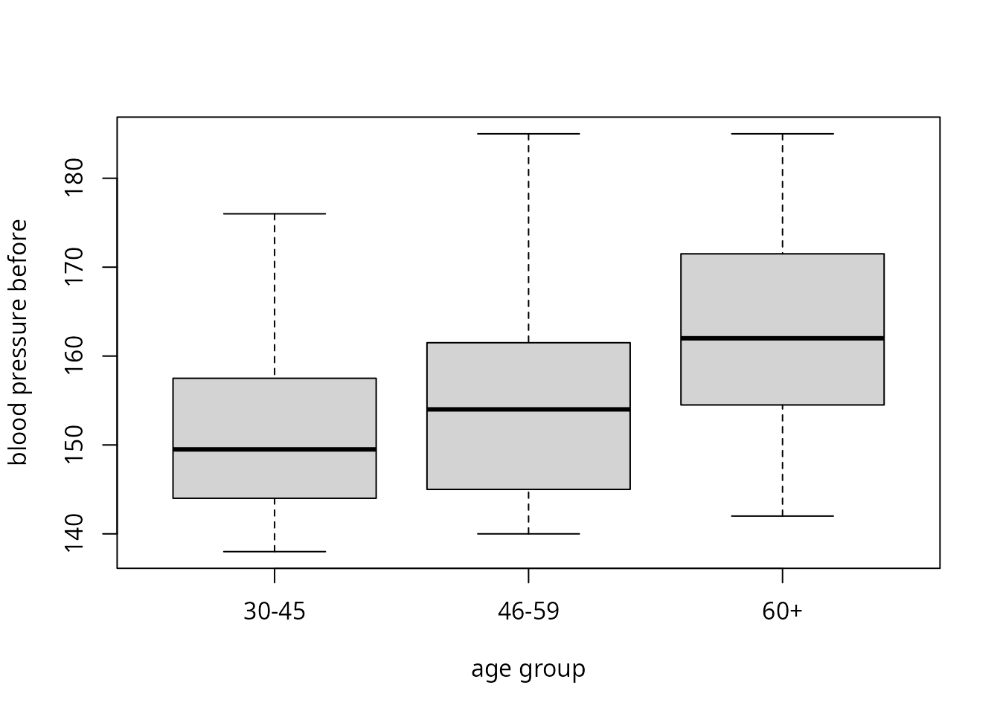

# Kruskal–Wallis test

## Description

This shows the output of `compute_kruskal_wallis_test` from the package
rwf, which runs the Kruskal-Wallis rank-sum test (Kruskal & Wallis,
1952), the non-parametric alternative to the one-way ANOVA. The function
returns the test statistic H with its degrees of freedom and p value,
two effect sizes (rank eta-squared \eta^2_H and rank epsilon-squared
\varepsilon^2_R) and, optionally, bootstrap confidence intervals for
both effect sizes. Each section gives the formulas the function uses,
computes them by hand and checks the results against `stats`, `coin`,
`rcompanion`, `rstatix` and `effectsize`.

The computation of H, including the correction for ties, is adapted from
[`stats::kruskal.test`](https://rdrr.io/r/stats/kruskal.test.html) (R
Core Team, 2026), and the effect sizes use the same formulas as
[`rstatix::kruskal_effsize`](https://rpkgs.datanovia.com/rstatix/reference/kruskal_effsize.html)
(Kassambara, 2026) and
[`effectsize::rank_epsilon_squared`](https://easystats.github.io/effectsize/reference/rank_epsilon_squared.html)
(Ben-Shachar, Lüdecke & Makowski, 2020).

Installation instructions for rwf can be found
[here](https://github.com/sedzinfo/rwf)

The code can be found
[here](https://github.com/sedzinfo/rwf/blob/main/rwf/R/GLM_ANOVA.R)

## Notation

There are k independent groups. Group j has n_j observations and the
total sample size is n=\sum\_{j=1}^{k}n_j. All n observations are pooled
and ranked from 1 to n. Tied values get the mean of the ranks they span
(mid-ranks). r\_{ij} is the rank of observation i in group j,
R_j=\sum\_{i=1}^{n_j}r\_{ij} is the rank sum of group j,
\bar{r}\_j=R_j/n_j is its mean rank and \bar{r}=(n+1)/2 is the mean of
all ranks. t_1,\dots,t_m are the sizes of the m groups of tied values.

## The Kruskal-Wallis test

The Kruskal-Wallis test is the rank-based alternative to the one-way
ANOVA. It replaces the observations with their ranks and asks whether
the mean ranks differ between groups more than they would by chance. It
does not assume normality, so it suits skewed or ordinal outcomes. Its
null hypothesis is that all groups come from the same distribution.

### The H statistic

Without ties the statistic is

H_0=\frac{12}{n(n+1)}\sum\_{j=1}^{k}\frac{R_j^2}{n_j}-3(n+1)

Ties shrink the variance of the ranks, so H_0 is divided by a correction
factor:

C=1-\frac{\sum\_{l=1}^{m}\left(t_l^3-t_l\right)}{n^3-n},\qquad
H=\frac{H_0}{C}

Values that occur once have t_l=1 and add nothing to the sum, so C=1
when there are no ties.

### Degrees of freedom and p value

Under the null hypothesis H approximately follows a chi-squared
distribution with k-1 degrees of freedom:

df=k-1,\qquad p=P\left(\chi^2\_{k-1}\ge H\right)

### H as an ANOVA on the ranks

The tie-corrected H can also be written with sums of squares of the
ranks:

H=(n-1)\\\frac{SS\_{\text{between}}}{SS\_{\text{total}}}=(n-1)\\\frac{\sum\_{j=1}^{k}n_j\left(\bar{r}\_j-\bar{r}\right)^2}{\sum\_{j=1}^{k}\sum\_{i=1}^{n_j}\left(r\_{ij}-\bar{r}\right)^2}

So the Kruskal-Wallis test is a one-way ANOVA run on the ranks.
SS\_{\text{between}}/SS\_{\text{total}} is the share of rank variance
explained by the groups. This is where the effect sizes below come from.

## When to use it and assumptions

### When to use it

Use the Kruskal-Wallis test to compare two or more independent groups on
one outcome when the one-way ANOVA is not a good fit:

- **The outcome is ordinal**, such as Likert items, rankings or grades,
  so means and variances are not meaningful.
- **The outcome is continuous but clearly not normal within groups**,
  for example strongly skewed reaction times or incomes, and the groups
  are small. With large groups the ANOVA is fairly robust to
  non-normality.
- **There are outliers** that would dominate the group means. Ranks
  limit the influence of any single value.

Do not use it when:

- **The data are normal with equal variances.** The ANOVA is then
  slightly more powerful. The asymptotic relative efficiency of
  Kruskal-Wallis against the ANOVA under normality is 3/\pi\approx0.955,
  so little is lost by using it (Hollander, Wolfe & Chicken, 2014).
- **The same participants are measured more than once.** Use the
  Friedman test for repeated measures, `compute_friedman_test`, which
  reports Kendall’s W as its effect size.
- **The groups have different spreads and the question is about means.**
  Use the Welch ANOVA (`compute_one_way_test(var.equal = FALSE)`).
  Kruskal-Wallis is not a fix for unequal variances.
- **The design has several factors or covariates.** The test handles
  only one grouping variable.

With two groups the Kruskal-Wallis test is the Wilcoxon-Mann-Whitney
rank-sum test. Both give the same p value when the Wilcoxon test uses
the normal approximation without continuity correction:

``` r

stats::kruskal.test(bp_before ~ sex, data = df_blood_pressure)$p.value
```

    ## [1] 0.004681996

``` r

stats::wilcox.test(bp_before ~ sex, data = df_blood_pressure, exact = FALSE, correct = FALSE)$p.value
```

    ## [1] 0.004681996

### Assumptions

1.  **Independent observations.** Each observation belongs to one group
    only and does not depend on any other observation.
2.  **An outcome that is at least ordinal.** The values must be
    orderable for the ranks to mean anything.
3.  **Similar shape and spread across groups, to compare medians.** If
    the group distributions have the same shape and differ only in
    location, a significant result means the medians differ. If shapes
    or spreads differ, the test still detects whether some groups tend
    to have larger values than others (stochastic dominance), but it is
    no longer a test of medians. Unequal spreads with equal medians can
    also make it reject the null hypothesis too often.
4.  **Groups large enough for the chi-squared approximation.** A common
    rule is at least 5 observations per group. With smaller groups use
    an exact or permutation p value, such as
    `coin::kruskal_test(distribution = coin::approximate(nresample = 10000))`.

Normality and equal variances are **not** assumed.

The assumptions in `df_blood_pressure`: 40 independent patients per age
group, and an outcome measured in whole numbers. The boxplots and the
Fligner-Killeen test of equal spread check whether the groups have a
similar shape and spread:

``` r

boxplot(bp_before ~ agegrp, data = df_blood_pressure, xlab = "age group", ylab = "blood pressure before")
```



``` r

table(df_blood_pressure$agegrp)
```

    ## 
    ## 30-45 46-59   60+ 
    ##    40    40    40

``` r

stats::fligner.test(bp_before ~ agegrp, data = df_blood_pressure)
```

    ## 
    ##  Fligner-Killeen test of homogeneity of variances
    ## 
    ## data:  bp_before by agegrp
    ## Fligner-Killeen:med chi-squared = 2.117, df = 2, p-value = 0.347

### After a significant result

A significant H means that at least one group differs from the others,
not which ones. Follow it with pairwise comparisons on the ranks, such
as Dunn’s test (Dunn, 1964), with an adjustment for multiple
comparisons.

## Why effect sizes

A p value answers one question: if the groups did not differ, how
surprising would data like these be? It does not say how large the
difference is. Because H grows with the sample size, a trivial
difference becomes “significant” in a large sample, and a large
difference can be “non-significant” in a small one.

An effect size answers a different question: how much do the groups
differ? Effect sizes are useful because they:

- **measure magnitude.** They separate practical importance from
  statistical significance.
- **do not grow with n.** The same population difference gives roughly
  the same effect size in a study of 30 people or 3,000.
- **can be compared across studies.** This is what meta-analysis
  combines.
- **drive power analysis.** The sample size a new study needs depends on
  the effect size it expects.
- **are expected in reports.** The APA Task Force on Statistical
  Inference recommends reporting effect sizes for primary outcomes
  (Wilkinson & Task Force on Statistical Inference, 1999; see also
  Lakens, 2013).

The [simulation below](#p-values-shrink-effect-sizes-do-not) shows this
with data.

## Effect sizes for Kruskal-Wallis

### Rank epsilon-squared

\varepsilon^2_R=\frac{H}{\left(n^2-1\right)/(n+1)}=\frac{H}{n-1}=\frac{SS\_{\text{between}}}{SS\_{\text{total}}}

\varepsilon^2_R is the proportion of rank variance explained by group
membership, the R^2 of a one-way ANOVA on the ranks (King, Rosopa &
Minium, 2018). It lies in \[0,1\]. Because the groups’ mean ranks never
match exactly in a sample, it is biased upwards. Under the null
hypothesis E\[H\]\approx k-1, so E\[\varepsilon^2_R\]\approx(k-1)/(n-1)
rather than 0.

### Rank eta-squared

\eta^2_H=\frac{H-k+1}{n-k}

\eta^2_H (Tomczak & Tomczak, 2014) subtracts k-1, the expected value of
H under the null hypothesis, before scaling. This removes most of the
bias: it is close to 0 on average when there is no effect. It can
therefore be **negative** when H\<k-1. rwf returns the negative value as
it is, while `rstatix` and `effectsize` truncate it at 0.

### Interpretation

Multiplied by 100, both measures read as the percentage of rank variance
explained by the groups. Small, medium and large are the \eta^2
benchmarks of Cohen (1988). Sawilowsky (2009) added very small, very
large and huge benchmarks for Cohen’s d, and the table converts them to
the \eta^2 scale with \eta^2=d^2/(d^2+4):

| Magnitude  | \eta^2_H, \varepsilon^2_R | Cohen’s d |
|------------|---------------------------|-----------|
| tiny       | \< 0.01                   | \< 0.2    |
| small      | 0.01 to \< 0.06           | 0.2       |
| medium     | 0.06 to \< 0.14           | 0.5       |
| large      | 0.14 to \< 0.26           | 0.8       |
| very large | 0.26 to \< 0.50           | 1.2       |
| huge       | ≥ 0.50                    | 2.0       |

``` r

d <- c(0.2, 0.5, 0.8, 1.2, 2)
data.frame(d, eta_squared = d^2 / (d^2 + 4))
```

    ##     d eta_squared
    ## 1 0.2  0.00990099
    ## 2 0.5  0.05882353
    ## 3 0.8  0.13793103
    ## 4 1.2  0.26470588
    ## 5 2.0  0.50000000

These are rough guides. What counts as a meaningful effect depends on
the field and the outcome.

## Data

`df_blood_pressure` records the blood pressure of 120 patients in three
age groups of 40. The formula `bp_before ~ agegrp` asks whether blood
pressure before treatment differs between age groups. Blood pressure is
recorded in whole numbers, so there are many ties.

``` r

head(df_blood_pressure)
```

    ##   patient  sex agegrp bp_before bp_after
    ## 1       1 Male  30-45       143      153
    ## 2       2 Male  30-45       163      170
    ## 3       3 Male  30-45       153      168
    ## 4       4 Male  30-45       153      142
    ## 5       5 Male  30-45       146      141
    ## 6       6 Male  30-45       150      147

``` r

form <- formula(bp_before ~ agegrp)
table(df_blood_pressure$agegrp)
```

    ## 
    ## 30-45 46-59   60+ 
    ##    40    40    40

## compute_kruskal_wallis_test

``` r

result <- compute_kruskal_wallis_test(formula = form, df = df_blood_pressure)
result
```

    ##              formula                       method     etasq epsilonsq        H df            p
    ## 1 bp_before ~ agegrp Kruskal-Wallis rank sum test 0.1501232 0.1644069 19.56442  2 5.644699e-05

The output columns are:

| Column      | Formula                                |
|-------------|----------------------------------------|
| `formula`   | the model formula                      |
| `method`    | the test name                          |
| `etasq`     | \eta^2_H=(H-k+1)/(n-k)                 |
| `epsilonsq` | \varepsilon^2_R=H/(n-1)                |
| `H`         | tie-corrected Kruskal-Wallis statistic |
| `df`        | k-1                                    |
| `p`         | P\left(\chi^2\_{k-1}\ge H\right)       |

## Step by step

Every quantity from the formulas above, computed by hand.

``` r

x <- df_blood_pressure$bp_before
g <- factor(df_blood_pressure$agegrp)
n <- length(x)
k <- nlevels(g)
r <- rank(x)
data.frame(n_j = tapply(r, g, length),
           R_j = tapply(r, g, sum),
           mean_rank = tapply(r, g, mean))
```

    ##       n_j    R_j mean_rank
    ## 30-45  40 1842.0   46.0500
    ## 46-59  40 2237.5   55.9375
    ## 60+    40 3180.5   79.5125

H without ties, the tie correction and the corrected H:

``` r

R_j <- tapply(r, g, sum)
n_j <- tapply(r, g, length)
H_0 <- 12 / (n * (n + 1)) * sum(R_j^2 / n_j) - 3 * (n + 1)
t_l <- table(x)
C <- 1 - sum(t_l^3 - t_l) / (n^3 - n)
H <- H_0 / C
data.frame(H_0, C, H)
```

    ##       H_0         C        H
    ## 1 19.5403 0.9987673 19.56442

The same H from the sums of squares of the ranks:

``` r

ss_between <- sum(n_j * (tapply(r, g, mean) - mean(r))^2)
ss_total <- sum((r - mean(r))^2)
(n - 1) * ss_between / ss_total
```

    ## [1] 19.56442

Degrees of freedom, p value and effect sizes:

``` r

by_hand <- data.frame(etasq = (H - k + 1) / (n - k),
                      epsilonsq = H / (n - 1),
                      H = H,
                      df = k - 1,
                      p = pchisq(H, k - 1, lower.tail = FALSE))
by_hand
```

    ##       etasq epsilonsq        H df            p
    ## 1 0.1501232 0.1644069 19.56442  2 5.644699e-05

``` r

all.equal(by_hand, result[, c("etasq", "epsilonsq", "H", "df", "p")], check.attributes = FALSE)
```

    ## [1] TRUE

## Checks against other packages

### stats and coin

[`stats::kruskal.test`](https://rdrr.io/r/stats/kruskal.test.html) and
[`coin::kruskal_test`](https://rdrr.io/pkg/coin/man/LocationTests.html)
give the same H, degrees of freedom and p value:

``` r

stats::kruskal.test(formula = form, data = df_blood_pressure)
```

    ## 
    ##  Kruskal-Wallis rank sum test
    ## 
    ## data:  bp_before by agegrp
    ## Kruskal-Wallis chi-squared = 19.564, df = 2, p-value = 5.645e-05

``` r

coin::kruskal_test(bp_before ~ factor(agegrp), data = df_blood_pressure)
```

    ## 
    ##  Asymptotic Kruskal-Wallis Test
    ## 
    ## data:  bp_before by factor(agegrp) (30-45, 46-59, 60+)
    ## chi-squared = 19.564, df = 2, p-value = 5.645e-05

### ANOVA on the ranks

\varepsilon^2_R is the R^2 of a linear model of the ranks on the groups:

``` r

summary(lm(rank(bp_before) ~ agegrp, data = df_blood_pressure))$r.squared
```

    ## [1] 0.1644069

``` r

result$epsilonsq
```

    ## [1] 0.1644069

### rcompanion, rstatix and effectsize

[`rcompanion::epsilonSquared`](https://rdrr.io/pkg/rcompanion/man/epsilonSquared.html),
[`rstatix::kruskal_effsize`](https://rpkgs.datanovia.com/rstatix/reference/kruskal_effsize.html)
and
[`effectsize::rank_epsilon_squared`](https://easystats.github.io/effectsize/reference/rank_epsilon_squared.html)
compute \varepsilon^2_R.
[`rstatix::kruskal_effsize`](https://rpkgs.datanovia.com/rstatix/reference/kruskal_effsize.html)
(its default method) and
[`effectsize::rank_eta_squared`](https://easystats.github.io/effectsize/reference/rank_epsilon_squared.html)
compute \eta^2_H. The confidence intervals are bootstrapped, so they
change slightly from run to run. The [confidence
intervals](#confidence-intervals) section compares them with the
intervals from rwf.

``` r

rcompanion::epsilonSquared(x = df_blood_pressure$bp_before, g = df_blood_pressure$agegrp,
                           group = "row", ci = TRUE, conf = 0.95, type = "perc", R = 1000, digits = 3)
```

    ##   epsilon.squared lower.ci upper.ci
    ## 1           0.164   0.0646    0.314

``` r

rstatix::kruskal_effsize(df_blood_pressure, form, ci = TRUE, conf.level = 0.95, ci.type = "perc", nboot = 100)
```

    ## # A tibble: 1 × 7
    ##   .y.           n effsize conf.low conf.high method  magnitude
    ## * <chr>     <int>   <dbl>    <dbl>     <dbl> <chr>   <ord>    
    ## 1 bp_before   120   0.150     0.05      0.28 eta2[H] large

``` r

rstatix::kruskal_effsize(df_blood_pressure, form, method = "epsilon2")
```

    ## # A tibble: 1 × 5
    ##   .y.           n effsize method   magnitude
    ## * <chr>     <int>   <dbl> <chr>    <ord>    
    ## 1 bp_before   120   0.164 epsilon2 large

``` r

effectsize::rank_epsilon_squared(form, data = df_blood_pressure)
```

    ## Epsilon2 (rank) |       95% CI
    ## ------------------------------
    ## 0.16            | [0.09, 1.00]
    ## 
    ## - One-sided CIs: upper bound fixed at [1.00].

``` r

effectsize::rank_eta_squared(form, data = df_blood_pressure)
```

    ## Eta2 (rank) |       95% CI
    ## --------------------------
    ## 0.15        | [0.06, 1.00]
    ## 
    ## - One-sided CIs: upper bound fixed at [1.00].

### A test function

`check_kruskal_wallis` puts each rwf value next to the value from the
other packages and returns the difference. `rstatix` and `effectsize`
truncate \eta^2_H at 0, so the rwf value is truncated in the same way
before the comparison.

``` r

check_kruskal_wallis <- function(formula, df) {
  y <- all.vars(formula)[1]
  g <- all.vars(formula)[2]
  df <- stats::na.omit(data.frame(y = df[[y]], g = factor(df[[g]])))
  rwf <- compute_kruskal_wallis_test(formula = y ~ g, df = df)
  kw <- stats::kruskal.test(y ~ g, data = df)
  rwf_etasq <- max(0, min(1, rwf$etasq))
  comparison <- data.frame(
    statistic = c("H", "H", "df", "p", "epsilonsq", "epsilonsq", "epsilonsq", "epsilonsq", "etasq", "etasq"),
    package = c("stats::kruskal.test", "coin::kruskal_test", "stats::kruskal.test", "stats::kruskal.test",
                "lm on ranks", "rcompanion::epsilonSquared", "rstatix::kruskal_effsize", "effectsize::rank_epsilon_squared",
                "rstatix::kruskal_effsize", "effectsize::rank_eta_squared"),
    rwf = c(rwf$H, rwf$H, rwf$df, rwf$p,
            rwf$epsilonsq, rwf$epsilonsq, rwf$epsilonsq, rwf$epsilonsq,
            rwf_etasq, rwf_etasq),
    other = c(unname(kw$statistic),
              unname(coin::statistic(coin::kruskal_test(y ~ g, data = df))),
              unname(kw$parameter),
              kw$p.value,
              summary(lm(rank(y) ~ g, data = df))$r.squared,
              unname(rcompanion::epsilonSquared(x = df$y, g = df$g, digits = 15)),
              rstatix::kruskal_effsize(df, y ~ g, method = "epsilon2")$effsize,
              effectsize::rank_epsilon_squared(y ~ g, data = df, ci = NULL)$rank_epsilon_squared,
              rstatix::kruskal_effsize(df, y ~ g)$effsize,
              effectsize::rank_eta_squared(y ~ g, data = df, ci = NULL)$rank_eta_squared))
  comparison$difference <- comparison$rwf - comparison$other
  comparison
}
check_kruskal_wallis(formula = form, df = df_blood_pressure)
```

    ##    statistic                          package          rwf        other   difference
    ## 1          H              stats::kruskal.test 1.956442e+01 1.956442e+01 0.000000e+00
    ## 2          H               coin::kruskal_test 1.956442e+01 1.956442e+01 1.776357e-14
    ## 3         df              stats::kruskal.test 2.000000e+00 2.000000e+00 0.000000e+00
    ## 4          p              stats::kruskal.test 5.644699e-05 5.644699e-05 0.000000e+00
    ## 5  epsilonsq                      lm on ranks 1.644069e-01 1.644069e-01 1.665335e-16
    ## 6  epsilonsq       rcompanion::epsilonSquared 1.644069e-01 1.644069e-01 1.110223e-16
    ## 7  epsilonsq         rstatix::kruskal_effsize 1.644069e-01 1.644069e-01 0.000000e+00
    ## 8  epsilonsq effectsize::rank_epsilon_squared 1.644069e-01 1.644069e-01 0.000000e+00
    ## 9      etasq         rstatix::kruskal_effsize 1.501232e-01 1.501232e-01 0.000000e+00
    ## 10     etasq     effectsize::rank_eta_squared 1.501232e-01 1.501232e-01 0.000000e+00

The same check on six datasets with different numbers of groups, sample
sizes and amounts of ties. `max_abs_difference` is the largest absolute
difference across all the comparisons for that dataset:

``` r

datasets <- list(
  list(formula = bp_before ~ agegrp, df = df_blood_pressure),
  list(formula = qsec ~ cyl, df = mtcars),
  list(formula = weight ~ group, df = PlantGrowth),
  list(formula = count ~ spray, df = InsectSprays),
  list(formula = weight ~ feed, df = chickwts),
  list(formula = len ~ dose, df = ToothGrowth)
)
do.call(rbind, lapply(datasets, function(d) {
  rwf <- compute_kruskal_wallis_test(formula = d$formula, df = d$df)
  check <- check_kruskal_wallis(formula = d$formula, df = d$df)
  data.frame(formula = deparse(d$formula),
             n = nrow(d$df),
             k = rwf$df + 1,
             H = rwf$H,
             etasq = rwf$etasq,
             epsilonsq = rwf$epsilonsq,
             max_abs_difference = max(abs(check$difference)))
}))
```

    ##              formula   n k         H     etasq epsilonsq max_abs_difference
    ## 1 bp_before ~ agegrp 120 3 19.564417 0.1501232 0.1644069       1.776357e-14
    ## 2         qsec ~ cyl  32 3 10.155158 0.2812123 0.3275857       5.329071e-15
    ## 3     weight ~ group  30 3  7.988229 0.2217862 0.2754562       1.421085e-14
    ## 4      count ~ spray  72 6 54.691345 0.7528992 0.7703006       2.220446e-16
    ## 5      weight ~ feed  71 6 37.342718 0.4975803 0.5334674       2.131628e-14
    ## 6         len ~ dose  60 3 40.668935 0.6784024 0.6893040       7.105427e-15

## Confidence intervals

With `ci = TRUE` the function adds percentile bootstrap confidence
intervals for both effect sizes. It draws `nboot` samples of n rows with
replacement and computes \eta^2_H and \varepsilon^2_R in each, giving
\hat{\theta}^{\*}\_1,\dots,\hat{\theta}^{\*}\_B. The interval is

\left\[\hat{\theta}^{\*}\_{(\alpha/2)},\\
\hat{\theta}^{\*}\_{(1-\alpha/2)}\right\],\qquad
\alpha=1-\texttt{conf.level}

where \hat{\theta}^{\*}\_{(q)} is the q quantile of the bootstrap
estimates. Unlike `rstatix` and `effectsize`, rwf does not truncate the
bootstrap values of \eta^2_H at 0, so its lower limit can be negative
when the effect is small.

``` r

set.seed(1)
compute_kruskal_wallis_test(formula = form, df = df_blood_pressure, ci = TRUE, conf.level = 0.95, nboot = 5000)
```

    ##              formula                       method     etasq etasq_lower etasq_upper epsilonsq epsilonsq_lower epsilonsq_upper        H df            p
    ## 1 bp_before ~ agegrp Kruskal-Wallis rank sum test 0.1501232  0.05272121   0.2940747 0.1644069      0.06864186        0.305939 19.56442  2 5.644699e-05

The other packages use the same percentile method. Each bootstrap draws
different resamples, so the limits agree only to about two decimals, and
they get closer as `nboot` grows:

``` r

set.seed(1)
rwf <- compute_kruskal_wallis_test(formula = form, df = df_blood_pressure, ci = TRUE, nboot = 5000)
set.seed(1)
rcompanion_epsilonsq <- rcompanion::epsilonSquared(x = df_blood_pressure$bp_before, g = df_blood_pressure$agegrp,
                                                   ci = TRUE, type = "perc", R = 5000, digits = 15)
set.seed(1)
rstatix_etasq <- rstatix::kruskal_effsize(df_blood_pressure, form, ci = TRUE, ci.type = "perc", nboot = 5000)
set.seed(1)
effectsize_epsilonsq <- effectsize::rank_epsilon_squared(form, data = df_blood_pressure, alternative = "two.sided", iterations = 5000)
set.seed(1)
effectsize_etasq <- effectsize::rank_eta_squared(form, data = df_blood_pressure, alternative = "two.sided", iterations = 5000)
data.frame(
  statistic = c("etasq", "etasq", "etasq", "epsilonsq", "epsilonsq", "epsilonsq"),
  package = c("rwf", "rstatix::kruskal_effsize", "effectsize::rank_eta_squared",
              "rwf", "rcompanion::epsilonSquared", "effectsize::rank_epsilon_squared"),
  estimate = c(rwf$etasq, rstatix_etasq$effsize, effectsize_etasq$rank_eta_squared,
               rwf$epsilonsq, rcompanion_epsilonsq$epsilon.squared, effectsize_epsilonsq$rank_epsilon_squared),
  lower = c(rwf$etasq_lower, rstatix_etasq$conf.low, effectsize_etasq$CI_low,
            rwf$epsilonsq_lower, rcompanion_epsilonsq$lower.ci, effectsize_epsilonsq$CI_low),
  upper = c(rwf$etasq_upper, rstatix_etasq$conf.high, effectsize_etasq$CI_high,
            rwf$epsilonsq_upper, rcompanion_epsilonsq$upper.ci, effectsize_epsilonsq$CI_high))
```

    ##   statistic                          package  estimate      lower     upper
    ## 1     etasq                              rwf 0.1501232 0.05272121 0.2940747
    ## 2     etasq         rstatix::kruskal_effsize 0.1501232 0.05000000 0.3000000
    ## 3     etasq     effectsize::rank_eta_squared 0.1501232 0.05316455 0.2929897
    ## 4 epsilonsq                              rwf 0.1644069 0.06864186 0.3059390
    ## 5 epsilonsq       rcompanion::epsilonSquared 0.1644069 0.06712741 0.3077967
    ## 6 epsilonsq effectsize::rank_epsilon_squared 0.1644069 0.06907775 0.3048722

`rstatix` rounds its limits to two decimals. `effectsize` reports
one-sided intervals by default, so `alternative = "two.sided"` is set
here.

## p values shrink, effect sizes do not

Three groups are drawn from normal distributions whose means differ by
0.3 standard deviations, with 10 to 1,000 observations per group. The
population effect is the same in every row. As the sample grows, H grows
and the p value drops towards 0, while \eta^2_H and \varepsilon^2_R
settle around the same value:

``` r

set.seed(1)
do.call(rbind, lapply(c(10, 30, 100, 300, 1000), function(n_per_group) {
  sim <- data.frame(group = rep(c("a", "b", "c"), each = n_per_group),
                    score = rnorm(3 * n_per_group, mean = rep(c(0, 0.3, 0.6), each = n_per_group)))
  cbind(n_per_group, compute_kruskal_wallis_test(formula = score ~ group, df = sim)[, c("H", "p", "etasq", "epsilonsq")])
}))
```

    ##   n_per_group          H            p       etasq  epsilonsq
    ## 1          10   1.643871 4.395800e-01 -0.01318996 0.05668521
    ## 2          30   5.518632 6.333506e-02  0.04044405 0.06200711
    ## 3         100  21.494769 2.150157e-05  0.06563895 0.07188886
    ## 4         300  67.447370 2.259382e-15  0.07296251 0.07502488
    ## 5        1000 161.564928 8.253187e-36  0.05324155 0.05387293

A p value from one study says little about the size of the effect. The
effect size does.

## Bias of epsilon-squared

When there is no effect at all, the average \varepsilon^2_R is close to
(k-1)/(n-1), while the average \eta^2_H is close to 0. With k=3 groups
of 10 the bias is 2/29\approx0.069, which is already above the “medium”
benchmark:

``` r

set.seed(1)
null_effects <- t(replicate(2000, {
  sim <- data.frame(group = rep(c("a", "b", "c"), each = 10), score = rnorm(30))
  unlist(compute_kruskal_wallis_test(formula = score ~ group, df = sim)[, c("etasq", "epsilonsq")])
}))
data.frame(mean_etasq = mean(null_effects[, "etasq"]),
           mean_epsilonsq = mean(null_effects[, "epsilonsq"]),
           expected_epsilonsq = (3 - 1) / (30 - 1),
           proportion_negative_etasq = mean(null_effects[, "etasq"] < 0))
```

    ##      mean_etasq mean_epsilonsq expected_epsilonsq proportion_negative_etasq
    ## 1 -0.0008525209     0.06817179         0.06896552                     0.625

With small samples, report \eta^2_H or remember that \varepsilon^2_R is
inflated by roughly (k-1)/(n-1).

## Negative eta-squared

If the groups have identical rank distributions, H=0 and
\eta^2_H=(0-k+1)/(n-k) is negative. rwf returns the negative value,
while `rstatix` and `effectsize` report 0:

``` r

identical_groups <- data.frame(group = rep(c("a", "b", "c"), each = 5), score = rep(1:5, times = 3))
compute_kruskal_wallis_test(formula = score ~ group, df = identical_groups)
```

    ##         formula                       method      etasq epsilonsq H df p
    ## 1 score ~ group Kruskal-Wallis rank sum test -0.1666667         0 0  2 1

``` r

rstatix::kruskal_effsize(identical_groups, score ~ group)
```

    ## # A tibble: 1 × 5
    ##   .y.       n effsize method  magnitude
    ## * <chr> <int>   <dbl> <chr>   <ord>    
    ## 1 score    15       0 eta2[H] small

``` r

effectsize::rank_eta_squared(score ~ group, data = identical_groups, ci = NULL)
```

    ## Eta2 (rank)
    ## -----------
    ## 0

A negative value means the groups differ less than expected by chance.
Report it as 0 or as it is, but do not read it as a negative effect.

## Missing values

`compute_kruskal_wallis_test` removes rows with a missing value in the
outcome or the grouping variable before the test, as
[`stats::kruskal.test`](https://rdrr.io/r/stats/kruskal.test.html) does.
Missing values in other columns of `df` are ignored. Two blood pressure
values are set to missing here, and both functions use the remaining 118
rows:

``` r

df_missing <- df_blood_pressure
df_missing$bp_before[c(1, 50)] <- NA
df_missing$bp_after[2] <- NA
compute_kruskal_wallis_test(formula = form, df = df_missing)
```

    ##              formula                       method     etasq epsilonsq        H df            p
    ## 1 bp_before ~ agegrp Kruskal-Wallis rank sum test 0.1374489 0.1521934 17.80663  2 0.0001359376

``` r

stats::kruskal.test(formula = form, data = df_missing)
```

    ## 
    ##  Kruskal-Wallis rank sum test
    ## 
    ## data:  bp_before by agegrp
    ## Kruskal-Wallis chi-squared = 17.807, df = 2, p-value = 0.0001359

``` r

check_kruskal_wallis(formula = form, df = df_missing)
```

    ##    statistic                          package          rwf        other    difference
    ## 1          H              stats::kruskal.test 1.780663e+01 1.780663e+01  0.000000e+00
    ## 2          H               coin::kruskal_test 1.780663e+01 1.780663e+01 -7.105427e-15
    ## 3         df              stats::kruskal.test 2.000000e+00 2.000000e+00  0.000000e+00
    ## 4          p              stats::kruskal.test 1.359376e-04 1.359376e-04  0.000000e+00
    ## 5  epsilonsq                      lm on ranks 1.521934e-01 1.521934e-01  1.110223e-16
    ## 6  epsilonsq       rcompanion::epsilonSquared 1.521934e-01 1.521934e-01 -2.498002e-16
    ## 7  epsilonsq         rstatix::kruskal_effsize 1.521934e-01 1.521934e-01  0.000000e+00
    ## 8  epsilonsq effectsize::rank_epsilon_squared 1.521934e-01 1.521934e-01  0.000000e+00
    ## 9      etasq         rstatix::kruskal_effsize 1.374489e-01 1.374489e-01  0.000000e+00
    ## 10     etasq     effectsize::rank_eta_squared 1.374489e-01 1.374489e-01  0.000000e+00

## References

Ben-Shachar, M. S., Lüdecke, D., & Makowski, D. (2020). effectsize:
Estimation of effect size indices and standardized parameters. *Journal
of Open Source Software, 5*(56), 2815.
<https://doi.org/10.21105/joss.02815>

Cohen, J. (1988). *Statistical power analysis for the behavioral
sciences* (2nd ed.). Lawrence Erlbaum Associates.

Dunn, O. J. (1964). Multiple comparisons using rank sums.
*Technometrics, 6*(3), 241–252.
<https://doi.org/10.1080/00401706.1964.10490181>

Hollander, M., Wolfe, D. A., & Chicken, E. (2014). *Nonparametric
statistical methods* (3rd ed.). Wiley.

Kassambara, A. (2026). *rstatix: Pipe-friendly framework for basic
statistical tests* (R package version 1.1.0).
<https://doi.org/10.32614/CRAN.package.rstatix>

King, B. M., Rosopa, P. J., & Minium, E. W. (2018). *Statistical
reasoning in the behavioral sciences* (7th ed.). Wiley.

Kruskal, W. H., & Wallis, W. A. (1952). Use of ranks in one-criterion
variance analysis. *Journal of the American Statistical Association,
47*(260), 583–621. <https://doi.org/10.1080/01621459.1952.10483441>

Lakens, D. (2013). Calculating and reporting effect sizes to facilitate
cumulative science: A practical primer for t-tests and ANOVAs.
*Frontiers in Psychology, 4*, 863.
<https://doi.org/10.3389/fpsyg.2013.00863>

R Core Team. (2026). *R: A language and environment for statistical
computing*. R Foundation for Statistical Computing, Vienna, Austria.
<https://doi.org/10.32614/R.manuals>

Sawilowsky, S. S. (2009). New effect size rules of thumb. *Journal of
Modern Applied Statistical Methods, 8*(2), 597–599.
<https://doi.org/10.22237/jmasm/1257035100>

Tomczak, M., & Tomczak, E. (2014). The need to report effect size
estimates revisited. An overview of some recommended measures of effect
size. *Trends in Sport Sciences, 1*(21), 19–25.

Wilkinson, L., & Task Force on Statistical Inference. (1999).
Statistical methods in psychology journals: Guidelines and explanations.
*American Psychologist, 54*(8), 594–604.
<https://doi.org/10.1037/0003-066X.54.8.594>
