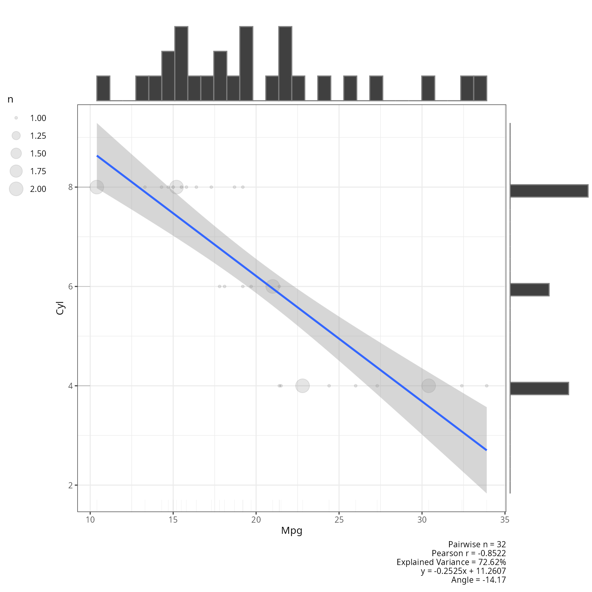
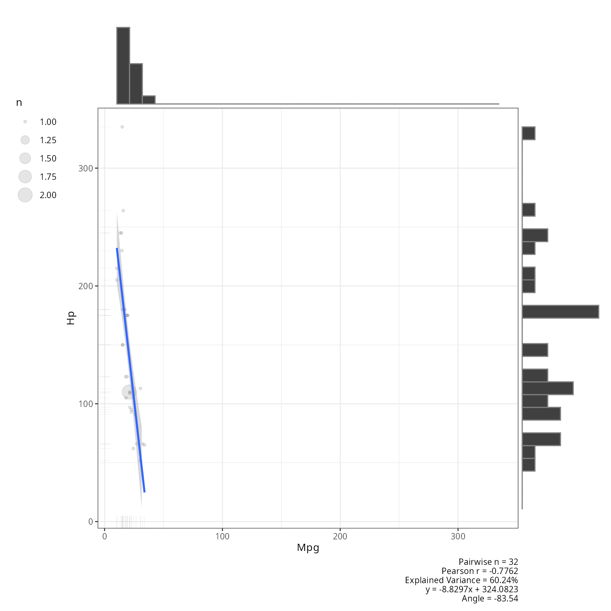
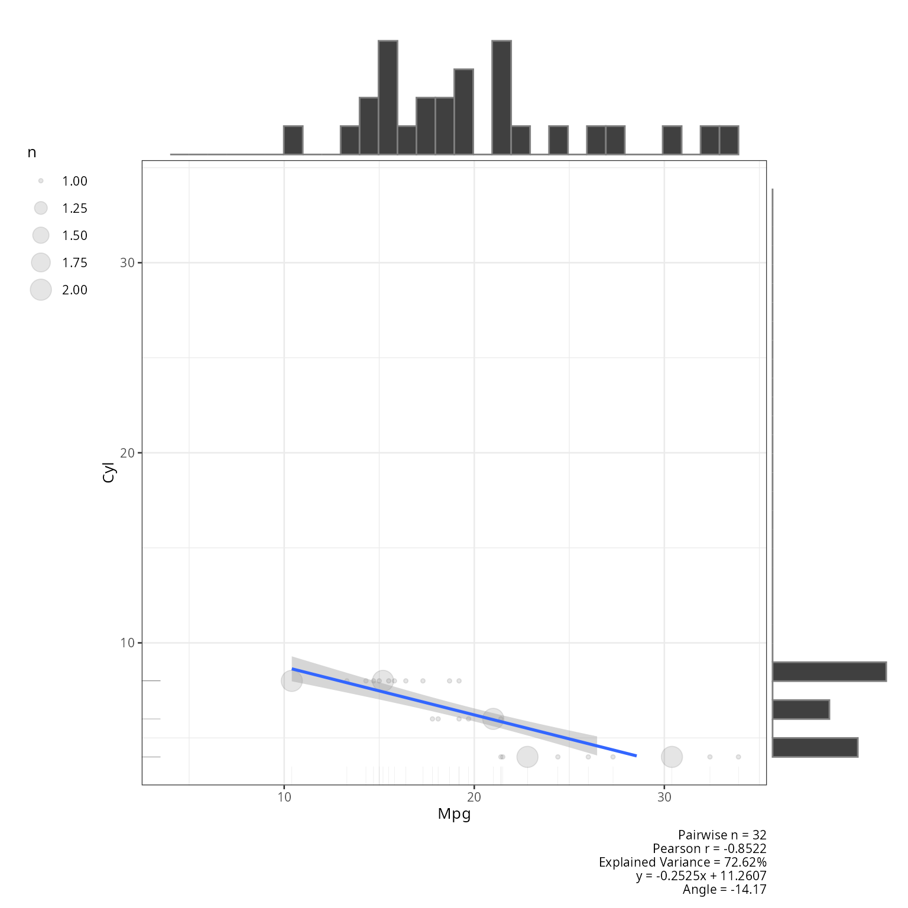
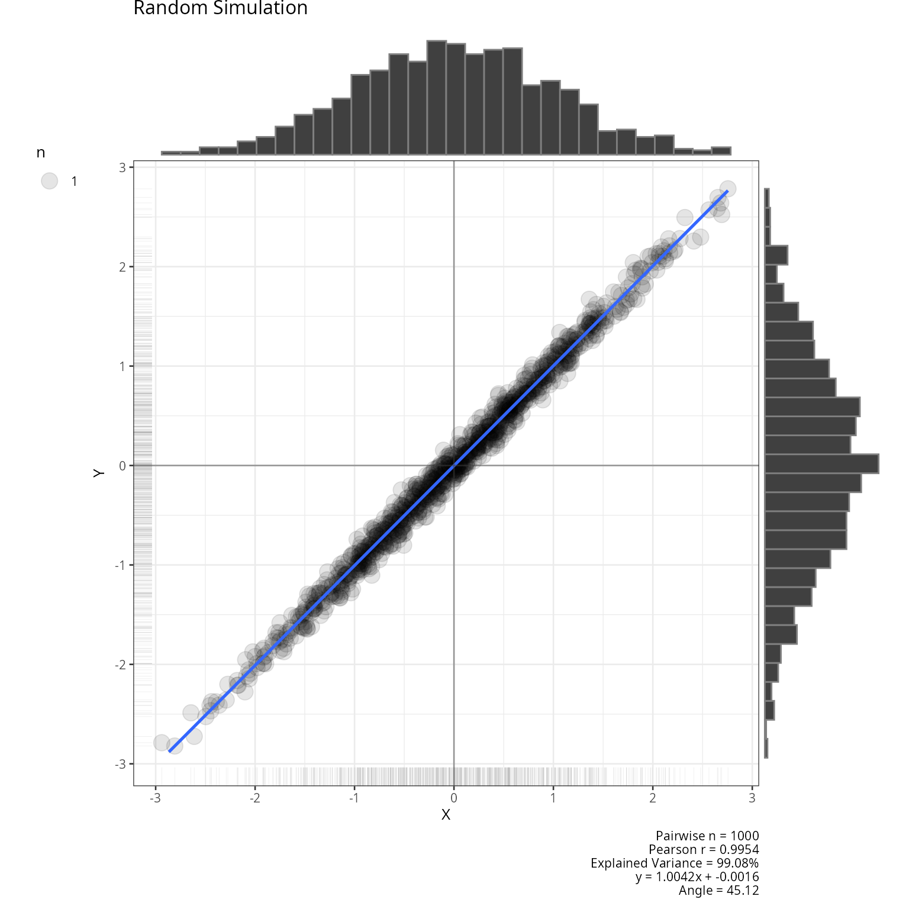
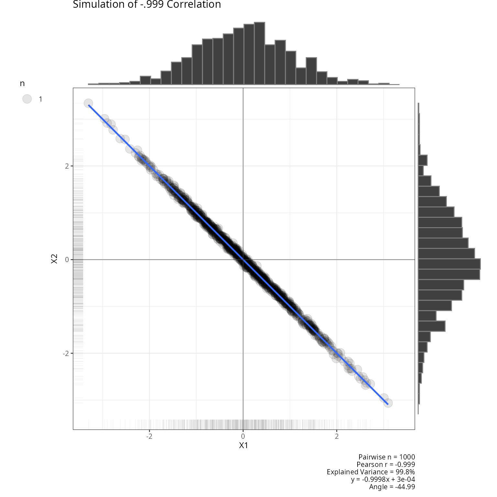
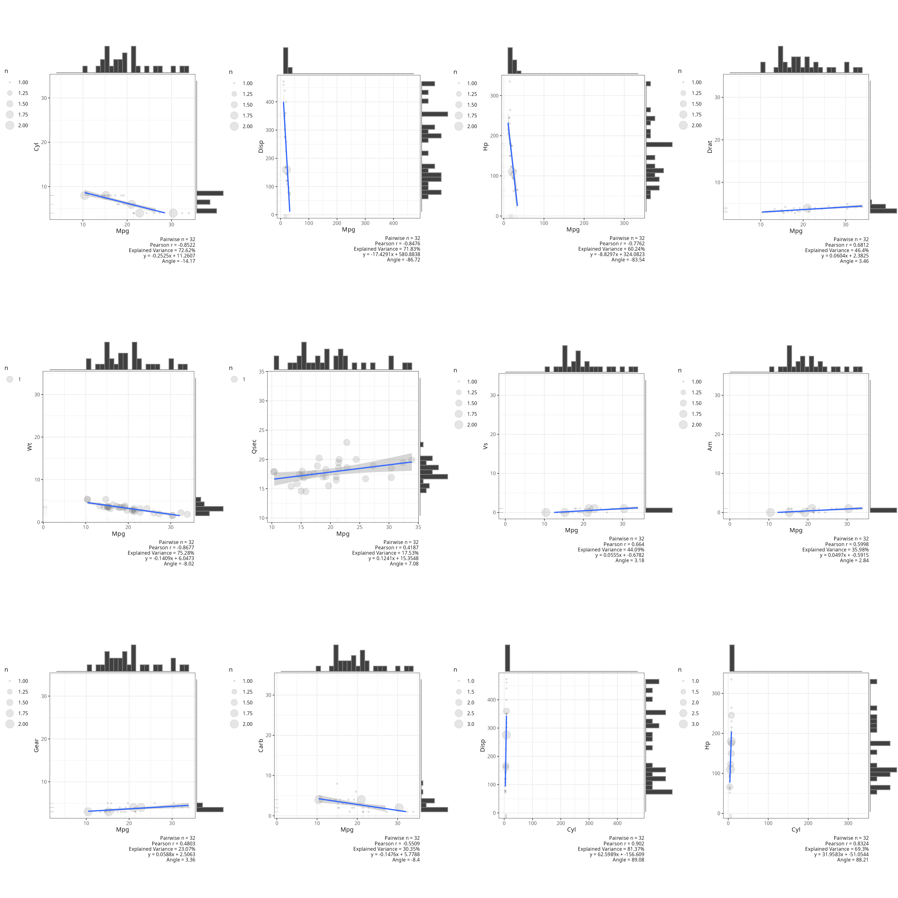
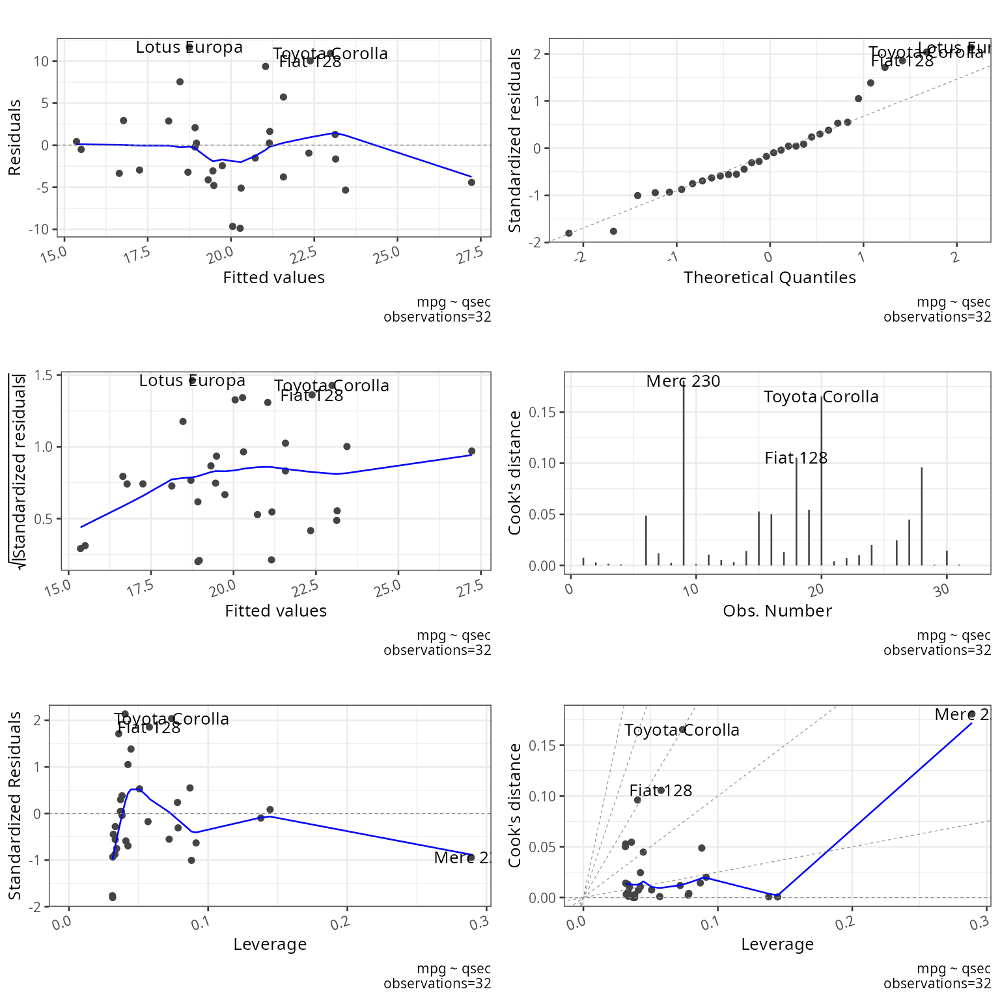
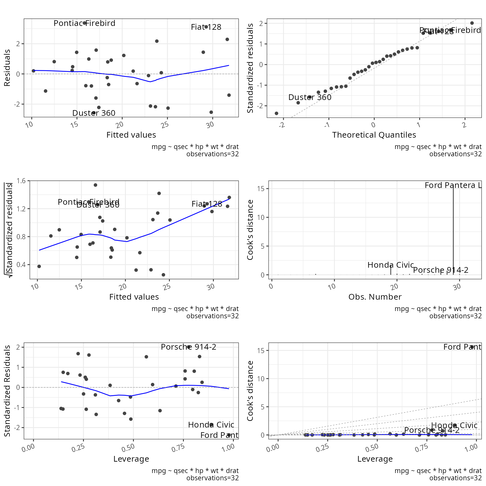

# Linear regression

## Description

This shows the output of linear regression functions from the package
rwf. The functions cover scatterplot visualisation and full regression
reporting for both simple and multiple regression models.

Installation instructions for rwf can be found
[here](https://github.com/sedzinfo/rwf)

The code can be found
[here](https://github.com/sedzinfo/rwf/blob/main/rwf/R/GLM_LINEAR_REGRESSION.R)

## Plot Scatterplot

`plot_scatterplot` produces scatterplots with a fitted regression line
and confidence band. It supports pairwise plots across all columns of a
dataframe, specific variable combinations, and symmetric
vs. non-symmetric axis scaling.

The examples show:

- **Full `mtcars` matrix**: all pairwise scatterplots stored in `result`
  for later multiplot use.
- **Single pair, equal axes** (`coord_equal = TRUE`): both axes share
  the same scale — useful when variables are on comparable units.
- **Single pair, free axes** (`coord_equal = FALSE`): each axis scales
  independently — better for variables with very different ranges.
- **Custom combinations**: only selected x–y pairs are plotted using the
  `combinations` argument, avoiding a full matrix when you only care
  about specific relationships.
- **All orders** (`all_orders = TRUE`): plots both x~y and y~x for a
  given pair, showing how the regression line changes with axis
  assignment.
- **Random simulation**: x and y generated with near-perfect correlation
  (sd = 0.1 noise) — confirms the function handles near-linear data
  cleanly.
- **Negative correlation simulation**: a matrix with r = −0.999 is
  generated and plotted — a stress test for strong negative linear
  relationships.

``` r

result<-plot_scatterplot(df=mtcars,title="",coord_equal=TRUE,base_size=10)
plot_scatterplot(df=mtcars[,1:2],base_size=10,coord_equal=TRUE,all_orders=FALSE)
```


``` r

plot_scatterplot(df=mtcars[,1:2],base_size=10,coord_equal=FALSE,all_orders=FALSE)
```



``` r

plot_scatterplot(df=mtcars,base_size=10,coord_equal=TRUE,all_orders=FALSE,
                 combinations=data.frame(x=c("mpg","mpg","mpg"),
                                         y=c("cyl","hp","mpg")))
```



``` r

plot_scatterplot(df=mtcars,base_size=10,coord_equal=TRUE,all_orders=TRUE,
                 combinations=data.frame(x=c("mpg"),y=c("cyl")))
```



``` r

x<-rnorm(1000)
y<-x+rnorm(x,sd=.1)
plot_scatterplot(df=data.frame(x,y),title="Random Simulation",coord_equal=TRUE)
```



``` r

df<-data.frame(matrix(-.999,ncol=2,nrow=2))
correlation_martix<-as.matrix(df)
diag(correlation_martix)<-1
df<-generate_correlation_matrix(correlation_martix,nrows=1000)
plot_scatterplot(df,title="Simulation of -.999 Correlation",coord_equal=TRUE,base_size=10)
```



## Plot Multiplot

`plot_multiplot` arranges multiple ggplot objects into a grid. Here it
displays the first 12 pairwise scatterplots from the full `mtcars`
matrix generated above, laid out in 4 columns. This is useful for
quickly scanning all pairwise relationships in a dataset side by side.

``` r

plot_multiplot(plotlist=result[1:12],cols=4)
```



## Report Regression

`report_regression` fits a linear model and returns a structured report
with model fit statistics (R², adjusted R², F, p), a coefficient table
with standardized and unstandardized betas, confidence intervals, and
tolerance/VIF collinearity diagnostics.

Two models are demonstrated:

- **Simple regression** (`mpg ~ qsec`): one predictor, with
  `plot_diagnostics = TRUE` to produce residual diagnostic plots
  (residuals vs. fitted, Q-Q plot, scale-location, leverage). These help
  assess whether linearity, homoscedasticity, and normality assumptions
  hold.
- **Multiple regression with interactions**
  (`mpg ~ qsec * hp * wt * drat`): all main effects and their two-,
  three-, and four-way interactions. This tests how the function handles
  a highly parameterised model and whether collinearity among
  interaction terms is flagged in the VIF output.

``` r

regressionmodel<-lm(stats::formula(mpg~qsec),data=mtcars)
multipleregressionmodel<-lm(mpg~qsec*hp*wt*drat,data=mtcars)
res<-report_regression(model=regressionmodel,plot_diagnostics=TRUE)
```



    ## [1] "##################################################"
    ## [1] "Summary"
    ## [1] "##################################################"
    ## 
    ## Call:
    ## lm(formula = stats::formula(mpg ~ qsec), data = mtcars)
    ## 
    ## Residuals:
    ##     Min      1Q  Median      3Q     Max 
    ## -9.8760 -3.4539 -0.7203  2.2774 11.6491 
    ## 
    ## Coefficients:
    ##             Estimate Std. Error t value Pr(>|t|)  
    ## (Intercept)  -5.1140    10.0295  -0.510   0.6139  
    ## qsec          1.4121     0.5592   2.525   0.0171 *
    ## ---
    ## Signif. codes:  0 '***' 0.001 '**' 0.01 '*' 0.05 '.' 0.1 ' ' 1
    ## 
    ## Residual standard error: 5.564 on 30 degrees of freedom
    ## Multiple R-squared:  0.1753, Adjusted R-squared:  0.1478 
    ## F-statistic: 6.377 on 1 and 30 DF,  p-value: 0.01708
    ## 
    ## [1] "##################################################"
    ## [1] "Coefficients"
    ## [1] "##################################################"
    ## [1] "Unstandardized coefficients (b's) indicate the change in the outcome resulting from a unit change in the predictor"                                            
    ## [2] "Standardized coefficients (for more than one predictors), indicate the change in outcome as a result of a unit change by a standard deviation of the predictor"
    ## [3] "t-test checks if coefficients are significantly different from 0. Coefficients of 0 indicate no predictor effects"                                             
    ## [4] "Significance value for t-test"                                                                                                                                 
    ## [1] "#########################"
    ##     Row.names standardized  Estimate Std. Error    t value   Pr(>|t|)       2.5 %    97.5 %
    ## 1        qsec     0.418684  1.412125  0.5592101  2.5252133 0.01708199   0.2700654  2.554184
    ## 2 (Intercept)           NA -5.114038 10.0295433 -0.5098974 0.61385436 -25.5970982 15.369022
    ## [1] "##################################################"
    ## [1] "ANOVA"
    ## [1] "##################################################"
    ## [1] "ANOVA tests for differences between the baseline model (model with no coefficient) and the predictive model (model with coefficient). A significant F shows that the predictor(s) significantly changes model predictability"
    ## [2] "Significance value for ANOVA"                                                                                                                                                                                                
    ## [3] "Null hypothesis: no variance explained by the predictor"                                                                                                                                                                     
    ## [1] "#########################"
    ## Analysis of Variance Table
    ## 
    ## Response: mpg
    ##           Df Sum Sq Mean Sq F value  Pr(>F)  
    ## qsec       1 197.39 197.392  6.3767 0.01708 *
    ## Residuals 30 928.66  30.955                  
    ## ---
    ## Signif. codes:  0 '***' 0.001 '**' 0.01 '*' 0.05 '.' 0.1 ' ' 1
    ## [1] "##################################################"
    ## [1] "Deviance"
    ## [1] "##################################################"
    ##   deviance
    ## 1 928.6553
    ## [1] "##################################################"
    ## [1] "Outliers"
    ## [1] "##################################################"
    ##              rstudent          p    bonf.p signif cutoff
    ## Lotus Europa 2.282331 0.02998961 0.9596677  FALSE   0.05
    ## [1] "##################################################"
    ## [1] "Durbin Watson"
    ## [1] "##################################################"
    ## [1] "Test the assumption of independent errors.\nTest values may vary between 0 and 4.\nValues above 3 and bellow 1 are problematic.\nValues of 2 are ideal indicating uncorrelated residuals.\n                        \nA value greater than 2 indicates a negative correlation between adjacent residuals.\nA value less than 2 indicates a positive correlation between adjacent residuals."
    ## [2] "Autocorrelation"                                                                                                                                                                                                                                                                                                                                                                           
    ## [3] "Durbin-Watson Statistic"                                                                                                                                                                                                                                                                                                                                                                   
    ## [4] "Significance value for Durbin-Watson Statistic"                                                                                                                                                                                                                                                                                                                                            
    ## [1] "#########################"
    ##        dw.r     dw.dw dw.p dw.alternative
    ## 1 0.5922771 0.8065068    0      two.sided
    ## [1] "##################################################"
    ## [1] "CALL"
    ## [1] "##################################################"
    ##                         call
    ## 1 lm(mpg ~ qsec,data=mtcars)
    ## NULL

``` r

res<-report_regression(model=multipleregressionmodel)
```



    ## [1] "##################################################"
    ## [1] "Summary"
    ## [1] "##################################################"
    ## 
    ## Call:
    ## lm(formula = mpg ~ qsec * hp * wt * drat, data = mtcars)
    ## 
    ## Residuals:
    ##     Min      1Q  Median      3Q     Max 
    ## -2.5752 -1.2004  0.1321  1.0475  3.3723 
    ## 
    ## Coefficients:
    ##                   Estimate Std. Error t value Pr(>|t|)
    ## (Intercept)     1754.76788 1332.32671   1.317    0.206
    ## qsec             -91.66358   72.94035  -1.257    0.227
    ## hp               -14.97597   10.14812  -1.476    0.159
    ## wt              -499.24128  392.14336  -1.273    0.221
    ## drat            -442.97619  328.51075  -1.348    0.196
    ## qsec:hp            0.82884    0.55545   1.492    0.155
    ## qsec:wt           25.76290   21.27164   1.211    0.243
    ## hp:wt              4.22975    2.93589   1.441    0.169
    ## qsec:drat         23.83671   17.84096   1.336    0.200
    ## hp:drat            3.98764    2.51452   1.586    0.132
    ## wt:drat          125.77969   97.63871   1.288    0.216
    ## qsec:hp:wt        -0.22968    0.15916  -1.443    0.168
    ## qsec:hp:drat      -0.22314    0.13653  -1.634    0.122
    ## qsec:wt:drat      -6.57692    5.24821  -1.253    0.228
    ## hp:wt:drat        -1.11655    0.73401  -1.521    0.148
    ## qsec:hp:wt:drat    0.06106    0.03947   1.547    0.141
    ## 
    ## Residual standard error: 2.278 on 16 degrees of freedom
    ## Multiple R-squared:  0.9263, Adjusted R-squared:  0.8571 
    ## F-statistic:  13.4 on 15 and 16 DF,  p-value: 2.5e-06
    ## 
    ## [1] "##################################################"
    ## [1] "Coefficients"
    ## [1] "##################################################"
    ## [1] "Unstandardized coefficients (b's) indicate the change in the outcome resulting from a unit change in the predictor"                                            
    ## [2] "Standardized coefficients (for more than one predictors), indicate the change in outcome as a result of a unit change by a standard deviation of the predictor"
    ## [3] "t-test checks if coefficients are significantly different from 0. Coefficients of 0 indicate no predictor effects"                                             
    ## [4] "Significance value for t-test"                                                                                                                                 
    ## [1] "#########################"
    ##          Row.names  standardized      Estimate   Std. Error   t value  Pr(>|t|)         2.5 %       97.5 %
    ## 1             qsec -2.717754e+01  -91.66357842 7.294035e+01 -1.256692 0.2269029 -2.462902e+02 6.296306e+01
    ## 2               hp -1.703674e+02  -14.97596573 1.014812e+01 -1.475738 0.1594222 -3.648901e+01 6.537081e+00
    ## 3               wt -8.105037e+01 -499.24127624 3.921434e+02 -1.273109 0.2211668 -1.330548e+03 3.320655e+02
    ## 4             drat -3.929849e+01 -442.97618634 3.285108e+02 -1.348437 0.1962972 -1.139388e+03 2.534355e+02
    ## 5          qsec:hp  2.457432e-01    0.82883521 5.554520e-01  1.492182 0.1551057 -3.486704e-01 2.006341e+00
    ## 6          qsec:wt  2.930801e+02   25.76289915 2.127164e+01  1.211138 0.2434282 -1.933096e+01 7.085676e+01
    ## 7            hp:wt  6.866880e-01    4.22975267 2.935894e+00  1.440704 0.1689513 -1.994064e+00 1.045357e+01
    ## 8        qsec:drat  2.114666e+00   23.83671194 1.784096e+01  1.336066 0.2002207 -1.398444e+01 6.165787e+01
    ## 9          hp:drat  1.182306e+00    3.98764491 2.514520e+00  1.585847 0.1323373 -1.342900e+00 9.318190e+00
    ## 10         wt:drat  1.430876e+03  125.77968939 9.763871e+01  1.288215 0.2159897 -8.120513e+01 3.327645e+02
    ## 11      qsec:hp:wt -3.728817e-02   -0.22968182 1.591600e-01 -1.443087 0.1682885 -5.670860e-01 1.077224e-01
    ## 12    qsec:hp:drat -1.979589e-02   -0.22314115 1.365331e-01 -1.634337 0.1217071 -5.125784e-01 6.629613e-02
    ## 13    qsec:wt:drat -1.950004e+00   -6.57691575 5.248208e+00 -1.253174 0.2281474 -1.770262e+01 4.548789e+00
    ## 14      hp:wt:drat -1.270188e+01   -1.11654543 7.340101e-01 -1.521158 0.1477359 -2.672577e+00 4.394865e-01
    ## 15 qsec:hp:wt:drat  9.912982e-03    0.06106043 3.946677e-02  1.547135 0.1413804 -2.260538e-02 1.447262e-01
    ## 16     (Intercept)            NA 1754.76788174 1.332327e+03  1.317070 0.2063672 -1.069639e+03 4.579174e+03
    ## [1] "##################################################"
    ## [1] "ANOVA"
    ## [1] "##################################################"
    ## [1] "ANOVA tests for differences between the baseline model (model with no coefficient) and the predictive model (model with coefficient). A significant F shows that the predictor(s) significantly changes model predictability"
    ## [2] "Significance value for ANOVA"                                                                                                                                                                                                
    ## [3] "Null hypothesis: no variance explained by the predictor"                                                                                                                                                                     
    ## [1] "#########################"
    ## Analysis of Variance Table
    ## 
    ## Response: mpg
    ##                 Df Sum Sq Mean Sq  F value    Pr(>F)    
    ## qsec             1 197.39  197.39  38.0362 1.353e-05 ***
    ## hp               1 519.76  519.76 100.1548 2.717e-08 ***
    ## wt               1 222.83  222.83  42.9388 6.653e-06 ***
    ## drat             1  11.96   11.96   2.3038   0.14857    
    ## qsec:hp          1   1.42    1.42   0.2740   0.60785    
    ## qsec:wt          1  12.93   12.93   2.4908   0.13408    
    ## hp:wt            1  44.06   44.06   8.4894   0.01015 *  
    ## qsec:drat        1   3.74    3.74   0.7210   0.40833    
    ## hp:drat          1   2.84    2.84   0.5465   0.47048    
    ## wt:drat          1   0.70    0.70   0.1356   0.71750    
    ## qsec:hp:wt       1   6.90    6.90   1.3295   0.26583    
    ## qsec:hp:drat     1   4.56    4.56   0.8796   0.36225    
    ## qsec:wt:drat     1   0.32    0.32   0.0613   0.80766    
    ## hp:wt:drat       1   1.18    1.18   0.2273   0.64001    
    ## qsec:hp:wt:drat  1  12.42   12.42   2.3936   0.14138    
    ## Residuals       16  83.03    5.19                       
    ## ---
    ## Signif. codes:  0 '***' 0.001 '**' 0.01 '*' 0.05 '.' 0.1 ' ' 1
    ## [1] "##################################################"
    ## [1] "Deviance"
    ## [1] "##################################################"
    ##   deviance
    ## 1 83.03333
    ## [1] "##################################################"
    ## [1] "Outliers"
    ## [1] "##################################################"
    ##                 rstudent          p    bonf.p signif cutoff
    ## Ford Pantera L -2.841787 0.01237028 0.3958488  FALSE   0.05
    ## [1] "##################################################"
    ## [1] "Durbin Watson"
    ## [1] "##################################################"
    ## [1] "Test the assumption of independent errors.\nTest values may vary between 0 and 4.\nValues above 3 and bellow 1 are problematic.\nValues of 2 are ideal indicating uncorrelated residuals.\n                        \nA value greater than 2 indicates a negative correlation between adjacent residuals.\nA value less than 2 indicates a positive correlation between adjacent residuals."
    ## [2] "Autocorrelation"                                                                                                                                                                                                                                                                                                                                                                           
    ## [3] "Durbin-Watson Statistic"                                                                                                                                                                                                                                                                                                                                                                   
    ## [4] "Significance value for Durbin-Watson Statistic"                                                                                                                                                                                                                                                                                                                                            
    ## [1] "#########################"
    ##        dw.r    dw.dw  dw.p dw.alternative
    ## 1 -0.190954 2.327011 0.802      two.sided
    ## [1] "##################################################"
    ## [1] "CALL"
    ## [1] "##################################################"
    ##                                          call
    ## 1 lm(mpg ~ qsec * hp * wt * drat,data=mtcars)
    ## NULL

``` r

res
```

    ## $r
    ##   r_squared adjusted_r_squared
    ## 1 0.9262612          0.8571311
    ## 
    ## $coeficients
    ##          Row.names  standardized      Estimate   Std. Error   t value  Pr(>|t|)         2.5 %       97.5 %
    ## 1             qsec -2.717754e+01  -91.66357842 7.294035e+01 -1.256692 0.2269029 -2.462902e+02 6.296306e+01
    ## 2               hp -1.703674e+02  -14.97596573 1.014812e+01 -1.475738 0.1594222 -3.648901e+01 6.537081e+00
    ## 3               wt -8.105037e+01 -499.24127624 3.921434e+02 -1.273109 0.2211668 -1.330548e+03 3.320655e+02
    ## 4             drat -3.929849e+01 -442.97618634 3.285108e+02 -1.348437 0.1962972 -1.139388e+03 2.534355e+02
    ## 5          qsec:hp  2.457432e-01    0.82883521 5.554520e-01  1.492182 0.1551057 -3.486704e-01 2.006341e+00
    ## 6          qsec:wt  2.930801e+02   25.76289915 2.127164e+01  1.211138 0.2434282 -1.933096e+01 7.085676e+01
    ## 7            hp:wt  6.866880e-01    4.22975267 2.935894e+00  1.440704 0.1689513 -1.994064e+00 1.045357e+01
    ## 8        qsec:drat  2.114666e+00   23.83671194 1.784096e+01  1.336066 0.2002207 -1.398444e+01 6.165787e+01
    ## 9          hp:drat  1.182306e+00    3.98764491 2.514520e+00  1.585847 0.1323373 -1.342900e+00 9.318190e+00
    ## 10         wt:drat  1.430876e+03  125.77968939 9.763871e+01  1.288215 0.2159897 -8.120513e+01 3.327645e+02
    ## 11      qsec:hp:wt -3.728817e-02   -0.22968182 1.591600e-01 -1.443087 0.1682885 -5.670860e-01 1.077224e-01
    ## 12    qsec:hp:drat -1.979589e-02   -0.22314115 1.365331e-01 -1.634337 0.1217071 -5.125784e-01 6.629613e-02
    ## 13    qsec:wt:drat -1.950004e+00   -6.57691575 5.248208e+00 -1.253174 0.2281474 -1.770262e+01 4.548789e+00
    ## 14      hp:wt:drat -1.270188e+01   -1.11654543 7.340101e-01 -1.521158 0.1477359 -2.672577e+00 4.394865e-01
    ## 15 qsec:hp:wt:drat  9.912982e-03    0.06106043 3.946677e-02  1.547135 0.1413804 -2.260538e-02 1.447262e-01
    ## 16     (Intercept)            NA 1754.76788174 1.332327e+03  1.317070 0.2063672 -1.069639e+03 4.579174e+03
    ## 
    ## $anova
    ## Analysis of Variance Table
    ## 
    ## Response: mpg
    ##                 Df Sum Sq Mean Sq  F value    Pr(>F)    
    ## qsec             1 197.39  197.39  38.0362 1.353e-05 ***
    ## hp               1 519.76  519.76 100.1548 2.717e-08 ***
    ## wt               1 222.83  222.83  42.9388 6.653e-06 ***
    ## drat             1  11.96   11.96   2.3038   0.14857    
    ## qsec:hp          1   1.42    1.42   0.2740   0.60785    
    ## qsec:wt          1  12.93   12.93   2.4908   0.13408    
    ## hp:wt            1  44.06   44.06   8.4894   0.01015 *  
    ## qsec:drat        1   3.74    3.74   0.7210   0.40833    
    ## hp:drat          1   2.84    2.84   0.5465   0.47048    
    ## wt:drat          1   0.70    0.70   0.1356   0.71750    
    ## qsec:hp:wt       1   6.90    6.90   1.3295   0.26583    
    ## qsec:hp:drat     1   4.56    4.56   0.8796   0.36225    
    ## qsec:wt:drat     1   0.32    0.32   0.0613   0.80766    
    ## hp:wt:drat       1   1.18    1.18   0.2273   0.64001    
    ## qsec:hp:wt:drat  1  12.42   12.42   2.3936   0.14138    
    ## Residuals       16  83.03    5.19                       
    ## ---
    ## Signif. codes:  0 '***' 0.001 '**' 0.01 '*' 0.05 '.' 0.1 ' ' 1
    ## 
    ## $deviance
    ##   deviance
    ## 1 83.03333
    ## 
    ## $variance_covariance
    ##                   (Intercept)          qsec            hp            wt          drat       qsec:hp       qsec:wt         hp:wt     qsec:drat       hp:drat       wt:drat    qsec:hp:wt  qsec:hp:drat
    ## (Intercept)     1775094.46689 -97145.564799 -1.276911e+04 -518872.18686 -436345.79921  696.16029575 28068.1184610  3628.9100948 23678.8426647 3089.99140791 127671.480112 -1.952401e+02 -166.49870865
    ## qsec             -97145.56480   5320.295190  6.999534e+02   28411.43938   23888.18911  -38.16693402 -1538.6505858  -199.2139240 -1297.2111542 -169.44986064  -6993.929902  1.072520e+01    9.13137828
    ## hp               -12769.11226    699.953438  1.029843e+02    3750.99973    3171.75048   -5.63339270  -203.2311607   -29.5255282  -172.4073953  -25.38510531   -932.991606  1.596306e+00    1.37445803
    ## wt              -518872.18686  28411.439383  3.751000e+03  153776.41327  128331.56346 -204.39144348 -8330.5048574 -1080.5272154 -6967.4533116 -913.81199716 -38133.833502  5.818519e+01   49.21105993
    ## drat            -436345.79921  23888.189106  3.171750e+03  128331.56346  107919.31555 -172.93927582 -6948.7447057  -908.0534609 -5858.8339653 -773.35540170 -31799.302097  4.890958e+01   41.68773134
    ## qsec:hp             696.16030    -38.166934 -5.633393e+00    -204.39144    -172.93928    0.30852692    11.0688356     1.6124078     9.4032685    1.38993613     50.836544 -8.723061e-02   -0.07537428
    ## qsec:wt           28068.11846  -1538.650586 -2.032312e+02   -8330.50486   -6948.74471   11.06883559   452.4825628    58.8257531   377.6972760   49.56659412   2068.384113 -3.171778e+00   -2.66767391
    ## hp:wt              3628.91009   -199.213924 -2.952553e+01   -1080.52722    -908.05346    1.61240782    58.8257531     8.6194712    49.4334400    7.33542529    271.173257 -4.669722e-01   -0.39648332
    ## qsec:drat         23678.84266  -1297.211154 -1.724074e+02   -6967.45331   -5858.83397    9.40326854   377.6972760    49.4334400   318.3000180   42.06999526   1727.316279 -2.664842e+00   -2.26858032
    ## hp:drat            3089.99141   -169.449861 -2.538511e+01    -913.81200    -773.35540    1.38993613    49.5665941     7.3354253    42.0699953    6.32281173    229.152062 -3.974112e-01   -0.34295589
    ## wt:drat          127671.48011  -6993.929902 -9.329916e+02  -38133.83350  -31799.30210   50.83654373  2068.3841126   271.1732569  1727.3162788  229.15206239   9533.317441 -1.462017e+01  -12.34302494
    ## qsec:hp:wt         -195.24013     10.725198  1.596306e+00      58.18519      48.90958   -0.08723061    -3.1717784    -0.4669722    -2.6648418   -0.39741125    -14.620167  2.533192e-02    0.02150049
    ## qsec:hp:drat       -166.49871      9.131378  1.374458e+00      49.21106      41.68773   -0.07537428    -2.6676739    -0.3964833    -2.2685803   -0.34295589    -12.343025  2.150049e-02    0.01864129
    ## qsec:wt:drat      -6827.35797    374.454141  4.998774e+01    2043.05191    1702.78453   -2.72261797  -111.1378238   -14.6102947   -92.6120005  -12.29997575   -511.591103  7.889530e-01    0.66224905
    ## hp:wt:drat         -874.09801     48.019350  7.258150e+00     262.62898     220.71308   -0.39668541   -14.3262599    -2.1410677   -12.0284497   -1.82433320    -66.557503  1.162762e-01    0.09876548
    ## qsec:hp:wt:drat      46.27866     -2.544291 -3.871177e-01     -13.92659     -11.70852    0.02117718     0.7608856     0.1145361     0.6387739    0.09763632      3.536642 -6.231388e-03   -0.00529346
    ##                  qsec:wt:drat    hp:wt:drat qsec:hp:wt:drat
    ## (Intercept)     -6827.3579658 -874.09801039    46.278655763
    ## qsec              374.4541415   48.01934952    -2.544291061
    ## hp                 49.9877373    7.25815030    -0.387117743
    ## wt               2043.0519062  262.62897560   -13.926585689
    ## drat             1702.7845265  220.71308207   -11.708515627
    ## qsec:hp            -2.7226180   -0.39668541     0.021177176
    ## qsec:wt          -111.1378238  -14.32625987     0.760885595
    ## hp:wt             -14.6102947   -2.14106771     0.114536070
    ## qsec:drat         -92.6120005  -12.02844970     0.638773901
    ## hp:drat           -12.2999757   -1.82433320     0.097636321
    ## wt:drat          -511.5911034  -66.55750318     3.536642241
    ## qsec:hp:wt          0.7889530    0.11627619    -0.006231388
    ## qsec:hp:drat        0.6622490    0.09876548    -0.005293460
    ## qsec:wt:drat       27.5436891    3.59589688    -0.191464345
    ## hp:wt:drat          3.5958969    0.53877082    -0.028932233
    ## qsec:hp:wt:drat    -0.1914643   -0.02893223     0.001557626
    ## 
    ## $outlier_test
    ##                 rstudent          p    bonf.p signif cutoff
    ## Ford Pantera L -2.841787 0.01237028 0.3958488  FALSE   0.05
    ## 
    ## $durbin_watson
    ##        dw.r    dw.dw  dw.p dw.alternative
    ## 1 -0.190954 2.327011 0.802      two.sided
    ## 
    ## $vif
    ## data frame with 0 columns and 0 rows
    ## 
    ## $call
    ##                                          call
    ## 1 lm(mpg ~ qsec * hp * wt * drat,data=mtcars)
    ## 
    ## $diagnostics
    ##                     simple_residuals standard_residuals student_residuals   fitted cooks_distance       dffits hatvalues covariance_ratio dfbeta.(Intercept)  dfbeta.qsec   dfbeta.hp    dfbeta.wt
    ## Mazda RX4                -2.12697306        -1.08816432       -1.09490418 23.12697   2.651688e-02  -0.65539453 0.2637886        1.1147697        -443.983537  23.89441450  2.90820404  129.8781460
    ## Mazda RX4 Wag            -0.64116616        -0.32507258       -0.31579474 21.64117   2.205828e-03  -0.18250315 0.2503681        3.3695077        -126.335941   6.82687528  0.81388964   37.9188967
    ## Datsun 710               -2.26562748        -1.07701837       -1.08280769 25.06563   1.252330e-02  -0.45003631 0.1472959        0.9878674          -8.341294   0.07907045  0.03011934    0.7094257
    ## Hornet 4 Drive            1.22467268         0.61377316        0.60140548 20.17533   7.145658e-03   0.33131462 0.2328296        2.5003719         -78.579366   4.30293395  0.30815297   20.3517661
    ## Hornet Sportabout         1.57706791         0.75024407        0.73954545 17.12293   6.137217e-03   0.30889297 0.1485421        1.8597021         -70.892184   3.89658870  0.58475395   24.4685142
    ## Valiant                  -0.24479978        -0.25641315       -0.24878264 18.34480   1.928731e-02  -0.53898361 0.8243658       14.9705538         -83.510337   4.83386318  0.42096217   36.8974461
    ## Duster 360               -2.57524107        -1.57823113       -1.66303595 16.87524   1.477546e-01  -1.62017337 0.4869471        0.3651278        -509.273409  27.96268404  5.49877271  180.6421723
    ## Merc 240D                 0.07889755         0.06460062        0.06255745 24.32110   6.466424e-04   0.09849958 0.7125772        9.7302890          15.043109  -0.75891740 -0.11309340   -3.4760683
    ## Merc 230                 -0.10897415        -0.10601942       -0.10268894 22.90897   2.748192e-03  -0.20310555 0.7964160       13.6405736          17.842675  -0.92023572 -0.11659547   -7.9428636
    ## Merc 280                  0.79574451         0.40722969        0.39635788 18.40426   3.722391e-03   0.23753032 0.2642403        3.2309191          14.305852  -0.86477658  0.03257376   -8.0380994
    ## Merc 280C                -0.70206615        -0.37089119       -0.36066762 18.50207   3.854579e-03  -0.24149554 0.3095526        3.5426564          26.268491  -1.29936222 -0.29171670   -4.1927932
    ## Merc 450SE                1.43105667         0.69027399        0.67853462 14.96894   6.177229e-03   0.30903476 0.1717943        2.0904788         109.650330  -6.25415175 -1.26357886  -30.5187499
    ## Merc 450SL                0.98840621         0.50401056        0.49192683 16.31159   5.547312e-03   0.29077840 0.2589301        2.9335456          30.363795  -1.61279167 -0.26091118   -5.1839345
    ## Merc 450SLC              -0.78011250        -0.47723448       -0.46540458 15.98011   1.341100e-02  -0.45174098 0.4851053        4.3362937          19.531813  -1.22004958 -0.33961577  -10.8079756
    ## Cadillac Fleetwood        0.20299351         0.14017241        0.13580476 10.19701   1.810754e-03   0.16490818 0.5958833        6.8141922         -36.595959   2.03757745  0.49588538   11.1510254
    ## Lincoln Continental      -1.13196379        -0.65579879       -0.64368433 11.53196   1.994033e-02  -0.55440669 0.4258949        3.1632543         -16.212986   0.69952800 -0.06592689    5.8529418
    ## Chrysler Imperial         0.22819285         0.25294189        0.24540107 14.47181   2.149841e-02   0.56900866 0.8431697       16.7953005          61.156320  -3.26540852 -1.10785863  -20.1978399
    ## Fiat 128                  3.11932125         1.61079068        1.70390589 29.28068   6.224794e-02   1.05567193 0.2773807        0.2291303        -149.588223   9.28260473  1.10262400   49.3770607
    ## Honda Civic              -1.40574469        -1.85160052       -2.02254442 31.80574   1.714974e+00  -5.72189123 0.8889328        0.5335675        -468.189862  31.88134906  2.52247915  123.2003325
    ## Toyota Corolla            2.28930228         1.52289327        1.59462810 31.61070   1.879270e-01   1.81570164 0.5645534        0.5264861         636.379949 -34.70858349 -3.97200349 -203.9512341
    ## Toyota Corona            -2.17349109        -1.29271366       -1.32264006 23.67349   8.729279e-02  -1.20917317 0.4552734        0.8825975         684.825298 -37.82507079 -3.54286191 -190.8766511
    ## Dodge Challenger         -1.59670900        -1.15680729       -1.17007324 17.09671   1.441892e-01  -1.53630835 0.6328893        1.8912023         223.632461 -11.46315998 -1.05445063  -94.0060221
    ## AMC Javelin              -2.21948633        -1.04944956       -1.05301282 17.41949   1.103048e-02  -0.42153080 0.1381149        1.0409834          91.988650  -4.88939578 -0.86321526  -34.2761173
    ## Camaro Z28                0.81297694         0.80613778        0.79689061 12.48702   1.666332e-01   1.61409903 0.8040228        7.3812974        -437.547172  24.07817746  5.64992167  150.8298367
    ## Pontiac Firebird          3.37231073         1.67960818        1.79189996 15.82769   5.066313e-02   0.96053184 0.2232044        0.1622962         264.022136 -15.14948888 -3.31279565  -72.2678769
    ## Fiat X1-9                -2.53630654        -1.34379574       -1.38141202 29.83631   5.155354e-02  -0.93363946 0.3135570        0.6021663         580.957906 -32.62541324 -4.26821148 -174.3232776
    ## Porsche 914-2             2.17219836         2.01357168        2.25636851 23.82780   8.766045e-01   4.19666963 0.7757501        0.1167062       -2212.645818 120.13774954 10.20277334  618.0493505
    ## Lotus Europa              1.43860014         1.53468919        1.60910212 28.96140   7.221843e-01   3.56407789 0.8306805        1.2979909        1491.800498 -79.61748534 -8.61052115 -393.1640002
    ## Ford Pantera L           -0.79796966        -2.36632061       -2.84178716 16.59797   1.562110e+01 -18.98601503 0.9780874        0.1302363       -2003.245478 111.75459416 28.27324426  463.8606091
    ## Ferrari Dino              0.91431145         0.81653382        0.80761129 18.78569   1.308024e-01   1.43085656 0.7583941        5.8828804        -960.031072  52.56364634  8.48322263  263.2044773
    ## Maserati Bora             0.47535086         0.42439619        0.41325242 14.52465   3.530908e-02   0.73189225 0.7582574        9.6926181          10.457489  -0.54485037  0.13960691  -10.3809551
    ## Volvo 142E                0.18522756         0.10353029        0.10027637 21.21477   4.161954e-04   0.07903870 0.3832007        4.5046301          43.991920  -2.43513752 -0.27550685  -13.6262614
    ##                      dfbeta.drat dfbeta.qsec:hp dfbeta.qsec:wt dfbeta.hp:wt dfbeta.qsec:drat dfbeta.hp:drat dfbeta.wt:drat dfbeta.qsec:hp:wt dfbeta.qsec:hp:drat dfbeta.qsec:wt:drat dfbeta.hp:wt:drat
    ## Mazda RX4            106.0116281   -0.157697601    -6.83512329 -0.804304889      -5.65547298   -0.685385034    -31.2292674      0.0424304499        0.0367893243         1.616592885       0.187154086
    ## Mazda RX4 Wag         30.7819649   -0.043961563    -1.99920485 -0.228148678      -1.64261448   -0.190071822     -9.3645221      0.0119578616        0.0100911512         0.484109758       0.052835696
    ## Datsun 710            -0.1536841    0.002394206     0.06861911  0.007947272       0.11362615    0.034240848      0.3842894     -0.0016189107       -0.0031686886        -0.051150268      -0.013972377
    ## Hornet 4 Drive        18.8600509   -0.014936417    -1.08744006 -0.082819967      -1.01039826   -0.062609451     -4.8599566      0.0038643104        0.0027191740         0.251731149       0.016216549
    ## Hornet Sportabout     17.7181998   -0.029138765    -1.40589004 -0.208437184      -0.96299816   -0.143025892     -6.1385371      0.0111080176        0.0069592256         0.350093583       0.051550990
    ## Valiant               22.2705957   -0.022570478    -2.20271141 -0.197735257      -1.28097647   -0.112813791     -9.8428008      0.0114006166        0.0059726584         0.586110067       0.053471029
    ## Duster 360           143.0660930   -0.306164595    -9.59296587 -1.767031600      -7.76789339   -1.504836058    -50.4907711      0.0959982048        0.0829372132         2.658893458       0.483404354
    ## Merc 240D             -3.2285441    0.006437236     0.14613855  0.021216093       0.15978011    0.026704444      0.6357613     -0.0010230571       -0.0015593249        -0.021307914      -0.003851728
    ## Merc 230              -5.4714346    0.006270459     0.40583095  0.041402059       0.28456396    0.032253725      2.4909804     -0.0021251719       -0.0017406894        -0.127905305      -0.011659644
    ## Merc 280              -5.1165340   -0.001526850     0.47606385  0.020480854       0.29522466    0.003232421      2.6635405     -0.0014115671       -0.0002451523        -0.153251508      -0.009947173
    ## Merc 280C             -4.9161228    0.015642717     0.14050089  0.044890016       0.23094704    0.055348571      0.4152396     -0.0018657364       -0.0028831405         0.002617145      -0.004144130
    ## Merc 450SE           -28.0327993    0.069344131     1.74741235  0.364589919       1.56758075    0.311606018      7.8899227     -0.0199739111       -0.0167808882        -0.441483675      -0.090242291
    ## Merc 450SL            -6.3468576    0.017622253     0.12509464  0.006787306       0.32887650    0.053339024      0.8438151     -0.0001702248       -0.0037484201        -0.001791084       0.003131917
    ## Merc 450SLC           -7.3090784    0.013148908     0.87063652  0.211985471       0.43449204    0.104500101      3.5876538     -0.0118997118       -0.0042266826        -0.269073657      -0.060958014
    ## Cadillac Fleetwood     9.7350627   -0.028497245    -0.62259002 -0.150036616      -0.54642924   -0.133557220     -2.9879665      0.0086357133        0.0077128686         0.168219449       0.040652430
    ## Lincoln Continental    4.1181958    0.007816572    -0.27404820  0.008804541      -0.16686183    0.020176978     -1.4732472     -0.0016365820       -0.0023055788         0.065225768      -0.003490558
    ## Chrysler Imperial    -17.5923104    0.063369586     1.14015607  0.360101207       0.99008348    0.324810650      5.8298985     -0.0210318958       -0.0189969605        -0.344713015      -0.106024406
    ## Fiat 128              33.2061434   -0.057697681    -3.29802871 -0.431983159      -2.03638037   -0.239411414    -11.4037173      0.0250509135        0.0117076560         0.769517932       0.103020135
    ## Honda Civic          102.7770042   -0.174415214    -8.57439774 -0.645361486      -7.25322257   -0.575903256    -25.8211360      0.0458415654        0.0413031644         1.892346304       0.142757096
    ## Toyota Corolla      -179.0222869    0.207601064    11.27449153  1.314549650       9.71354347    1.072475115     57.7748052     -0.0703518832       -0.0553608451        -3.178377477      -0.358027972
    ## Toyota Corona       -161.8386910    0.198342313    10.42457066  0.959305085       8.91554630    0.856248383     44.5602069     -0.0528094410       -0.0481032648        -2.413217351      -0.226210320
    ## Dodge Challenger     -58.7539619    0.063853432     4.30172993  0.255024279       2.99139218    0.270385578     24.7557235     -0.0115818058       -0.0162998031        -1.126468678      -0.065701889
    ## AMC Javelin          -23.9739948    0.046450539     1.74114759  0.266356623       1.25978658    0.221491662      8.8610298     -0.0137622341       -0.0117660677        -0.445153165      -0.067991165
    ## Camaro Z28           130.0915458   -0.310934179    -8.18638795 -1.813442477      -7.10673818   -1.654788816    -43.8771165      0.0989916157        0.0906302879         2.368059739       0.527150841
    ## Pontiac Firebird     -68.8221278    0.179957169     4.29076143  1.000237193       3.86998708    0.829679490     19.1588168     -0.0551839330       -0.0442571865        -1.110738316      -0.252178187
    ## Fiat X1-9           -142.2113401    0.231756934     9.75916764  1.268823347       7.85605119    1.015250633     42.8837796     -0.0688117405       -0.0537917320        -2.360431941      -0.303478604
    ## Porsche 914-2        554.5305089   -0.558696263   -33.32501828 -2.728134069     -29.99310396   -2.472069941   -154.3008767      0.1472894332        0.1347448274         8.273299366       0.652634256
    ## Lotus Europa        -329.9938043    0.459173804    20.93153193  2.249711441      17.58889407    1.904576921     84.0610137     -0.1189795478       -0.1005844847        -4.472396668      -0.484548660
    ## Ford Pantera L       569.5171343   -1.563331591   -25.65449486 -7.062267457     -31.39239869   -7.815411469   -132.1314231      0.3880573281        0.4288733723         7.201854965       1.945129737
    ## Ferrari Dino         223.4645057   -0.464180896   -14.02821355 -2.222695631     -12.07657549   -1.910159445    -60.4398102      0.1183835738        0.1028399932         3.149830961       0.486400050
    ## Maserati Bora         -1.1092137   -0.009254615     0.55966168  0.014735640       0.04582551   -0.048834061      1.9062130     -0.0003458425        0.0031925067        -0.099693802       0.002222812
    ## Volvo 142E           -10.8206496    0.014167827     0.75746061  0.086364403       0.58646953    0.060780863      3.4124306     -0.0045143112       -0.0029504850        -0.185936212      -0.019594162
    ##                     dfbeta.qsec:hp:wt:drat       effects
    ## Mazda RX4                    -9.661717e-03 -113.64973741
    ## Mazda RX4 Wag                -2.687048e-03   14.04962378
    ## Datsun 710                    1.144444e-03  -22.79827810
    ## Hornet 4 Drive               -6.462635e-04   14.92764139
    ## Hornet Sportabout            -2.705714e-03    3.45771788
    ## Valiant                      -3.068420e-03   -1.19241544
    ## Duster 360                   -2.602166e-02   -3.59532094
    ## Merc 240D                     1.690093e-04    6.63751764
    ## Merc 230                      5.949401e-04   -1.93440708
    ## Merc 280                      6.280829e-04    1.68400359
    ## Merc 280C                     3.383369e-05   -0.83892551
    ## Merc 450SE                    4.843569e-03    2.62672533
    ## Merc 450SL                   -2.475198e-04   -2.13653899
    ## Merc 450SLC                   3.403508e-03    0.56383925
    ## Cadillac Fleetwood           -2.351649e-03    1.08600574
    ## Lincoln Continental           5.283891e-04    3.52447551
    ## Chrysler Imperial             6.318475e-03    0.91110977
    ## Fiat 128                     -5.879677e-03    4.92141610
    ## Honda Civic                  -1.066476e-02   -0.09034867
    ## Toyota Corolla                1.897297e-02    4.70201499
    ## Toyota Corona                 1.240132e-02   -1.99166765
    ## Dodge Challenger              2.936468e-03   -1.27149775
    ## AMC Javelin                   3.457485e-03   -1.92812887
    ## Camaro Z28                   -2.864848e-02    2.54706987
    ## Pontiac Firebird              1.366798e-02    3.04418038
    ## Fiat X1-9                     1.605944e-02   -0.59281340
    ## Porsche 914-2                -3.492730e-02    1.38305012
    ## Lotus Europa                  2.532652e-02    1.25317778
    ## Ford Pantera L               -1.059368e-01   -1.17720658
    ## Ferrari Dino                 -2.515548e-02    2.13472714
    ## Maserati Bora                -2.770040e-04    0.95401244
    ## Volvo 142E                    9.771126e-04    0.34972736
