# Logistic regression

## Description

This shows the output of logistic regression functions from the package
rwf. The functions include the logistic response function, a plot of a
fitted logistic model against its predictors, a likelihood-ratio test
for comparing nested models, and a full diagnostic report
(`report_logistic`) covering pseudo-R², coefficients, residual
diagnostics, and confusion-matrix-based classification performance.

Installation instructions for rwf can be found
[here](https://github.com/sedzinfo/rwf)

The code can be found
[here](https://github.com/sedzinfo/rwf/blob/main/rwf/R/GLM_LOGISTIC_REGRESSION.R)

## Theoretical Background

### The logistic function

Logistic regression models the probability of a binary outcome as

P(y=1\mid x) = \frac{1}{1+e^{-(\beta_0+\beta_1 x)}}

which maps any real-valued linear predictor onto the (0,1) probability
range via the S-shaped logistic curve.

### Maximum likelihood, deviance, and pseudo-R²

Unlike OLS regression, logistic regression coefficients are found by
**maximum likelihood** — the coefficients that make the observed 0/1
outcomes most probable. **Deviance** (-2 \times log-likelihood) plays
the role that residual sum of squares plays in OLS; it follows a \chi^2
distribution and can be tested for significance.

Because there’s no single, universally agreed-upon R^2 for logistic
regression (unlike OLS, where R^2 has one unambiguous definition),
several **pseudo-R^2** measures exist, all comparing the fitted model’s
deviance to the null (intercept-only) model’s deviance:

- **Hosmer-Lemeshow R^2_L**: 1 -
  \text{deviance}\_{model}/\text{deviance}\_{null} — the proportional
  reduction in deviance.
- **Cox and Snell R^2\_{CS}**: based on the likelihood ratio, but capped
  below 1 even for a perfect model.
- **Nagelkerke R^2_N**: a rescaling of Cox & Snell that stretches it to
  reach a true maximum of 1.

### The likelihood-ratio test

To test whether an additional predictor (or set of predictors)
significantly improves a model, compare the deviance of two *nested*
models:

X^2 = \text{deviance}\_{smaller} - \text{deviance}\_{larger} \sim
\chi^2\_{df}

with degrees of freedom equal to the difference in the number of
parameters between the two models. A significant result means the larger
model fits significantly better than the smaller one.

### Diagnostics

Logistic regression carries over the same influence diagnostics as OLS —
standardized/studentized residuals, `dfbeta`, hat values (leverage), and
VIF (multicollinearity) — interpreted the same way, but computed on the
deviance/Pearson residual scale rather than raw residuals.

------------------------------------------------------------------------

## The Logistic Function

``` r

x <- -10:10
plot(x, compute_y_logistic(intercept = 0, coefficient = 1, x = x), type = "l",
     xlab = "x", ylab = "P(y=1)", main = "Logistic function (intercept=0, coefficient=1)")
grid()
abline(h = .5, lty = 2)
```

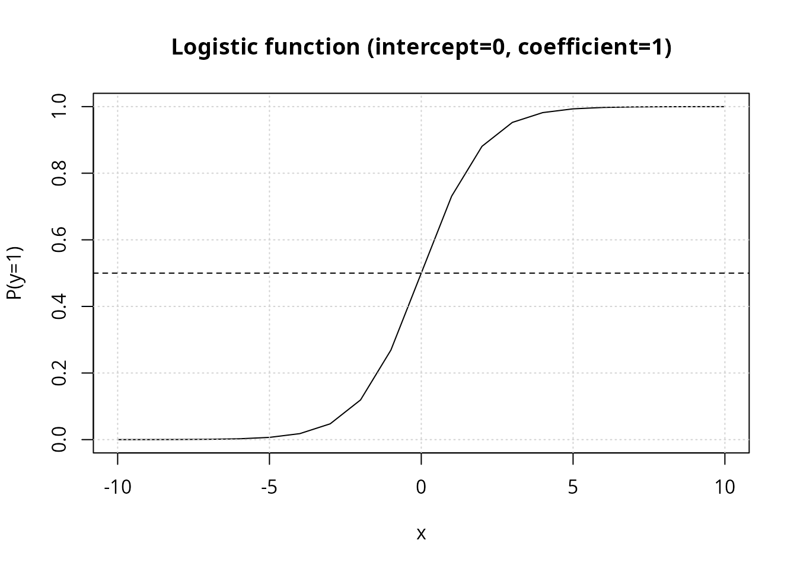

The curve crosses P=0.5 exactly at
x=-\text{intercept}/\text{coefficient} (here, x=0); larger `coefficient`
values make the transition steeper.

## Plotting a Fitted Model

`plot_logistic_model` overlays a fitted logistic curve for every
predictor in a data frame against a single binary outcome, letting you
compare how strongly each predictor separates the two outcome classes.

``` r

set.seed(12345)
df <- data.frame(
  outcome = c(rep(1, 10), rep(0, 10)),
  pd1 = c(rep(1, 11), rep(0, 9)),
  pd2 = c(rep(1, 9), rep(0, 11)),
  pc1 = c(rnorm(10, mean = 5), rnorm(10, mean = 10)),
  pc2 = c(rnorm(10, mean = 5), rnorm(10, mean = 20))
)
plot_logistic_model(df = df, base_size = 15)
```

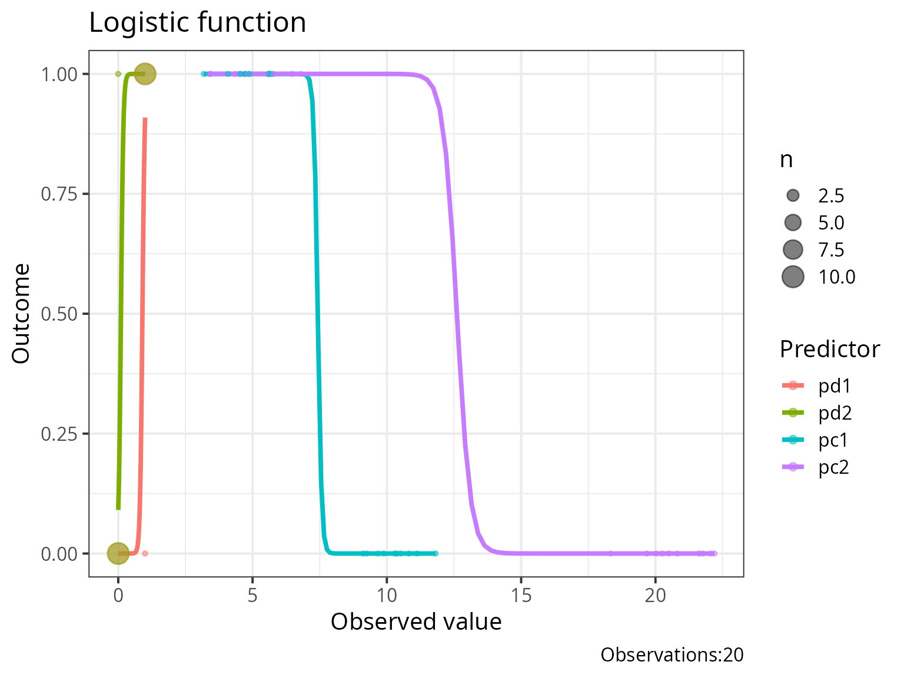

`pc2` separates the two outcome groups far more sharply than `pc1`
(means 5 vs. 20, rather than 5 vs. 10) — its fitted curve accordingly
rises more steeply, visually previewing that it will be the stronger
predictor once modeled formally.

## Comparing Nested Models

`output_compare_model_logistic` runs the likelihood-ratio test described
above between two fitted `glm` models.

``` r

modelcategoricalpredictor <- glm(case ~ education, data = infert, family = binomial)
modelcontinuouspredictor  <- glm(case ~ age, data = infert, family = binomial)
modeltwopredictors        <- glm(case ~ education * age, data = infert, family = binomial)

anova(modelcategoricalpredictor, modelcontinuouspredictor)
```

    ## Analysis of Deviance Table
    ## 
    ## Model 1: case ~ education
    ## Model 2: case ~ age
    ##   Resid. Df Resid. Dev Df   Deviance Pr(>Chi)
    ## 1       245     316.17                       
    ## 2       246     316.17 -1 0.00080113

``` r

output_compare_model_logistic(model1 = modelcategoricalpredictor, model2 = modeltwopredictors)
```

    ##          X.2 df         p
    ## 1 0.01543896  3 0.9994922

``` r

output_compare_model_logistic(model1 = modelcontinuouspredictor, model2 = modeltwopredictors)
```

    ##          X.2 df         p
    ## 1 0.01463783  4 0.9999733

``` r

output_compare_model_logistic(model1 = modelcontinuouspredictor, model2 = modelcategoricalpredictor)
```

    ##             X.2 df p
    ## 1 -0.0008011253  1 1

Note the last comparison: `model1` and `model2` here are **not nested**
(`education` and `age` are different, non-overlapping predictor sets) —
the likelihood-ratio test’s \chi^2 approximation is only valid for
nested models, so a non-nested comparison like this one should not be
interpreted as a formal significance test, only as a raw deviance
difference.

## Full Model Report

`report_logistic` runs the model through a comprehensive diagnostic
pipeline: pseudo-R^2, coefficient table, residual/influence diagnostics,
VIF, and confusion-matrix-based classification performance (with an
optimal cut-point search).

``` r

model_simple <- glm(case ~ education, data = infert, family = binomial)
model_two    <- glm(case ~ education + stratum, data = infert, family = binomial)
result_simple <- report_logistic(model = model_simple)
```


``` r

result_two    <- report_logistic(model = model_two)
```

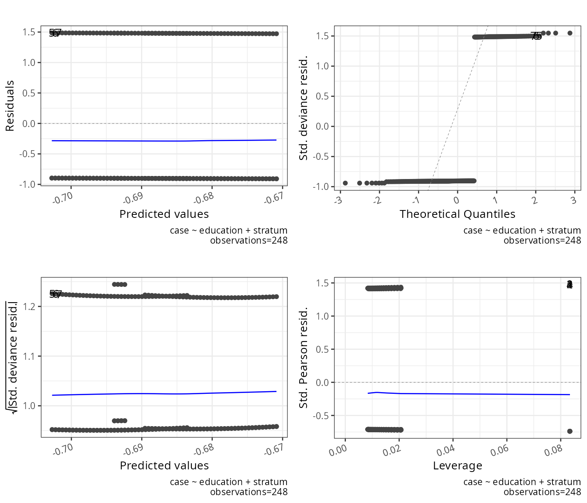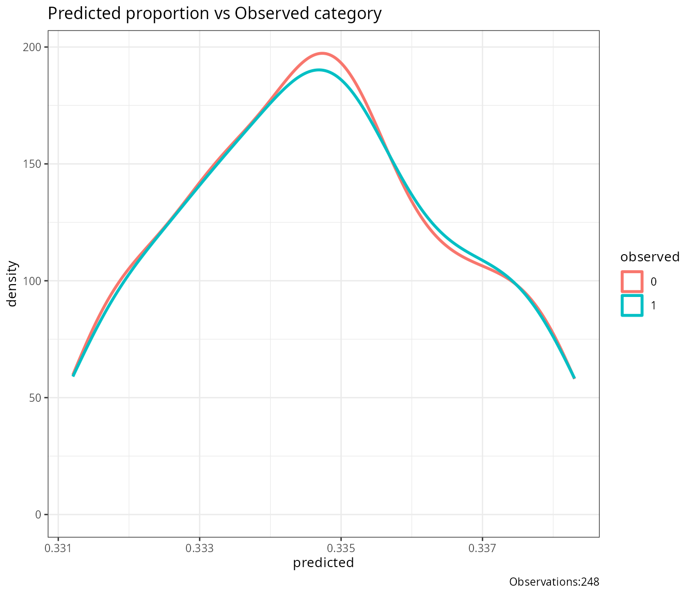

``` r

result_simple$result_X2_logistic
```

    ## NULL

``` r

result_simple$result_R2_logistic
```

    ## NULL

``` r

result_simple$coefficients
```

    ## NULL

``` r

result_two$VIF
```

    ## NULL

- **`result_X2_logistic`**: the omnibus test of the full model against
  the null (intercept-only) model — analogous to the F-test in OLS
  regression.
- **`result_R2_logistic`**: all three pseudo-R^2 measures side by side.
- **`coefficients`**: standard `glm` coefficient table (estimate, SE, z,
  p).
- **`VIF`**: only populated when the model has more than one predictor —
  flags multicollinearity among predictors (values above 10 are
  conventionally considered problematic).

### Validation on held-out data

`report_logistic` accepts a `validation_data` argument to evaluate
classification performance on data the model wasn’t fit to, rather than
on its own training data (which otherwise gives an optimistic,
resubstitution estimate of accuracy):

``` r

result_validated <- report_logistic(model = model_simple, validation_data = infert)
```

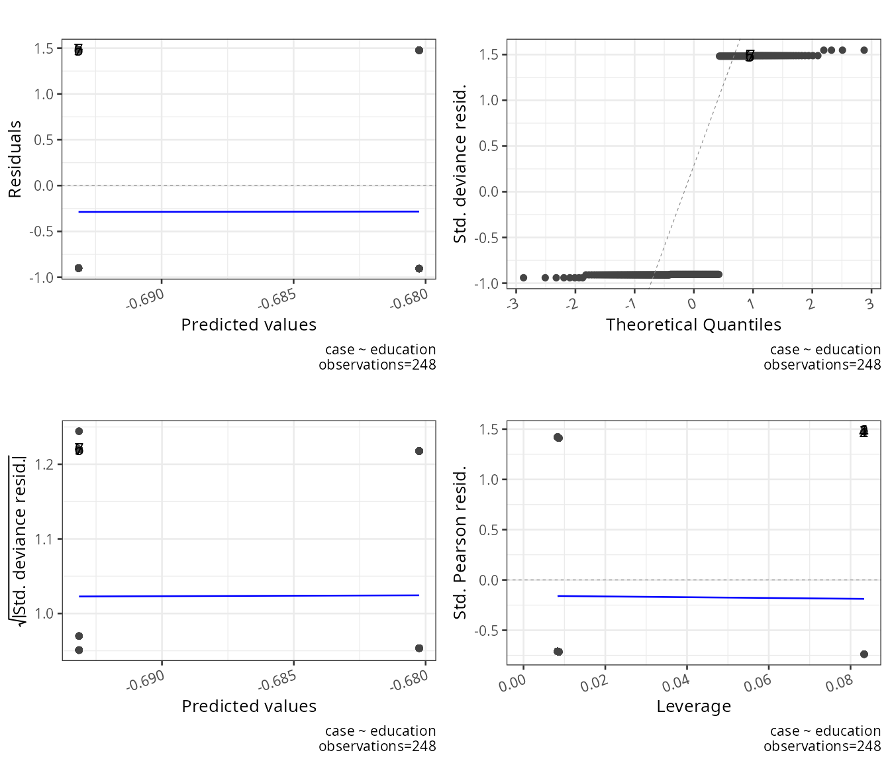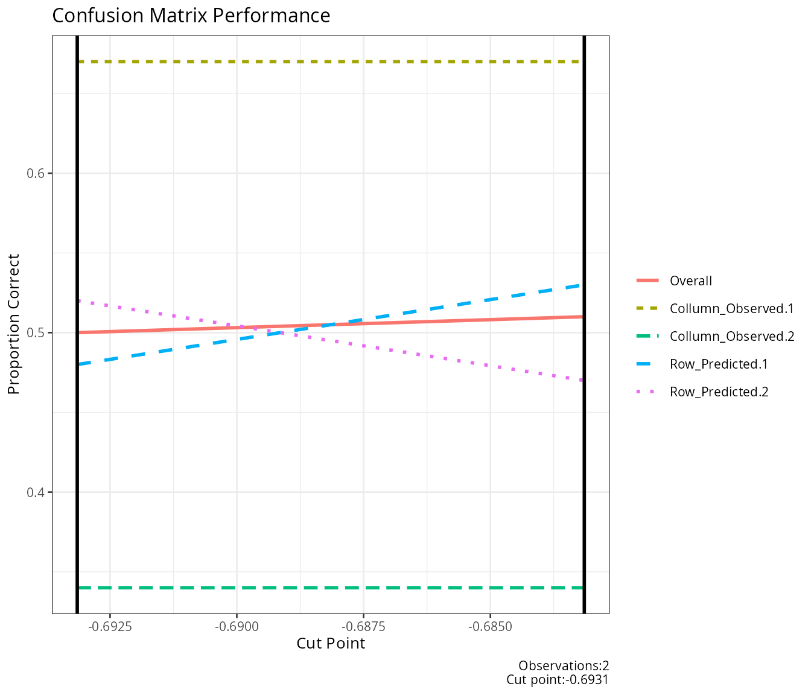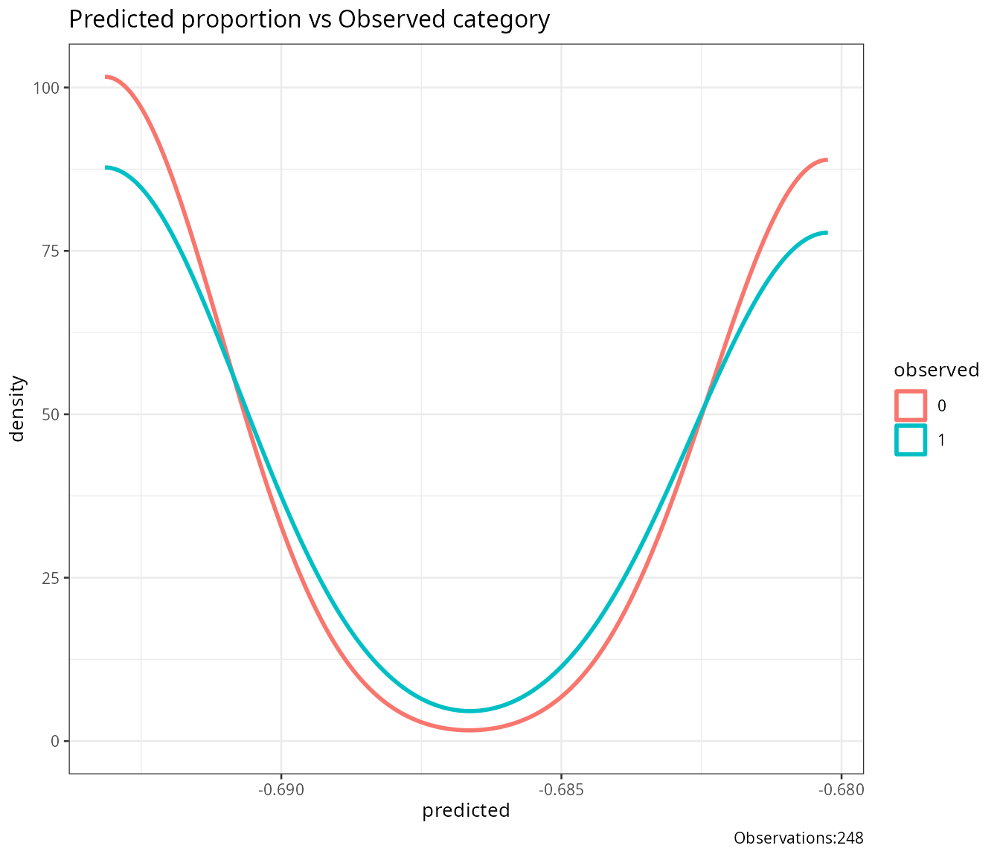

``` r

result_validated$score_descriptives
```

    ## NULL

## Family Robustness

Because `report_logistic` operates on the generic `glm` object, it works
across GLM families beyond binomial — though pseudo-R^2 and the
confusion-matrix performance metrics are only meaningful for binary
outcomes:

``` r

model_gaussian <- glm(case ~ education, data = infert, family = gaussian)
model_poisson  <- glm(case ~ education, data = infert, family = poisson)
result_gaussian <- report_logistic(model = model_gaussian)
```

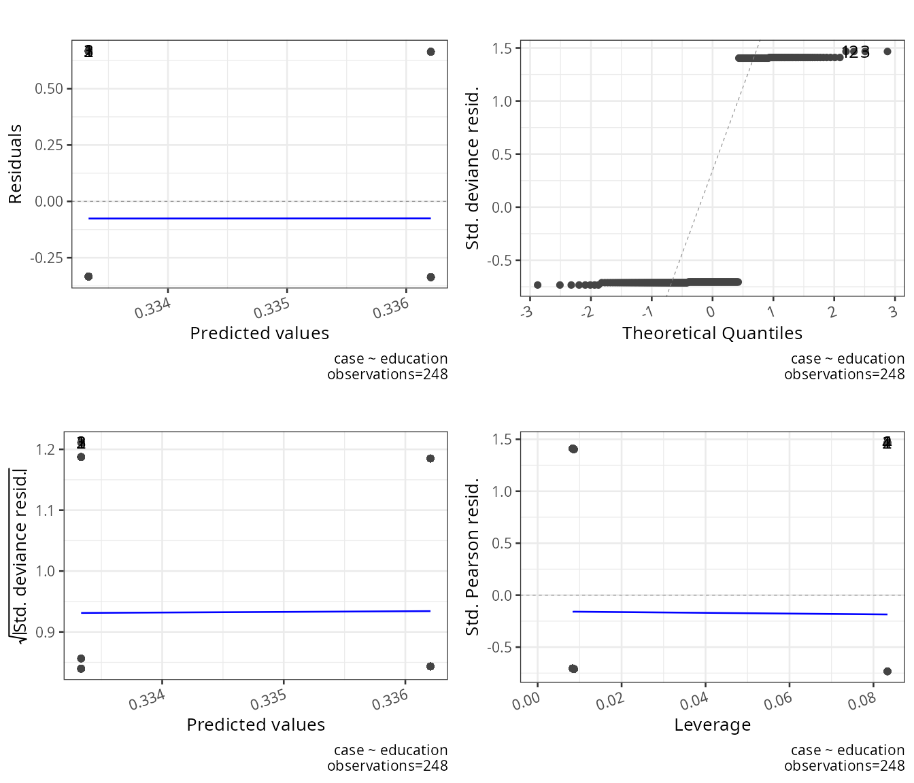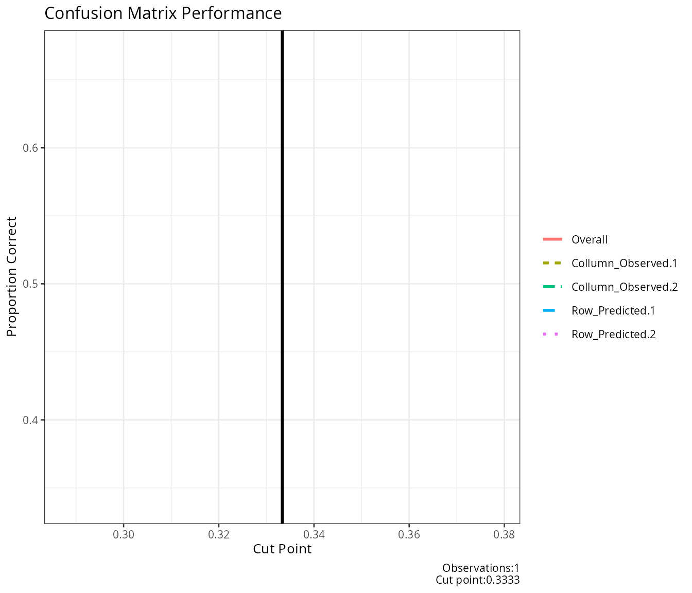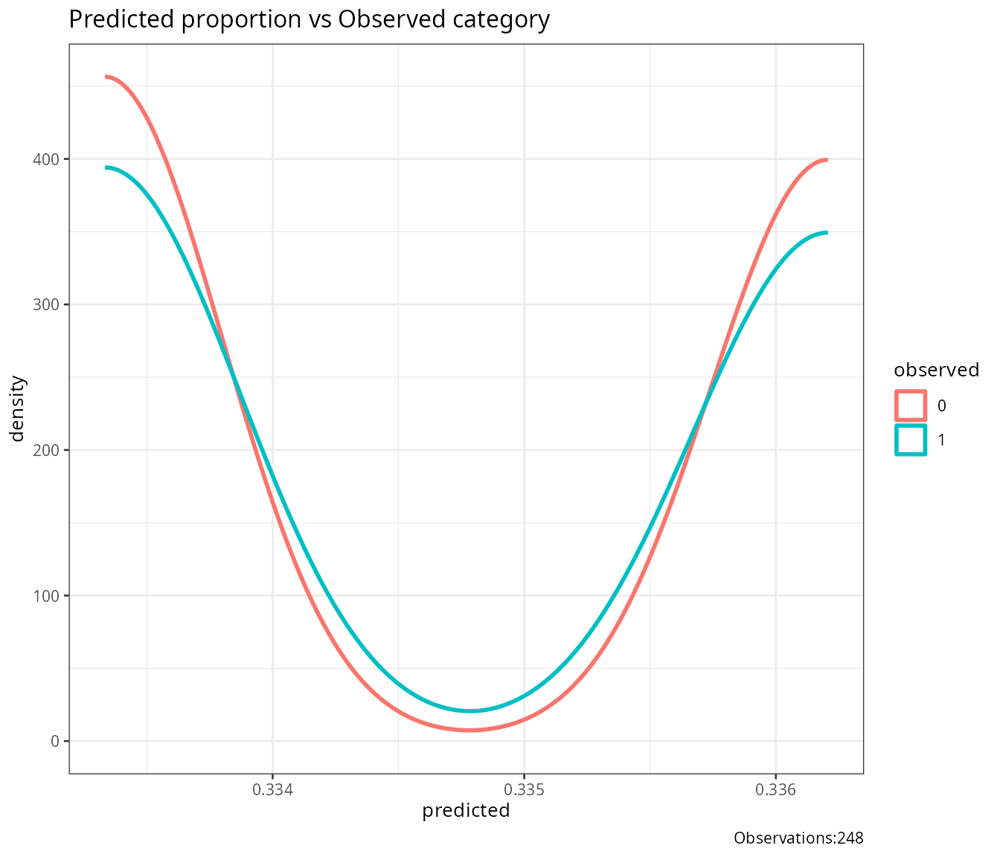

``` r

result_poisson  <- report_logistic(model = model_poisson)
```

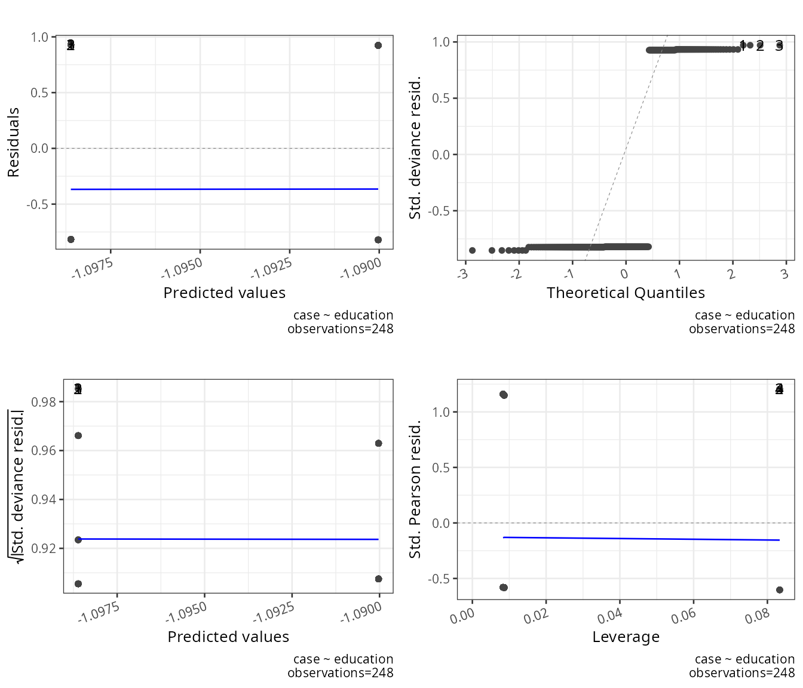

``` r

result_gaussian$logistic_output
```

    ## NULL

``` r

result_poisson$logistic_output
```

    ## NULL

------------------------------------------------------------------------

## Conclusion

`compute_y_logistic` and `plot_logistic_model` make the shape of the
fitted response curve visible and comparable across predictors;
`output_compare_model_logistic` formalizes whether adding predictors
significantly improves fit (for genuinely nested models); and
`report_logistic` bundles pseudo-R^2, coefficients, influence
diagnostics, and out-of-sample classification performance into a single
report suitable for a full model write-up.

------------------------------------------------------------------------

*Rendered with R 4.6.1*
