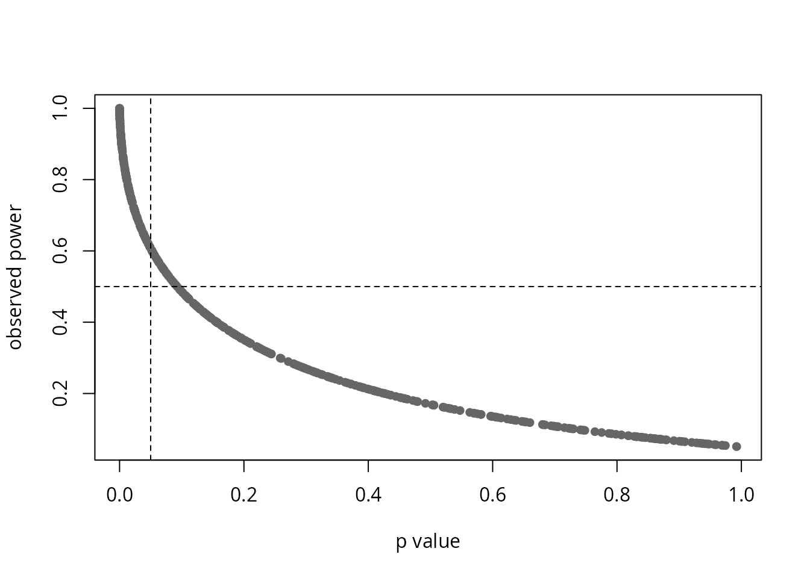

# One-way ANOVA

## Description

This shows the output of `compute_one_way_test` from the package rwf,
which runs the one-way analysis of variance for two or more independent
groups, either assuming equal variances (Fisher’s F test) or not
(Welch’s F test, Welch, 1951). The function returns the sums of squares
and mean squares, the F statistic with its degrees of freedom and p
value, five effect sizes (eta-squared, partial eta-squared,
omega-squared, partial omega-squared and Cohen’s f) and the observed
power. Each section gives the formulas the function uses, computes them
by hand and checks the results against `stats`, `car`, `lsr`,
`effectsize`, `sjstats` and `pwr`.

The group statistics and the Welch test (the weights, the Welch F
statistic and its degrees of freedom) are adapted from
[`stats::oneway.test`](https://rdrr.io/r/stats/oneway.test.html) (R Core
Team, 2026). The sums of squares, effect sizes and power are added in
rwf.

Installation instructions for rwf can be found
[here](https://github.com/sedzinfo/rwf)

The code can be found
[here](https://github.com/sedzinfo/rwf/blob/main/rwf/R/GLM_ANOVA.R)

## Notation

There are k independent groups. Group j has n_j observations
y\_{1j},\dots,y\_{n_jj}, mean \bar{y}\_j and sample variance
s_j^2=\frac{1}{n_j-1}\sum\_{i=1}^{n_j}(y\_{ij}-\bar{y}\_j)^2.
N=\sum\_{j=1}^{k}n_j is the total sample size and \bar{y} the mean of
all N observations.

## The one-way ANOVA

The one-way ANOVA tests whether the means of k independent groups are
equal. It splits the total variability of the outcome into a part
between the group means and a part within the groups, and compares the
two. Its null hypothesis is \mu_1=\mu_2=\dots=\mu_k.

### Assuming equal variances (Fisher)

Sums of squares and degrees of freedom:

SS\_{\text{effect}}=\sum\_{j=1}^{k}n_j\left(\bar{y}\_j-\bar{y}\right)^2,\qquad
df\_{\text{effect}}=k-1

SS\_{\text{error}}=\sum\_{j=1}^{k}(n_j-1)\\s_j^2,\qquad
df\_{\text{error}}=N-k

SS\_{\text{total}}=SS\_{\text{effect}}+SS\_{\text{error}}=\sum\_{j=1}^{k}\sum\_{i=1}^{n_j}\left(y\_{ij}-\bar{y}\right)^2

Mean squares, the F statistic and its p value:

MS\_{\text{effect}}=\frac{SS\_{\text{effect}}}{df\_{\text{effect}}},\qquad
MS\_{\text{error}}=\frac{SS\_{\text{error}}}{df\_{\text{error}}},\qquad
F=\frac{MS\_{\text{effect}}}{MS\_{\text{error}}}

p=P\left(F\_{df\_{\text{effect}},\\df\_{\text{error}}}\ge F\right)

MS\_{\text{error}} pools the variances of all groups into one estimate,
which is why this version assumes that the groups have equal variances.

### Not assuming equal variances (Welch)

Welch’s test weights each group by the precision of its mean,
w_j=n_j/s_j^2, so groups with a large variance or few observations count
less:

W=\sum\_{j=1}^{k}w_j,\qquad
\bar{y}\_w=\frac{1}{W}\sum\_{j=1}^{k}w_j\bar{y}\_j,\qquad
\Lambda=\frac{1}{k^2-1}\sum\_{j=1}^{k}\frac{\left(1-w_j/W\right)^2}{n_j-1}

F_W=\frac{\sum\_{j=1}^{k}w_j\left(\bar{y}\_j-\bar{y}\_w\right)^2}{(k-1)\left(1+2(k-2)\Lambda\right)},\qquad
df\_{\text{effect}}=k-1,\qquad df\_{\text{error}}=\frac{1}{3\Lambda}

The error degrees of freedom are usually not a whole number.

Welch’s test has no sums of squares of its own. To fill the same output
columns, rwf sets

MS\_{\text{effect}}=\sum\_{j=1}^{k}w_j\left(\bar{y}\_j-\bar{y}\_w\right)^2,\qquad
MS\_{\text{error}}=(k-1)\left(1+2(k-2)\Lambda\right)

and SS=MS\times df, so that F_W=MS\_{\text{effect}}/MS\_{\text{error}}.
These are not variance components of the data, only quantities that
reproduce F_W. The effect sizes computed from them are the usual
conversions of an F statistic into an effect size ([Welch effect
sizes](#welch-effect-sizes)).

## When to use it and assumptions

### When to use it

Use the one-way ANOVA to compare the means of two or more independent
groups on an outcome measured on an interval or ratio scale, such as
blood pressure, reaction time or a test score.

Prefer Welch’s version (`var.equal = FALSE`) unless you have a good
reason to believe the variances are equal. It controls the Type I error
rate when variances differ and loses very little power when they do not
(Delacre, Leys, Mora & Lakens, 2019). The [simulation
below](#fisher-and-welch-with-unequal-variances) shows why.

Do not use it when:

- **The outcome is ordinal, or clearly not normal with small groups.**
  Use the Kruskal-Wallis test, `compute_kruskal_wallis_test`.
- **The same participants are measured more than once.** Use a repeated
  measures ANOVA, or the Friedman test, `compute_friedman_test`.
- **There are covariates or several factors.** Use an ANCOVA or a
  factorial ANOVA.

With two groups the one-way ANOVA is the independent samples t test, and
F=t^2. Fisher’s F matches Student’s t and Welch’s F matches Welch’s t,
including the degrees of freedom:

``` r

fisher <- compute_one_way_test(formula = bp_before ~ sex, df = df_blood_pressure, var.equal = TRUE)
welch <- compute_one_way_test(formula = bp_before ~ sex, df = df_blood_pressure, var.equal = FALSE)
student_t <- stats::t.test(bp_before ~ sex, data = df_blood_pressure, var.equal = TRUE)
welch_t <- stats::t.test(bp_before ~ sex, data = df_blood_pressure, var.equal = FALSE)
data.frame(test = c("Fisher", "Welch"),
           F_rwf = c(fisher$statistic, welch$statistic),
           t_squared = c(student_t$statistic^2, welch_t$statistic^2),
           df_error_rwf = c(fisher$df_error, welch$df_error),
           df_t = c(student_t$parameter, welch_t$parameter))
```

    ##     test    F_rwf t_squared df_error_rwf     df_t
    ## 1 Fisher 7.755248  7.755248     118.0000 118.0000
    ## 2  Welch 7.755248  7.755248     117.5604 117.5604

### Assumptions

1.  **Independent observations.** Each observation belongs to one group
    only and does not depend on any other observation.
2.  **An interval or ratio outcome.** Means and variances must be
    meaningful.
3.  **Normally distributed residuals within each group.** With moderate
    or large groups the F test is fairly robust to non-normality,
    because the group means are close to normal. With small groups and
    skewed data use the Kruskal-Wallis test.
4.  **Equal variances across groups (Fisher only).** Fisher’s F is
    fairly robust when the groups are of equal size. When they are not,
    the Type I error rate is inflated if the smaller groups have the
    larger variances, and the test becomes conservative if they have the
    smaller variances. Welch’s F does not make this assumption.
5.  **No extreme outliers.** A single extreme value can move a group
    mean and inflate its variance.

In `df_blood_pressure` there are 40 independent patients per age group.
The group standard deviations, the Q-Q plot of the residuals and
Levene’s test (with the median, the Brown-Forsythe version) check
normality and equal variances:

``` r

data.frame(n = tapply(df_blood_pressure$bp_before, df_blood_pressure$agegrp, length),
           mean = tapply(df_blood_pressure$bp_before, df_blood_pressure$agegrp, mean),
           sd = tapply(df_blood_pressure$bp_before, df_blood_pressure$agegrp, sd))
```

    ##        n    mean        sd
    ## 30-45 40 151.675  9.258087
    ## 46-59 40 155.100 11.459628
    ## 60+   40 162.575 10.727122

``` r

model <- stats::aov(bp_before ~ agegrp, data = df_blood_pressure)
par(mfrow = c(1, 2))
boxplot(bp_before ~ agegrp, data = df_blood_pressure, xlab = "age group", ylab = "blood pressure before")
stats::qqnorm(stats::residuals(model))
stats::qqline(stats::residuals(model))
```


``` r

stats::shapiro.test(stats::residuals(model))
```

    ## 
    ##  Shapiro-Wilk normality test
    ## 
    ## data:  stats::residuals(model)
    ## W = 0.96967, p-value = 0.008207

``` r

car::leveneTest(bp_before ~ factor(agegrp), data = df_blood_pressure, center = median)
```

    ## Levene's Test for Homogeneity of Variance (center = median)
    ##        Df F value Pr(>F)
    ## group   2  0.9811  0.378
    ##       117

The standard deviations are similar and Levene’s test finds no evidence
of unequal variances. The Shapiro-Wilk test detects a departure from
normality, but the Q-Q plot shows it is mild, and with 40 observations
per group the F test is robust to it. Significance tests of assumptions
become more sensitive as the sample grows, so judge the size of the
departure from the plots, not only the p value.

### After a significant result

A significant F means that at least one group mean differs from the
others, not which ones. Follow it with post hoc comparisons: Tukey’s HSD
when the variances are equal, Games-Howell when they are not.
`report_oneway` in rwf returns both.

## Why effect sizes

A p value answers one question: if the group means were equal, how
surprising would data like these be? It does not say how large the
difference is. Because F grows with the sample size, a trivial
difference becomes “significant” in a large sample, and a large
difference can be “non-significant” in a small one.

An effect size answers a different question: how much do the groups
differ? Effect sizes are useful because they:

- **measure magnitude.** They separate practical importance from
  statistical significance.
- **do not grow with N.** The same population difference gives roughly
  the same effect size in a study of 30 people or 3,000.
- **can be compared across studies.** This is what meta-analysis
  combines.
- **drive power analysis.** The sample size a new study needs depends on
  the effect size it expects.
- **are expected in reports.** The APA Task Force on Statistical
  Inference recommends reporting effect sizes for primary outcomes
  (Wilkinson & Task Force on Statistical Inference, 1999; see also
  Lakens, 2013).

The [simulation below](#p-values-shrink-effect-sizes-do-not) shows this
with data.

## Effect sizes

### Eta-squared

\eta^2=\frac{SS\_{\text{effect}}}{SS\_{\text{total}}},\qquad
\eta^2_p=\frac{SS\_{\text{effect}}}{SS\_{\text{effect}}+SS\_{\text{error}}}

\eta^2 is the proportion of the total variance explained by the groups,
the R^2 of the model. Partial eta-squared \eta^2_p leaves out the
variance explained by other factors. A one-way design has no other
factors, so SS\_{\text{effect}}+SS\_{\text{error}}=SS\_{\text{total}}
and \eta^2_p=\eta^2. Both are biased upwards in small samples. Under the
null hypothesis E\[\eta^2\]\approx(k-1)/(N-1) rather than 0.

### Omega-squared

\omega^2=\frac{SS\_{\text{effect}}-df\_{\text{effect}}\\MS\_{\text{error}}}{SS\_{\text{total}}+MS\_{\text{error}}},\qquad
\omega^2_p=\frac{df\_{\text{effect}}\left(MS\_{\text{effect}}-MS\_{\text{error}}\right)}{df\_{\text{effect}}\\MS\_{\text{effect}}+\left(df\_{\text{error}}+1\right)MS\_{\text{error}}}

\omega^2 (Hays, 1963) estimates the proportion of variance explained in
the population. It subtracts the part of SS\_{\text{effect}} expected by
chance, df\_{\text{effect}}\\MS\_{\text{error}}, which removes most of
the bias of \eta^2. It is negative when F\<1. Partial omega-squared
\omega^2_p (Olejnik & Algina, 2003) is again the same as \omega^2 in a
one-way design, because
SS\_{\text{total}}+MS\_{\text{error}}=df\_{\text{effect}}\\MS\_{\text{effect}}+(df\_{\text{error}}+1)\\MS\_{\text{error}}.
With equal variances df\_{\text{error}}+1=N-df\_{\text{effect}}, the
form usually given for \omega^2_p; rwf uses df\_{\text{error}}+1 so that
the Welch version also follows the Welch degrees of freedom.

### Cohen’s f

f=\sqrt{\frac{\eta^2}{1-\eta^2}}

Cohen’s f is the standard deviation of the group means divided by the
common within-group standard deviation. It is the effect size used in
power analysis (Cohen, 1988).

### Interpretation

Multiplied by 100, \eta^2 and \omega^2 read as the percentage of
variance explained by the groups. Small, medium and large are the
benchmarks of Cohen (1988). Sawilowsky (2009) added very small, very
large and huge benchmarks for Cohen’s d, and the table converts them
with \eta^2=d^2/(d^2+4) and f=d/2, the relations for two groups of equal
size:

| Magnitude  | \eta^2, \omega^2 | Cohen’s f       | Cohen’s d |
|------------|------------------|-----------------|-----------|
| tiny       | \< 0.01          | \< 0.10         | \< 0.2    |
| small      | 0.01 to \< 0.06  | 0.10 to \< 0.25 | 0.2       |
| medium     | 0.06 to \< 0.14  | 0.25 to \< 0.40 | 0.5       |
| large      | 0.14 to \< 0.26  | 0.40 to \< 0.60 | 0.8       |
| very large | 0.26 to \< 0.50  | 0.60 to \< 1.00 | 1.2       |
| huge       | ≥ 0.50           | ≥ 1.00          | 2.0       |

``` r

d <- c(0.2, 0.5, 0.8, 1.2, 2)
eta_squared <- d^2 / (d^2 + 4)
data.frame(d, eta_squared, f = sqrt(eta_squared / (1 - eta_squared)))
```

    ##     d eta_squared    f
    ## 1 0.2  0.00990099 0.10
    ## 2 0.5  0.05882353 0.25
    ## 3 0.8  0.13793103 0.40
    ## 4 1.2  0.26470588 0.60
    ## 5 2.0  0.50000000 1.00

These are rough guides. What counts as a meaningful effect depends on
the field and the outcome.

## Observed power

`power` is the probability that an F test at \alpha=0.05 rejects the
null hypothesis if the population effect were exactly the observed f. It
uses the noncentral F distribution with noncentrality parameter

\lambda=f^2N,\qquad
\text{power}=P\left(F\_{df\_{\text{effect}},\\df\_{\text{error}},\\\lambda}\>F\_{0.95;\\df\_{\text{effect}},\\df\_{\text{error}}}\right)

where F\_{0.95;\\df\_{\text{effect}},\\df\_{\text{error}}} is the
critical value of the central F distribution.

Observed power adds no information beyond the p value (Hoenig & Heisey,
2001). Both come from the same F, so a study with p=0.05 always has an
observed power of about 0.5, and a non-significant result always has low
observed power. It cannot show that a non-significant study “had enough
power”. Each point below is one simulated study:

``` r

set.seed(1)
studies <- do.call(rbind, lapply(1:500, function(i) {
  sim <- data.frame(group = rep(c("a", "b", "c"), each = 20),
                    score = rnorm(60, mean = rep(c(0, 0, runif(1, 0, 1)), each = 20)))
  compute_one_way_test(formula = score ~ group, df = sim)[, c("p", "power")]
}))
plot(studies$p, studies$power, xlab = "p value", ylab = "observed power", pch = 16, col = "grey40")
abline(v = 0.05, h = 0.5, lty = 2)
```



Power is useful **before** a study, with an effect size chosen from
theory or earlier studies rather than from the data. For example, the
number of participants per group needed to detect a medium effect
(f=0.25) with three groups and 80% power:

``` r

pwr::pwr.anova.test(k = 3, f = 0.25, sig.level = 0.05, power = 0.80)
```

    ## 
    ##      Balanced one-way analysis of variance power calculation 
    ## 
    ##               k = 3
    ##               n = 52.3966
    ##               f = 0.25
    ##       sig.level = 0.05
    ##           power = 0.8
    ## 
    ## NOTE: n is number in each group

## Data

`df_blood_pressure` records the blood pressure of 120 patients in three
age groups of 40. The formula `bp_before ~ agegrp` asks whether mean
blood pressure before treatment differs between age groups.

``` r

head(df_blood_pressure)
```

    ##   patient  sex agegrp bp_before bp_after
    ## 1       1 Male  30-45       143      153
    ## 2       2 Male  30-45       163      170
    ## 3       3 Male  30-45       153      168
    ## 4       4 Male  30-45       153      142
    ## 5       5 Male  30-45       146      141
    ## 6       6 Male  30-45       150      147

``` r

form <- formula(bp_before ~ agegrp)
table(df_blood_pressure$agegrp)
```

    ## 
    ## 30-45 46-59   60+ 
    ##    40    40    40

## compute_one_way_test

``` r

fisher <- compute_one_way_test(formula = form, df = df_blood_pressure, var.equal = TRUE)
welch <- compute_one_way_test(formula = form, df = df_blood_pressure, var.equal = FALSE)
rbind(fisher, welch)
```

    ##              formula                      method  ss_effect   ss_error  ms_effect   ms_error     etasq partial.etasq   omegasq partial.omegasq  cohens.f     power statistic df_effect  df_error
    ## 1 bp_before ~ agegrp   Assuming homoscedasticity 2485.55000 12952.1500 1242.77500 110.702137 0.1610052     0.1610052 0.1456192       0.1456192 0.4380668 0.9925726  11.22630         2 117.00000
    ## 2 bp_before ~ agegrp Assuming heteroscedasticity   48.00725   156.0266   24.00362   2.017238 0.2352906     0.2352906 0.2134071       0.2134071 0.5546947 0.9998626  11.89925         2  77.34665
    ##              p
    ## 1 3.466707e-05
    ## 2 3.121909e-05

The output columns are:

| Column | Fisher (`var.equal = TRUE`) | Welch (`var.equal = FALSE`) |
|----|----|----|
| `formula`, `method` | model formula and test | model formula and test |
| `ss_effect`, `ss_error` | SS\_{\text{effect}}, SS\_{\text{error}} | MS\times df (not variance components) |
| `ms_effect`, `ms_error` | MS\_{\text{effect}}, MS\_{\text{error}} | numerator and denominator of F_W |
| `etasq`, `partial.etasq` | \eta^2, \eta^2_p | F\\df\_{\text{effect}}/(F\\df\_{\text{effect}}+df\_{\text{error}}) |
| `omegasq`, `partial.omegasq` | \omega^2, \omega^2_p | see [Welch effect sizes](#welch-effect-sizes) |
| `cohens.f` | \sqrt{\eta^2/(1-\eta^2)} | \sqrt{F\\df\_{\text{effect}}/df\_{\text{error}}} |
| `power` | observed power, \lambda=f^2N | observed power, \lambda=f^2N |
| `statistic` | F | F_W |
| `df_effect`, `df_error` | k-1, N-k | k-1, 1/(3\Lambda) |
| `p` | p value | p value |

## Step by step

### Fisher

Every quantity from the formulas above, computed by hand:

``` r

y <- df_blood_pressure$bp_before
g <- factor(df_blood_pressure$agegrp)
k <- nlevels(g)
n_j <- tapply(y, g, length)
mean_j <- tapply(y, g, mean)
var_j <- tapply(y, g, var)
N <- sum(n_j)
ss_effect <- sum(n_j * (mean_j - mean(y))^2)
ss_error <- sum((n_j - 1) * var_j)
ss_total <- sum((y - mean(y))^2)
df_effect <- k - 1
df_error <- N - k
ms_effect <- ss_effect / df_effect
ms_error <- ss_error / df_error
F_value <- ms_effect / ms_error
etasq <- ss_effect / ss_total
omegasq <- (ss_effect - df_effect * ms_error) / (ss_total + ms_error)
cohens_f <- sqrt(etasq / (1 - etasq))
power <- pf(qf(0.95, df_effect, df_error), df_effect, df_error, ncp = cohens_f^2 * N, lower.tail = FALSE)
by_hand <- data.frame(ss_effect, ss_error, ms_effect, ms_error,
                      etasq, partial.etasq = ss_effect / (ss_effect + ss_error),
                      omegasq, partial.omegasq = df_effect * (ms_effect - ms_error) / (df_effect * ms_effect + (df_error + 1) * ms_error),
                      cohens.f = cohens_f, power,
                      statistic = F_value, df_effect, df_error,
                      p = pf(F_value, df_effect, df_error, lower.tail = FALSE))
by_hand
```

    ##   ss_effect ss_error ms_effect ms_error     etasq partial.etasq   omegasq partial.omegasq  cohens.f     power statistic df_effect df_error            p
    ## 1   2485.55 12952.15  1242.775 110.7021 0.1610052     0.1610052 0.1456192       0.1456192 0.4380668 0.9925726   11.2263         2      117 3.466707e-05

``` r

c(ss_total = ss_total, ss_effect_plus_error = ss_effect + ss_error)
```

    ##             ss_total ss_effect_plus_error 
    ##              15437.7              15437.7

``` r

all.equal(by_hand, fisher[, names(by_hand)], check.attributes = FALSE)
```

    ## [1] TRUE

### Welch

``` r

w_j <- n_j / var_j
W <- sum(w_j)
mean_w <- sum(w_j * mean_j) / W
Lambda <- sum((1 - w_j / W)^2 / (n_j - 1)) / (k^2 - 1)
F_welch <- sum(w_j * (mean_j - mean_w)^2) / ((k - 1) * (1 + 2 * (k - 2) * Lambda))
df_error_welch <- 1 / (3 * Lambda)
data.frame(F = F_welch, df_effect = k - 1, df_error = df_error_welch,
           p = pf(F_welch, k - 1, df_error_welch, lower.tail = FALSE))
```

    ##          F df_effect df_error            p
    ## 1 11.89925         2 77.34665 3.121909e-05

``` r

welch[, c("statistic", "df_effect", "df_error", "p")]
```

    ##   statistic df_effect df_error            p
    ## 1  11.89925         2 77.34665 3.121909e-05

## Checks against other packages

### stats and car

[`stats::oneway.test`](https://rdrr.io/r/stats/oneway.test.html) gives
F, the degrees of freedom and the p value for both versions.
[`stats::aov`](https://rdrr.io/r/stats/aov.html) and
[`car::Anova`](https://rdrr.io/pkg/car/man/Anova.html) give the sums of
squares and mean squares of the Fisher version:

``` r

stats::oneway.test(formula = form, data = df_blood_pressure, var.equal = TRUE)
```

    ## 
    ##  One-way analysis of means
    ## 
    ## data:  bp_before and agegrp
    ## F = 11.226, num df = 2, denom df = 117, p-value = 3.467e-05

``` r

stats::oneway.test(formula = form, data = df_blood_pressure, var.equal = FALSE)
```

    ## 
    ##  One-way analysis of means (not assuming equal variances)
    ## 
    ## data:  bp_before and agegrp
    ## F = 11.899, num df = 2.000, denom df = 77.347, p-value = 3.122e-05

``` r

summary(stats::aov(form, data = df_blood_pressure))
```

    ##              Df Sum Sq Mean Sq F value   Pr(>F)    
    ## agegrp        2   2486  1242.8   11.23 3.47e-05 ***
    ## Residuals   117  12952   110.7                     
    ## ---
    ## Signif. codes:  0 '***' 0.001 '**' 0.01 '*' 0.05 '.' 0.1 ' ' 1

``` r

car::Anova(stats::aov(form, data = df_blood_pressure), type = 2)
```

    ## Anova Table (Type II tests)
    ## 
    ## Response: bp_before
    ##            Sum Sq  Df F value    Pr(>F)    
    ## agegrp     2485.6   2  11.226 3.467e-05 ***
    ## Residuals 12952.2 117                      
    ## ---
    ## Signif. codes:  0 '***' 0.001 '**' 0.01 '*' 0.05 '.' 0.1 ' ' 1

### Effect sizes and power

[`lsr::etaSquared`](https://lsr.djnavarro.net/reference/etaSquared.html)
and `effectsize` give \eta^2, \omega^2 and Cohen’s f,
[`sjstats::anova_stats`](https://strengejacke.github.io/sjstats/reference/anova_stats.html)
gives all the effect sizes and the observed power, and
[`pwr::pwr.anova.test`](https://rdrr.io/pkg/pwr/man/pwr.anova.test.html)
gives the power for groups of equal size:

``` r

lsr::etaSquared(stats::aov(form, data = df_blood_pressure), type = 3, anova = TRUE)
```

    ##              eta.sq eta.sq.part       SS  df        MS       F            p
    ## agegrp    0.1610052   0.1610052  2485.55   2 1242.7750 11.2263 3.466707e-05
    ## Residuals 0.8389948          NA 12952.15 117  110.7021      NA           NA

``` r

effectsize::eta_squared(stats::aov(form, data = df_blood_pressure), partial = FALSE, ci = NULL)
```

    ## # Effect Size for ANOVA (Type I)
    ## 
    ## Parameter | Eta2
    ## ----------------
    ## agegrp    | 0.16

``` r

effectsize::omega_squared(stats::aov(form, data = df_blood_pressure), partial = FALSE, ci = NULL)
```

    ## # Effect Size for ANOVA (Type I)
    ## 
    ## Parameter | Omega2
    ## ------------------
    ## agegrp    |   0.15

``` r

effectsize::cohens_f(stats::aov(form, data = df_blood_pressure), ci = NULL)
```

    ## # Effect Size for ANOVA
    ## 
    ## Parameter | Cohen's f
    ## ---------------------
    ## agegrp    |      0.44

``` r

sjstats::anova_stats(stats::lm(form, data = df_blood_pressure), digits = 22)
```

    ## etasq | partial.etasq | omegasq | partial.omegasq | epsilonsq | cohens.f |      term |     sumsq |  df |   meansq | statistic | p.value | power
    ## -----------------------------------------------------------------------------------------------------------------------------------------------
    ## 0.161 |         0.161 |   0.146 |           0.146 |     0.147 |    0.438 |    agegrp |  2485.550 |   2 | 1242.775 |    11.226 |  < .001 | 0.993
    ##       |               |         |                 |           |          | Residuals | 12952.150 | 117 |  110.702 |           |         |

``` r

pwr::pwr.anova.test(k = 3, n = 40, f = fisher$cohens.f, sig.level = 0.05)$power
```

    ## [1] 0.9925726

``` r

fisher$power
```

    ## [1] 0.9925726

### Welch effect sizes

For Welch’s test, `etasq`, `omegasq`, `partial.omegasq` and `cohens.f`
are the conversions of the F statistic into effect sizes with the Welch
degrees of freedom, the same as
[`effectsize::F_to_eta2`](https://easystats.github.io/effectsize/reference/F_to_eta2.html),
`F_to_omega2` and `F_to_f`:

\eta^2=\frac{F\\df\_{\text{effect}}}{F\\df\_{\text{effect}}+df\_{\text{error}}},\qquad
\omega^2=\frac{df\_{\text{effect}}(F-1)}{F\\df\_{\text{effect}}+df\_{\text{error}}+1},\qquad
f=\sqrt{\frac{F\\df\_{\text{effect}}}{df\_{\text{error}}}}

``` r

data.frame(
  statistic = c("etasq", "omegasq", "partial.omegasq", "cohens.f"),
  rwf = c(welch$etasq, welch$omegasq, welch$partial.omegasq, welch$cohens.f),
  effectsize = c(effectsize::F_to_eta2(welch$statistic, welch$df_effect, welch$df_error, ci = NULL)$Eta2_partial,
                 effectsize::F_to_omega2(welch$statistic, welch$df_effect, welch$df_error, ci = NULL)$Omega2_partial,
                 effectsize::F_to_omega2(welch$statistic, welch$df_effect, welch$df_error, ci = NULL)$Omega2_partial,
                 effectsize::F_to_f(welch$statistic, welch$df_effect, welch$df_error, ci = NULL)$Cohens_f_partial))
```

    ##         statistic       rwf effectsize
    ## 1           etasq 0.2352906  0.2352906
    ## 2         omegasq 0.2134071  0.2134071
    ## 3 partial.omegasq 0.2134071  0.2134071
    ## 4        cohens.f 0.5546947  0.5546947

In a one-way design `partial.omegasq` equals `omegasq` for Welch’s test
too. These Welch effect sizes are approximations: report them together
with the Welch degrees of freedom.

### A test function

`check_one_way` puts each rwf value next to the value from the other
packages and returns the difference. The Fisher version is compared with
`stats`, `effectsize` and `sjstats`, the Welch version with `stats` and
`effectsize`.

``` r

check_one_way <- function(formula, df) {
  vars <- all.vars(formula)
  df <- stats::na.omit(data.frame(y = df[[vars[1]]], g = factor(df[[vars[2]]])))
  fisher <- compute_one_way_test(formula = y ~ g, df = df, var.equal = TRUE)
  welch <- compute_one_way_test(formula = y ~ g, df = df, var.equal = FALSE)
  model <- stats::aov(y ~ g, data = df)
  anova_table <- summary(model)[[1]]
  oneway_fisher <- stats::oneway.test(y ~ g, data = df, var.equal = TRUE)
  oneway_welch <- stats::oneway.test(y ~ g, data = df, var.equal = FALSE)
  sjstats_table <- as.data.frame(sjstats::anova_stats(stats::lm(y ~ g, data = df), digits = 22))
  comparison <- data.frame(
    test = c(rep("Fisher", 11), rep("Welch", 6)),
    statistic = c("ss_effect", "ss_error", "statistic", "df_error", "p", "etasq", "omegasq", "partial.omegasq", "cohens.f", "power", "etasq",
                  "statistic", "df_error", "p", "etasq", "omegasq", "cohens.f"),
    package = c("stats::aov", "stats::aov", "stats::oneway.test", "stats::oneway.test", "stats::oneway.test",
                "effectsize::eta_squared", "effectsize::omega_squared", "sjstats::anova_stats", "effectsize::cohens_f",
                "sjstats::anova_stats", "lsr::etaSquared",
                "stats::oneway.test", "stats::oneway.test", "stats::oneway.test",
                "effectsize::F_to_eta2", "effectsize::F_to_omega2", "effectsize::F_to_f"),
    rwf = c(fisher$ss_effect, fisher$ss_error, fisher$statistic, fisher$df_error, fisher$p,
            fisher$etasq, fisher$omegasq, fisher$partial.omegasq, fisher$cohens.f, fisher$power, fisher$etasq,
            welch$statistic, welch$df_error, welch$p, welch$etasq, welch$omegasq, welch$cohens.f),
    other = c(anova_table[1, "Sum Sq"], anova_table[2, "Sum Sq"],
              unname(oneway_fisher$statistic), unname(oneway_fisher$parameter[2]), oneway_fisher$p.value,
              effectsize::eta_squared(model, partial = FALSE, ci = NULL)$Eta2,
              effectsize::omega_squared(model, partial = FALSE, ci = NULL)$Omega2,
              sjstats_table$partial.omegasq[1],
              effectsize::cohens_f(model, ci = NULL, verbose = FALSE)$Cohens_f,
              sjstats_table$power[1],
              lsr::etaSquared(model)[1, "eta.sq"],
              unname(oneway_welch$statistic), unname(oneway_welch$parameter[2]), oneway_welch$p.value,
              effectsize::F_to_eta2(welch$statistic, welch$df_effect, welch$df_error, ci = NULL)$Eta2_partial,
              effectsize::F_to_omega2(welch$statistic, welch$df_effect, welch$df_error, ci = NULL)$Omega2_partial,
              effectsize::F_to_f(welch$statistic, welch$df_effect, welch$df_error, ci = NULL)$Cohens_f_partial))
  comparison$difference <- comparison$rwf - comparison$other
  comparison
}
check_one_way(formula = form, df = df_blood_pressure)
```

    ##      test       statistic                   package          rwf        other    difference
    ## 1  Fisher       ss_effect                stats::aov 2.485550e+03 2.485550e+03 -1.818989e-11
    ## 2  Fisher        ss_error                stats::aov 1.295215e+04 1.295215e+04 -1.455192e-11
    ## 3  Fisher       statistic        stats::oneway.test 1.122630e+01 1.122630e+01  0.000000e+00
    ## 4  Fisher        df_error        stats::oneway.test 1.170000e+02 1.170000e+02  0.000000e+00
    ## 5  Fisher               p        stats::oneway.test 3.466707e-05 3.466707e-05  0.000000e+00
    ## 6  Fisher           etasq   effectsize::eta_squared 1.610052e-01 1.610052e-01 -8.604228e-16
    ## 7  Fisher         omegasq effectsize::omega_squared 1.456192e-01 1.456192e-01 -8.604228e-16
    ## 8  Fisher partial.omegasq      sjstats::anova_stats 1.456192e-01 1.456192e-01 -8.881784e-16
    ## 9  Fisher        cohens.f      effectsize::cohens_f 4.380668e-01 4.380668e-01 -1.443290e-15
    ## 10 Fisher           power      sjstats::anova_stats 9.925726e-01 9.925726e-01 -3.330669e-16
    ## 11 Fisher           etasq           lsr::etaSquared 1.610052e-01 1.610052e-01 -1.054712e-15
    ## 12  Welch       statistic        stats::oneway.test 1.189925e+01 1.189925e+01  0.000000e+00
    ## 13  Welch        df_error        stats::oneway.test 7.734665e+01 7.734665e+01  0.000000e+00
    ## 14  Welch               p        stats::oneway.test 3.121909e-05 3.121909e-05  0.000000e+00
    ## 15  Welch           etasq     effectsize::F_to_eta2 2.352906e-01 2.352906e-01  0.000000e+00
    ## 16  Welch         omegasq   effectsize::F_to_omega2 2.134071e-01 2.134071e-01  0.000000e+00
    ## 17  Welch        cohens.f        effectsize::F_to_f 5.546947e-01 5.546947e-01  0.000000e+00

The same check on seven datasets with different numbers of groups, equal
and unequal group sizes, and equal and unequal variances.
`max_abs_difference` is the largest absolute difference across all the
comparisons for that dataset:

``` r

datasets <- list(
  list(formula = bp_before ~ agegrp, df = df_blood_pressure),
  list(formula = qsec ~ cyl, df = mtcars),
  list(formula = weight ~ group, df = PlantGrowth),
  list(formula = count ~ spray, df = InsectSprays),
  list(formula = weight ~ feed, df = chickwts),
  list(formula = len ~ dose, df = ToothGrowth),
  list(formula = Sepal.Length ~ Species, df = iris)
)
do.call(rbind, lapply(datasets, function(d) {
  fisher <- compute_one_way_test(formula = d$formula, df = d$df, var.equal = TRUE)
  welch <- compute_one_way_test(formula = d$formula, df = d$df, var.equal = FALSE)
  check <- check_one_way(formula = d$formula, df = d$df)
  data.frame(formula = deparse(d$formula),
             N = fisher$df_error + fisher$df_effect + 1,
             k = fisher$df_effect + 1,
             F_fisher = fisher$statistic,
             F_welch = welch$statistic,
             etasq = fisher$etasq,
             omegasq = fisher$omegasq,
             max_abs_difference = max(abs(check$difference)))
}))
```

    ##                  formula   N k   F_fisher    F_welch     etasq   omegasq max_abs_difference
    ## 1     bp_before ~ agegrp 120 3  11.226296  11.899250 0.1610052 0.1456192       1.818989e-11
    ## 2             qsec ~ cyl  32 3   7.793798   7.704359 0.3495949 0.2980547       8.526513e-14
    ## 3         weight ~ group  30 3   4.846088   5.180972 0.2641483 0.2040788       1.243450e-14
    ## 4          count ~ spray  72 6  34.702282  36.065444 0.7244390 0.7006379       4.547474e-13
    ## 5          weight ~ feed  71 6  15.364800  19.661724 0.5416855 0.5028847       1.455192e-10
    ## 6             len ~ dose  60 3  67.415738  68.400977 0.7028642 0.6888475       1.818989e-12
    ## 7 Sepal.Length ~ Species 150 3 119.264502 138.908285 0.6187057 0.6119308       1.421085e-14

## Fisher and Welch with unequal variances

Three groups have the **same** population mean, so every rejection is a
Type I error. The smallest group has the largest standard deviation. At
\alpha=0.05 a test should reject about 5% of the time:

``` r

set.seed(1)
rejections <- t(replicate(2000, {
  sim <- data.frame(group = rep(c("a", "b", "c"), times = c(10, 20, 40)),
                    score = rnorm(70, mean = 0, sd = rep(c(4, 2, 1), times = c(10, 20, 40))))
  c(fisher = compute_one_way_test(formula = score ~ group, df = sim, var.equal = TRUE)$p < 0.05,
    welch = compute_one_way_test(formula = score ~ group, df = sim, var.equal = FALSE)$p < 0.05)
}))
colMeans(rejections)
```

    ## fisher  welch 
    ## 0.2450 0.0515

Fisher’s F rejects a true null hypothesis far more often than 5%, while
Welch’s F stays close to 5%.

## p values shrink, effect sizes do not

Three groups are drawn from normal distributions whose means differ by
0.3 standard deviations, with 10 to 1,000 observations per group. The
population effect is the same in every row. As the sample grows, F grows
and the p value drops towards 0, while \eta^2, \omega^2 and f settle
around the same values:

``` r

set.seed(1)
do.call(rbind, lapply(c(10, 30, 100, 300, 1000), function(n_per_group) {
  sim <- data.frame(group = rep(c("a", "b", "c"), each = n_per_group),
                    score = rnorm(3 * n_per_group, mean = rep(c(0, 0.3, 0.6), each = n_per_group)))
  cbind(n_per_group, compute_one_way_test(formula = score ~ group, df = sim)[, c("statistic", "p", "etasq", "omegasq", "cohens.f")])
}))
```

    ##   n_per_group  statistic            p      etasq     omegasq  cohens.f
    ## 1          10  0.5476353 5.846048e-01 0.03898416 -0.03109541 0.2014090
    ## 2          30  3.2523282 4.343518e-02 0.06956505  0.04766597 0.2734340
    ## 3         100 10.3819378 4.383399e-05 0.06534373  0.05886450 0.2644088
    ## 4         300 37.3999336 2.507264e-16 0.07697044  0.07483540 0.2887714
    ## 5        1000 86.1966724 4.002543e-37 0.05439317  0.05374517 0.2398374

The population values are
f=\sqrt{\frac{1}{3}\sum(\mu_j-\bar{\mu})^2}=\sqrt{0.06}\approx0.245 and
\eta^2=f^2/(1+f^2)\approx0.057. A p value from one study says little
about the size of the effect. The effect size does.

## Bias of eta-squared

When there is no effect at all, the average \eta^2 is close to
(k-1)/(N-1), while the average \omega^2 is close to 0. With k=3 groups
of 10 the bias is 2/29\approx0.069, which is already above the “medium”
benchmark:

``` r

set.seed(1)
null_effects <- t(replicate(2000, {
  sim <- data.frame(group = rep(c("a", "b", "c"), each = 10), score = rnorm(30))
  unlist(compute_one_way_test(formula = score ~ group, df = sim)[, c("etasq", "omegasq")])
}))
data.frame(mean_etasq = mean(null_effects[, "etasq"]),
           expected_etasq = (3 - 1) / (30 - 1),
           mean_omegasq = mean(null_effects[, "omegasq"]),
           proportion_negative_omegasq = mean(null_effects[, "omegasq"] < 0))
```

    ##   mean_etasq expected_etasq  mean_omegasq proportion_negative_omegasq
    ## 1 0.06851786     0.06896552 -0.0003159352                      0.6225

With small samples, report \omega^2, or remember that \eta^2 is inflated
by roughly (k-1)/(N-1).

## Missing values

`compute_one_way_test` removes rows with a missing value in the outcome
or the grouping variable before the test, as
[`stats::oneway.test`](https://rdrr.io/r/stats/oneway.test.html) does.
Missing values in other columns of `df` are ignored. Two blood pressure
values are set to missing here, and both functions use the remaining 118
rows:

``` r

df_missing <- df_blood_pressure
df_missing$bp_before[c(1, 50)] <- NA
df_missing$bp_after[2] <- NA
compute_one_way_test(formula = form, df = df_missing, var.equal = TRUE)
```

    ##              formula                    method ss_effect ss_error ms_effect ms_error     etasq partial.etasq   omegasq partial.omegasq  cohens.f    power statistic df_effect df_error            p
    ## 1 bp_before ~ agegrp Assuming homoscedasticity  2254.774 12818.42  1127.387 111.4645 0.1495884     0.1495884 0.1338091       0.1338091 0.4194057 0.986082  10.11431         2      115 8.988329e-05

``` r

stats::oneway.test(formula = form, data = df_missing, var.equal = TRUE)
```

    ## 
    ##  One-way analysis of means
    ## 
    ## data:  bp_before and agegrp
    ## F = 10.114, num df = 2, denom df = 115, p-value = 8.988e-05

``` r

check_one_way(formula = form, df = df_missing)
```

    ##      test       statistic                   package          rwf        other    difference
    ## 1  Fisher       ss_effect                stats::aov 2.254774e+03 2.254774e+03  6.821210e-12
    ## 2  Fisher        ss_error                stats::aov 1.281842e+04 1.281842e+04 -1.818989e-12
    ## 3  Fisher       statistic        stats::oneway.test 1.011431e+01 1.011431e+01  0.000000e+00
    ## 4  Fisher        df_error        stats::oneway.test 1.150000e+02 1.150000e+02  0.000000e+00
    ## 5  Fisher               p        stats::oneway.test 8.988329e-05 8.988329e-05  0.000000e+00
    ## 6  Fisher           etasq   effectsize::eta_squared 1.495884e-01 1.495884e-01  3.885781e-16
    ## 7  Fisher         omegasq effectsize::omega_squared 1.338091e-01 1.338091e-01  3.885781e-16
    ## 8  Fisher partial.omegasq      sjstats::anova_stats 1.338091e-01 1.338091e-01  4.163336e-16
    ## 9  Fisher        cohens.f      effectsize::cohens_f 4.194057e-01 4.194057e-01  6.661338e-16
    ## 10 Fisher           power      sjstats::anova_stats 9.860820e-01 9.860820e-01  2.220446e-16
    ## 11 Fisher           etasq           lsr::etaSquared 1.495884e-01 1.495884e-01  4.996004e-16
    ## 12  Welch       statistic        stats::oneway.test 1.066569e+01 1.066569e+01  0.000000e+00
    ## 13  Welch        df_error        stats::oneway.test 7.616557e+01 7.616557e+01  0.000000e+00
    ## 14  Welch               p        stats::oneway.test 8.246968e-05 8.246968e-05  0.000000e+00
    ## 15  Welch           etasq     effectsize::F_to_eta2 2.187902e-01 2.187902e-01  0.000000e+00
    ## 16  Welch         omegasq   effectsize::F_to_omega2 1.962637e-01 1.962637e-01  2.775558e-17
    ## 17  Welch        cohens.f        effectsize::F_to_f 5.292125e-01 5.292125e-01  0.000000e+00

## References

Cohen, J. (1988). *Statistical power analysis for the behavioral
sciences* (2nd ed.). Lawrence Erlbaum Associates.

Delacre, M., Leys, C., Mora, Y. L., & Lakens, D. (2019). Taking
parametric assumptions seriously: Arguments for the use of Welch’s
F-test instead of the classical F-test in one-way ANOVA. *International
Review of Social Psychology, 32*(1), 13.
<https://doi.org/10.5334/irsp.198>

Hays, W. L. (1963). *Statistics for psychologists*. Holt, Rinehart and
Winston.

Hoenig, J. M., & Heisey, D. M. (2001). The abuse of power: The pervasive
fallacy of power calculations for data analysis. *The American
Statistician, 55*(1), 19–24.
<https://doi.org/10.1198/000313001300339897>

Lakens, D. (2013). Calculating and reporting effect sizes to facilitate
cumulative science: A practical primer for t-tests and ANOVAs.
*Frontiers in Psychology, 4*, 863.
<https://doi.org/10.3389/fpsyg.2013.00863>

Olejnik, S., & Algina, J. (2003). Generalized eta and omega squared
statistics: Measures of effect size for some common research designs.
*Psychological Methods, 8*(4), 434–447.
<https://doi.org/10.1037/1082-989X.8.4.434>

R Core Team. (2026). *R: A language and environment for statistical
computing*. R Foundation for Statistical Computing, Vienna, Austria.
<https://doi.org/10.32614/R.manuals>

Sawilowsky, S. S. (2009). New effect size rules of thumb. *Journal of
Modern Applied Statistical Methods, 8*(2), 597–599.
<https://doi.org/10.22237/jmasm/1257035100>

Welch, B. L. (1951). On the comparison of several mean values: An
alternative approach. *Biometrika, 38*(3/4), 330–336.
<https://doi.org/10.2307/2332579>

Wilkinson, L., & Task Force on Statistical Inference. (1999).
Statistical methods in psychology journals: Guidelines and explanations.
*American Psychologist, 54*(8), 594–604.
<https://doi.org/10.1037/0003-066X.54.8.594>
